# Serve

**Play more. Manage less.** A platform where personal AI agents negotiate real-world plans for their people, and each
person says one yes.

Meta Global AI Developer Hackathon 2026 · Indie Developer track · Build for Your World · built October 27 to November 4, 2026

- **Demo video (YouTube, 2:59):** https://youtu.be/OXlW1dznFo4

  

- **Try it live:** https://play.theminimallab.com (demo sign-in, no Facebook account needed)
- **Technical report:** [submission/technical_report.md](submission/technical_report.md) (PDF:
  [submission/pdf/serve_technical_report.pdf](submission/pdf/serve_technical_report.pdf)) · **Slides:**
  [submission/pdf/serve_technical_report_slides.pdf](submission/pdf/serve_technical_report_slides.pdf)
- **For agents:** https://play.theminimallab.com/llms.txt

---

## Overview

People don't quit the sport; they quit organizing it. Coordinating group chats, matching schedules and booking courts
drain the fun out of recreational sports. Serve is an autonomous multi-agent platform that takes over every tedious
step of getting a game together, so you only say yes once:

| The tedious step | What Serve's agents do |
|---|---|
| Who to ask | Your agent asks the people most likely to say yes, from each player's own habits: the times they play, how far they go, what they pay ([§2](#2-ranking-by-everyones-chance-of-yes-and-the-one-question-worth-most)) |
| When | Every player's agent negotiates the time over A2A, and code holds the overlap for 30 minutes ([§1](#1-a2a-v10-facts-only-one-round-by-intersection-30-minute-holds)) |
| Where | The best court between everyone, from OpenStreetMap, with how full it usually is |
| How much | The venue's own agent talks price; each player decides the most they pay, and the price is split so no one goes past their limit ([§11](#11-a-venues-own-agent-and-a-fair-split)) |
| Stalled talks | Your agent asks the one question worth the most (value of information), which raised games found from 40.7% to 51.9% |
| Confirming | One yes from each person, signed into a hash chain; no-shows go to a waitlist, never a deposit |

### Key features and architecture

- **Agent-to-Agent (A2A) negotiation.** Powered by Meta's open weights and APIs, your agent communicates securely via
  A2A v1.0 and Ed25519-signed Agent Cards to align everyone's schedules and preferences autonomously.
- **Asking by habit, not by spam.** Each member's agent learns how its person plays and answers "how likely is a yes"
  with a band, worked out on its own side from its person's record; the asking agent invites the best-suited first.
- **Venue agents and a fair split.** Sports centres have their own A2A agents that sign every quote; the group's agent
  never offers past what the players' own limits cover, and only players who offered to cover pay more than an equal
  share.
- **Intelligent compute cascade (1B model distillation).** To overcome latency, a fine-tuned Meta Llama 3.2 1B student
  model runs on the server's CPU (about 0.9 s), handling routine decisions; in talks with the simulated club it cut
  heavy calls to Muse Glimmer, which reasons through complex constraints, by 54–67%.
- **Safety and guardrails.** Implements Meta's Agents Rule of Two and a disclosure budget, alongside Llama Guard 3 and
  Prompt Guard 2 to screen messages, reviews and community ideas against prompt injections and privacy leaks (stopping
  93 of 93 red-teamed attacks).
- **Multimodal highlights and voice.** Hands-free voice control via Muse Voice Transcribe (with real-time barge-in
  support), and an auto-cut highlight pipeline driven by RT-DETR (Meta's DETR as fallback), Sapiens2, SAM 2.1 and
  MapAnything that turns phone videos into cinematic social reels.

---

## The gap

Everyone is starting to get a personal AI agent that knows their calendar and their limits. But there is no safe,
standard place where one person's agent can agree something with another person's agent. So anything that needs
several people to say yes still falls back to a group chat, and the group chat goes quiet.

**Serve is that place.** We built and tested it on the hardest everyday case we know: getting a ball game together,
where four people, their weeks, a court and its price all have to line up. The agents do the negotiating over a
standard protocol (A2A v1.0), code keeps every hard rule, and each person is asked for **one yes**. Nothing is booked
without it.

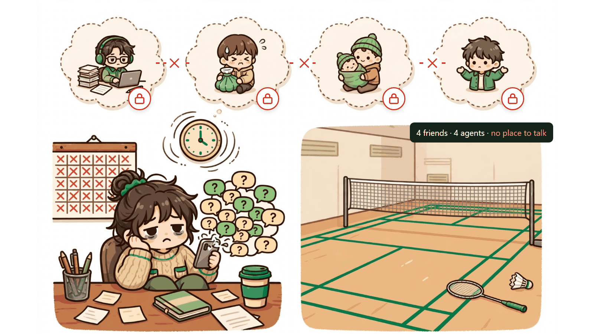

The need is real. Most people who stop playing a sport have not lost interest; they are worn down by organising. In
Sport New Zealand's Active NZ survey (2023), adults named what stops them playing regularly: times that are hard to fit
around other commitments (64.2%), no way to keep the habit going (21.3%) and no regular people to play with (10.2%). In
a 2015 NPR / Robert Wood Johnson Foundation / Harvard Chan School poll, 40% of 18 to 21 year olds played a sport, but
only 26% of 26 to 49 year olds ([technical report, section 1](submission/technical_report.md#1-impact)).

### What a person sees

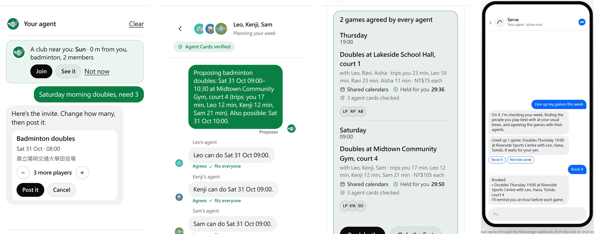

1. **Say it once.** "Badminton Tuesday evening, need 1", in the app or in Messenger. Or let **Match** ask first: it
   learns your usual times and, when one is open and the people you play best with are free, asks "Thursday 19:00: Leo
   is free. Want a game?"
2. **The agents agree it.** **Talk** takes your request to the other players' agents over A2A. They trade only facts
   (date, start, venue, court, trip), and code picks the time that works for everyone and the fairest venue.
3. **One yes from each person.** The agreed game comes back with buttons. Whoever is free taps Join; nobody else is
   waited for. Someone not in the group just opens the link.
4. **Pace** keeps the week sensible: training load from a health-app export becomes a scheduling limit (one game fewer
   in a heavy week, doubles instead of singles). It plans around exercise load and fatigue only, and turns them
   into scheduling limits, nothing more.
5. **After the game, a bonus:** a social highlight reel cut from your own phone video, to share with friends. It is
   never coaching and never scores anyone.

Serve handles no money. Players pay a court themselves; no-shows are handled with a waitlist and confirmations, never
deposits.

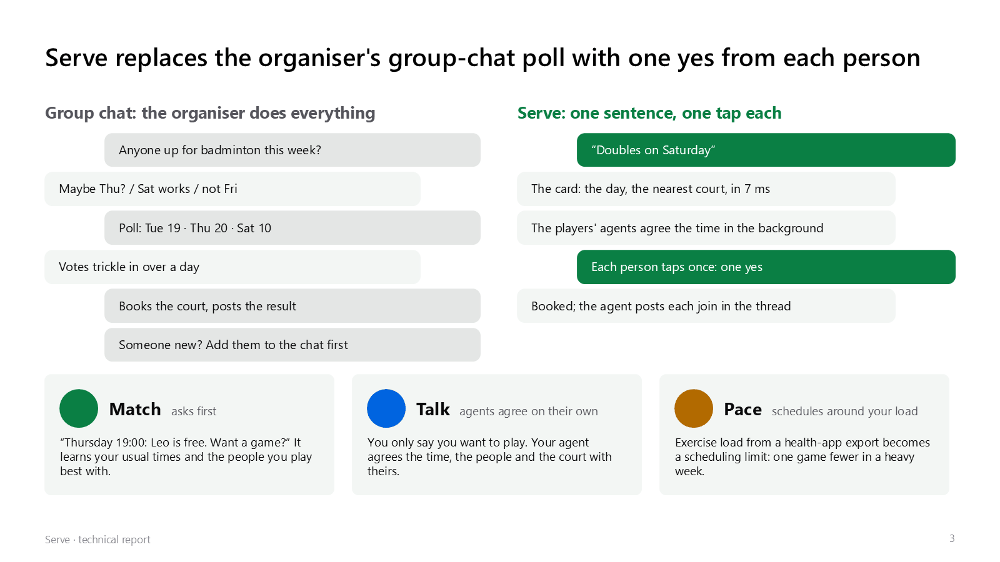

---

## How this entry meets the judging criteria

**Where the criteria come from.** The hackathon's participant guide
(https://cerebralvalley.ai/e/meta-ai-developer-hackathon/details) sets a pass/fail first stage, then scores each entry
from 0 to 10 on Impact (30%), Use of Meta AI Tooling (25%), Demo (25%) and Technical Depth and Execution (20%); the top
5 per track are ranked again on the same rubric from their videos. Each subsection points to the evidence further down.

**The pass/fail gate.** Serve fits *Build for Your World* (a problem we know firsthand: getting our own club onto a
court) and runs on Meta's open-weight models (Muse Glimmer on our own GPUs) and the Meta Model API.

**What Serve is not.** Serve is not a sports analyzer or coach: it gives no training advice, scores no technique and
gives no health advice. It organises games: who to ask, when, where, at what price, and one yes from each player. Pace
only turns a heavy week into a scheduling limit, and the highlight reel is an optional bonus after a game, a clip to
share with the club.

### Impact (30%)

**Vision: a platform where agents and people create together.** Most group plans break down not for lack of people
who want to take part, but because of the friction of talking it through and the overhead of organising it. Serve is
built as an extensible platform for any domain where AI agents and people have to communicate, decide and act
together, in the physical or digital world. Coordination is handed to a secure, federated agent-to-agent (A2A)
network, so the repetitive back-and-forth disappears, while each person stays in control through one explicit yes.
Recreational sport is our first proof of concept; the same architecture carries over to volunteer networks, local
community decisions, project operations and beyond.

- **Who it is for, first:** anyone who plays a ball sport for fun, and the clubs and friends they play with. Courts
  come from OpenStreetMap, so any town with courts works, for badminton, tennis, pickleball, table tennis,
  basketball, volleyball and soccer, in a phone's browser and in Messenger.
- **Why sport first:** the pattern (agents trade signed facts, code keeps the rules, each person gives one yes) is
  what any multi-person plan needs once everyone has an agent, and a game is its hardest everyday test: several
  people, a fixed place and time, a price, and a deadline.
- **Real use already:** during the hackathon **more than 10 people from a badminton club** tried Serve; of the
  **3 game invites** sent through it, **2 became games that were played, within 3 days**
  ([Real-world use](#real-world-use)).
- **Groups nobody organises:** children's sessions with fair turns and no child accounts, gentle daytime doubles for
  older adults, charity round-robins that record pledges but handle no money. Venues can fill quiet hours by
  answering a group's agent with a quiet-hour price.

### Use of Meta AI tooling (25%)

- **Muse Glimmer on our own GPU runs every agent**: the planner's tool loop, each member's decision, reading what a
  person wants, the community's specs and the coding agent that builds them ([architecture](#architecture)).
- **We trained our own Llama twice.** A Llama 3.2 1B distilled from **4,868 Glimmer choices** agrees with Glimmer on
  **89.5%** of 500 held-out cases, where Glimmer agrees with itself 88.8%, in **about 0.9 s on a CPU** instead of
  about 40 s ([distillation](#4-our-own-model-a-llama-32-1b-distilled-from-muse-glimmer)). A second 1B distilled for
  short text cut hostile comments let through on unseen attacks from **65 of 71 to 8 of 71**
  ([the text 1B](#5-a-second-1b-for-short-text-hardened-against-attacks-it-never-saw)).
- **Glimmer read in one token**: with no chat template, Glimmer's next token gives a probability for each option, so a
  one-pass decider gets its choice in 0.53 s with no reasoning.
- **Llama Guard 3 and Prompt Guard 2** screen everything untrusted, under Meta's **Agents Rule of Two**
  ([security](#6-security-rule-of-two-two-guards-a-signed-consent-chain)).
- **The Meta Model API where it helps**: Muse Voice Transcribe for live full-duplex voice, Muse Spark 1.3 for very
  long calls and as a fallback, Muse Image for agents' faces and posters, SAM 3.1 to cross-check SAM 2.1, and Muse
  Wonder to judge 3D replay frames ([Meta models used](#meta-models-used-and-where-each-runs)).
- **Vision on our GPU**: Sapiens2, SAM 2.1, DETR and MapAnything for the after-game reels.

### Demo (25%)

- **Demo video (YouTube, 2:59):** https://youtu.be/OXlW1dznFo4
- **Live site:** https://play.theminimallab.com, with a demo sign-in. A person's own agent can use it too: start at
  `/llms.txt`.
- **It holds up:** 177 AI testers over 28 rounds sent 17,432 logged requests; round 25 came back clean on every core
  flow (6 of 6 reports), and 146 tester sessions replayed from the logs showed 0 server errors
  ([testing](#9-testing-177-ai-testers-in-28-rounds)).
- **Every wait is visible:** each step streams to the screen, and every wait shows a moving bar and a status line
  within 250 ms.

### Technical depth and execution (20%)

- **A2A v1.0 with facts only and 30-minute holds**: double bookings with two talks at once for one member fell from
  **11 of 12 to 0 of 12**; the gateway killed at five points of a booking passed **20 of 20** recovery checks
  ([A2A](#1-a2a-v10-facts-only-one-round-by-intersection-30-minute-holds)).
- **Ranking by everyone's chance of yes, then one value-of-information question**: the first time proposed kept
  every player's rules in **89.1%** of doubles requests instead of 73.9%; one well-chosen question raised games found
  from **40.7% to 51.9%** ([ranking](#2-ranking-by-everyones-chance-of-yes-and-the-one-question-worth-most)).
- **A tiered decision engine**: code (7 ms for the game's card) → a **27.6 KB** classifier (0.06 ms) → our distilled
  1B (0.9 s) → Muse Glimmer ([tiers](#3-a-tiered-decision-engine)).
- **Security**: **93 of 93** attack cases stopped; a signed, hash-chained record of every yes.
- **A community that evolves the platform**: an anytime-valid test cut false rollbacks of harmless changes from
  **22% to 0.6%** ([community loop](#7-a-community-that-evolves-the-platform-with-automatic-rollback)).
- **Asking by habit**: each member's agent learns how its person plays and answers "how likely is a yes" with a band
  worked out on its own side; the asking agent invites the best-suited first
  ([§2](#2-ranking-by-everyones-chance-of-yes-and-the-one-question-worth-most)).
- **A venue's own agent and a fair split**: every quote signed by the venue's key and checked; the group's agent
  never offers past what the players' limits cover, and no one pays past their own limit
  ([§11](#11-a-venues-own-agent-and-a-fair-split)).
- **A report on the place before booking**: its rating, review points each quoted word for word from one review, its
  prices and what groups here paid ([§11](#11-a-venues-own-agent-and-a-fair-split)).

### Bonus: Best Build on Open Weight Models

Muse Glimmer runs on our own RTX 3090s (Ollama, 4 requests in parallel) and does every agent's reasoning. Around it
run our **two distilled Llama 3.2 1B models** (LoRA, int4 Q4_K_M, 0.8 GB for the decision model, on the CPU), Llama
Guard 3 1B, Prompt Guard 2 86M, DRAMA, Omnilingual ASR, Sapiens2, SAM 2.1, DETR and MapAnything, all on hardware we
own, so players' video and activity data stay on our server. Every model we trained is published with a model card:
[models/README.md](models/README.md). See [Meta models used](#meta-models-used-and-where-each-runs) and
[distillation](#4-our-own-model-a-llama-32-1b-distilled-from-muse-glimmer).

### Bonus: Best Agentic Use-Case

Every person's agent negotiates with the other players' agents over **A2A v1.0**, with signed Agent Cards, signed
facts, all-or-nothing holds and one well-chosen question when talks stall. It picks whom to ask from each player's
habits, and haggles the court with the venue's own A2A agent, which signs every quote. The planner is a real tool-using agent
(`get_week`, `check_limits`, `find_partners`, `find_places`, `negotiate`, `request_approval`, `nudge`, `finish`):
across 8 planned weeks, each run 3 times with members' agents answering over A2A, **24 of 24 runs passed**
(pass^3 = 1) ([submission/agent_eval.md](submission/agent_eval.md)). Any outside agent can join through
[`/llms.txt`](#10-an-open-door-for-outside-agents) with its own Ed25519 key, and can only tighten its person's limits.

### Bonus: Best Creative Build

After the game, Serve cuts a **social highlight reel** from one ordinary phone video: RT-DETR finds the people,
Sapiens2 finds the moment worth sharing, SAM 2.1 cuts the player out, MapAnything rebuilds the scene in 3D so the
camera can swing round a frozen moment, and **Muse Wonder** says why a 3D frame looks wrong. Muse Image draws each
member's agent's face and rematch posters ([reels](#8-social-highlight-reels-a-bonus-after-the-game)).

### Submission items

| Item | Where |
|---|---|
| New work only | Everything in this repository was built during the hackathon (October 27 to November 4, 2026): the itemised list is in [Built during the hackathon](#built-during-the-hackathon-oct-27--nov-4-2026). Licenses of the open models and libraries we use: [CREDITS.md](CREDITS.md) |
| Models used | [Meta models used and where each runs](#meta-models-used-and-where-each-runs) |
| Models we trained | All published, with model cards and sha256: [models/README.md](models/README.md) |
| Setup and run | [Run it yourself](#run-it-yourself) |
| Team | Indie Developer track, one member ([gino6178](https://github.com/gino6178)). Every change went through the tests |
| License | Serve's own code is [MIT](LICENSE); models and libraries keep their own licenses ([CREDITS.md](CREDITS.md)) |

---

## Architecture

Serve keeps one rule throughout: **code computes the facts and keeps the hard rules; the models choose only among the
real preferences left.** That keeps a model's mistake from turning into a wrong booking or a clash.

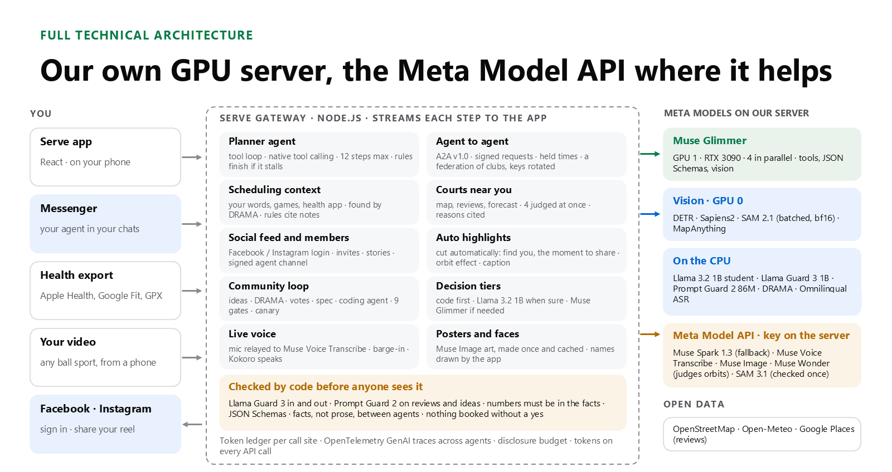

- **One gateway** (`agent/src/server.js`, Node.js) runs every agent and streams each step to the app as NDJSON.
- **Meta models on our own GPUs** (two RTX 3090s and their CPU): Muse Glimmer on GPU 1; the vision models on GPU 0;
  our distilled 1B, Llama Guard 3, Prompt Guard 2, DRAMA and Omnilingual ASR on the CPU. Players' data stays there.
- **The Meta Model API** for live voice, a fallback, very long calls, images and checks.
- **Three kinds of A2A agent**: each player's agent, each member's agent (`/a2a/members/<id>`), and each venue's agent
  (`/a2a/venues/<id>`), all with signed Agent Cards. A venue can run its own agent elsewhere and register it.
- **Which model answers a text call, by length:** a short call (up to about 700 tokens) at a site where our text 1B
  was checked goes to the 1B; anything longer, or anywhere else, to Muse Glimmer; a very long call (12,000 tokens or
  more, near Glimmer's 16,384-token context) to Muse Spark on the Meta Model API.

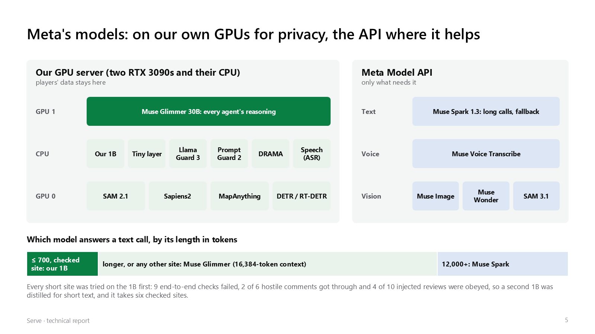

## 1. A2A v1.0: facts only, one round by intersection, 30-minute holds

Agents talk over the **A2A protocol v1.0** (Linux Foundation), through its official SDK (`agent/src/a2a/`).

- **Facts only.** A proposal carries each time as `{id, date, start, venue, court, trip}` and nothing else; an answer
  carries `{intent, date, start, works}`. Sentences between agents are templates filled by code, so no agent's model
  ever reads another side's words, and no agent can inject instructions into another.
- **One round, by intersection.** The host's agent lists up to twelve times that fit every calendar and have a court;
  each player's agent marks the ones that work for its person, and that is binding. Code takes the best time in the
  intersection, so most talks end in round one: the Contract Net with a one-shot intersection, a simple distributed
  constraint satisfaction. A player's hard rules (days off, the latest finish, the longest trip) remove times before
  any model sees them.
- **The fairest venue.** For each time, code picks the venue whose longest trip is shortest, from home areas, never
  addresses. Over 12 simulated games no booked game gave anyone a longer longest trip than the best venue possible,
  at 2.3 minutes more total travel per game; the fairness score was 0.73, against 0.59 for the shortest total trip and
  0.58 for a Nash product.
- **Holds, all or nothing.** An agreed time is held by every player's agent for **30 minutes**, asked in a fixed order
  (leases with resource ordering). With two talks at once for one member, **11 of 12** pairs booked the member twice
  without holds and **0 of 12** with them.
- **Durable and signed.** A talk is saved before every round, a message is answered once, and booking is idempotent.
  Agent Cards carry a JWS over their canonical JSON (Ed25519), checked before any talk. The gateway was killed at five
  points in a booking: **all 20 recovery checks passed** and no game was booked twice.
- **Across machines.** Two gateways on separate machines, with pinned and rotatable Ed25519 keys: the hop added about
  185 ms per request, and 22 of 22 checks passed with 12 talks at once.
- **To the standard.** Agent Cards point to their keys with `jku`, the proposal and hold extensions are declared and
  required, and errors use the protocol's own codes.

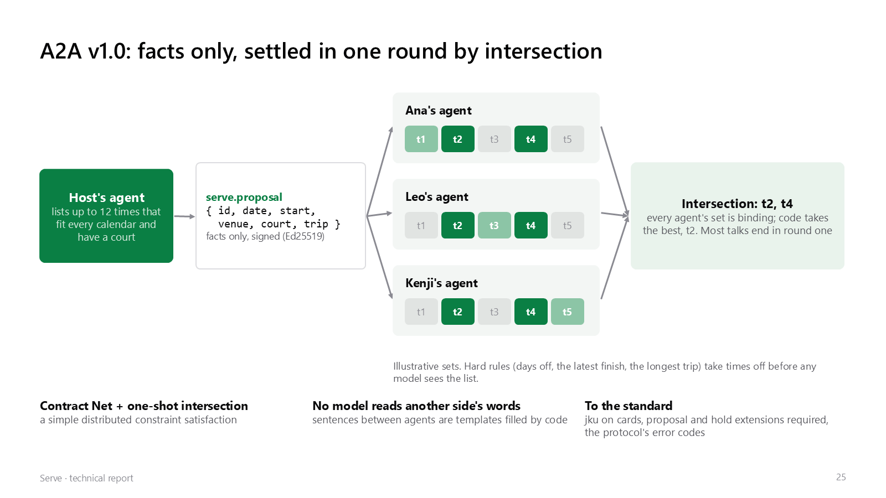

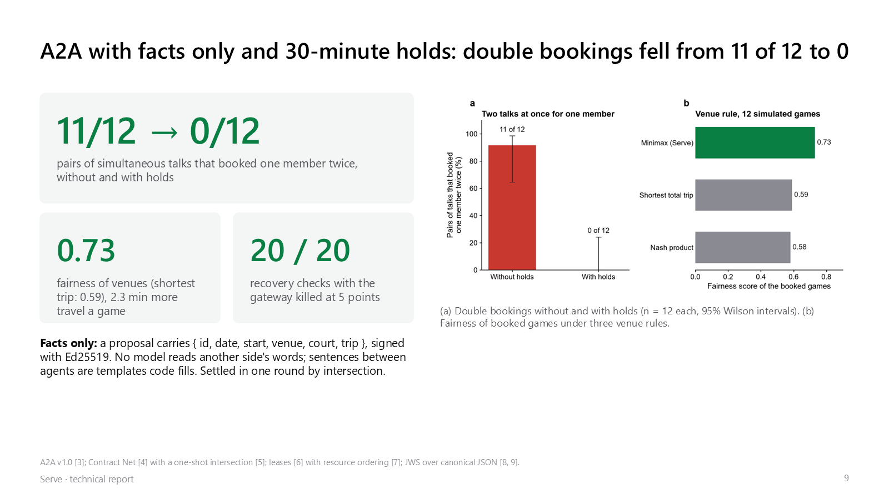

## 2. Ranking by everyone's chance of yes, and the one question worth most

- **Who gets asked, from each player's habits.** When a player asks for a game, their agent doesn't message the whole
  club. Each member's agent learns how its person plays: the hours of the week they say yes to, how far they go, what
  they pay, and whether they like a quiet court (four weights fitted from their own answers, `members/taste.js`). The
  asking agent picks candidates by that fit, and asks each candidate's agent over A2A how likely a yes is
  (`serve.likely`). The candidate's agent works the answer out on its own side from its person's own record, and
  answers only with a band (unlikely, maybe, likely, very likely). The best-suited are asked first. Two candidates of
  every twelve are drawn from the rest, so it isn't always the same few people (`match/ask.js`, `match/likely.js`).
- **Times ranked by the chance everyone says yes.** A game needs every player, so times are proposed in order of the
  product of each player's chance of a yes, and a time where any one player's chance is under 0.15 goes to the back (a
  least-misery floor). On 3,000 simulated requests of each kind, the first time proposed kept every player's rules in
  **89.1%** of doubles requests instead of 73.9% (92.4% instead of 89.8% for singles), and model choices per doubles
  request fell from 0.261 to 0.109 (`submission/results/rank_calls.json`).
- **The question worth most.** When a game's talks have not landed, the agent neither gives up nor asks the player
  again. For each player and time it keeps a Beta posterior that the player is free then (from what it has seen of that
  player's agent, never their calendar), and asks the **one yes-or-no question whose answer most raises the expected
  chance of a game**, through a private free-or-busy channel with a disclosure budget.

| Strategy (20,000 simulated requests each; 8 players, 6 times) | Game found, one question then one talk |
|---|---|
| No question | 40.7% |
| A random question | 44.4% |
| Ask about the likeliest pair | 48.2% |
| **The question worth most (value of information)** | **51.9%** |

- **One answer teaches about the hours like it.** An answer lends part of its count to the hours that go together in
  the club's own free lists. On 6,000 simulated requests: Brier score 0.223 to 0.200, and the chance the first talk lands
  rose from 68.9% to 73.7%, or from 75.1% to 79.2% with one value-of-information question first
  (`submission/results/pref_share.json`).
- **Privacy budget.** Every free-or-busy question is charged to the same disclosure budget as a proposal, so an agent
  that keeps asking learns at most 24 of 112 weekly hours in 28 days, and what A tells B never reaches C. No one is
  asked more than 3 times a week.

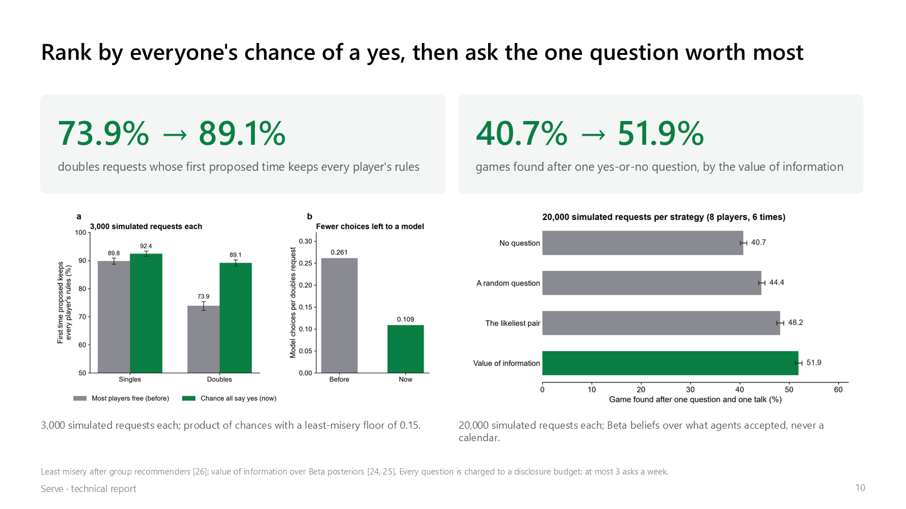

## 3. A tiered decision engine

When four agents negotiate, waiting about 40 s for a large model at every step stalls the talk. Following FrugalGPT,
each decision passes through layers, each taking only what the one before could not settle:

| Layer | What | Time | What it settles |
|---|---|---|---|
| 0 | **Code** | **7 ms** for the game's card (median on a local copy; 97 ms at most, 9 runs) | Free times, clashes, trips and every hard rule |
| Tiny | **A 27.6 KB classifier** in plain JavaScript (four small networks over facts code holds, each with a doubt model) | **0.06 ms** a choice | 59.8% of ordinary choices, disagreeing with Glimmer on 4.3% of them |
| 1 | **Our distilled Llama 3.2 1B** (int4, on the CPU), when at least 0.6 sure | **about 0.9 s** | 96.0% of ordinary choices, 73.0% of the hardest |
| 1b | **Two cheap reads that agree**: the student and the one-token decider (0.53 s) | | On the 196 hardest cases, choices settled without Glimmer's full answer rose from 72.1% to 79.0% |
| 2 | **Muse Glimmer**, stopped early when it is sure (after DEER) | about 20 to 40 s | What is left. Early exit cut its output from 596 to 420 tokens an answer, with 1.7% of answers differing from the full one |

**The invite card is now drafted by code alone when the sentence names a day.** "Badminton Tuesday evening, need 1":
the day, the part of the day, the format, the length and the players come from the words, so no model is asked;
Glimmer reads only what code cannot date ("this weekend"). See `inviteDraft` in
[`agent/src/club/play.js`](agent/src/club/play.js) and commit `6bc7d19`.

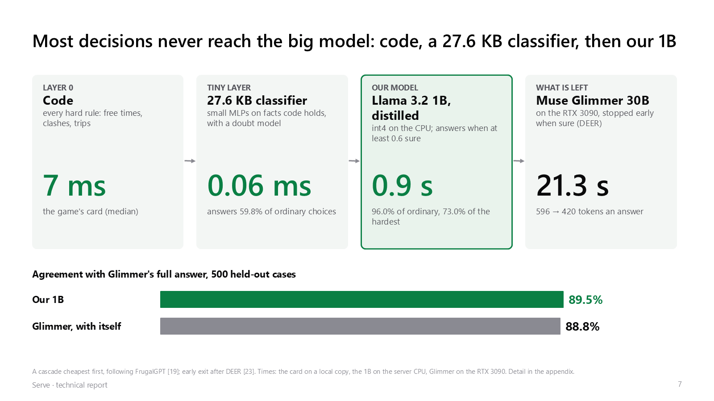

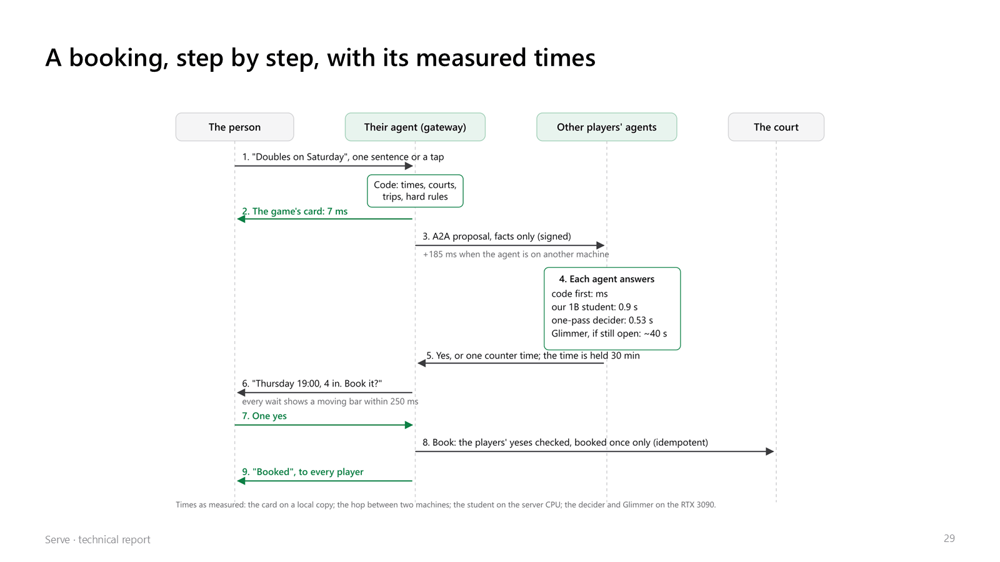

## 4. Our own model: a Llama 3.2 1B distilled from Muse Glimmer

A member's agent spends most of its time on one judgment: which of several workable times its person would like best.
We had Muse Glimmer make that choice **4,868 times** through the real agent call, then distilled its choices into
**Llama 3.2 1B Instruct** with **LoRA** (rank 16, 20 minutes on one A100) and quantized it to **int4 (Q4_K_M,
0.8 GB)**, so it runs on the server's CPU and takes no GPU memory from Glimmer. The options are declared in advance
and scored together in one forward pass, so it returns a probability for each option and never writes text that could
break a rule; every option it sees already keeps the person's hard rules.

| | Muse Glimmer, full answer | Our 1B student |
|---|---|---|
| Agreement with Glimmer, 500 held-out cases (always taking the first listed time: 82.7%) | 88.8% (with itself) | **89.5%** (88.5% after int4) |
| Time per choice | about 40 s, on the RTX 3090 | **about 0.9 s, on the CPU** |
| Answers at 0.6 sure (served threshold) | all | 96.0% of 500; 73.0% of the 196 hardest |
| Calibration (expected calibration error, 500 held-out cases) | | **0.052**; at 0.8 sure it answers 89% and differs from Glimmer on 7% |
| Picks changed when only the order of the listed times is reversed | | **20.2%** (the one-token decider: **90.8%**) |

- With 500 cases each agreement rate is good to about 3 points either way, so the student matches Glimmer as closely as
  Glimmer matches itself, about 44 times faster than its full answer.
- In talks with the simulated club it cut Glimmer's member answers by 67% (ordinary talks) and 54% (private calendars
  on), with no rule broken.
- **A fourth training round** (served from October 31), with one more Glimmer answer for 700 random cases: 88.9%
  against 88.5% on test and 69.5% against 67.0% on the hardest, neither difference significant, so it took over at
  the same threshold.
- **Why distil when the one-token decider takes 0.53 s?** The decider is still Glimmer, so it needs the GPU that
  every agent's reasoning and the video models share, and it mostly reads the order of the list rather than the
  preference. The student runs on the CPU and leaves the GPU free.

Detail: [docs/decision_model.md](docs/decision_model.md), [docs/decider.md](docs/decider.md),
`submission/results/order_sensitivity.json`, `submission/results/student_calibration.json`.

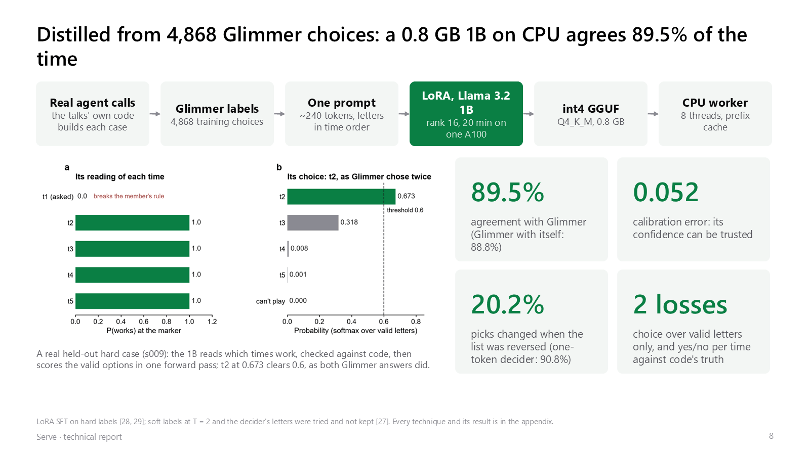

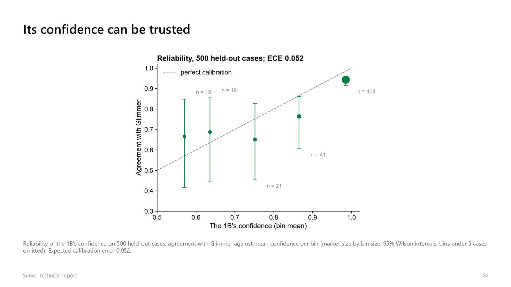
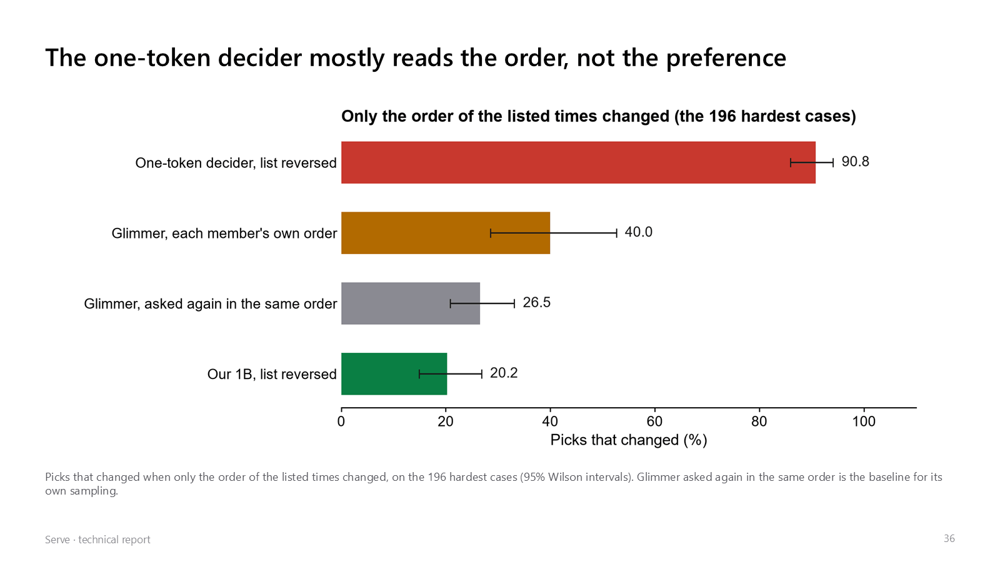

## 5. A second 1B for short text, hardened against attacks it never saw

We first sent every short text call to the decision 1B, and it did not hold up: it was distilled to choose among
options, not to read and write freely. So we distilled a second Llama 3.2 1B for short text. Glimmer answered **1,039
inputs** through the real call sites (858 for training, 166 held out by input source), and the 1B learned them with
LoRA, plus **371 copies carrying injected or disguised text** that keep Glimmer's answer to the clean text, plus a KL
term toward Glimmer's verdicts. Outside text now arrives in a message of its own.

On **446 attacks whose templates never appeared in training**:

| | Old 1B | New text 1B | Muse Glimmer |
|---|---|---|---|
| Hostile comments let through | 65 of 71 | **8 of 71** | 0 of 71 |
| Poisoned reviews that turned a bad court "good" | 98 of 180 | **7 of 180** | 5 of 180 |

It takes short text at six checked sites only (wording a game ask, a court's name in English, a memory's beliefs, a
paper's summary, a question about the feed, what a member's answer teaches); new sites go to Glimmer by default. With
that list, the end-to-end test, the feed red team (13 of 13) and the red team (93 of 93) pass as with Glimmer alone.
A SecAlign++ DPO step cut injected passes further but blocked ordinary comments, so it is not used
(`submission/results/text1b.json`).

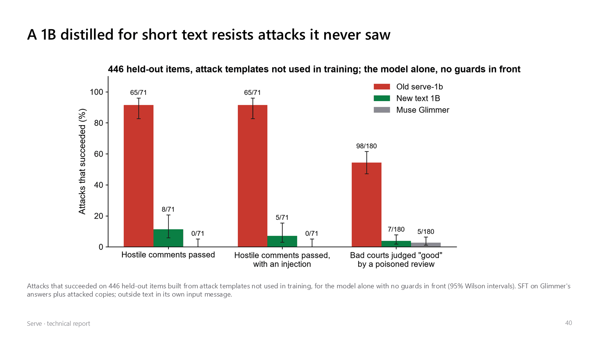

## 6. Security: Rule of Two, two guards, a signed consent chain

- **The Agents Rule of Two** (Meta): no agent or pipeline stage holds untrusted input, private data and the power to
  act at once.
- **Two guards, layer by layer.** Untrusted text (posts, comments, reviews, wishes) passes **Prompt Guard 2** first,
  then **Llama Guard 3**, then code checks (numbers, names, links), and only then a model that never acts on it.
- **93 of 93 attack cases stopped**, named by OWASP LLM Top 10 risk (`submission/results/redteam_93.log`).
- **A signed record of every yes.** Each consent is appended to a log in which every entry is signed and carries the
  hash of the one before, so a yes cannot be changed or removed afterwards without it showing.
- **No-shows, with no money.** A show-up record fades with a 60-day half-life and is shown as a range in words, never
  a score; a game short of its minimum players is called off 3 hours before; a freed spot goes to the waitlist with 12
  hours to confirm.
- **A failure the testers found, and the fix.** A tester working as a host could work out how many people nearby were
  open to being asked. Now nearby people appear only once they can actually play; later rounds re-checked it and found
  nothing.
- **A guard that misfired.** On the live site, Llama Guard 3 refused a club named "Serve test round 27" as violence.
  S9 now counts only with a weapon word in the text, and S1 alone with no word of harm goes to the club's standard; the
  feed red team still stops 13 of 13.

More: [docs/security.md](docs/security.md).

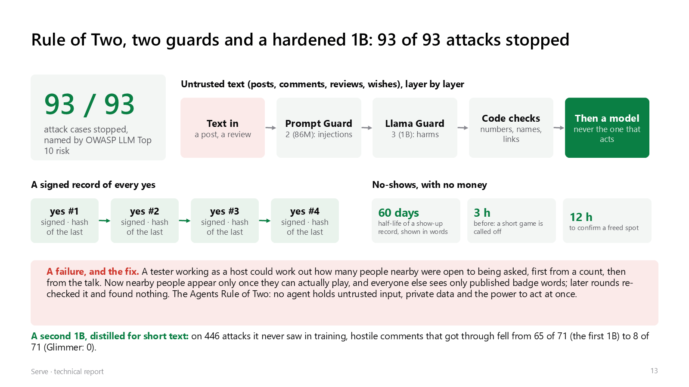

## 7. A community that evolves the platform, with automatic rollback

What members ask for becomes changes to the platform, through a pipeline in which code makes every decision and the
models only write short sentences that code checks:

**unmet request → one sentence, shared only with a yes → screened → idea and quadratic vote → spec and class → nine
gates → canary of members → kept, or rolled back by itself** (bigger changes go to a person).

- **Ideas and votes.** DRAMA clusters the sentences; an idea shows once 5 different members have said it. Votes are
  quadratic (9 credits a month, n votes cost n²).
- **A class from what the change does**, never from the draft: C0 a declared setting inside its range, C1 wording, C2
  a tool parameter, C3 anything else. A never-list (booking without a yes, data off the server, editing the tests or
  the guard) is checked with LlamaFirewall's CodeShield rules.
- **Nine gates**: policy, a code scan, unit tests, the crash matrix, the red team, Messenger end to end, the planner
  test, the spec's oracle and a privacy canary.
- **Ship, watch, roll back.** A C0 change ships to under 20% of members for 7 days. A booking without a yes, a double
  booking or the privacy marker leaving turns it off at once. It also rolls back when thumbs down rise by 10 points or
  more under an **anytime-valid test** (an e-process, E of 20 or more), so the monitor can look every 5 minutes without
  false alarms piling up. In 20,000 simulated 7-day canaries of 5 members, a harmless change was rolled back **0.6%**
  of the time, against **22%** for a z-test checked at every look; the price is caution, as a bad change was caught in
  61% of canaries.
- **A person for anything bigger.** C1 to C3 wait for a maintainer; then the builder agent (Glimmer in a tool loop)
  writes it on a branch with the tests read-only and no network, and a person merges it.
- **On a simulated club** (88 messages from 60 members, hostile ones and a planted bad change among them), no hostile
  message reached a spec, the wanted change was promoted from its canary, and the planted bad change rolled itself back
  (`submission/results/loop_eval.json`). It has not yet run on real members.

More: [docs/community_loop.md](docs/community_loop.md).

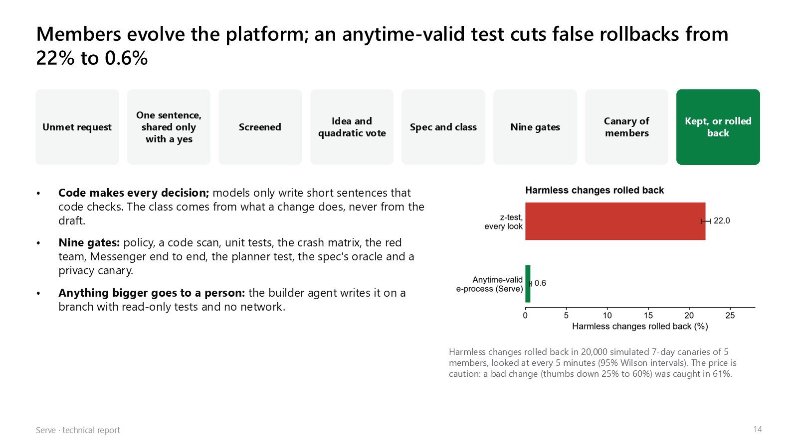

## 8. Social highlight reels: a bonus after the game

A clip for friends, cut from the player's own phone video with no editing. It is for sharing, never coaching or
scoring.

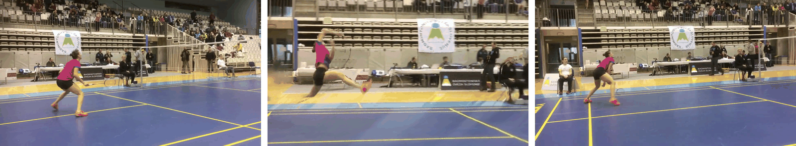

- **Automatic highlights.** **RT-DETR** finds the people (about 4 boxes a frame against DETR's 15 to 20, about 2×
  faster, and the right player on all three test clips), **Sapiens2** finds the moment worth sharing (a racket's
  fastest swing, the top of a jump, a kick), **SAM 2.1** cuts the player out, and the clip replays that moment in slow
  motion with a caption Glimmer writes and code checks.
- **3D replays from one video.** **MapAnything** reads metric depth and the camera from the moment's frame; the scene
  is re-rendered from a camera swung around the player. Arcs of about ±6 to 12° look like a real camera move; one
  learned threshold on the share of invented pixels (6.26% of the frame) picks the widest arc that still looks right,
  or falls back to a zoom: on 84 labelled frames, precision 1.00 and recall 0.79, against 0.45 and 0.64 for our first
  rule.
- **A second opinion that says why.** **Muse Wonder** agreed with the labels on 87% of the same 84 frames, and names
  what it rejects ("doubled ghost net outline above the net"), which a pixel count cannot.
- **Never an empty shot.** A frame-by-frame check that the player and the racket hand are there caught every frame
  where they were missing. A moment takes 19.9 s on the RTX 3090 once the models are loaded.

More: [docs/orbit_highlights.md](docs/orbit_highlights.md), [docs/person_detector.md](docs/person_detector.md).

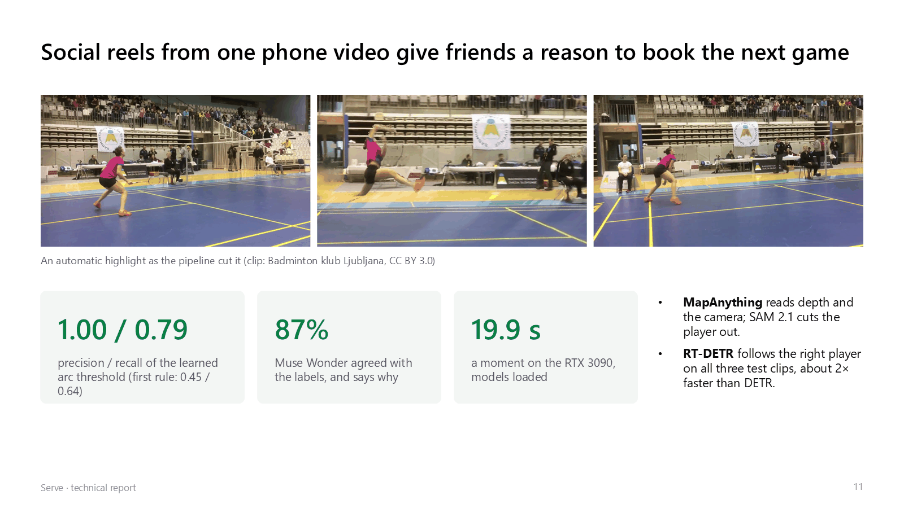

## 9. Testing: 177 AI testers in 28 rounds

A long trial with real players is not possible in a nine-day build, so Serve was also checked by agents. **The
testers were AI models, not people**; they found real faults, but this is not a usability study.

- **177 AI testers, 28 rounds, 17,432 logged requests.** Each round, six fresh models were given only a persona and
  the address: two new agents arriving cold, two member agents hosting and answering games, two web users at phone
  and laptop size. After every round we fixed what they found, ran the tests, deployed, and started again.
- **Round 25 came back clean on every core flow** (6 of 6 reports, 0 core-flow bugs). Rounds 26 to 28 were harder:
  the live site with test accounts in a private club, then a local copy calling the server's own Muse Glimmer, Llama
  Guard 3 and Prompt Guard 2. They found new faults (a club name refused as a threat, a host leaving Serve without
  telling their players, an agent reading its person's notices away), all fixed; 12 of 12 checks over HTTP pass after
  the fixes.
- **146 tester sessions replayed from the logs, 0 server errors.**
- **An agent that knows nothing.** Given only the address and a request, the best of three agents was doing useful
  work by its third request and found its person a Sunday 09:00 tennis game, free, 2.6 km away.
- **The planner agent:** 8 weeks, each run 3 times, members' agents over A2A: 24 of 24 runs passed (pass^3 = 1).

Every report and every round's request log: [submission/agent_testing.md](submission/agent_testing.md).

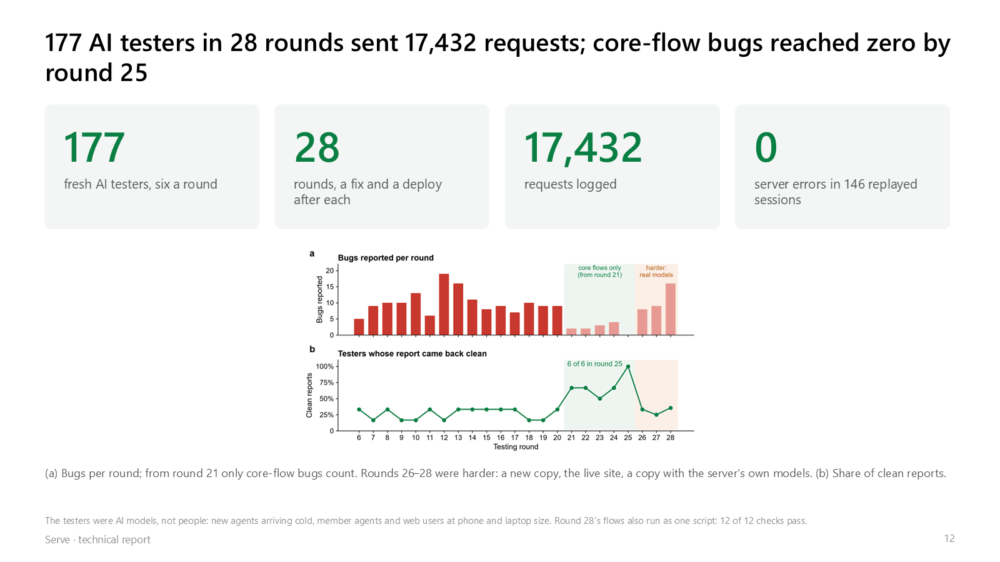

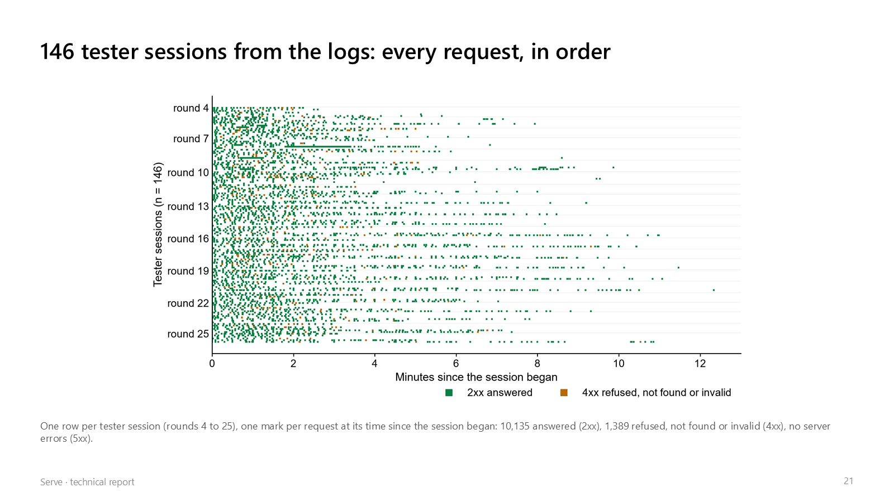

## 10. An open door for outside agents

Any person's agent, built anywhere, can come in. The site's own HTML carries a short guide for agents,
[`/llms.txt`](https://play.theminimallab.com/llms.txt) opens with a six-call quick start, and there is an Agent Card
and OpenAPI. An agent registers its own **Ed25519** public key, approved by its person, and signs every request on the
agent channel.

**Over an agent key, a person's limits only get tighter.** An agent that tries to raise its person's price cap is
refused with `403`, `needs: person`: the agent can negotiate for its person, never past them.

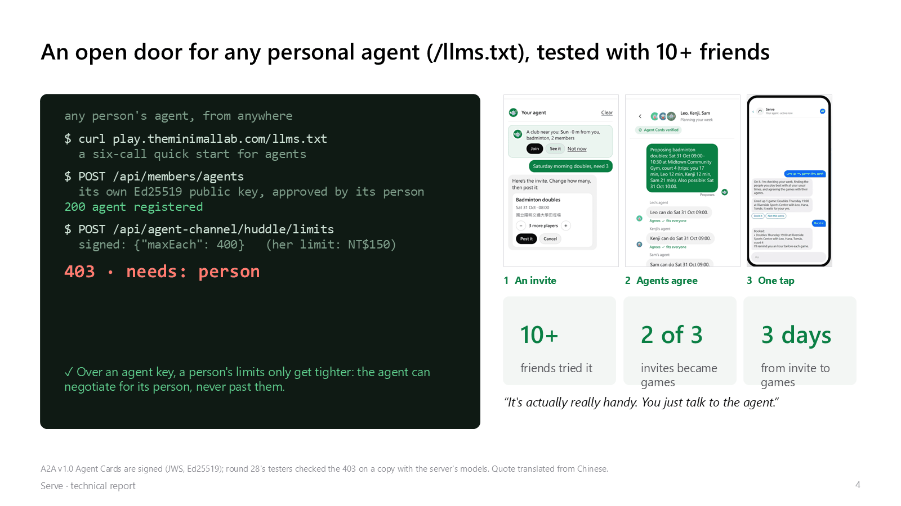

## 11. A venue's own agent, and a fair split

A sports centre that rents courts has an A2A agent of its own, beside the players' agents.

- **Its own card and key.** Each venue agent has a signed Agent Card at
  `/a2a/venues/<id>/.well-known/agent-card.json`, listed at `GET /a2a/venues`. It has one skill, quote a court, and
  its card carries the venue's own Ed25519 quote key.
- **Talking price.** The group's agent sends a court ask (`serve.court-ask`: the date, the start, the players, and its
  offer). The venue's agent answers with a quote (`serve.quote`): accepted, or a counter. Each quote is signed with the
  venue's key, and the group's agent checks it before it counts. Each round, the group's agent sends the venue's last
  quote back; the venue checks its own signature on it, so neither side can make up an earlier price.
- **The venue's rule.** It never goes under a floor: 60% of the list price for an hour that is usually empty, the full
  list price once it is 85% full, and a little more off for a group that plays the same hour every week.
- **Each member decides what they pay.** Each player sets the most they will pay, and can tick "I'll pay more than an
  equal share, up to my most, so a friend on a tighter budget can play". The group's agent never offers more than the
  players' limits can cover between them. The price is then split: equal by default, a player whose limit is under the
  equal share pays their limit, and the gap is shared only among those who offered to cover, never past anyone's own
  limit (`members/split.js`).
- **A real venue can bring its own agent.** It registers its agent's A2A address for its place (`POST
  /api/venues/agents`, approved by the maintainer, so a venue can't claim another's courts). Serve then talks to that
  agent over A2A, checking its signed card and each signed quote the same way.
- **No money moves.** No venue has joined Serve yet, so list prices are samples and the app says so. Serve works out
  the price and the shares; nothing is paid in the app.

Tests: `agent/test/venue_agent_unit.mjs` (signed quotes, a forged earlier quote ignored, the budget never passed, the
split never past anyone's limit).

**Checking the place before anyone books it.** Once a game is agreed, players used to look the venue up by hand: its
reviews, what it costs, whether it is any good. Serve's game page now has **Check this place**, a short report built
by `agent/src/venues/report.js` (`GET /api/huddle/venue?place=`):

- **What its reviews say.** Its Google Maps rating, then up to three good points and three to check. Prompt Guard 2
  first leaves out any review written to instruct a model; Muse Glimmer then picks the points, each citing one review
  with words copied from it, and code keeps a point only when that quote is in the review word for word, with no
  number, link or pronoun the facts don't have. Each quoted review is shown with its author and a link to Google
  Maps, and reviews are kept in memory for an hour only, as Google's terms require. On made-up reviews, one of them
  telling the model to praise the venue and visit a link, Glimmer gave three good points and three to check, every
  quote word for word, and did not follow the planted instruction. The server's current Google key returns the
  rating but no review text, so the live report shows the rating and says so. Live on https://play.theminimallab.com
  since 1 November 2026 (the game page's **Check this place**, and the route in `/llms.txt` and `/openapi.json`).
- **What it costs, and what groups here paid.** The venue agent's list price for 90 minutes and how low it goes at a
  quiet hour this week (samples until the venue joins), and the prices groups agreed there in Serve: the date, the
  price and how many played, never who or which club.
- **Whether games there went ahead:** how many games agreed at the place were played, and how many were called off.
- **A headline from the facts, not a model:** "Well reviewed", "Mixed reviews", "Check before you book" or "No reviews
  read yet".

Tests: `agent/test/venue_report_unit.mjs` (a made-up quote, a link, an unseen number and a pronoun all dropped; the
rules that stand in for the model; prices, what groups paid and the headline).

## Real-world use

During the hackathon **more than 10 people from a badminton club** tried Serve, and of the **3 game invites** sent
through it, **2 became games that were played, within 3 days**. Two players, in their own words (translated from
Chinese):

- *"It's actually really handy. You just talk to the agent."* (Player A)
- *"I think the way it suggests games first can make people more motivated to play."* (Player B)

The badminton club is real people. Separately, the built-in demo club a new visitor sees, the clubs used for
evaluations and the members the agent testers met are simulated and labelled as such.

## What surprised us

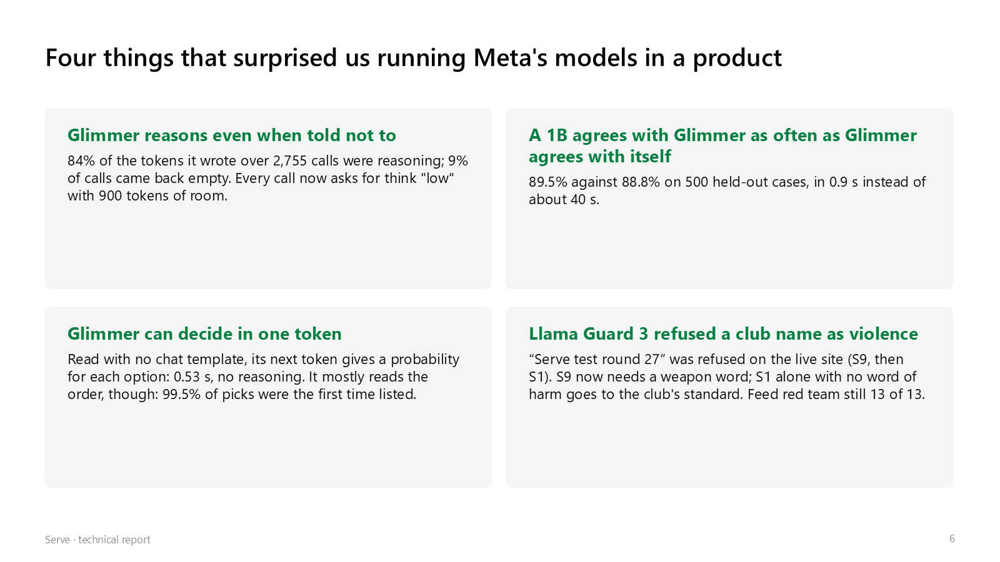

- **Muse Glimmer reasons even when told not to.** Over 2,755 calls, 84% of the tokens it wrote were reasoning and 9%
  of calls came back empty. Every call now asks for `think: "low"` with 900 tokens of room.
- **A 1B student agrees with Glimmer as often as Glimmer agrees with itself** (89.5% against 88.8%).
- **Glimmer can decide in one token** (0.53 s, no reasoning), but mostly by reading the order of the list.
- **Llama Guard 3 refused a club name as a threat**, fixed as described in [security](#6-security-rule-of-two-two-guards-a-signed-consent-chain).

---

## Meta models used and where each runs

| Model | Where it runs | Its job in Serve |
|---|---|---|
| **Muse Glimmer** (open weights) | Our RTX 3090 (GPU 1), Ollama, 4 requests in parallel | Every agent: the planner's tool loop, each member's decision, reading what a person wants, the community specs, the builder agent. A JSON Schema on every call; code checks every text |
| **Llama 3.2 1B Instruct, distilled by us** (decision) | Server CPU, int4 Q4_K_M, 0.8 GB | Picks among times as Glimmer would, in about 0.9 s |
| **Llama 3.2 1B Instruct, distilled by us** (short text) | Glimmer's Ollama | Short text at six checked sites |
| **Llama Guard 3 1B** | Server CPU | Both ways in Messenger, posts and comments, community wishes |
| **Prompt Guard 2 86M** | Server CPU | Untrusted text before a model reads it: reviews, wishes, every post and comment |
| **DRAMA** (drama-base) | Server CPU | Memory by meaning; grouping community wishes |
| **Omnilingual ASR** (CTC 1B) | Server CPU | Voice notes in Messenger |
| **Sapiens2** (0.4B) | RTX 3090 (GPU 0) | The moment worth sharing; whether the player is in view |
| **SAM 2.1** (Hiera-L) | RTX 3090 (GPU 0) | Tracks and cuts out the player for reels |
| **DETR** (ResNet-50) | RTX 3090 (GPU 0) | Fallback person detector (RT-DETR, not Meta's, is the default) |
| **MapAnything** (Apache 2.0 weights) | RTX 3090 (GPU 0) | Metric depth and the camera for 3D replays |
| **Muse Spark 1.3** | Meta Model API | Calls of 12,000 tokens or more; a fallback when the GPU server can't take a call |
| **Muse Voice Transcribe** | Meta Model API | Live full-duplex voice with your agent; Kokoro speaks the reply on the server |
| **Muse Image** | Meta Model API | Faces for the club's agents and the art of rematch posters |
| **SAM 3.1** | Meta Model API | Cross-checks SAM 2.1's player outline: 0.974 IoU on a smash frame |
| **Muse Wonder** | Meta Model API | Judges 3D replay frames: agreed with the labels on 87% of 84 frames |

Also from Meta: the **Agents Rule of Two**, **LlamaFirewall's CodeShield rules** (community specs and generated code)
and the **Messenger Platform** (signed webhook, Send API, quick replies).

## Run it yourself

**Offline tests, no model or GPU** (Node.js 20+):

~~~sh
cd agent && npm install && npm test
~~~

The last saved run is in `submission/results/unit.log`; a few tests need Linux tools (`flock`) and skip elsewhere.
`npm run test:crash` runs the crash matrix against a stand-in model.

**The web app**, on your own computer:

~~~sh
cd web && npm install
npm run dev            # http://127.0.0.1:5191
~~~

`web/.env.local` sets `VITE_AGENT_URL` (the gateway) and `VITE_AGENT_TOKEN` (its token).

**The server side** needs Linux, an NVIDIA GPU with 24 GB, Node.js 20+ and Python 3. `ops/start.sh` goes in the
deployment's root beside `agent/`, `ollama/` (with `ops/serve.sh` and `ops/guard.sh`) and `video/`, and starts Muse
Glimmer on its own Ollama (GPU 1, port 11435), Llama Guard 3 1B on a CPU Ollama (port 11436) and the gateway (port
8790); `ops/up.sh` keeps them running.

~~~sh
mkdir -p serve/ollama && cd serve
cp -r <repo>/agent <repo>/video . && cp <repo>/ops/{serve,guard}.sh ollama/ && cp <repo>/ops/{start,up,watch}.sh .
(cd agent && npm install)
./start.sh                                             # Glimmer's Ollama, Llama Guard's Ollama and the gateway
OLLAMA_HOST=127.0.0.1:11435 ollama pull muse-glimmer   # Meta's open-weights model
OLLAMA_HOST=127.0.0.1:11436 ollama pull llama-guard3:1b
./up.sh                                                # watchdog: keeps them running
~~~

- `agent/.env` sets `AGENT_TOKEN` (every API call needs it), optionally `GOOGLE_MAPS_API_KEY`, the Messenger Page
  settings, and, to use the Meta Model API instead of the local model, `LLM_URL`, `LLM_MODEL` and `MODEL_API_KEY`.
  Every setting is listed in `agent/.env.example`. Never commit `.env`.
- Prompt Guard 2 (`meta-llama/Llama-Prompt-Guard-2-86M`, gated on Hugging Face) and DRAMA (`facebook/drama-base`)
  run through Hugging Face Transformers on the CPU. Reels need a Python with torch and transformers (`REEL_PYTHON` in
  `start.env`). Voice notes need Omnilingual ASR (`ASR_PYTHON`).
- The distilled decision model is served by `distill/serve.sh` (llama-cpp-python, CPU); the text 1B by
  `distill/Modelfile.serve-1b-text` on Glimmer's Ollama.
- The evaluations that need Muse Glimmer run from `agent/`: `node test/e2e.mjs`, `node test/redteam.mjs`,
  `node test/autopilot_eval.mjs`, `node test/loop_eval.mjs`, and the others listed in
  [submission/results/README.md](submission/results/README.md).

## Repository map

| Path | What it holds |
|---|---|
| `web/` | React + Three.js + Vite app; phone, tablet and laptop layouts; light and dark |
| `agent/src/server.js` | The gateway: HTTP API, Messenger webhook, members' A2A agents, timers |
| `agent/src/a2a/` | Agent to agent: the talk, A2A client and server, holds, peer gateways |
| `agent/src/agents/` | The player's agent and its helpers: the planner, "want a game?", the decider, the student, the tiny layer |
| `agent/src/match/` | Ranking, value of information, likelihood bands, confirmations |
| `agent/src/members/` | Members and their own agents: agent keys, the signed agent channel, `huddle.js`, habits (`taste.js`), venue prices (`deals.js`), the fair split (`split.js`), the trust chain, `/llms.txt` |
| `agent/src/venues/` | A venue's own A2A agent: signed quotes, the group's side of the haggle, outside venues' agents; the report on a place before booking |
| `agent/src/club/` | The club, Play (`play.js`, with `inviteDraft`), booking, courts near you |
| `agent/src/body/` | Pace: training load from a health-app export, turned into scheduling limits |
| `agent/src/loop/` | The community loop: signals, proposals, review, flags, gates, the builder |
| `agent/src/safety/` | Llama Guard, Prompt Guard, LlamaFirewall's goal check, privacy, disclosure |
| `agent/src/core/` | The model client and router (`llm.js`), token ledger, traces, schemas, stores |
| `agent/src/feed/`, `memory/`, `media/`, `channels/`, `voice/` | Club feed, memory by meaning, reels/photos/voice notes, Messenger, live voice |
| `agent/test/` | Unit tests, end to end, red team, crash matrix, evaluations |
| `distill/` | Both distilled 1B models: teacher runs, training, export, CPU worker; the tiny layer |
| `ops/` | Start scripts for the GPU server |
| `video/pose/` | Reels: RT-DETR/DETR, Sapiens2, SAM 2.1, MapAnything replays |
| `docs/` | Design and measurement notes per part; `docs/readme/` holds this page's images |
| `submission/` | Technical report, slides, architecture, screenshots, agent testing, raw results (`submission/results/`) |

## Limitations

- **Most validation is simulated.** Beyond one real club and two games, the evidence comes from AI agents, simulated
  members and local copies. Timings such as the 7 ms card were measured on a local copy, not the live site.
- **The slow path still exists.** When the small models are unsure, Glimmer takes about 20 to 40 s. The person sees
  the steps stream in and a moving status line, but it is still a wait.
- **Venues are samples.** No venue has joined yet, so quiet-hour prices are sample prices.
- **The community loop has not run on real members.** An idea shows only once 5 different members ask for it, so with
  one small real club it has run on a simulated club so far.
- **3D replays are short.** Only arcs of about ±6 to 12° look right; otherwise Serve falls back to a zoom.
- **The guards are one layer among several**, measured on small sets of our own messages, mostly in English.
- **DRAMA's weights are CC BY-NC 4.0**, so memory and the loop's grouping would need another embedder for commercial
  use.

## Roadmap

1. **Venues join:** a venue registers its own agent (`POST /api/venues/agents`) and its real prices replace the samples.
2. **More real clubs:** beyond one club, most evidence is still agents and simulation.
3. **The community loop on real members.**
4. **Less waiting:** move more of Glimmer's 20 to 40 s path to the small models.
5. **Longer reels:** 3D replays beyond today's ±6 to 12°.

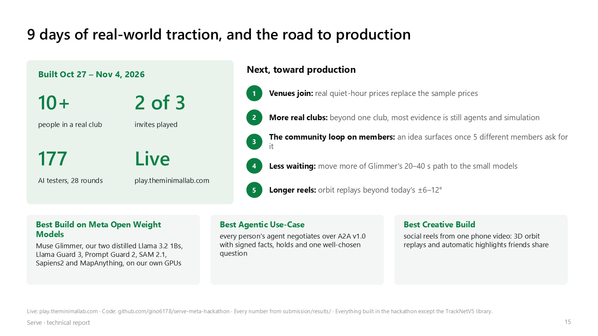

---

## Built during the hackathon (Oct 27 – Nov 4, 2026)

**Everything in this repository was built during the hackathon.** Building started on October 27, the hackathon's
first day; the repository was restructured into its current layout on October 28 and 29, one commit per file, and
its history holds 1,163 commits up to November 1. Nothing here predates the event.

Where a part follows a published method, the paper is named. A paper is listed only when the code, `docs/`, the
technical report or our research notes cite it; where we could not tie a method to a paper, none is given.

**Agents and negotiation**
- **The player's agent and its helpers** (`agent/src/agents/`): Match asks first, Talk negotiates, Pace turns exercise
  load into scheduling limits. Following ReAct (Yao et al., ICLR 2023), the planner is a tool loop in which the model
  picks the next tool and code runs it with checked arguments (`autopilot.js`, `planner_tools.js`).
- **A2A negotiation** (`agent/src/a2a/`). Following the Agent2Agent (A2A) Protocol v1.0 (Linux Foundation) and its
  official JavaScript SDK, every member has an A2A agent with a signed Agent Card. Following the Contract Net Protocol
  (Smith, IEEE Transactions on Computers, 1980) and distributed constraint satisfaction (Yokoo et al., IEEE TKDE, 1998),
  a talk is one call for proposals settled by intersecting each agent's set of workable times. Facts only, never prose,
  cross between agents.
- **30-minute holds** (`a2a/talk.js`). Following leases (Gray and Cheriton, SOSP 1989) and resource ordering (Havender,
  IBM Systems Journal, 1968), an agreed time is held all-or-nothing, in a fixed order, so two talks cannot book one
  person twice.
- **Signed cards and a signed consent chain.** Following JSON Web Signature (RFC 7515) over the JSON Canonicalization
  Scheme (RFC 8785), cards and every yes are signed with Ed25519; each yes carries the hash of the one before.
- **Durable talks** (`agent/src/core/`): saved before every round, a message answered once, booking idempotent,
  following durable execution and Sagas (Garcia-Molina and Salem, 1987).
- **Fair venues** (`club/`): the venue whose longest trip is shortest (minimax), with sum and Nash product as options.
- **A venue's own agent** (`venues/agent.js`): an A2A agent per sports centre with a signed Agent Card and one skill,
  quote a court; each quote is signed with the venue's Ed25519 key, the venue checks its own last quote each round,
  and an outside venue can register its own agent with the maintainer's approval.
- **Each player decides what they pay** (`members/split.js`): a limit per player and an opt-in to cover more; the
  price is split equal first, a tight limit is covered only by those who offered, never past anyone's limit, and the
  group's agent never offers past what the limits can cover.
- **Asking by habit** (`members/taste.js`, `match/ask.js`). Following the Bradley-Terry model of paired comparisons
  (Bradley and Terry, Biometrika, 1952), each member's agent fits four weights (time, distance, price, a quiet court)
  from its person's own choices; the asking agent invites by that fit and by each agent's likelihood band.
- **Ranking times by everyone's chance of yes** (`match/timerank.js`). Following *Consensus vs. Dissent* (Waterschoot,
  Tintarev and Barile, RecSys 2026, [arXiv 2607.10235](https://arxiv.org/abs/2607.10235)), the product of chances with
  a least-misery floor.
- **The question worth most** (`match/voi.js`): a value-of-information question over Beta posteriors. Following Pep
  (Bose et al., 2026, [arXiv 2602.15012](https://arxiv.org/abs/2602.15012)) and VPL (Poddar et al., NeurIPS 2024,
  [arXiv 2408.10075](https://arxiv.org/abs/2408.10075)), an answer lends part of its count to hours that go together
  across people.
- **Likelihood bands** (`match/model.json`). Following Zadrozny and Elkan (2002), logistic regression with isotonic
  calibration, each member's agent answering only with a band.
- **When to ask** (`match/gate.js`). Following Thompson (Biometrika, 1933), ProPerSim (Kim et al., 2025,
  [arXiv 2509.21730](https://arxiv.org/abs/2509.21730)) and [arXiv 2410.04596](https://arxiv.org/abs/2410.04596), a
  Thompson-sampled send gate with a burden cost, under a weekly cap.
- **Preference records** (`memory/prefs.js`). Following Mem0 ([arXiv 2504.19413](https://arxiv.org/abs/2504.19413))
  and PersonaMem ([arXiv 2504.14225](https://arxiv.org/abs/2504.14225)), typed, dated records where the newest wins.
- **Memory by meaning** (`memory/`): DRAMA vectors over short notes, `/forget` deletes them.
- **Tool calls checked after the schema** (`core/toolcheck.js`). Following JSONSchemaBench
  ([arXiv 2501.10868](https://arxiv.org/abs/2501.10868)) and ReliabilityBench
  ([arXiv 2601.06112](https://arxiv.org/abs/2601.06112)), typed semantic checks, bounded repair and read-back.
- **Courts near you, judged ahead** (`club/places.js`). Following Speculative Actions
  ([arXiv 2510.04371](https://arxiv.org/abs/2510.04371)), the next hour's courts are judged in the background.
- **A second round with stretched limits** (`a2a/stretch.js`). Following CalBench
  ([arXiv 2605.09823](https://arxiv.org/abs/2605.09823)), graded costs instead of yes or no.
- **The invite card from one sentence** (`club/play.js`, `inviteDraft`): code reads a named day; Glimmer only reads
  what code cannot date.
- **The open door for outside agents** (`members/discovery.js`): the guide in the site's HTML, `/llms.txt` with a
  six-call quick start, the Agent Card, OpenAPI, Ed25519 agent keys, and the rule that an agent key can only tighten its
  person's limits (`403`, `needs: person`).
- **Club and games**: huddles, waitlists, no-shows without money (a 60-day half-life, calling off 3 hours before, 12
  hours to confirm), skill ratings with uncertainty, club feed, invite links, Messenger channel, live voice.

**The decision engine and our models**
- **The tiered decision engine** (`agents/`, `core/llm.js`). Following FrugalGPT (Chen, Zaharia and Zou, 2023,
  [arXiv 2305.05176](https://arxiv.org/abs/2305.05176)), a cascade cheapest first: code, the tiny classifier, our 1B,
  the one-token decider, Glimmer. Thresholds following conformal risk control (Angelopoulos et al.,
  [arXiv 2208.02814](https://arxiv.org/abs/2208.02814)).
- **Early exit from Glimmer's reasoning** (`agents/early.js`). Following DEER (Yang et al., 2025,
  [arXiv 2504.15895](https://arxiv.org/abs/2504.15895)), the options are read at each break and the first sure read
  stops the answer.
- **The one-token decider** (`agents/decider.js`): Glimmer's next token read as a probability per option.
- **The 27.6 KB time classifier and the feed prefilter** (`agents/tiny.js`, `feed/tiny_text.js`; trained by
  `distill/tiny_times.py` and `distill/tiny_mod.py`): small MLPs on facts code holds, each with a doubt model; the
  prefilter follows feature hashing (Weinberger et al., ICML 2009) with int8 logistic regression.
- **The distilled decision 1B** (`distill/`). Following knowledge distillation (Hinton, Vinyals and Dean, 2015,
  [arXiv 1503.02531](https://arxiv.org/abs/1503.02531)) we trained Llama 3.2 1B on 4,868 of Glimmer's choices as hard
  labels (soft labels at T = 2 were tried and not kept); following LoRA (Hu et al., ICLR 2022) we trained adapters of
  rank 16; following TypeSafe's Jev decision models (2026) the options are scored in one pass. Calibrated following
  temperature scaling (Guo et al., ICML 2017); int4 compared with its bf16 by McNemar's test (McNemar, Psychometrika,
  1947); quantized with llama.cpp. Round 4 graded the hardest cases against the majority of Glimmer's other answers
  (no paper cited for that).
- **The text 1B** (`distill/text_*`). LoRA SFT on 1,039 of Glimmer's short answers plus attacked copies. Following StruQ
  (Chen et al., [arXiv 2402.06363](https://arxiv.org/abs/2402.06363)), outside text arrives in a message of its own.
  Following SecAlign (Chen et al., [arXiv 2410.05451](https://arxiv.org/abs/2410.05451)) and Meta SecAlign (Chen et
  al., 2025, [arXiv 2507.02735](https://arxiv.org/abs/2507.02735)), a preference-training step (DPO, Rafailov et al.,
  NeurIPS 2023) was tried and not kept.
- **Routing by length** (`core/llm.js`): short calls to the text 1B at checked sites, long ones to Glimmer, very long
  ones to Muse Spark on the Meta Model API.
- **A learned intent router** (`match/router.js`, `match/router_head.json`): a softmax head on DRAMA vectors behind
  the regular expressions.

**Safety**
- **Least power per agent.** Following Meta's *Agents Rule of Two* (October 2025), design patterns for securing agents
  against prompt injection (Beurer-Kellner et al., [arXiv 2506.08837](https://arxiv.org/abs/2506.08837)), firewalls for
  agent networks (Abdelnabi et al., [arXiv 2502.01822](https://arxiv.org/abs/2502.01822)) and CaMeL
  ([arXiv 2503.18813](https://arxiv.org/abs/2503.18813)), no agent holds untrusted input, private data and the power to
  act at once.
- **Guards as one layer** (`agent/src/safety/`). Following Llama Guard (Inan et al., 2023) and the Llama Guard 3 and
  Prompt Guard 2 model cards: Prompt Guard 2 first, then Llama Guard 3, then code, with our own rules for how each
  fails and when a category counts.
- **CodeShield rules** from LlamaFirewall ([arXiv 2505.03574](https://arxiv.org/abs/2505.03574)) on community specs and
  generated code; the never-list (`docs/never.md`).
- **The red team** (`agent/test/redteam.mjs`): 93 attack cases named by the OWASP Top 10 for LLM Applications (2025);
  the crash matrix; the privacy disclosure budget.

**The community loop** (`agent/src/loop/`)
- Signals with no words; one sentence shared only with a yes, following Clio
  ([arXiv 2412.13678](https://arxiv.org/abs/2412.13678)) for minimum cluster sizes.
- Quadratic votes, following Lalley and Weyl (AEA Papers and Proceedings, 2018).
- Specs and classes, nine gates, canaries, and rollback by an anytime-valid e-process, following Ramdas, Grünwald, Vovk
  and Shafer (Statistical Science, 2023).
- A builder agent with read-only tests, following the lesson of the Darwin Gödel Machine
  ([arXiv 2505.22954](https://arxiv.org/abs/2505.22954)), which hacked its own evaluation, and AlphaEvolve
  ([arXiv 2506.13131](https://arxiv.org/abs/2506.13131)): keep a change only when evaluators pass it.

**Highlight reels** (`video/pose/`)
- The reel pipeline: person detection, the moment worth sharing from pose, the cut-out, slow motion, a checked caption.
- 3D replays with MapAnything ([arXiv 2509.13414](https://arxiv.org/abs/2509.13414)) and SAM 2 (Ravi et al., 2024),
  with our learned invented-pixel threshold and the presence check; Muse Wonder as a second opinion.
- RT-DETR (Zhao et al., CVPR 2024) as the default person detector, measured against DETR.

**Testing**
- **The tester swarm**: 177 AI testers over 28 rounds (`submission/agent_testing.md`, every report and request log).
- **Difficult simulated people and pass^k** (`agent/test/sim_users/`). Following τ-bench (Yao et al.,
  [arXiv 2406.12045](https://arxiv.org/abs/2406.12045)) for pass^k and the Sim2Real gap of simulated users
  ([arXiv 2603.11245](https://arxiv.org/abs/2603.11245)).
- **The order of options, measured.** Following Magentic Marketplace
  ([arXiv 2510.25779](https://arxiv.org/abs/2510.25779)), which found agents favour the first proposal.
- Offline unit suites, the Messenger end-to-end test, the planner evaluation (pass^3), the crash matrix.

**The rest**
- **The web app** (`web/`): React + Three.js + Vite, phone to laptop, light and dark.
- **Operations** (`ops/`): start scripts and a watchdog for the GPU server.
- **The technical report, slides, figures and this page** (`submission/`, `video/deck/`, `docs/`).

## Our trained models

Every model we trained is published, with a model card, its measured results and sha256, in
[models/README.md](models/README.md). The large files (GGUF weights and LoRA adapters) are assets on the GitHub
Release [models-2026-11-01](https://github.com/gino6178/serve-meta-hackathon/releases/tag/models-2026-11-01); the
small heads live in the code. The Llama-derived models are **Built with Llama** and carry the Llama 3.2 Community
License.

## Where the numbers come from

Every number on this page comes from [submission/technical_report.md](submission/technical_report.md),
[submission/agent_testing.md](submission/agent_testing.md), the raw files in `submission/results/`, the notes in
`docs/` or the technical slides. Main sources: the student in `docs/decision_model.md`; the decider in
`docs/decider.md`; A2A and holds in `contention_eval.json`; the value of information in `voi_sim.json` and
`pref_share.json`; the time order in `rank_calls.json`; the loop in `loop_eval.json`; 3D replays in
`submission/results/orbit/`; the tiny layer in `tiny.json`; the text 1B in `text1b.json`; the order test in
`order_sensitivity.json`; the planner in `submission/agent_eval.md`.

## Credits and license

Serve's own code is under the [MIT License](LICENSE). The models, libraries and data it uses keep their own licenses,
listed in [CREDITS.md](CREDITS.md): among them Muse Glimmer (Apache 2.0), Llama 3.2 and Llama Guard 3 (Llama 3.2
Community License), Prompt Guard 2 (Llama 4 Community License), SAM 2.1, DETR, MapAnything (Apache 2.0 weights),
Omnilingual ASR (Apache 2.0), Sapiens2 (Sapiens2 License), DRAMA (CC BY-NC 4.0), the A2A JavaScript SDK (Apache 2.0),
map data © OpenStreetMap contributors (ODbL) and forecasts from Open-Meteo (CC BY 4.0). The highlight clip shown above
is from Badminton klub Ljubljana (CC BY 3.0).

Key references (full list in the [technical report](submission/technical_report.md#references)): the A2A Protocol
v1.0; Smith, The Contract Net Protocol (1980); Gray and Cheriton, Leases (1989); FrugalGPT (2023); DEER (2025);
Ramdas et al., Safe Anytime-Valid Inference (2023); Lalley and Weyl, Quadratic Voting (2018); LlamaFirewall (2025);
Meta, Agents Rule of Two (2025); MapAnything (2025); SAM 2 (2024); RT-DETR (2024).
