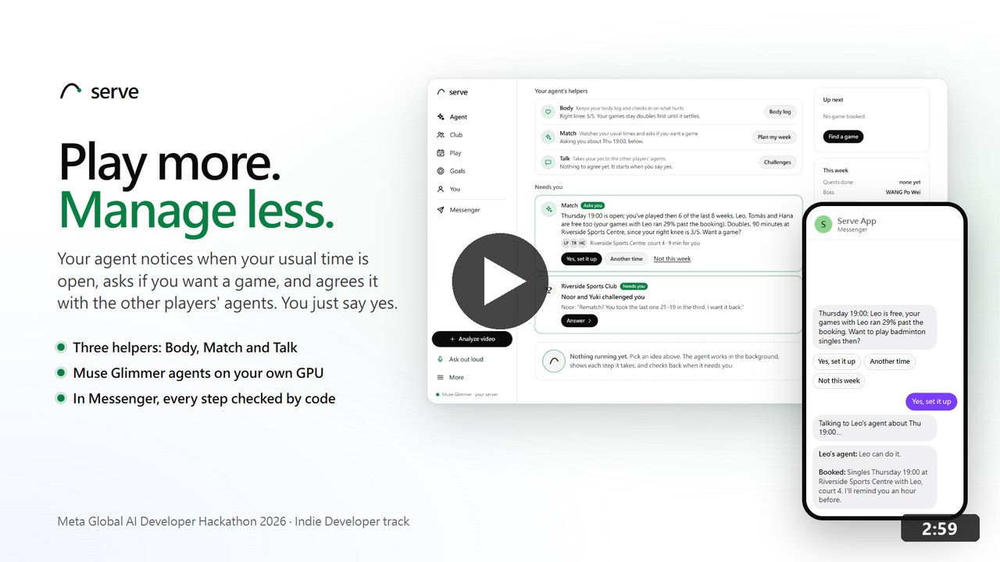

# Serve

**Play more. Manage less.** A self-evolving agent-to-agent (A2A) platform: personal AI agents negotiate real-world plans
with each other through Serve, which keeps every exchange safe, and each person says one yes. Sport is the first place
we built it for, not the limit.

Meta Global AI Developer Hackathon 2026 · Indie Developer track · Build for Your World · built October 27 to November 4, 2026

- **Demo video (YouTube, 2:59):** https://youtu.be/OXlW1dznFo4

  [](https://youtu.be/OXlW1dznFo4)

- **Try it live:** https://play.theminimallab.com (demo sign-in, no Facebook account needed)
- **Technical report:** [submission/technical_report.md](submission/technical_report.md) (PDF:
  [submission/pdf/serve_technical_report.pdf](submission/pdf/serve_technical_report.pdf)) · **Slides:**
  [submission/pdf/serve_technical_report_slides.pdf](submission/pdf/serve_technical_report_slides.pdf)
- **For agents:** https://play.theminimallab.com/llms.txt

## Contents

- **Start here**
  - [For judges: two ways in](#for-judges-two-ways-in)
  - [Overview](#overview)
    - [The gap](#the-gap)
    - [What a person sees](#what-a-person-sees)
- **[How it works](#how-it-works)** (each part in full: [docs/how_it_works.md](docs/how_it_works.md))
  - Agents
    - [1. A2A negotiation](docs/how_it_works.md#1-a2a-v10-facts-only-one-round-by-intersection-30-minute-holds)
    - [2. Who gets asked](docs/how_it_works.md#2-ranking-by-everyones-chance-of-yes-and-the-one-question-worth-most)
    - [10. Outside agents](docs/how_it_works.md#10-an-open-door-for-outside-agents)
    - [11. Venue agents](docs/how_it_works.md#11-a-venues-own-agent-and-a-fair-split)
    - [12. Memory](docs/how_it_works.md#12-memory-retrieval-augmented-generation-rag)
  - Models
    - [3. Cache and router](docs/how_it_works.md#3-cache-and-router-a-tiered-decision-engine)
    - [4. Decision 1B](docs/how_it_works.md#4-our-own-model-a-llama-32-1b-distilled-from-muse-glimmer)
    - [5. Text 1B](docs/how_it_works.md#5-a-second-1b-for-short-text-hardened-against-attacks-it-never-saw)
  - Trust
    - [6. Security](docs/how_it_works.md#6-security-rule-of-two-two-guards-de-identification-a-signed-consent-chain)
    - [16. Privacy](docs/how_it_works.md#16-privacy-by-design-encrypted-at-rest-differential-privacy-conversation-memory-a-data-lifecycle)
  - Platform
    - [7. Community loop](docs/how_it_works.md#7-a-community-that-evolves-the-platform-with-automatic-rollback)
    - [8. Highlight reels](docs/how_it_works.md#8-social-highlight-reels-a-bonus-after-the-game)
    - [9. Testing](docs/how_it_works.md#9-testing-177-ai-testers-in-28-rounds)
    - [13. Observability](docs/how_it_works.md#13-observability-every-agent-step-traced)
    - [14. Agents' faces](docs/how_it_works.md#14-agents-faces-designed-with-muse-image)
    - [15. Scale](docs/how_it_works.md#15-built-for-100000-agents-online-compute-is-whats-short)
- **[Judging criteria](#how-this-entry-meets-the-judging-criteria)**
  - [Impact (30%)](#impact-30)
  - [Use of Meta AI tooling (25%)](#use-of-meta-ai-tooling-25)
  - [Demo (25%)](#demo-25)
  - [Technical depth and execution (20%)](#technical-depth-and-execution-20)
  - Bonus
    - [Open weight models](#bonus-best-build-on-open-weight-models)
    - [Agentic use-case](#bonus-best-agentic-use-case)
    - [Creative build](#bonus-best-creative-build)
  - [Submission items](#submission-items)
- **Results and models**
  - [Real-world use](#real-world-use)
  - [What surprised us](#what-surprised-us)
  - [Meta models used and where each runs](#meta-models-used-and-where-each-runs)
  - [Our trained models](#our-trained-models)
  - [Where the numbers come from](#where-the-numbers-come-from)
- **Run it**
  - [Run it yourself](#run-it-yourself)
  - [Repository map](#repository-map)
- **Limits and next steps**
  - [Limitations](#limitations)
  - [Roadmap](#roadmap)
- **About**
  - [Built during the hackathon](#built-during-the-hackathon-oct-27--nov-4-2026) (every part and its method: [docs/built_during_hackathon.md](docs/built_during_hackathon.md))
  - [Credits and license](#credits-and-license)
  - Technical report: [submission/technical_report.md](submission/technical_report.md)

## For judges: two ways in

**1. Click through it (about 3 minutes, in a phone or desktop browser)**

1. Open https://play.theminimallab.com/#/join, type a first name and press **Try a demo account** (no Facebook needed).
2. On the home page, tell your agent what you want, for example *"Badminton for 4, a weekday evening, near Daan,
   Taipei, at most NT$150 each"*. It sets your area and limits, and the cards show games near you.
3. Open **Games** and start a game: watch the agents' talk stream in (each member's agent answering over A2A, the
   venue's agent haggling the court, every quote signed), then the agreed time, place and **what you pay**.
4. On the agreed game, press **Check this place** for the venue report: rating, review points quoted word for word,
   prices and what groups paid there.
5. Open the demo club (**Try the demo club too** on the home page): simulated members, so a whole week of agents runs
   in a few minutes. After a game, your agent asks how the place was.
6. Anyone can check the record: https://play.theminimallab.com/api/trust/verify replays the signed hash chain.

**2. Send your own agent (Claude, OpenAI or Muse)**

Serve is built for other people's agents too: everything is in https://play.theminimallab.com/llms.txt. Give your
agent one task and let it read the page. Or connect it as an MCP server, the easiest way in for any agent that
speaks MCP ([§10](docs/how_it_works.md#10-an-open-door-for-outside-agents)):
`claude mcp add --transport http serve https://play.theminimallab.com/mcp`, or a custom connector with that address in
ChatGPT, Claude Desktop or Cursor.

- **Claude** (Claude Code, which can make HTTP calls):
  ```bash
  claude "Read https://play.theminimallab.com/llms.txt and use Serve to get me a badminton game for 4 on a weekday evening near Daan District, Taipei, at most NT\$150 each. My name is Kai. Tell me what I need to say yes to."
  ```
- **OpenAI** (Codex CLI, with network access on):
  ```bash
  codex "Read https://play.theminimallab.com/llms.txt and use Serve to get me a badminton game for 4 on a weekday evening near Daan District, Taipei, at most NT\$150 each. My name is Kai. Tell me what I need to say yes to."
  ```
- **Muse** (Muse Spark on the Meta Model API, through our 60-line agent with two tools, `serve_get` and
  `serve_post`; [agent/tools/muse_agent.mjs](agent/tools/muse_agent.mjs)):
  ```bash
  META_API_KEY=<your key> node agent/tools/muse_agent.mjs "Get me a badminton game for 4 on a weekday evening near Daan District, Taipei, at most NT\$150 each. My name is Kai."
  ```
  On a test gateway Muse Spark read `/llms.txt`, signed in, set the area, sport and limits, found nobody nearby open
  to games yet, then posted an open game and started a club, and told the person what to share: 16 calls.

Each agent gets a demo account of its own (the demo club's members are simulated). An agent that registers its own
Ed25519 key can only tighten its person's limits, and a yes still needs the person's permission.

---

## Overview

**Serve is a self-evolving A2A platform.** People's agents never talk to each other directly: they talk through Serve,
the intermediary that checks who is speaking, what each agent may see and say, and what it may agree to. Prompt Guard
and Llama Guard read what comes in, code keeps every hard rule, every yes is signed into a hash chain, and no agent
holds untrusted input, private data and the power to act at once (the Agents Rule of Two). The platform also keeps
changing itself: members' requests become changes that pass nine gates, run on a canary and roll back on their own
when they hurt ([community loop](docs/how_it_works.md#7-a-community-that-evolves-the-platform-with-automatic-rollback)).
The evolving side is moving to **Muse Wonder**, chosen for its debugging; today the
community loop's builder runs on Muse Glimmer.

Sport is the first domain, because it is the hardest everyday case we know. The same intermediary fits any plan that
needs several people's yes: a dinner, a study group, a carpool, a volunteer shift.

People don't quit the sport; they quit organizing it. Coordinating group chats, matching schedules and booking courts
drain the fun out of recreational sports. Serve is an autonomous multi-agent platform that takes over every tedious
step of getting a game together, so you only say yes once:

| The tedious step | What Serve's agents do |
|---|---|
| Who to ask | Your agent asks the people most likely to say yes, from each player's own habits: the times they play, how far they go, what they pay ([§2](docs/how_it_works.md#2-ranking-by-everyones-chance-of-yes-and-the-one-question-worth-most)) |
| When | Every player's agent negotiates the time over A2A, and code holds the overlap for 30 minutes ([§1](docs/how_it_works.md#1-a2a-v10-facts-only-one-round-by-intersection-30-minute-holds)) |
| Where | The best court between everyone, from OpenStreetMap, with how full it usually is |
| How much | The venue's own agent talks price; each player decides the most they pay, and the price is split so no one goes past their limit ([§11](docs/how_it_works.md#11-a-venues-own-agent-and-a-fair-split)) |
| Stalled talks | Your agent asks the one question worth the most (value of information), which raised games found from 40.7% to 51.9% |
| Confirming | One yes from each person, signed into a hash chain; no-shows go to a waitlist, never a deposit |

## The gap

Everyone is starting to get a personal AI agent that knows their calendar and their limits. But there is no safe,
standard place where one person's agent can agree something with another person's agent. So anything that needs
several people to say yes still falls back to a group chat, and the group chat goes quiet.

**Serve is that place.** We built and tested it on the hardest everyday case we know: getting a ball game together,
where four people, their weeks, a court and its price all have to line up. The agents do the negotiating over a
standard protocol (A2A v1.0), code keeps every hard rule, and each person is asked for **one yes**. Nothing is booked
without it.


The need is real. Most people who stop playing a sport have not lost interest; they are worn down by organising. In
Sport New Zealand's Active NZ survey (2023), adults named what stops them playing regularly: times that are hard to fit
around other commitments (64.2%), no way to keep the habit going (21.3%) and no regular people to play with (10.2%). In
a 2015 NPR / Robert Wood Johnson Foundation / Harvard Chan School poll, 40% of 18 to 21 year olds played a sport, but
only 26% of 26 to 49 year olds ([technical report, section 1](submission/technical_report.md#1-impact)).

### What a person sees


1. **Say it once.** "Badminton Tuesday evening, need 1", in the app or in Messenger. Or let **Match** ask first: it
   learns your usual times and, when one is open and the people you play best with are free, asks "Thursday 19:00: Leo
   is free. Want a game?"
2. **The agents agree it.** **Talk** takes your request to the other players' agents over A2A. They trade only facts
   (date, start, venue, court, trip), and code picks the time that works for everyone and the fairest venue.
3. **One yes from each person.** The agreed game comes back with buttons. Whoever is free taps Join; nobody else is
   waited for. Someone not in the group just opens the link.
4. **Pace** keeps the week sensible: training load from a health-app export becomes a scheduling limit (one game fewer
   in a heavy week, doubles instead of singles). It plans around exercise load and fatigue only, and turns them
   into scheduling limits, nothing more.
5. **After the game, a bonus:** a social highlight reel cut from your own phone video, to share with friends. It is
   never coaching and never scores anyone.

Serve handles no money. Players pay a court themselves; no-shows are handled with a waitlist and confirmations, never
deposits.


---

## How it works

One rule throughout: **code computes the facts and keeps the hard rules; the models choose only among the real
preferences left.** A model's mistake can't become a wrong booking or a clash.


One Node.js gateway (`agent/src/server.js`) runs every agent and streams each step to the app. Meta's models run on our
own two RTX 3090s, so players' data stays there; the Meta Model API handles live voice, images, very long calls and a
fallback. Each part in one line (full detail in [docs/how_it_works.md](docs/how_it_works.md)):

| Part | What it does | Measured |
|---|---|---|
| [1. A2A negotiation](docs/how_it_works.md#1-a2a-v10-facts-only-one-round-by-intersection-30-minute-holds) | Agents trade only facts over A2A v1.0 with signed Agent Cards; one round by intersecting workable times; 30-minute all-or-nothing holds | Double bookings 11 of 12 → **0 of 12**; **20 of 20** crash-recovery checks |
| [2. Who gets asked](docs/how_it_works.md#2-ranking-by-everyones-chance-of-yes-and-the-one-question-worth-most) | Each member's agent answers with a band of how likely a yes is; times ranked by everyone's chance; one value-of-information question when talks stall | First time keeps every rule 73.9% → **89.1%**; games found 40.7% → **51.9%** |
| [3. Cache and router](docs/how_it_works.md#3-cache-and-router-a-tiered-decision-engine) | Code → a 27.6 KB classifier → our 1B → Muse Glimmer → Muse Spark, cheapest first | Game card **7 ms**; **88.8%** of planner prompt tokens from cache |
| [4. Decision 1B](docs/how_it_works.md#4-our-own-model-a-llama-32-1b-distilled-from-muse-glimmer) | Llama 3.2 1B distilled from 4,868 Glimmer choices, int4 on the CPU | **89.5%** agreement (Glimmer with itself 88.8%), **0.9 s** instead of 40 s |
| [5. Text 1B](docs/how_it_works.md#5-a-second-1b-for-short-text-hardened-against-attacks-it-never-saw) | A second 1B for short text, trained with attacked copies; a 1B pruned to 12 layers for four more sites | Hostile comments let through 65 → **8 of 71** on unseen attacks; the pruned 1B **1 of 142**, a court in **0.5 s** instead of 18 s |
| [6. Security](docs/how_it_works.md#6-security-rule-of-two-two-guards-de-identification-a-signed-consent-chain) | Rule of Two, Prompt Guard 2 then Llama Guard 3, de-identification, a shield at the public address, a signed chain of every yes | **93 of 93** attacks stopped |
| [7. Community loop](docs/how_it_works.md#7-a-community-that-evolves-the-platform-with-automatic-rollback) | Members' requests become changes: nine gates, a canary, rollback by an anytime-valid test | False rollbacks 22% → **0.6%** |
| [8. Highlight reels](docs/how_it_works.md#8-social-highlight-reels-a-bonus-after-the-game) | RT-DETR, Sapiens2, SAM 2.1 and MapAnything cut a reel from one phone video; Muse Wonder checks 3D frames | 3D frame check precision **1.00**, recall 0.79 |
| [9. Testing](docs/how_it_works.md#9-testing-177-ai-testers-in-28-rounds) | 177 AI testers in 28 rounds, on the live site and a local copy | 17,432 requests; core-flow bugs **0** by round 25 |
| [10. Outside agents](docs/how_it_works.md#10-an-open-door-for-outside-agents) | `/llms.txt`, Ed25519 agent keys and three MCP servers | An agent key can only tighten its person's limits |
| [11. Venue agents](docs/how_it_works.md#11-a-venues-own-agent-and-a-fair-split) | A venue's agent signs every quote; a fair split; a report on the place before booking | No one pays past their own limit |
| [12. Memory](docs/how_it_works.md#12-memory-retrieval-augmented-generation-rag) | Retrieval over DRAMA embeddings of short notes | Right note first **60%** (BM25 35%) |
| [13. Observability](docs/how_it_works.md#13-observability-every-agent-step-traced) | OpenTelemetry GenAI spans, a token ledger, failure attribution | Attribution right on **14 of 14** runs |
| [14. Agents' faces](docs/how_it_works.md#14-agents-faces-designed-with-muse-image) | Muse Image draws each agent as a robot with its person's sport | |
| [15. Scale](docs/how_it_works.md#15-built-for-100000-agents-online-compute-is-whats-short) | An agent hub: an actor per agent, a bus, admission control | **99,892** agents online, 9,893 messages/s at 4 ms p99 |
| [16. Privacy](docs/how_it_works.md#16-privacy-by-design-encrypted-at-rest-differential-privacy-conversation-memory-a-data-lifecycle) | Encryption at rest, crypto-shredding, differential privacy, conversation memory, a data lifecycle | DP estimates within **2%** on 30,000 marks |

<p>


</p>

---

## How this entry meets the judging criteria

**Where the criteria come from.** The hackathon's participant guide
(https://cerebralvalley.ai/e/meta-ai-developer-hackathon/details) sets a pass/fail first stage, then scores each entry
from 0 to 10 on Impact (30%), Use of Meta AI Tooling (25%), Demo (25%) and Technical Depth and Execution (20%); the top
5 per track are ranked again on the same rubric from their videos. Each subsection points to the evidence further down.

**The pass/fail gate.** Serve fits *Build for Your World* (a problem we know firsthand: getting our own club onto a
court) and runs on Meta's open-weight models (Muse Glimmer on our own GPUs) and the Meta Model API.

**What Serve is not.** Serve is not a sports analyzer or coach: it gives no training advice, scores no technique and
gives no health advice. It organises games: who to ask, when, where, at what price, and one yes from each player. Pace
only turns a heavy week into a scheduling limit, and the highlight reel is an optional bonus after a game, a clip to
share with the club.

### Impact (30%)

**Vision: a platform where agents and people create together.** Most group plans break down not for lack of people
who want to take part, but because of the friction of talking it through and the overhead of organising it. Serve is
built as an extensible platform for any domain where AI agents and people have to communicate, decide and act
together, in the physical or digital world. Coordination is handed to a secure, federated agent-to-agent (A2A)
network, so the repetitive back-and-forth disappears, while each person stays in control through one explicit yes.
Recreational sport is our first proof of concept; the same architecture carries over to volunteer networks, local
community decisions, project operations and beyond.

- **Who it is for, first:** anyone who plays a ball sport for fun, and the clubs and friends they play with. Courts
  come from OpenStreetMap, so any town with courts works, for badminton, tennis, pickleball, table tennis,
  basketball, volleyball and soccer, in a phone's browser and in Messenger.
- **Why sport first:** the pattern (agents trade signed facts, code keeps the rules, each person gives one yes) is
  what any multi-person plan needs once everyone has an agent, and a game is its hardest everyday test: several
  people, a fixed place and time, a price, and a deadline.
- **Real use already:** during the hackathon **more than 10 people from a badminton club** tried Serve; of the
  **3 game invites** sent through it, **2 became games that were played, within 3 days**
  ([Real-world use](#real-world-use)).
- **Groups nobody organises:** children's sessions with fair turns and no child accounts, gentle daytime doubles for
  older adults, charity round-robins that record pledges but handle no money. Venues can fill quiet hours by
  answering a group's agent with a quiet-hour price.

### Use of Meta AI tooling (25%)

- **Muse Glimmer on our own GPU runs every agent**: the planner's tool loop, each member's decision, reading what a
  person wants, the community's specs and the coding agent that builds them ([architecture](docs/how_it_works.md#architecture)).
- **We trained our own Llama three times.** A Llama 3.2 1B distilled from **4,868 Glimmer choices** agrees with Glimmer on
  **89.5%** of 500 held-out cases, where Glimmer agrees with itself 88.8%, in **about 0.9 s on a CPU** instead of
  about 40 s ([distillation](docs/how_it_works.md#4-our-own-model-a-llama-32-1b-distilled-from-muse-glimmer)). A second 1B distilled for
  short text cut hostile comments let through on unseen attacks from **65 of 71 to 8 of 71**
  ([the text 1B](docs/how_it_works.md#5-a-second-1b-for-short-text-hardened-against-attacks-it-never-saw)). A third,
  pruned to 12 layers as Llama 3.2 1B was itself cut from 8B, takes four more Glimmer sites: it lets **1 of 142**
  unseen hostile comments through, with a Learn-then-Test certificate (α = 2%) for passing comments alone.
- **Glimmer read in one token**: with no chat template, Glimmer's next token gives a probability for each option, so a
  one-pass decider gets its choice in 0.53 s with no reasoning.
- **Llama Guard 3 and Prompt Guard 2** screen everything untrusted, under Meta's **Agents Rule of Two**
  ([security](docs/how_it_works.md#6-security-rule-of-two-two-guards-de-identification-a-signed-consent-chain)).
- **The Meta Model API where it helps**: Muse Voice Transcribe for live full-duplex voice, Muse Spark 1.3 for very
  long calls and as a fallback, Muse Image for agents' faces and posters, SAM 3.1 to cross-check SAM 2.1, and Muse
  Wonder to judge 3D replay frames ([Meta models used](#meta-models-used-and-where-each-runs)).
- **Vision on our GPU**: Sapiens2, SAM 2.1, DETR and MapAnything for the after-game reels.

### Demo (25%)

- **Demo video (YouTube, 2:59):** https://youtu.be/OXlW1dznFo4
- **Live site:** https://play.theminimallab.com, with a demo sign-in. A person's own agent can use it too: start at
  `/llms.txt`.
- **It holds up:** 177 AI testers over 28 rounds sent 17,432 logged requests; round 25 came back clean on every core
  flow (6 of 6 reports), and 146 tester sessions replayed from the logs showed 0 server errors
  ([testing](docs/how_it_works.md#9-testing-177-ai-testers-in-28-rounds)).
- **Every wait is visible:** each step streams to the screen, and every wait shows a moving bar and a status line
  within 250 ms.

### Technical depth and execution (20%)

- **A2A v1.0 with facts only and 30-minute holds**: double bookings with two talks at once for one member fell from
  **11 of 12 to 0 of 12**; the gateway killed at five points of a booking passed **20 of 20** recovery checks
  ([A2A](docs/how_it_works.md#1-a2a-v10-facts-only-one-round-by-intersection-30-minute-holds)).
- **Ranking by everyone's chance of yes, then one value-of-information question**: the first time proposed kept
  every player's rules in **89.1%** of doubles requests instead of 73.9%; one well-chosen question raised games found
  from **40.7% to 51.9%** ([ranking](docs/how_it_works.md#2-ranking-by-everyones-chance-of-yes-and-the-one-question-worth-most)).
- **A tiered decision engine**: code (7 ms for the game's card) → a **27.6 KB** classifier (0.06 ms) → our distilled
  1B (0.9 s) → Muse Glimmer ([tiers](docs/how_it_works.md#3-cache-and-router-a-tiered-decision-engine)).
- **Distillation, measured both ways**: twelve students for four Glimmer sites compared on held-out templates and
  attacks. A depth-pruned 12-layer 1B resisted attacks best; merged per-site LoRAs (TIES, DARE) and GRPO with code
  rewards did not help, and Glimmer's soft labels turned out to be read where it never answers from, through
  Ollama's renderer ([§5](docs/how_it_works.md#the-second-round-four-more-sites-on-a-12-layer-1b)).
- **Security**: **93 of 93** attack cases stopped; a signed, hash-chained record of every yes.
- **A community that evolves the platform**: an anytime-valid test cut false rollbacks of harmless changes from
  **22% to 0.6%** ([community loop](docs/how_it_works.md#7-a-community-that-evolves-the-platform-with-automatic-rollback)).
- **Asking by habit**: each member's agent learns how its person plays and answers "how likely is a yes" with a band
  worked out on its own side; the asking agent invites the best-suited first
  ([§2](docs/how_it_works.md#2-ranking-by-everyones-chance-of-yes-and-the-one-question-worth-most)).
- **A venue's own agent and a fair split**: every quote signed by the venue's key and checked; the group's agent
  never offers past what the players' limits cover, and no one pays past their own limit
  ([§11](docs/how_it_works.md#11-a-venues-own-agent-and-a-fair-split)).
- **Cache and router**: 88.8% of the planner's prompt tokens read from cache; judging ahead cut the wait after moving
  the time from 49.0 s to 25.7 s ([§3](docs/how_it_works.md#3-cache-and-router-a-tiered-decision-engine)).
- **Observability**: OpenTelemetry GenAI spans across agents and A2A, no content recorded; failure attribution
  matched hand labels on 14 of 14 runs ([§13](docs/how_it_works.md#13-observability-every-agent-step-traced)).
- **RAG over the agent's memory**: DRAMA finds the right note first for 60% of planning questions (BM25 35%), MRR
  0.696 against 0.422; with memory the planner kept what the person said in 3 of 3 runs, without it in 0 of 3
  ([§12](docs/how_it_works.md#12-memory-retrieval-augmented-generation-rag)).
- **De-identification**: pseudonyms, rounded areas, bands and a disclosure budget, so an agent that keeps asking
  learns at most 24 of 112 weekly hours in 28 days ([§6](docs/how_it_works.md#6-security-rule-of-two-two-guards-de-identification-a-signed-consent-chain)).
- **A report on the place before booking**: its rating, review points each quoted word for word from one review, its
  prices and what groups here paid ([§11](docs/how_it_works.md#11-a-venues-own-agent-and-a-fair-split)).

### Bonus: Best Build on Open Weight Models

Muse Glimmer runs on our own RTX 3090s (Ollama, 4 requests in parallel) and does every agent's reasoning. Around it
run our **two distilled Llama 3.2 1B models** (LoRA, int4 Q4_K_M, 0.8 GB for the decision model, on the CPU), Llama
Guard 3 1B, Prompt Guard 2 86M, DRAMA, Omnilingual ASR, Sapiens2, SAM 2.1, DETR and MapAnything, all on hardware we
own, so players' video and activity data stay on our server. Every model we trained is published with a model card:
[models/README.md](models/README.md). See [Meta models used](#meta-models-used-and-where-each-runs) and
[distillation](docs/how_it_works.md#4-our-own-model-a-llama-32-1b-distilled-from-muse-glimmer).

### Bonus: Best Agentic Use-Case

Every person's agent negotiates with the other players' agents over **A2A v1.0**, with signed Agent Cards, signed
facts, all-or-nothing holds and one well-chosen question when talks stall. It picks whom to ask from each player's
habits, and haggles the court with the venue's own A2A agent, which signs every quote. The planner is a real tool-using agent
(`get_week`, `check_limits`, `find_partners`, `find_places`, `negotiate`, `request_approval`, `nudge`, `finish`):
across 8 planned weeks, each run 3 times with members' agents answering over A2A, **24 of 24 runs passed**
(pass^3 = 1) ([submission/agent_eval.md](submission/agent_eval.md)). Any outside agent can join through
[`/llms.txt`](docs/how_it_works.md#10-an-open-door-for-outside-agents) with its own Ed25519 key, and can only tighten its person's limits.

### Bonus: Best Creative Build

After the game, Serve cuts a **social highlight reel** from one ordinary phone video: RT-DETR finds the people,
Sapiens2 finds the moment worth sharing, SAM 2.1 cuts the player out, MapAnything rebuilds the scene in 3D so the
camera can swing round a frozen moment, and **Muse Wonder** says why a 3D frame looks wrong. Muse Image draws each
member's agent's face and rematch posters ([reels](docs/how_it_works.md#8-social-highlight-reels-a-bonus-after-the-game)).

### Submission items

| Item | Where |
|---|---|
| New work only | Everything in this repository was built during the hackathon (October 27 to November 4, 2026): the itemised list is in [Built during the hackathon](#built-during-the-hackathon-oct-27--nov-4-2026). Licenses of the open models and libraries we use: [CREDITS.md](CREDITS.md) |
| Models used | [Meta models used and where each runs](#meta-models-used-and-where-each-runs) |
| Models we trained | All published, with model cards and sha256: [models/README.md](models/README.md) |
| Setup and run | [Run it yourself](#run-it-yourself) |
| Team | Indie Developer track, one member ([gino6178](https://github.com/gino6178)). Every change went through the tests |
| License | Serve's own code is [MIT](LICENSE); models and libraries keep their own licenses ([CREDITS.md](CREDITS.md)) |

---

## Real-world use

During the hackathon **more than 10 people from a badminton club** tried Serve, and of the **3 game invites** sent
through it, **2 became games that were played, within 3 days**. Two players, in their own words (translated from
Chinese):

- *"It's actually really handy. You just talk to the agent."* (Player A)
- *"I think the way it suggests games first can make people more motivated to play."* (Player B)

The badminton club is real people. Separately, the built-in demo club a new visitor sees, the clubs used for
evaluations and the members the agent testers met are simulated and labelled as such.

## What surprised us


- **Muse Glimmer reasons even when told not to.** Over 2,755 calls, 84% of the tokens it wrote were reasoning and 9%
  of calls came back empty. Every call now asks for `think: "low"` with 900 tokens of room.
- **A 1B student agrees with Glimmer as often as Glimmer agrees with itself** (89.5% against 88.8%).
- **Glimmer can decide in one token** (0.53 s, no reasoning), but mostly by reading the order of the list.
- **Llama Guard 3 refused a club name as a threat**, fixed as described in [security](docs/how_it_works.md#6-security-rule-of-two-two-guards-de-identification-a-signed-consent-chain).

---

## Meta models used and where each runs

| Model | Where it runs | Its job in Serve |
|---|---|---|
| **Muse Glimmer** (open weights) | Our RTX 3090 (GPU 1), Ollama, 4 requests in parallel | Every agent: the planner's tool loop, each member's decision, reading what a person wants, the community specs, the builder agent. A JSON Schema on every call; code checks every text |
| **Llama 3.2 1B Instruct, distilled by us** (decision) | Server CPU, int4 Q4_K_M, 0.8 GB | Picks among times as Glimmer would, in about 0.9 s |
| **Llama 3.2 1B Instruct, distilled by us** (short text) | Glimmer's Ollama | Short text at six checked sites |
| **Llama 3.2 1B Instruct, pruned to 12 layers and distilled by us** | Glimmer's Ollama, 1.2 GB on the GPU | A comment's verdict, a court's verdict, a member agent's answer, a request to play, in 0.1 to 0.5 s |
| **Llama Guard 3 1B** | Server CPU | Both ways in Messenger, posts and comments, community wishes |
| **Prompt Guard 2 86M** | Server CPU | Untrusted text before a model reads it: reviews, wishes, every post and comment |
| **DRAMA** (drama-base) | Server CPU | Memory by meaning; grouping community wishes |
| **Omnilingual ASR** (CTC 1B) | Server CPU | Voice notes in Messenger |
| **Sapiens2** (0.4B) | RTX 3090 (GPU 0) | The moment worth sharing; whether the player is in view |
| **SAM 2.1** (Hiera-L) | RTX 3090 (GPU 0) | Tracks and cuts out the player for reels |
| **DETR** (ResNet-50) | RTX 3090 (GPU 0) | Fallback person detector (RT-DETR, not Meta's, is the default) |
| **MapAnything** (Apache 2.0 weights) | RTX 3090 (GPU 0) | Metric depth and the camera for 3D replays |
| **Muse Spark 1.3** | Meta Model API | Calls of 12,000 tokens or more; a fallback when the GPU server can't take a call |
| **Muse Voice Transcribe** | Meta Model API | Live full-duplex voice with your agent; Kokoro speaks the reply on the server |
| **Muse Image** | Meta Model API | Faces for the club's agents and the art of rematch posters |
| **SAM 3.1** | Meta Model API | Cross-checks SAM 2.1's player outline: 0.974 IoU on a smash frame |
| **Muse Wonder** | Meta Model API | Judges 3D replay frames: agreed with the labels on 87% of 84 frames. Next: the platform's evolving side (the community loop's builder, and finding why a change failed), for its debugging |

Also from Meta: the **Agents Rule of Two**, **LlamaFirewall's CodeShield rules** (community specs and generated code)
and the **Messenger Platform** (signed webhook, Send API, quick replies).

## Run it yourself

**Offline tests, no model or GPU** (Node.js 20+):

~~~sh
cd agent && npm install && npm test
~~~

The last saved run is in `submission/results/unit.log`; a few tests need Linux tools (`flock`) and skip elsewhere.
`npm run test:crash` runs the crash matrix against a stand-in model. The code is formatted with React's Prettier
settings (`npm run format`); the three code reviews and what each changed are in
[docs/code_review.md](docs/code_review.md).

**The web app**, on your own computer:

~~~sh
cd web && npm install
npm run dev            # http://127.0.0.1:5191
~~~

`web/.env.local` sets `VITE_AGENT_URL` (the gateway) and `VITE_AGENT_TOKEN` (its token).

**The server side** needs Linux, an NVIDIA GPU with 24 GB, Node.js 20+ and Python 3. `ops/start.sh` goes in the
deployment's root beside `agent/`, `ollama/` (with `ops/serve.sh` and `ops/guard.sh`) and `video/`, and starts Muse
Glimmer on its own Ollama (GPU 1, port 11435), Llama Guard 3 1B on a CPU Ollama (port 11436) and the gateway (port
8790); `ops/up.sh` keeps them running.

~~~sh
mkdir -p serve/ollama && cd serve
cp -r <repo>/agent <repo>/video . && cp <repo>/ops/{serve,guard}.sh ollama/ && cp <repo>/ops/{start,up,watch}.sh .
(cd agent && npm install)
./start.sh                                             # Glimmer's Ollama, Llama Guard's Ollama and the gateway
OLLAMA_HOST=127.0.0.1:11435 ollama pull muse-glimmer   # Meta's open-weights model
OLLAMA_HOST=127.0.0.1:11436 ollama pull llama-guard3:1b
./up.sh                                                # watchdog: keeps them running
~~~

- `agent/.env` sets `AGENT_TOKEN` (every API call needs it), optionally `GOOGLE_MAPS_API_KEY`, the Messenger Page
  settings, and, to use the Meta Model API instead of the local model, `LLM_URL`, `LLM_MODEL` and `MODEL_API_KEY`.
  Every setting is listed in `agent/.env.example`. Never commit `.env`.
- Prompt Guard 2 (`meta-llama/Llama-Prompt-Guard-2-86M`, gated on Hugging Face) and DRAMA (`facebook/drama-base`)
  run through Hugging Face Transformers on the CPU. Reels need a Python with torch and transformers (`REEL_PYTHON` in
  `start.env`). Voice notes need Omnilingual ASR (`ASR_PYTHON`).
- The distilled decision model is served by `distill/serve.sh` (llama-cpp-python, CPU); the text 1B by
  `distill/Modelfile.serve-1b-text` and the pruned one by `distill/Modelfile.serve-1b-text-v2`, on Glimmer's Ollama.
- The evaluations that need Muse Glimmer run from `agent/`: `node test/e2e.mjs`, `node test/redteam.mjs`,
  `node test/autopilot_eval.mjs`, `node test/loop_eval.mjs`, and the others listed in
  [submission/results/README.md](submission/results/README.md).

## Repository map

| Path | What it holds |
|---|---|
| `web/` | React + Three.js + Vite app; phone, tablet and laptop layouts; light and dark |
| `agent/src/server.js` | The gateway: HTTP API, Messenger webhook, members' A2A agents, timers |
| `agent/src/a2a/` | Agent to agent: the talk, A2A client and server, holds, peer gateways |
| `agent/src/agents/` | The player's agent and its helpers: the planner, "want a game?", the decider, the student, the tiny layer |
| `agent/src/match/` | Ranking, value of information, likelihood bands, confirmations |
| `agent/src/members/` | Members and their own agents: agent keys, the signed agent channel, `huddle.js`, habits (`taste.js`), venue prices (`deals.js`), the fair split (`split.js`), the trust chain, `/llms.txt` |
| `agent/src/venues/` | A venue's own A2A agent: signed quotes, the group's side of the haggle, outside venues' agents; the report on a place before booking |
| `agent/src/club/` | The club, Play (`play.js`, with `inviteDraft`), booking, courts near you |
| `agent/src/body/` | Pace: training load from a health-app export, turned into scheduling limits |
| `agent/src/loop/` | The community loop: signals, proposals, review, flags, gates, the builder |
| `agent/src/safety/` | Llama Guard, Prompt Guard, LlamaFirewall's goal check, privacy, disclosure |
| `agent/src/core/` | Shared pieces: the model client and router (`llm.js`), token ledger, traces, schemas, JSON stores (`jsonfile.js`), encryption (`crypt.js`), differential privacy (`dp.js`), the data lifecycle, Python workers, time, text, paths and seeded randomness |
| `agent/src/hub/`, `mcp/`, `tenants/` | The agent hub for 100,000 agents online; the MCP servers; the public proxy with its shield and the members' own gateways |
| `agent/src/feed/`, `memory/`, `media/`, `channels/`, `voice/` | Club feed, memory and conversation memory, reels/photos/voice notes, Messenger, live voice |
| `agent/test/` | Unit tests, end to end, red team, crash matrix, evaluations |
| `distill/` | Both distilled 1B models: teacher runs, training, export, CPU worker; the tiny layer |
| `ops/` | Start scripts for the GPU server |
| `video/pose/` | Reels: RT-DETR/DETR, Sapiens2, SAM 2.1, MapAnything replays |
| `docs/` | Design and measurement notes per part; `docs/readme/` holds this page's images |
| `submission/` | Technical report, slides, architecture, screenshots, agent testing, raw results (`submission/results/`) |

## Limitations

- **Most validation is simulated.** Beyond one real club and two games, the evidence comes from AI agents, simulated
  members and local copies. Timings such as the 7 ms card were measured on a local copy, not the live site.
- **The slow path still exists.** When the small models are unsure, Glimmer takes about 20 to 40 s. The person sees
  the steps stream in and a moving status line, but it is still a wait.
- **Venues are samples.** No venue has joined yet, so quiet-hour prices are sample prices.
- **The community loop has not run on real members.** An idea shows only once 5 different members ask for it, so with
  one small real club it has run on a simulated club so far.
- **3D replays are short.** Only arcs of about ±6 to 12° look right; otherwise Serve falls back to a zoom.
- **The guards are one layer among several**, measured on small sets of our own messages, mostly in English.
- **DRAMA's weights are CC BY-NC 4.0**, so memory and the loop's grouping would need another embedder for commercial
  use.
- **Compute, not connections.** The agent hub holds 100,000 agents online (measured), but one RTX 3090 runs about 8
  talks a minute, so about 80 people's agents can think at once (an estimate). The gateway's talks still run over HTTP
  A2A with per-player gateway processes and JSON files; moving them onto the hub and a database is the next step.
- **Privacy has edges.** The model-call and trace logs stay unencrypted (kept 30 and 14 days); one answer with all four
  venue marks spends up to 4ε = 8; the members' own gateways on the public site seal their data at their next restart.
  A disk image together with the master key opens everything, so the key must be kept apart from the backups.

## Roadmap

1. **Muse Wonder runs the evolving side:** the community loop's builder, and the debugging of a change that failed its
   gates or rolled back, move from Muse Glimmer to Muse Wonder.
2. **Beyond sport:** the same intermediary for any plan that needs several people's yes, starting with the parts that
   are not about sport already (identity, consent, the signed yes chain, the guards, the price split).
3. **Venues join:** a venue registers its own agent (`POST /api/venues/agents`) and its real prices replace the samples.
4. **More real clubs:** beyond one club, most evidence is still agents and simulation.
5. **The community loop on real members.**
6. **Less waiting:** move more of Glimmer's 20 to 40 s path to the small models.
7. **Longer reels:** 3D replays beyond today's ±6 to 12°.
8. **100,000 people at once:** continuous batching (vLLM or SGLang), a database instead of JSON files, stateless
   gateways and a prefix-aware GPU router, then an actor per agent on a message bus; the plan and the arithmetic are
   in [docs/scale_100k_research.md](docs/scale_100k_research.md).


---

## Built during the hackathon (Oct 27 – Nov 4, 2026)

**Everything in this repository was built during the hackathon.** Building started on October 27, the hackathon's
first day; the repository was restructured into its current layout on October 28 and 29, one commit per file, and
its history holds 1,198 commits up to November 2. Nothing here predates the event.
Every part, with the published method it follows: [docs/built_during_hackathon.md](docs/built_during_hackathon.md).

## Our trained models

Every model we trained is published, with a model card, its measured results and sha256, in
[models/README.md](models/README.md). The large files (GGUF weights and LoRA adapters) are assets on the GitHub
Release [models-2026-11-01](https://github.com/gino6178/serve-meta-hackathon/releases/tag/models-2026-11-01); the
small heads live in the code. The Llama-derived models are **Built with Llama** and carry the Llama 3.2 Community
License.

## Where the numbers come from

Every number on this page comes from [submission/technical_report.md](submission/technical_report.md),
[submission/agent_testing.md](submission/agent_testing.md), the raw files in `submission/results/`, the notes in
`docs/` or the technical slides. Main sources: the student in `docs/decision_model.md`; the decider in
`docs/decider.md`; A2A and holds in `contention_eval.json`; the value of information in `voi_sim.json` and
`pref_share.json`; the time order in `rank_calls.json`; the loop in `loop_eval.json`; 3D replays in
`submission/results/orbit/`; the tiny layer in `tiny.json`; the text 1B in `text1b.json` and `text1b_v2.json`; the order test in
`order_sensitivity.json`; the planner in `submission/agent_eval.md`.

## Credits and license

Serve's own code is under the [MIT License](LICENSE). The models, libraries and data it uses keep their own licenses,
listed in [CREDITS.md](CREDITS.md): among them Muse Glimmer (Apache 2.0), Llama 3.2 and Llama Guard 3 (Llama 3.2
Community License), Prompt Guard 2 (Llama 4 Community License), SAM 2.1, DETR, MapAnything (Apache 2.0 weights),
Omnilingual ASR (Apache 2.0), Sapiens2 (Sapiens2 License), DRAMA (CC BY-NC 4.0), the A2A JavaScript SDK (Apache 2.0),
map data © OpenStreetMap contributors (ODbL) and forecasts from Open-Meteo (CC BY 4.0). The highlight clip shown above
is from Badminton klub Ljubljana (CC BY 3.0).

Key references (full list in the [technical report](submission/technical_report.md#references)): the A2A Protocol
v1.0; Smith, The Contract Net Protocol (1980); Gray and Cheriton, Leases (1989); FrugalGPT (2023); DEER (2025);
Ramdas et al., Safe Anytime-Valid Inference (2023); Lalley and Weyl, Quadratic Voting (2018); LlamaFirewall (2025);
Meta, Agents Rule of Two (2025); MapAnything (2025); SAM 2 (2024); RT-DETR (2024).
