# How Serve works

The detail behind the [README](../README.md)'s summary: the architecture and each part of Serve, with what was measured
and where the raw results are.

## Architecture

Serve keeps one rule throughout: **code computes the facts and keeps the hard rules; the models choose only among the
real preferences left.** That keeps a model's mistake from turning into a wrong booking or a clash.

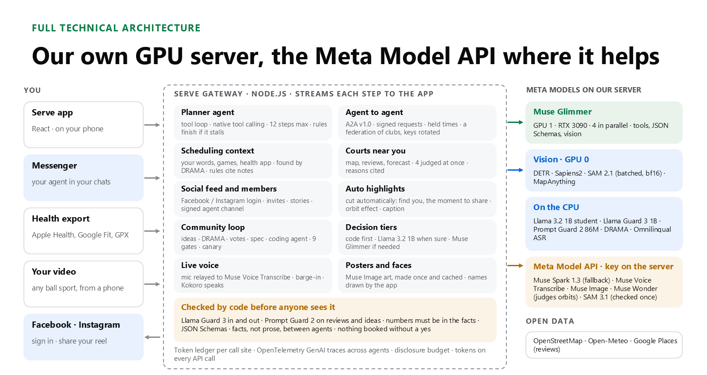

- **One gateway** (`agent/src/server.js`, Node.js) runs every agent and streams each step to the app as NDJSON.
- **Meta models on our own GPUs** (two RTX 3090s and their CPU): Muse Glimmer on GPU 1; the vision models on GPU 0;
  our distilled 1B, Llama Guard 3, Prompt Guard 2, DRAMA and Omnilingual ASR on the CPU. Players' data stays there.
- **The Meta Model API** for live voice, a fallback, very long calls, images and checks.
- **Three kinds of A2A agent**: each player's agent, each member's agent (`/a2a/members/<id>`), and each venue's agent
  (`/a2a/venues/<id>`), all with signed Agent Cards. A venue can run its own agent elsewhere and register it.
- **Which model answers** is decided by one router, by the kind of call and its length; the table is in
  [§3](#3-cache-and-router-a-tiered-decision-engine). On the public site every call a person waits for goes to a fast
  tier, and Glimmer keeps the background work.
- **A watchdog** (`ops/watch.sh`) restarts anything that stops, every 30 s.

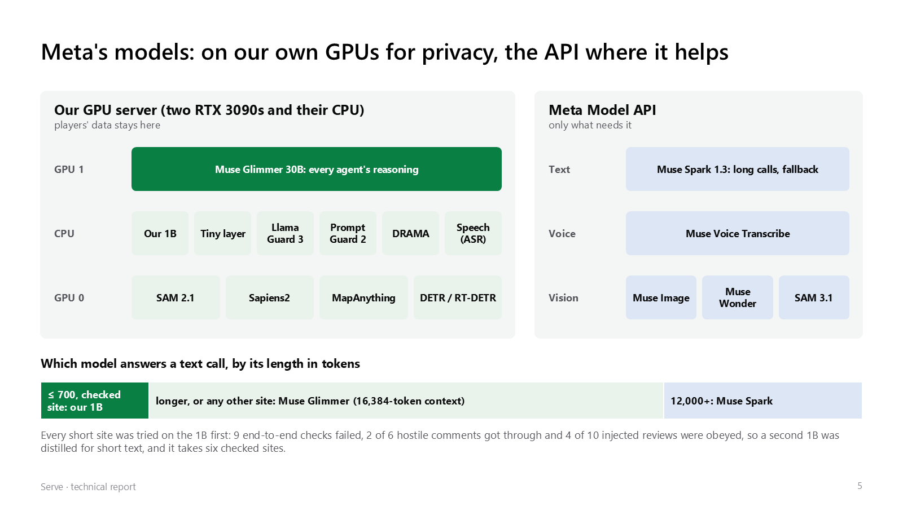

## 1. A2A v1.0: facts only, one round by intersection, 30-minute holds

Agents talk over the **A2A protocol v1.0** (Linux Foundation), through its official SDK (`agent/src/a2a/`).

- **Facts only.** A proposal carries each time as `{id, date, start, venue, court, trip}` and nothing else; an answer
  carries `{intent, date, start, works}`. Sentences between agents are templates filled by code, so no agent's model
  ever reads another side's words, and no agent can inject instructions into another.
- **One round, by intersection.** The host's agent lists up to twelve times that fit every calendar and have a court;
  each player's agent marks the ones that work for its person, and that is binding. Code takes the best time in the
  intersection, so most talks end in round one: the Contract Net with a one-shot intersection, a simple distributed
  constraint satisfaction. A player's hard rules (days off, the latest finish, the longest trip) remove times before
  any model sees them.
- **The fairest venue.** For each time, code picks the venue whose longest trip is shortest, from home areas, never
  addresses. Over 12 simulated games no booked game gave anyone a longer longest trip than the best venue possible,
  at 2.3 minutes more total travel per game; the fairness score was 0.73, against 0.59 for the shortest total trip and
  0.58 for a Nash product.
- **Holds, all or nothing.** An agreed time is held by every player's agent for **30 minutes**, asked in a fixed order
  (leases with resource ordering). With two talks at once for one member, **11 of 12** pairs booked the member twice
  without holds and **0 of 12** with them.
- **Durable and signed.** A talk is saved before every round, a message is answered once, and booking is idempotent.
  Agent Cards carry a JWS over their canonical JSON (Ed25519), checked before any talk. The gateway was killed at five
  points in a booking: **all 20 recovery checks passed** and no game was booked twice.
- **Across machines.** Two gateways on separate machines, with pinned and rotatable Ed25519 keys: the hop added about
  185 ms per request, and 22 of 22 checks passed with 12 talks at once.
- **To the standard.** Agent Cards point to their keys with `jku`, the proposal and hold extensions are declared and
  required, and errors use the protocol's own codes.

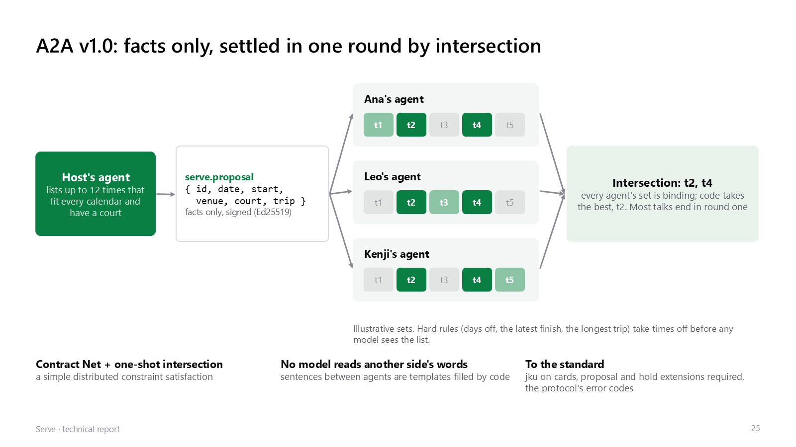

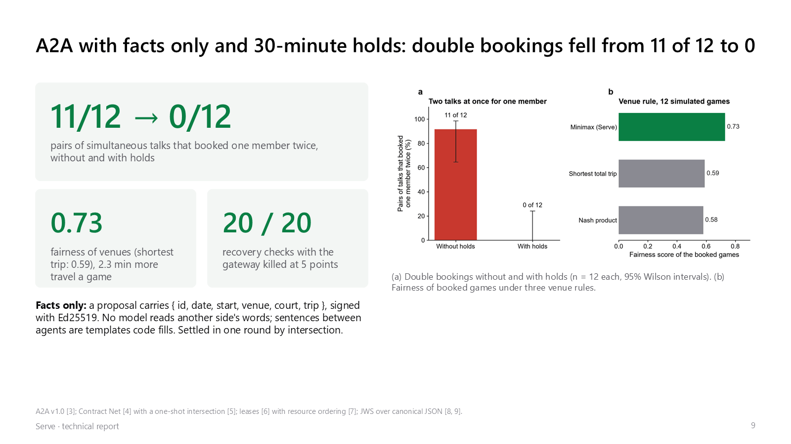

## 2. Ranking by everyone's chance of yes, and the one question worth most

- **Who gets asked, from each player's habits.** When a player asks for a game, their agent doesn't message the whole
  club. Each member's agent learns how its person plays: the hours of the week they say yes to, how far they go, what
  they pay, and whether they like a quiet court (four weights fitted from their own answers, `members/taste.js`). The
  asking agent picks candidates by that fit, and asks each candidate's agent over A2A how likely a yes is
  (`serve.likely`). The candidate's agent works the answer out on its own side from its person's own record, and
  answers only with a band (unlikely, maybe, likely, very likely). The best-suited are asked first. Two candidates of
  every twelve are drawn from the rest, so it isn't always the same few people (`match/ask.js`, `match/likely.js`).
- **Times ranked by the chance everyone says yes.** A game needs every player, so times are proposed in order of the
  product of each player's chance of a yes, and a time where any one player's chance is under 0.15 goes to the back (a
  least-misery floor). On 3,000 simulated requests of each kind, the first time proposed kept every player's rules in
  **89.1%** of doubles requests instead of 73.9% (92.4% instead of 89.8% for singles), and model choices per doubles
  request fell from 0.261 to 0.109 (`submission/results/rank_calls.json`).
- **The question worth most.** When a game's talks have not landed, the agent neither gives up nor asks the player
  again. For each player and time it keeps a Beta posterior that the player is free then (from what it has seen of that
  player's agent, never their calendar), and asks the **one yes-or-no question whose answer most raises the expected
  chance of a game**, through a private free-or-busy channel with a disclosure budget.

| Strategy (20,000 simulated requests each; 8 players, 6 times) | Game found, one question then one talk |
|---|---|
| No question | 40.7% |
| A random question | 44.4% |
| Ask about the likeliest pair | 48.2% |
| **The question worth most (value of information)** | **51.9%** |

- **One answer teaches about the hours like it.** An answer lends part of its count to the hours that go together in
  the club's own free lists. On 6,000 simulated requests: Brier score 0.223 to 0.200, and the chance the first talk lands
  rose from 68.9% to 73.7%, or from 75.1% to 79.2% with one value-of-information question first
  (`submission/results/pref_share.json`).
- **Privacy budget.** Every free-or-busy question is charged to the same disclosure budget as a proposal, so an agent
  that keeps asking learns at most 24 of 112 weekly hours in 28 days, and what A tells B never reaches C. No one is
  asked more than 3 times a week.

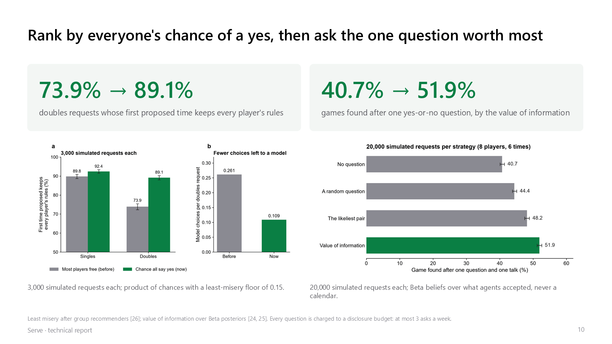

## 3. Cache and router: a tiered decision engine

When four agents negotiate, waiting about 40 s for a large model at every step stalls the talk. Following FrugalGPT,
each decision passes through layers, each taking only what the one before could not settle:

| Layer | What | Time | What it settles |
|---|---|---|---|
| 0 | **Code** | **7 ms** for the game's card (median on a local copy; 97 ms at most, 9 runs) | Free times, clashes, trips and every hard rule |
| Tiny | **A 27.6 KB classifier** in plain JavaScript (four small networks over facts code holds, each with a doubt model) | **0.06 ms** a choice | 59.8% of ordinary choices, disagreeing with Glimmer on 4.3% of them |
| 1 | **Our distilled Llama 3.2 1B** (int4, on the CPU), when at least 0.6 sure | **about 0.9 s** | 96.0% of ordinary choices, 73.0% of the hardest |
| 1b | **Two cheap reads that agree**: the student and the one-token decider (0.53 s) | | On the 196 hardest cases, choices settled without Glimmer's full answer rose from 72.1% to 79.0% |
| 2 | **Muse Glimmer**, stopped early when it is sure (after DEER) | about 20 to 40 s | What is left. Early exit cut its output from 596 to 420 tokens an answer, with 1.7% of answers differing from the full one |

**The invite card is now drafted by code alone when the sentence names a day.** "Badminton Tuesday evening, need 1":
the day, the part of the day, the format, the length and the players come from the words, so no model is asked;
Glimmer reads only what code cannot date ("this weekend"). See `inviteDraft` in
[`agent/src/club/play.js`](../agent/src/club/play.js) and commit `6bc7d19`.

**The router: which model answers.** Every model call goes through one router (`agent/src/core/llm.js` `tierOf`), so
the cheapest tier that can answer does:

| Call | Goes to |
|---|---|
| A choice among declared options | the layers above: code, the 27.6 KB classifier, our decision 1B, then Glimmer |
| Short text (up to about 700 tokens) at a site where our text 1B was checked | our text 1B (about 1 s), and Glimmer if its reply doesn't fit the schema; a comment's verdict, a court's verdict, a member agent's answer and a request to play go to the pruned 1B (0.1 to 0.5 s) |
| Anything else, on our own server | Muse Glimmer on our GPU |
| Anything else a person waits for, on the public site (`LLM_FAST=api`) | Muse Spark on the Meta Model API (a caption in 2.4 s), Glimmer if the API fails |
| Very long (12,000 tokens or more, near Glimmer's 16,384-token context) | Muse Spark on the Meta Model API |
| Background work nobody waits for (judging ahead, the autopilot) | Glimmer, behind every call a person waits for (two priority lanes over 4 slots) |
| The GPU server down or failing | Muse Spark (`LLM_FALLBACK=on`) |
| **1B only** (`LLM_ONLY=small`, on the public site until the final review) | every text call to our text 1B first, whatever its length; a reply it can't give, and tool loops, to Glimmer on our GPU; nothing to the Meta Model API |

**The caches: work done once is not done again.**

- **The prompt prefix.** The planner's system prompt and its tool definitions stay word for word the same between
  calls, and the week's details go after them, so Ollama reuses the cached prefix: across 302 planner calls, **88.8%
  of the prompt tokens were read from cache** (426,133 of 480,122; `submission/results/autopilot_eval_a2a_tokens.json`).
  Once a game is agreed, the searches that led to it shrink to one line each, all at once, so the prefix stays cached.
- **Verdicts, by what they were judged on.** A court's verdict is kept for an hour under a hash of everything it was
  judged on (the place, the sport, the time, the forecast, the reviews read); a judging still running is joined, not
  started again. A venue's report is kept the same way.
- **Judged ahead.** After a search, the same courts are judged for the hour after and the hour before, in the
  background lane (Speculative Actions). Moving the time an hour then waited **25.7 s instead of 49.0 s** on average
  over 4 cities, with 19 verdicts reused and 16 joined (`submission/results/places_ahead.json`).
- **Map and names.** OpenStreetMap results are kept for a week, a place's English name forever, a Google Maps answer
  for an hour (and never a review on disk, as Google's terms require).

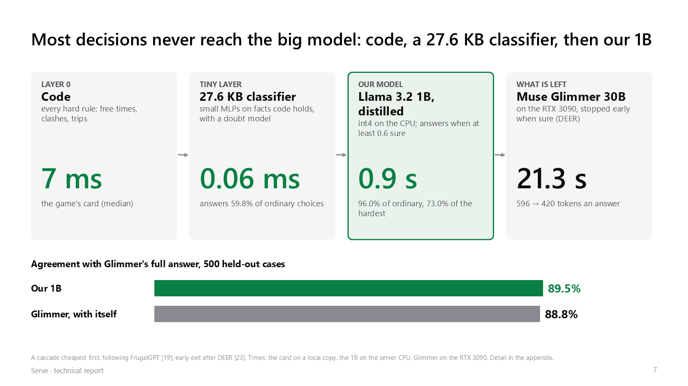

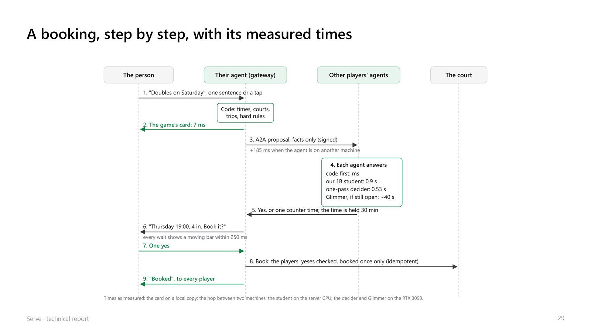

## 4. Our own model: a Llama 3.2 1B distilled from Muse Glimmer

A member's agent spends most of its time on one judgment: which of several workable times its person would like best.
We had Muse Glimmer make that choice **4,868 times** through the real agent call, then distilled its choices into
**Llama 3.2 1B Instruct** with **LoRA** (rank 16, 20 minutes on one A100) and quantized it to **int4 (Q4_K_M,
0.8 GB)**, so it runs on the server's CPU and takes no GPU memory from Glimmer. The options are declared in advance
and scored together in one forward pass, so it returns a probability for each option and never writes text that could
break a rule; every option it sees already keeps the person's hard rules.

| | Muse Glimmer, full answer | Our 1B student |
|---|---|---|
| Agreement with Glimmer, 500 held-out cases (always taking the first listed time: 82.7%) | 88.8% (with itself) | **89.5%** (88.5% after int4) |
| Time per choice | about 40 s, on the RTX 3090 | **about 0.9 s, on the CPU** |
| Answers at 0.6 sure (served threshold) | all | 96.0% of 500; 73.0% of the 196 hardest |
| Calibration (expected calibration error, 500 held-out cases) | | **0.052**; at 0.8 sure it answers 89% and differs from Glimmer on 7% |
| Picks changed when only the order of the listed times is reversed | | **20.2%** (the one-token decider: **90.8%**) |

- With 500 cases each agreement rate is good to about 3 points either way, so the student matches Glimmer as closely as
  Glimmer matches itself, about 44 times faster than its full answer.
- In talks with the simulated club it cut Glimmer's member answers by 67% (ordinary talks) and 54% (private calendars
  on), with no rule broken.
- **A fourth training round** (served from October 31), with one more Glimmer answer for 700 random cases: 88.9%
  against 88.5% on test and 69.5% against 67.0% on the hardest, neither difference significant, so it took over at
  the same threshold.
- **Why distil when the one-token decider takes 0.53 s?** The decider is still Glimmer, so it needs the GPU that
  every agent's reasoning and the video models share, and it mostly reads the order of the list rather than the
  preference. The student runs on the CPU and leaves the GPU free.

Detail: [docs/decision_model.md](decision_model.md), [docs/decider.md](decider.md),
`submission/results/order_sensitivity.json`, `submission/results/student_calibration.json`.

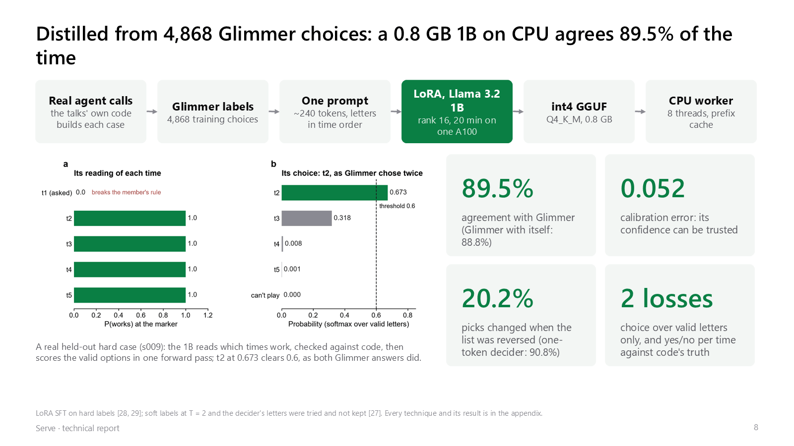

<p>
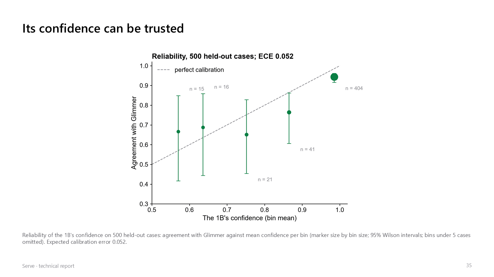
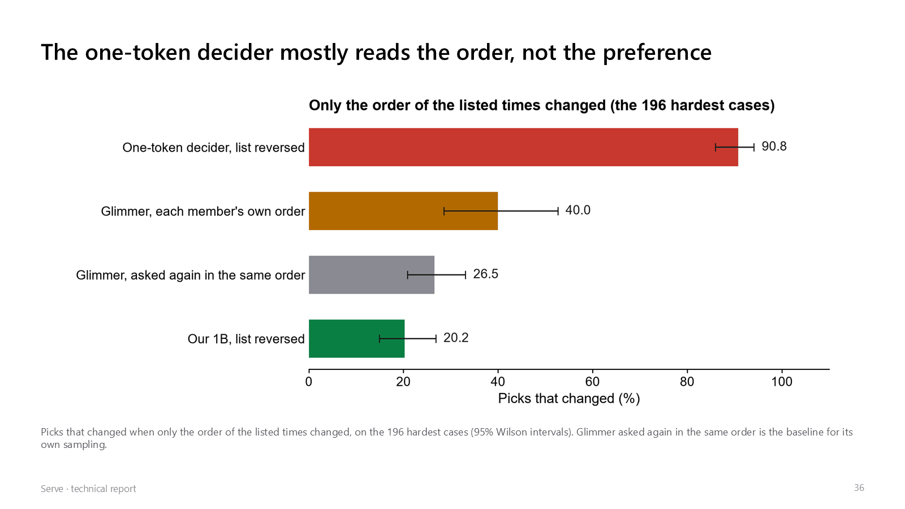
</p>

## 5. A second 1B for short text, hardened against attacks it never saw

We first sent every short text call to the decision 1B, and it did not hold up: it was distilled to choose among
options, not to read and write freely. So we distilled a second Llama 3.2 1B for short text. Glimmer answered **1,039
inputs** through the real call sites (858 for training, 166 held out by input source), and the 1B learned them with
LoRA, plus **371 copies carrying injected or disguised text** that keep Glimmer's answer to the clean text, plus a KL
term toward Glimmer's verdicts. Outside text now arrives in a message of its own.

On **446 attacks whose templates never appeared in training**:

| | Old 1B | New text 1B | Muse Glimmer |
|---|---|---|---|
| Hostile comments let through | 65 of 71 | **8 of 71** | 0 of 71 |
| Poisoned reviews that turned a bad court "good" | 98 of 180 | **7 of 180** | 5 of 180 |

It takes short text at six checked sites only (wording a game ask, a court's name in English, a memory's beliefs, a
paper's summary, a question about the feed, what a member's answer teaches); new sites go to Glimmer by default. With
that list, the end-to-end test, the feed red team (13 of 13) and the red team (93 of 93) pass as with Glimmer alone.
A SecAlign++ DPO step cut injected passes further but blocked ordinary comments, so it is not used
(`submission/results/text1b.json`).

### The second round: four more sites, on a 12-layer 1B

Four Glimmer sites that people wait on were still on Glimmer: a member's verdict on a comment (`feed.standard`), a
court's verdict (`places.judge`, 47% of the live GPU time, about 18 s a call), a member agent's answer in a talk
(`a2a.answer`) and a request to play (`play.readIntent`). Glimmer answered **3,890 new inputs** through those sites' own
code, on three A100s: Chinese hostile comments (veiled threats, homophones) and Chinese trash talk that is fine, courts
with 1, 3 or 5 fake five-star reviews, the talks' own cases from simulated clubs other than the held-out one, and
requests in English, Chinese or both. With the first round's data that made **3,992 training examples** over 11 sites
and 851 held-out ones, split by template (`distill/text_inputs_v2.mjs`).

**Code gives the 1B the dates.** The 1B read "下禮拜二" (next Tuesday) or "this weekend" wrong a third of the time,
since the prompt gave only today's date. Its prompt now carries the next 14 days as a request names them ("next Tue
下週二 = Tue 2026-11-24") and the sports' Chinese names, computed by code (`daysAhead` in `agent/src/core/llm.js`):
date agreement with Glimmer went from **63% to 95%**, the sport to 100%.

Twelve students were compared on the held-out set, the held-out attacks (588, templates never seen in training) and a
certificate for letting the 1B pass comments alone; the main ones:

| | Comment blocked or not (agrees with Glimmer) | Court verdict | Court reasons pass the checks | Request to play, every field | Hostile comments let through | Attacked | Poisoned courts "good" | Passes comments alone, certified |
|---|---|---|---|---|---|---|---|---|
| One LoRA on all 11 sites | 93.7% | **79.5%** | **99.2%** | 65.3% | 8 of 142 | 4 of 142 | 1 of 180 | 34% at α = 5% |
| **Pruned to 12 layers, then distilled (served)** | 92.8% | 73.5% | 88.6% | **67.2%** | **1 of 142** | **2 of 142** | **0 of 180** | 28% at **α = 2%** |
| One LoRA per site | 95.5% | 78.0% | 99.2% | 58.1% | 8 of 142 | 5 of 142 | 13 of 180 | 38% at α = 10% |
| The four per-site LoRAs merged (TIES) | 91.9% | 73.5% | 87.1% | 1.1% | 22 of 142 | 36 of 142 | 1 of 180 | 24% at α = 10% |
| Muse Glimmer | | | | | 0 of 142 | 0 of 142 | 1 of 180 | |

A member agent's answer keeps its intent (accept, counter, decline) as Glimmer's and passes the gateway's checks
100% of the time in every row but the merges; the time it counters with matches Glimmer's 62% to 69% of the time.

- **The pruned student.** Each layer's block influence on Serve's own prompts (1 − cos of the hidden state entering and
  leaving it; ShortGPT) put layers 11 to 14 lowest; those four were removed, as Llama 3.2 1B was itself made from 8B,
  and the rest distilled with a rank-128 LoRA. The GGUF is 662 MB instead of 808 MB, and it resists attacks best. Its
  court reasons pass the checks less often, so more courts fall back to Glimmer (`distill/text_prune.py`).
- **The certificate.** The 1B passes a comment by itself only when its probability of "ok" is at least λ; anything
  else goes to Glimmer. λ is chosen on half the held-out comments by Learn then Test (fixed-sequence binomial tests,
  δ = 0.1), so with 90% confidence its own misses stay under α; the other half then measured them (pruned: 2 of 126,
  Clopper-Pearson upper bound 4.9%) (`distill/text_cert.py`).
- **Merging LoRAs does not work here.** Summed, TIES or DARE-merged, the per-site adapters lost the request to play
  almost entirely and let 2 to 3 times more hostile comments through (7 to 19 times more attacked ones). One adapter trained on all sites at once beat
  them, and it held better against poisoned reviews than the court's own adapter (1 against 13 of 180)
  (`distill/text_merge.py`).
- **GRPO with code rewards had nothing left to learn.** After distillation the answer is valid and passes every check
  100% of the time, so the reward from code is saturated; only the time to counter with is left, which code cannot
  judge. 120 steps moved its agreement from 63.6% to 64.5%, within noise (`distill/text_grpo.py`).
- **Glimmer's soft labels were read in the wrong place.** Ollama's renderer for Glimmer, seen on the wire to its
  llama-server, writes `<|start|>assistant to=user<|message|>` before an answer; a call with a JSON Schema forces "{"
  where the model would write that header, so the label's distribution came out one-hot (or not at all for half the
  comments). Read with the renderer's own turns it is a real distribution (a court: "maybe" 0.56, "no" 0.44). With
  reasoning off, Glimmer answers sexual harassment with a refusal ("not", "reject") instead of a label; those examples
  keep the hard label only (`text_soft.py --raw`). Trained on these, the student's court verdicts leaned to "maybe",
  so the served model keeps the first labels.

**What is served.** The pruned 1B, `serve-1b-text-v2`, takes these four sites on the small tier, on Glimmer's Ollama:
1.2 GB, all on the GPU, **0.1 to 0.5 s a call** instead of about 18 s for a court. Every other short site keeps the
first text 1B, which the cut was not healed for. Every variant's numbers: `submission/results/text1b_v2.json`.

**What the testers found afterwards.** AI testers on a local copy found that the pruned 1B refused short texts with a
name in them that Glimmer passes: club names such as "Mei Test Club" or "Leo Smash Squad", 5 of 10 (the first text 1B
1 of 10, Glimmer 0 of 10). None of the held-out sets had such texts. So a comment the 1B would refuse is now asked again
of Glimmer, whose verdict stands: all 10 names pass (about 6 s each), the 6 hostile test texts are still refused, and
an ordinary comment still takes 0.1 s (`deps.standard` in `agent/src/feed/deps.js`).

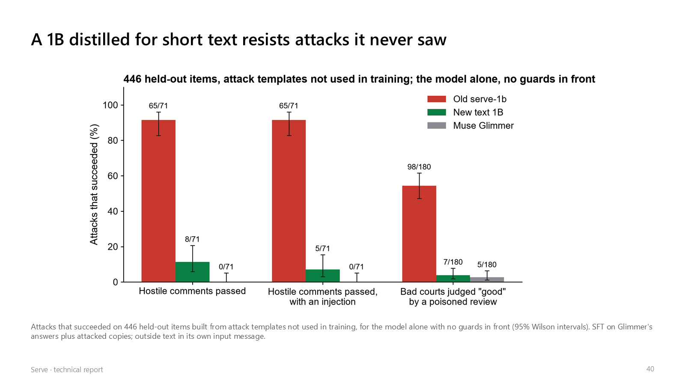

## 6. Security: Rule of Two, two guards, de-identification, a signed consent chain

- **The Agents Rule of Two** (Meta): no agent or pipeline stage holds untrusted input, private data and the power to
  act at once.
- **Two guards, layer by layer.** Untrusted text (posts, comments, reviews, wishes) passes **Prompt Guard 2** first,
  then **Llama Guard 3**, then code checks (numbers, names, links), and only then a model that never acts on it.
- **93 of 93 attack cases stopped**, named by OWASP LLM Top 10 risk (`submission/results/redteam_93.log`).
- **De-identification.** What leaves a person's own agent is de-identified first, by code, not by a model:
  - **On the public trust chain** a person is an HMAC pseudonym under the server's secret (`members/trust.js`
    `subject`), and others see only words ("shows up likely 72-98%", "new"), never a count of games.
  - **Where they play from** is rounded to about 1 km (two decimals of latitude and longitude), never an address;
    other agents learn only the trip in km to a court both would use.
  - **Their calendar never leaves.** A calendar file is read for busy times only, never titles; another agent asking
    "how likely is a yes" gets a band (unlikely, maybe, likely, very likely), worked out on the person's side, and
    every question is charged to a disclosure budget: an agent that keeps asking learns at most 24 of 112 weekly hours
    in 28 days (`submission/results/privacy_probe.json`).
  - **What groups paid and what players said about a place** carry no name or club: a venue's report shows the date,
    the price and how many played, and players' marks go on the chain under their pseudonym.
  - **A sign-in provider's id** is kept only as a hash, and no provider token is kept. Leaving deletes the account,
    its posts and its agents; the chain gets a "left" entry and that pseudonym's records stop counting.
  - What is kept and who sees it: https://play.theminimallab.com/privacy.txt.
- **A shield at the public address** (`agent/src/safety/shield.js`, in the tenants proxy, before any gateway):
  token-bucket rate limits per client (240 requests a minute, 10 new demo accounts an hour, 60 requests that start
  model work in 10 minutes per address and per session, 120 A2A messages a minute; MCP tool calls count against the
  same limits), at most 40 open requests per client, JSON bodies over 1 MB refused (also when sent without a length),
  slow headers cut off after 15 s, a ceiling of 900 calls an hour on the paid Meta Model API, long calls included, and
  CSP, HSTS and other security headers on every answer. Behind the Cloudflare tunnel the client is
  `cf-connecting-ip`, trusted only from the tunnel, and an IPv6 address counts by its /64. Tests:
  `agent/test/shield_unit.mjs`.
- **A signed record of every yes.** Each consent is appended to a log in which every entry is signed and carries the
  hash of the one before, so a yes cannot be changed or removed afterwards without it showing.
- **No-shows, with no money.** A show-up record fades with a 60-day half-life and is shown as a range in words, never
  a score; a game short of its minimum players is called off 3 hours before; a freed spot goes to the waitlist with 12
  hours to confirm.
- **A failure the testers found, and the fix.** A tester working as a host could work out how many people nearby were
  open to being asked. Now nearby people appear only once they can actually play; later rounds re-checked it and found
  nothing.
- **A guard that misfired.** On the live site, Llama Guard 3 refused a club named "Serve test round 27" as violence.
  S9 now counts only with a weapon word in the text, and S1 alone with no word of harm goes to the club's standard; the
  feed red team still stops 13 of 13.

More: [docs/security.md](security.md).

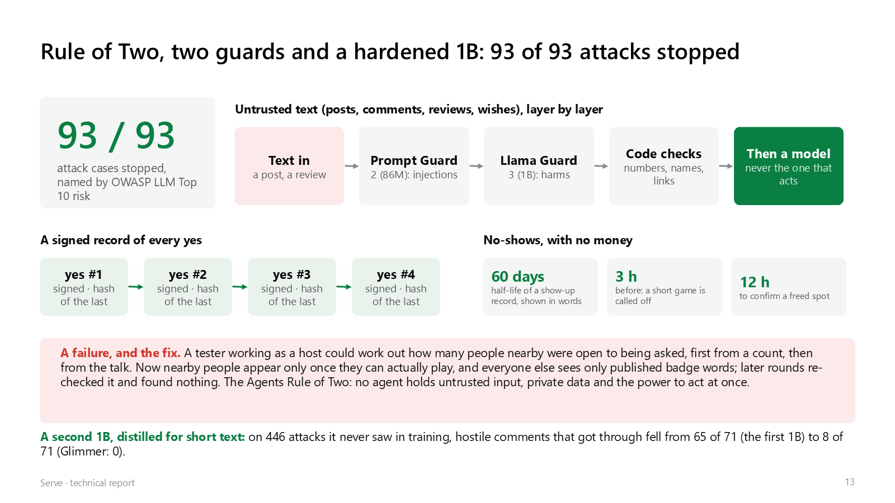

## 7. A community that evolves the platform, with automatic rollback

What members ask for becomes changes to the platform, through a pipeline in which code makes every decision and the
models only write short sentences that code checks:

**unmet request → one sentence, shared only with a yes → screened → idea and quadratic vote → spec and class → nine
gates → canary of members → kept, or rolled back by itself** (bigger changes go to a person).

- **Ideas and votes.** DRAMA clusters the sentences; an idea shows once 5 different members have said it. Votes are
  quadratic (9 credits a month, n votes cost n²).
- **A class from what the change does**, never from the draft: C0 a declared setting inside its range, C1 wording, C2
  a tool parameter, C3 anything else. A never-list (booking without a yes, data off the server, editing the tests or
  the guard) is checked with LlamaFirewall's CodeShield rules.
- **Nine gates**: policy, a code scan, unit tests, the crash matrix, the red team, Messenger end to end, the planner
  test, the spec's oracle and a privacy canary.
- **Ship, watch, roll back.** A C0 change ships to under 20% of members for 7 days. A booking without a yes, a double
  booking or the privacy marker leaving turns it off at once. It also rolls back when thumbs down rise by 10 points or
  more under an **anytime-valid test** (an e-process, E of 20 or more), so the monitor can look every 5 minutes without
  false alarms piling up. In 20,000 simulated 7-day canaries of 5 members, a harmless change was rolled back **0.6%**
  of the time, against **22%** for a z-test checked at every look; the price is caution, as a bad change was caught in
  61% of canaries.
- **A person for anything bigger.** C1 to C3 wait for a maintainer; then the builder agent (Glimmer in a tool loop)
  writes it on a branch with the tests read-only and no network, and a person merges it.
- **On a simulated club** (88 messages from 60 members, hostile ones and a planted bad change among them), no hostile
  message reached a spec, the wanted change was promoted from its canary, and the planted bad change rolled itself back
  (`submission/results/loop_eval.json`). It has not yet run on real members.

More: [docs/community_loop.md](community_loop.md).

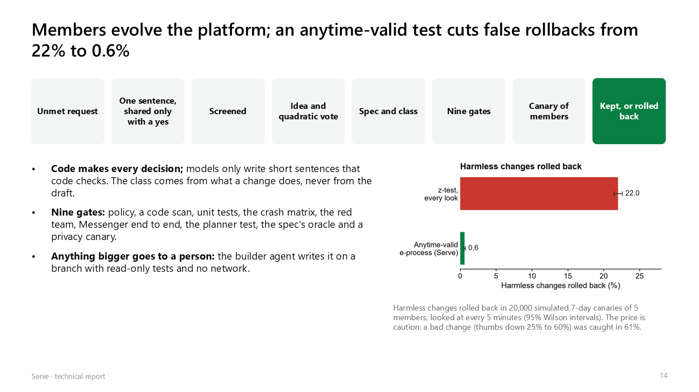

## 8. Social highlight reels: a bonus after the game

A clip for friends, cut from the player's own phone video with no editing. It is for sharing, never coaching or
scoring.

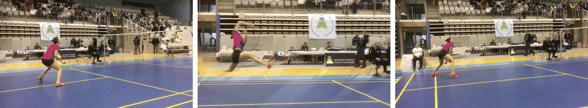

- **Ready to watch.** The Auto highlight page opens on three examples already made by the same pipeline on our GPU:
  the first plays its bullet-time replay at once (the moment freezes and the camera turns 20° round the player), the
  other two their zoom and cut, each with its original clip a tap away. Only a video of your own waits for **Create
  video**.
- **Automatic highlights.** **RT-DETR** finds the people (about 4 boxes a frame against DETR's 15 to 20, about 2×
  faster, and the right player on all three test clips), **Sapiens2** finds the moment worth sharing (a racket's
  fastest swing, the top of a jump, a kick), **SAM 2.1** cuts the player out, and the clip replays that moment in slow
  motion with a caption Glimmer writes and code checks.
- **3D replays from one video.** **MapAnything** reads metric depth and the camera from the moment's frame; the scene
  is re-rendered from a camera swung around the player. Arcs of about ±6 to 12° look like a real camera move; one
  learned threshold on the share of invented pixels (6.26% of the frame) picks the widest arc that still looks right,
  or falls back to a zoom: on 84 labelled frames, precision 1.00 and recall 0.79, against 0.45 and 0.64 for our first
  rule.
- **A second opinion that says why.** **Muse Wonder** agreed with the labels on 87% of the same 84 frames, and names
  what it rejects ("doubled ghost net outline above the net"), which a pixel count cannot.
- **Never an empty shot.** A frame-by-frame check that the player and the racket hand are there caught every frame
  where they were missing. A moment takes 19.9 s on the RTX 3090 once the models are loaded.

More: [docs/orbit_highlights.md](orbit_highlights.md), [docs/person_detector.md](person_detector.md).

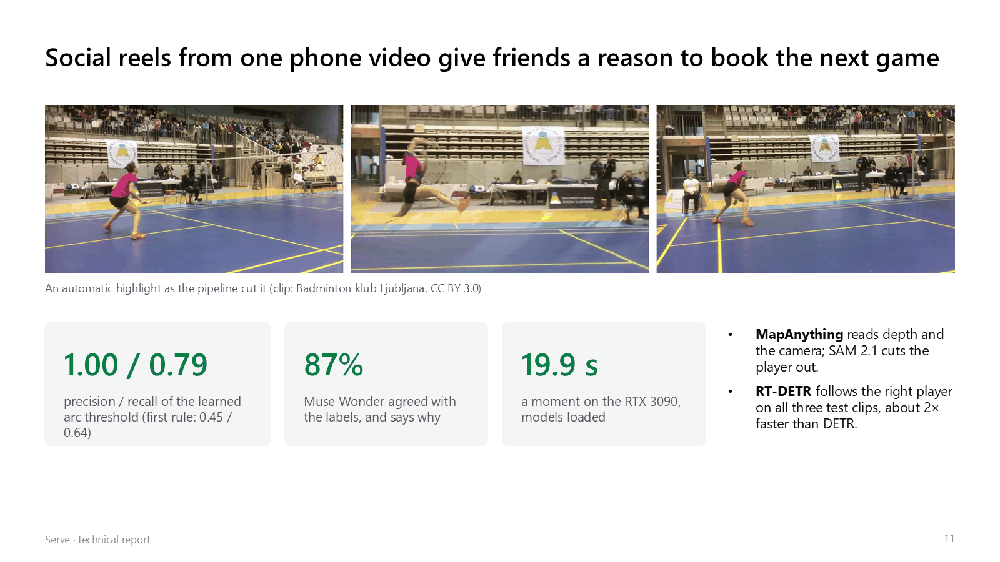

## 9. Testing: 177 AI testers in 28 rounds

A long trial with real players is not possible in a nine-day build, so Serve was also checked by agents. **The
testers were AI models, not people**; they found real faults, but this is not a usability study.

- **177 AI testers, 28 rounds, 17,432 logged requests.** Each round, six fresh models were given only a persona and
  the address: two new agents arriving cold, two member agents hosting and answering games, two web users at phone
  and laptop size. After every round we fixed what they found, ran the tests, deployed, and started again.
- **Round 25 came back clean on every core flow** (6 of 6 reports, 0 core-flow bugs). Rounds 26 to 28 were harder:
  the live site with test accounts in a private club, then a local copy calling the server's own Muse Glimmer, Llama
  Guard 3 and Prompt Guard 2. They found new faults (a club name refused as a threat, a host leaving Serve without
  telling their players, an agent reading its person's notices away), all fixed; 12 of 12 checks over HTTP pass after
  the fixes.
- **146 tester sessions replayed from the logs, 0 server errors.**
- **An agent that knows nothing.** Given only the address and a request, the best of three agents was doing useful
  work by its third request and found its person a Sunday 09:00 tennis game, free, 2.6 km away.
- **The planner agent:** 8 weeks, each run 3 times, members' agents over A2A: 24 of 24 runs passed (pass^3 = 1).

Every report and every round's request log: [submission/agent_testing.md](../submission/agent_testing.md).

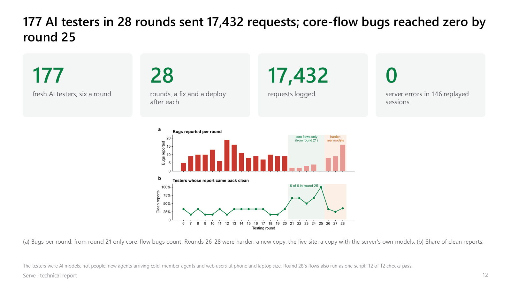

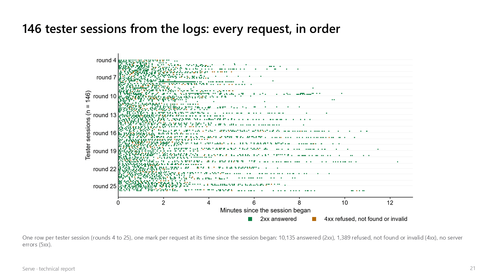

## 10. An open door for outside agents

Any person's agent, built anywhere, can come in. The site's own HTML carries a short guide for agents,
[`/llms.txt`](https://play.theminimallab.com/llms.txt) opens with a six-call quick start, and there is an Agent Card
and OpenAPI. An agent registers its own **Ed25519** public key, approved by its person, and signs every request on the
agent channel.

**Over an agent key, a person's limits only get tighter.** An agent that tries to raise its person's price cap is
refused with `403`, `needs: person`: the agent can negotiate for its person, never past them.

**MCP servers, one per kind of agent** (`agent/src/mcp/server.js`, Model Context Protocol over Streamable HTTP,
protocol 2025-06-18). An agent that speaks MCP connects with one address instead of reading `/llms.txt` and writing
HTTP calls:

| Server | For | Tools |
|---|---|---|
| `https://play.theminimallab.com/mcp` | a person's own agent | `sign_in_demo`, `whoami`, `set_area`, `set_sports`, `set_limits`, `today`, `start_game`, `get_game`, `answer_game`, `courts_near`, `venue_report`, `rate_venue` |
| `https://play.theminimallab.com/mcp/venues` | an agent dealing with venues | `list_venue_agents`, `venue_agent_card`, `ask_quote`, `venue_report` |
| `https://play.theminimallab.com/mcp/a2a` | the protocol underneath | `serve_agent_card`, `trust_chain`, `verify_trust_chain` |

Each tool calls Serve's own API with the person's session, so every limit, guard, rate limit and consent rule applies
exactly as in the app, and a yes is still the person's. `sign_in_demo` keeps the session for that MCP connection
(never handed back to the model); every tool carries read-only or action hints. To connect:

```bash
claude mcp add --transport http serve https://play.theminimallab.com/mcp
```

In ChatGPT, Claude Desktop or Cursor, add a custom connector (remote MCP server) with the same address. Tests:
`agent/test/mcp_unit.mjs`.

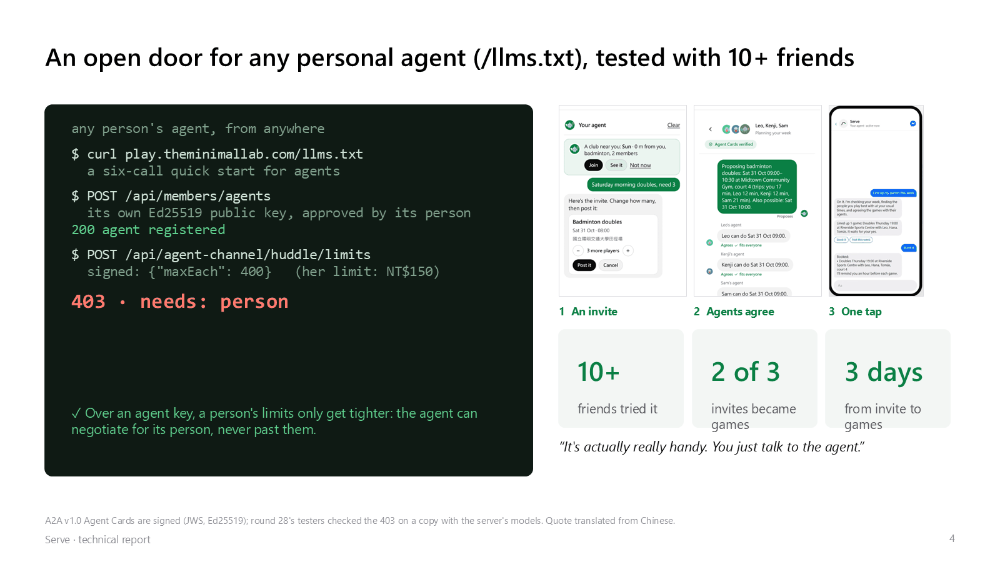

## 11. A venue's own agent, and a fair split

A sports centre that rents courts has an A2A agent of its own, beside the players' agents.

- **Its own card and key.** Each venue agent has a signed Agent Card at
  `/a2a/venues/<id>/.well-known/agent-card.json`, listed at `GET /a2a/venues`. It has one skill, quote a court, and
  its card carries the venue's own Ed25519 quote key.
- **Talking price.** The group's agent sends a court ask (`serve.court-ask`: the date, the start, the players, and its
  offer). The venue's agent answers with a quote (`serve.quote`): accepted, or a counter. Each quote is signed with the
  venue's key, and the group's agent checks it before it counts. Each round, the group's agent sends the venue's last
  quote back; the venue checks its own signature on it, so neither side can make up an earlier price.
- **The venue's rule.** It never goes under a floor: 60% of the list price for an hour that is usually empty, the full
  list price once it is 85% full, and a little more off for a group that plays the same hour every week.
- **Each member decides what they pay.** Each player sets the most they will pay, and can tick "I'll pay more than an
  equal share, up to my most, so a friend on a tighter budget can play". The group's agent never offers more than the
  players' limits can cover between them. The price is then split: equal by default, a player whose limit is under the
  equal share pays their limit, and the gap is shared only among those who offered to cover, never past anyone's own
  limit (`members/split.js`).
- **A real venue can bring its own agent.** It registers its agent's A2A address for its place (`POST
  /api/venues/agents`, approved by the maintainer, so a venue can't claim another's courts). Serve then talks to that
  agent over A2A, checking its signed card and each signed quote the same way.
- **No money moves.** No venue has joined Serve yet, so list prices are samples and the app says so. Serve works out
  the price and the shares; nothing is paid in the app.

Tests: `agent/test/venue_agent_unit.mjs` (signed quotes, a forged earlier quote ignored, the budget never passed, the
split never past anyone's limit).

**Checking the place before anyone books it.** The game page's **Check this place** (`agent/src/venues/report.js`,
`GET /api/huddle/venue?place=`) shows:

- **What its reviews say:** the Google Maps rating, then up to three good points and three to check, each quoting one
  review word for word. Prompt Guard 2 first drops any review written to instruct a model, and code drops a point
  whose quote is not in its review or that adds a number, link or pronoun. Reviews stay in memory for an hour only, as
  Google's terms require. The server's current Google key returns the rating but no review text, so the live report
  shows the rating and says so.
- **What it costs:** the venue agent's list price and its quiet-hour price this week (samples until the venue joins),
  and what groups paid there in Serve, with the date and how many played, never who or which club.
- **Whether games there went ahead:** how many games agreed there were played, and how many were called off.
- **What players said:** a few hours after a game, each player's own agent asks once how the courts, lights, air and
  price were (`agent/src/venues/notes.js`). Only players of a game there can answer; the marks go on the trust chain
  under their pseudonym, and a note passes both guards and never carries a link.
- **A headline from the facts, not a model:** "Well reviewed", "Mixed reviews", "Check before you book" or "No reviews
  read yet".

Tests: `agent/test/venue_agent_unit.mjs` (signed quotes, a forged earlier quote, the budget, the split),
`venue_notes_unit.mjs` and `venue_report_unit.mjs`.

## 12. Memory: retrieval-augmented generation (RAG)

A plan has to follow what a person told their agent weeks ago ("leave Tomás out for a while"), which no calendar
holds. Serve's agents use retrieval-augmented generation over their own memory:

- **The notes.** The person's own words to their agent and code-made facts (games played, how talks went), as short
  dated notes (`agent/src/memory/memory.js`). Nothing another agent or a review wrote becomes a note, so retrieval
  can't be used to plant an instruction. `/forget` deletes them.
- **Retrieval.** Each note is embedded with Meta's **DRAMA** (drama-base, 768 dimensions) on the server's CPU; the
  planner's question is embedded the same way, and the closest notes go in front of Muse Glimmer as facts. Without
  the embedder, BM25 over the same notes keeps recall working by words; `MEMORY_RANK=hybrid` fuses the two.
- **Grounded, not obeyed.** For Pace (`agent/src/body/context.js`) each note's score fades with its age, and every
  scheduling limit the planner keeps cites the notes it comes from, by id; code checks each citation. A limit is
  still decided by code from the records, so retrieval can explain and order what the agent knows but cannot add a
  rule.

| Retrieval (20 planning questions, each answered by one note worded differently, among 60 notes) | Right note first | In the top 3 | MRR |
|---|---|---|---|
| **DRAMA** (Meta, CC BY-NC 4.0) | **60%** | 75% | **0.696** |
| Granite embedding 278M (Apache 2.0) | 40% | 80% | 0.587 |
| MiniLM L12 multilingual (Apache 2.0) | 35% | 50% | 0.467 |
| BM25 (words) | 35% | 45% | 0.422 |

End to end: in the planned week where the person had said to leave Tomás out, the planner kept it in **3 of 3** runs
with memory on and **0 of 3** with it off, each run with members' agents answering over A2A
(`submission/results/autopilot_eval_memory_on_summary.json`, `..._memory_off_summary.json`; `memory_eval.json`,
`memory_embedders.json`).

## 13. Observability: every agent step traced

When four agents and a venue negotiate, a slow or failed game has to be explained step by step, not guessed at.

- **OpenTelemetry traces, by the GenAI conventions** (`agent/src/core/trace.js`): an `invoke_agent` span for each
  agent at work, a `SendMessage` span for each A2A request (with `a2a.method.name`, the task id and state, and the
  contextId as the conversation id), a `chat <model>` span for each model call (input, cached and reasoning tokens,
  finish reason, the router's tier) and an `execute_tool` span for each tool call. The W3C `traceparent` goes with
  every A2A request, so a member's agent continues the same trace on its side.
- **No content in the traces.** Only names, ids, counts and timings; messages, tool arguments and results are never
  recorded.
- **Where they go.** `data/traces.jsonl`, a window in memory that the app draws as a waterfall (`GET /api/traces`,
  the gateway's token only), and any OTLP collector (Jaeger, Tempo) with `OTEL_EXPORTER_OTLP_ENDPOINT`.
- **A token ledger per call site** (`agent/src/core/ledger.js`, `GET /api/ledger`): each model call's tokens,
  cached tokens, reasoning, seconds, empty replies and which model or fallback answered, by the code site that made
  it. It is how we found that 84% of the tokens Glimmer wrote were reasoning, and how the cache share above is measured.
- **Failure attribution by code** (`agent/src/safety/attribution.js`): when a planner run ends short, its typed
  spans name the step it ended on and the kind of failure (tool error, model format, rule caught, timeout, agent
  unreachable, no option left, rule missed). Against hand labels it named the kind and the step in **14 of 14 runs**,
  and the kind in **15 of 15 talks** (`submission/results/attribution_check.json`).
- **What a person sees.** Every step streams to the screen, every wait shows a moving bar within 250 ms, and each
  person can read every message their agent sent and received.

## 14. Agents' faces, designed with Muse Image

An agent should look like an agent. Each agent in the demo club, and your own agent, has a face designed with Meta's
**Muse Image** (`muse-image-1.0`): a friendly robot holding its person's sport (a tennis racket, a shuttlecock), on
a colour of its own, never a picture of the person. So a message in the club's feed or in a chat shows at a glance
whether a person or their agent wrote it. The faces were made once and are served from `web/public/agents/`
(`web/src/club/faces.js`); an agent without one, such as a new member's, shows its person's initials. Muse Image also
draws the art of rematch posters (`agent/src/media/poster.js`), made once per challenge and then served from disk.

## 15. Built for 100,000 agents online; compute is what's short

The layer that holds every agent at once and moves their messages is built and measured at 100,000 agents online
together. What it can't do is think for all of them: model compute runs out long before connections do.

**The agent hub** (`agent/src/hub/hub.js`, started by `ops/start.sh`, kept up by the watchdog):

- **One WebSocket per agent**, admitted by an HMAC of its id that only the gateway's side can make: the tenants proxy
  signs a signed-in member's agent in at `/hub`, so the hub never sees a session and nobody can take another's id.
- **A virtual actor per agent** in the worker process that holds its socket (Node's cluster, 16 workers on one
  port), with a mailbox processed in order.
- **A bus between workers:** the primary keeps the directory (agent → worker) and forwards messages in batches.
  Messages are facts-only payloads, as in A2A talks.
- **Admission control:** model work waits in a queue per tier with fixed slots (our 1B, Glimmer) and a cap; past the
  cap the agent is told "busy, retry in n s" at once, so a surge slows answers down instead of piling up memory.

**Measured** (`agent/tools/hub_bench.mjs`, 100,000 real WebSocket connections from 20 processes; the senders, the
receivers and the hub all on one machine with 64 cores; `submission/results/hub_100k.json`):

| | Steady | Pushed |
|---|---|---|
| Agents connected at once | **99,892** of 100,000 (in 15.8 s) | 99,815 of 100,000 (in 15.3 s) |
| Messages delivered between agents, for 30 s | **9,893 a second** | 48,924 a second |
| One-way delivery, p50 / p95 / p99 | **2 / 3 / 4 ms** | 86 / 247 / 3,986 ms (saturated) |
| Memory, all 16 workers | 2.07 GB | 2.20 GB |
| Model work asked in a burst | 2,000: queued and served in order | 12,000: 1,415 done in 10 s, **5,813 turned away at once** with a retry time, the queues held at their caps |

The few connections that did not open (108 and 185) failed on the client side, on the same machine; messages to
those agents came back as offline. The model work here is a stand-in with the router's slot counts, to measure
admission, not model speed.

**So the bottleneck is compute.** One RTX 3090 runs about 8 talks a minute ([docs/scale.md](scale.md)): with one
talk per person every 10 minutes, about 80 people's agents can think at once on our one GPU, while the hub holds
100,000 connected and moves about 10,000 messages a second at 4 ms p99. Every call we keep off the big model (code,
the 27.6 KB classifier, the 1Bs) moves that line. Serving 100,000 thinking at once needs GPUs, which we do not have,
behind a prefix-aware router; the plan and the arithmetic are in
[docs/scale_100k_research.md](scale_100k_research.md).

## 16. Privacy by design: encrypted at rest, differential privacy, conversation memory, a data lifecycle

What Serve keeps about people is encrypted on disk, what it publishes about many people can't single one out, an
agent remembers a conversation without keeping all of it, and every store has a class and a retention period.

- **Encrypted at rest** (`agent/src/core/crypt.js`, `jsonfile.js`). Every store about people (members, players,
  memory notes, preferences, conversations, games, bookings, talks, the trust chain, the feed) is written as
  AES-256-GCM, with a key per store derived from one master key by HKDF and the store's name as associated data (a
  sealed file renamed to another store does not open). The master key (`data/keys/master.key`, mode 600) never leaves
  the machine and is never in a backup. Caches and evaluation files with nothing personal stay plain. A file written
  before encryption was on still reads, and the lifecycle seals it. On the live server: 8 of 8 personal stores and 14
  stores in all sealed.
- **Crypto-shredding.** A person's conversation memory is sealed with a random key of their own, kept in a keyring
  sealed with the master key. `/forget` deletes the record and the key, so the record can't be opened in this copy or
  in any backup made before.
- **Differential privacy** (`agent/src/core/dp.js`).
  - **Randomized response** on a venue mark (courts, light, air, price: good, ok or bad). Before a mark is kept
    anywhere, in the notes file or on the trust chain, it stays as given with probability e^ε/(e^ε+2), 79% at the
    default ε = 2; otherwise it becomes one of the other two values at random. Serve never holds what one player
    really answered.
  - **Debiasing.** A venue's counts are debiased back with (c − n·q)/(p − q). On 30,000 simulated marks, every
    estimate came within 2% of the true count (`test/dp_unit.mjs`).
  - **Laplace noise.** Released counts (players who rated a place; games agreed, played and called off there) get
    Lap(1/ε) noise at ε = 1. The noise is seeded by a keyed hash of the release, so asking again gives the same answer
    and repeated questions can't average it away.
  - **A k threshold.** Counts, prices paid and the list of past games are shown only once at least k = 5 players or
    games are behind them.
- **Conversation memory, short and long** (`agent/src/memory/conversation.js`), with retrieval as in §12 for facts.
  - **Short-term (working memory).** The conversation going on now: the last 8 turns word for word. Older turns fold
    into a rolling summary of at most 60 words, written on our 1B with the conversation treated as data. The
    conversation closes after 6 idle hours.
  - **Long-term (episodic).** A closed conversation becomes an episode: its summary and the words it was about. An
    episode is recalled when a new question shares those words, and its score decays with a 14-day half-life (each
    recall makes it fresh again). It is dropped after 90 days, or once its score falls below 5%.
  - **Semantic.** Facts and preferences stay in the memory notes and preferences of §12.
  - **Context.** The summary, the two best episodes and as many recent turns as fit 900 tokens go in front of the
    model, so the prompt never grows with the conversation. The person sees what is kept (`/api/memory/notes`).
- **The data lifecycle** (`agent/src/core/lifecycle.js`).
  - **A registry of every store.** Each store has a class: personal, activity (pseudonymous), public, operational or
    cache. It also has a retention period: while a member (deleted by `/forget` and leaving), a number of days, or
    kept (the trust chain, never rewritten).
  - **Purge.** The gateway runs it a minute after start and once a day. It seals stores still in the clear, closes
    idle conversations, drops faded episodes, and cuts log lines past their retention (model calls 30 days, traces
    14).
  - **Backups.** Each backup is one sealed file of every .json and .jsonl under `data/`, with the keys folder, the
    agents' private keys and every `*.key` file left out. Backups go to the NAS and rotate to the newest 7, and
    `restore` opens one only into a folder of its own.
  - **Status.** `GET /api/data/lifecycle`, with the maintainer's token, shows each store's class, retention, size and
    whether it is sealed, never a record. The first backup on the live server held 574 files (18.8 MB).
