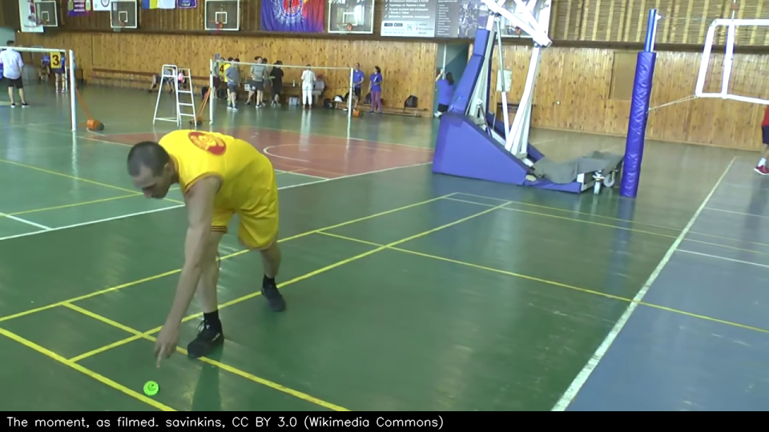
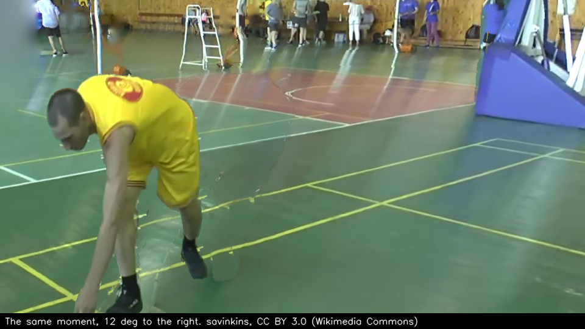
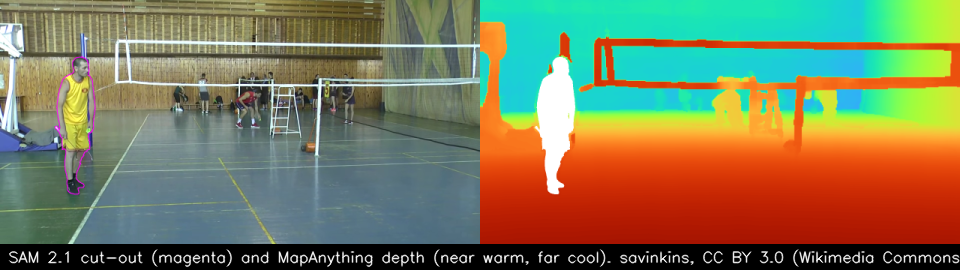
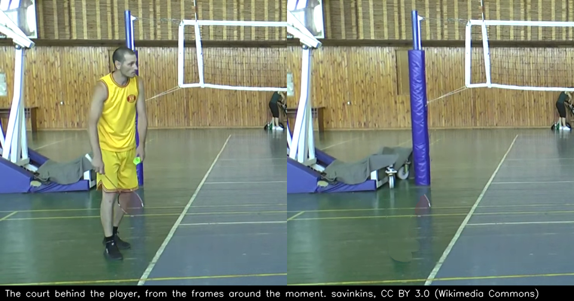

# Orbit replays

At your moment, time stops and the camera moves around you, then the rally plays on. It runs on
the GPU server (`video/pose/orbit.py`) and is in the app as an optional camera effect ("Add a camera effect" on
Highlights; `docs/web_features.md`). It runs after the highlight pipeline (`reel.py`) and
reuses its Sapiens2 keypoints and SAM 2.1 outlines.

**Verdict on phone footage.** A short frozen-time orbit works when the player is big in the frame, away from its
edge, and the background is mostly floor. In those cases ±6–12° looks like a camera move, and one close moment held
up to −18°. Wider arcs bend the thin things at middle distance (posts, the net, people behind it), and a player near
the frame's edge leaves no room to turn. On our 14 test moments the decision chose **4 orbits** (sweeps of 8° to 28°),
**6 zooms** and **4 holds** (the player not there). So the default should stay the zoom and cut, with the orbit as a
bonus when the decision allows it.





## How it works

1. **The moment and the cut.** The moment is the reel's (fastest overhead swing, top of the jump, the kick) or the
   fastest swing in its pose. The cut goes in where the hand is slowest before the moment and out 0.8 s after.
2. **Is the target there?** (`exists.py`, below). The effect's window is cut to where the player and the racket hand
   exist, or the effect is held and the clip plays plain.
3. **Depth and camera.** Meta's MapAnything reads metric depth and the intrinsics from the moment's frame. With
   `--views N`, it reads the court from N frames around the moment, in one metric frame with the camera poses. RANSAC
   finds the floor in that depth, which gives "up" and two scale checks: the camera's height and the player's height.
4. **The player, cut out.** SAM 2.1 cuts the player out again at full resolution from the reel's outline and four
   keypoints; its own IoU estimate is the mask's quality. Anything next to the player that differs from the empty
   court (the racket, the shuttle) goes with the player.
5. **The empty court behind the player.** It comes from the frames around the moment, aligned by homography (exact
   for a phone that pans). Samples that look like the player standing still are left out, so there are no ghost legs.
6. **Rendering.** The court and the player are point clouds, splatted on the GPU with a soft z-buffer. Holes are
   filled by push-pull from the far side, so a post leaves a blur of wall rather than a smear of post. The player gets
   a gentle bulge (8 cm), not MapAnything's own depth at their edge: that ramps into the background and tears into a
   comb when seen 20° round.
7. **The camera path.** Lead-in at full speed, then time stops: push in while swinging to one end of the arc, sweep
   to the other end (1.6 s), come back to the phone's own view (0.7 s), and play on. 30 fps, 1280×720.
8. **The decision** (below) picks the orbit centre, the zoom, the arc on each side and its direction. It refuses an
   orbit when the mask, the pose or the depth is unreliable, and then renders the zoom: slow motion into the moment,
   pushing in on the player, with a held frame.




## MapAnything, checked

| | |
|---|---|
| Paper | "MapAnything: Universal Feed-Forward Metric 3D Reconstruction", arXiv 2509.13414 (Meta and Carnegie Mellon, v1 16 Sep 2025, v3 23 Jan 2026, 3DV 2026) |
| Code | `facebookresearch/map-anything`, Apache 2.0 (we used v1.1.4, commit `3d10cf7`) |
| Weights | `facebook/map-anything-apache`: Apache 2.0, the one we use. `facebook/map-anything`: CC BY-NC 4.0. Older `-v1` pairs (2.25 GB). None are gated. |
| Size | 1.23 B parameters (we counted the checkpoint): DINOv2 ViT-G encoder 683 M, a 16-layer alternating-attention transformer 453 M, a DPT head 20 M, a pose head 6 M, and encoders for optional depth, rays, poses and scale. 4.91 GB in float32. |
| Takes | One or many images. Optionally intrinsics (or ray directions), depth, camera poses (OpenCV camera-to-world), and whether they are metric. |
| Returns, per view | Depth along z and along the ray, ray directions, intrinsics, camera pose, world and camera point maps, a confidence, a non-ambiguous mask, and one metric scale factor |
| Input size | 518 px on the long side: 518×294 for 16:9 |
| On our RTX 3090 (bf16 autocast) | Weights 4.91 GB. One view: 0.26 s, peak 7.5 GB. 8 views: 1.9 s, peak 10.0 GB. Loading took 95–104 s from the NAS with PyTorch's random init; from local disk with the init skipped, about 16 s (all three models: 25 s). |
| Moving players | The paper says "Our current scene parameterization does not capture dynamic motion or scene flow". Here the players come from the moment's frame alone. In the other views they are masked out (the reel's outlines), and court points that disagree with the moment's depth by more than 6% are dropped. |
| Metric scale, one view | Short on this clip: the player (often bent over) measured 1.19 m median (0.91–2.27 m) and the camera 0.85 m above the floor. With 7 views: 1.58 m (1.30–2.39 m) and 1.23 m. The orbit itself does not depend on scale (angles are scale-free), but the scale checks allow 0.9–2.8 m for that reason. |
| Thin things | Unreliable. The far net's top tape is one pixel thick at 518 px, and in one column MapAnything put it at 3.4 m, in the next at 8.0 m. Its post stood at a steady 4.0–4.4 m and the wall behind it at 11.5 m. Snapping edge pixels to the near side keeps a post from smearing, but it also takes the tape's nearest reading, so in a wide arc the tape swings more than the wall and doubles. |

## Three ways to orbit

| | What | Verdict here | Artifacts |
|---|---|---|---|
| **(a) A 3D photo of one frame** | MapAnything depth of the moment's frame, the player cut out by SAM 2.1, the court behind them from the neighbouring frames, a virtual arc, push-pull filling | **Works for short arcs.** It is the default. 4 orbits of 14 moments; about 20 s per moment once the models are loaded, 8.6 GB of GPU memory at most | Past the phone's frame edge the view turns onto nothing (blurred bands); posts and the net bend where the depth is soft across them; far people double or smear; the player is a gently rounded relief, so their back is never seen |
| **(b) The court from the pan** | MapAnything on 7 frames over 3.2 s: depth in one metric frame and the camera poses; the court from all of them, the player from the moment | **Works, no clear gain.** The same 14 decisions. The arc came at less zoom (1.31 against 1.56 on one moment, with a sweep of +6° to −12° against +4° to −10°), but on another the arc was narrower. The metric scale was more plausible. +0.5 s and +1.9 GB (10.5 GB) | As (a), plus seams where two views' depths disagree, a blurrier background (the other views' colours come at 518 px), and ghosts of people the reel doesn't track (the umpire). The phone turned 1–49° over the 7 views but moved only 0.02–0.41 m, so the extra views add field of view more than parallax behind things. The threshold was learned on (a) frames only |
| **(c) A 4D reconstruction of the window** | Gaussian splatting or a dynamic point cloud of 1–2 s | **Too heavy for a phone reel, and no better here** | Per-scene optimisation: Shape of Motion took about 2 h on an A100 for 300 frames and needs camera, depth, track and mask preprocessing. MonST3R needs about 23–33 GB for 65 frames. The feed-forward 4D models are non-commercial (4DGT) or need posed video (MoVieS). With one phone that mostly turns, the hidden side of the player was never filmed, so every method has to invent it anyway |

Meta models that could go further:
- **Sapiens2** has pointmap and normal heads in Transformers (`Sapiens2ForPointmapEstimation`, 0.4B–5B). They are
  human-only and focal-normalized, a better relief for the player than our bulge. Not tried.
- **SAM 3D Body** gives a full body mesh with a camera-space translation, so the player's back could be shown. It is
  gated (SAM License).
- **VGGT-1B** is another feed-forward reconstructor. The open checkpoint is CC BY-NC, and the commercial one is gated.
- **DINOv3** is gated, and its depth head exists only on the 7B backbone.
- **Perception Encoder** is Apache 2.0 and not gated. It is a possible zero-shot image judge, but untested here.


## The decision: what judges the orbit

The decisions, and what each rests on:

| Decision | How |
|---|---|
| The moment | The pose scores, as in the reel |
| Whether to orbit at all | Gates: the cut-out touches the frame's edge, SAM 2.1's IoU < 0.8, the mask in pieces, < 60% of joints seen, another player overlapping, the player < 18% of the frame's height, blur (Laplacian variance on the player against the frame < 0.25), the depth's scale off (player 0.9–2.8 m, camera 0.3–6 m), MapAnything's depth at the feet disagreeing with the floor by > 30%, MapAnything marking the player ambiguous, < 50% of the court behind the player ever seen |
| The orbit centre | The player's mask centroid at the depth of the floor under their feet (MapAnything's own depth when the two disagree by > 15%) |
| The zoom | From filling 55% of the frame's height up to the closest that keeps the whole player in frame (85%): the first that leaves 12° of turn either way with few invented patches, else the one with the most room |
| The arc on each side | The widest angle (2° steps) whose full-size frame invents no more than 6.26% of its pixels (holes plus court that was never seen), and that keeps 85% of the player's points and the hit point in view |
| The direction | The main sweep ends on the side the player faces when it has 10° of room, else on the side with more room |
| After rendering | Every frame is checked again; an orbit that fails is shortened once, then replaced by the zoom |

**The learned threshold.** We rendered every test moment at fixed angles (±6, ±12, ±18°), 84 frames, and labelled
each by eye: would a viewer notice a defect in a 2 s sweep on a phone? 14 were good (`video/pose/labels/orbit_labels.json`).
`orbit_fit.py` fits the threshold, leaving one moment out at a time (results in `submission/results/orbit/`):

| Judge | Precision | Recall | Accuracy |
|---|---|---|---|
| The first rule: invented patches under a budget at low resolution (`orbit_fit_first_rule.json`) | 0.45 | 0.64 | 0.81 |
| One threshold on the share of invented pixels at full size (learned: 6.26%) | **1.00** | 0.79 | 0.96 |
| A logistic model on that share, the share around the player, the angle × the scene's depth edges, and the angle | 0.85 | 0.79 | 0.94 |

The threshold is picked for precision first (a broken orbit costs more than a missed one). The sample is small: 14
moments from one clip, labelled by the coding agent, not a viewer study.

**A vision-language judge.** We planned Llama 3.2 11B Vision (4-bit, about 10 GB) as a final check of the rendered
frames. Hugging Face refused the download: the account is "not in the authorized list" for
`meta-llama/Llama-3.2-11B-Vision-Instruct` (2026-10-28). Either the request for that repository is still pending, or
the licence was accepted for another Llama repository.

Later (2026-10-29) two vision models judged the same 84 labelled frames with the labels' own question
(`video/pose/orbit_judge.py`, `submission/results/orbit/orbit_judge_*.json`): Muse Wonder on the Meta Model API reached
precision 0.80 and recall 0.29 for "good" (accuracy 0.87; it passed 5 frames, 1 of them broken), and Muse Glimmer on
an A100 called every frame broken (accuracy 0.83, recall 0). Both name real defects, both are stricter than the labels,
and neither beats the threshold above, which stays the judge.

## Does the target exist?

Coordinates are not enough. A player walks out of the frame or behind the net post, and the pose model still returns
points. `exists.py` gives every frame a yes or no for the player and for the points an effect aims at (the racket
hand, the pelvis the orbit turns about, the head):
- **The player.** SAM 2.1, used as a video tracker, follows the player from the best-read frame forwards and
  backwards. Its object-presence head (`object_score_logits`) says whether the player is there at all, and the mask's
  area against its usual area says whether they are mostly in view. The reel's own track (DETR) must have them too.
- **A point on the player.** Sapiens2's keypoint confidence, counted only if the point lies inside the frame and on
  the player's SAM mask; if it is off the mask, something is in front of it.
- **Hysteresis.** A 3-sample median, then on at 0.6 and off below 0.4, and a change must last 3 samples (0.12 s).
- **For the orbit.** Along the arc: the share of the player's 3D points that land in the virtual camera's view with
  nothing else in front (a z-buffer of everything but the player), and the hit point and centre inside the frame.
- **The shuttle** has no detector in the uploaded-video path (`reel.py`), so it has no signal and no effect aims at
  it.

We hand-labelled 170 frames of the four sub-clips (`video/pose/labels/exists_labels.json`, every 10th frame, ambiguous ones
left out) and checked them with `exists_eval.py` (`submission/results/orbit/exists_eval.json`):

| "The player is there" from | Precision | Recall | Absences caught |
|---|---|---|---|
| The reel's track (DETR box) | 0.97 | 0.88 | 30 of 34 |
| SAM 2.1 presence alone | 0.93 | 0.91 | 24 of 34 |
| SAM 2.1 presence × mask area | 0.99 | 0.91 | 33 of 34 |
| All three, with hysteresis (used) | **1.00** | 0.88 | **34 of 34** |
| The racket hand: keypoint confidence, on the mask, with hysteresis | 0.97 | 0.84 | 30 of 33 |

The misses are mostly one stretch of 2.2 s where the player came back after the phone panned away and the reel's
track did not pick them up again. SAM 2.1's tracker did (recall 0.91 without the reel's track). Hysteresis changed
no labelled answer at this spacing. It did halve the flicker: over the 35 s of the four sub-clips, the racket hand's
answer changed 25 times without it and 14 times with it. The player's answer changed 7 times either way.

**Effects that would have aimed at nothing.** We took each sub-clip's three fastest swings, 12 effects, as the reel
would pick them. Without the check, **4 of 12 would have aimed at a player or a hand that wasn't there** (the player
leaving the frame within the window; in one, the "fastest swing" was the player being panned out of the frame). With
the check, 6 play, 2 are cut to where the player is, and 4 are held. None aims at an absent target, though 2 of the
holds were not needed (a bent-over player whose mask shrank, and one start-of-clip window). Along the arcs, the view
check never shortened an orbit on this clip: the frame-edge threshold always bound first.

## Numbers

What the decision chose for each test moment (`submission/results/orbit/orbit_batch.json` has every plan and feature):

| Moment (sub-clip, s) | The player there? | (a) one view | (b) 7 views | Why not an orbit, (a) |
|---|---|---|---|---|
| s12 1.04 | yes | zoom | zoom | no room to turn (0°, 0°): the player is near the frame's edge |
| s12 2.44 | yes | zoom | zoom | no room to turn (0°, 0°) |
| s12 3.56 | cut | zoom | zoom | the court behind the player barely seen (30%); no room |
| s21 0.88 | yes | zoom | zoom | 2° of room either way |
| s21 6.52 | yes | orbit +4° to −6°, zoom 1.56 | orbit +4° to −6°, zoom 1.56 | |
| s21 7.0 | yes | orbit +4° to −10°, zoom 1.56 | orbit +6° to −12°, zoom 1.31 | |
| s21 8.0 | cut | orbit +2° to −6°, zoom 1.51 | orbit +2° to −6°, zoom 1.39 | |
| s54 0.16 | hold | none | none | the hand not in frame at the moment; the player cut off by the edge |
| s54 2.16 | yes | zoom | zoom | the player cut off by the frame's edge |
| s54 4.0 | hold | none | none | the player not in frame long enough around the moment |
| s76 0.04 | yes | zoom | zoom | the court behind the player barely seen (5%) |
| s76 3.5 | yes | orbit +12° to −16°, zoom 1.47 | orbit −6° to +8°, zoom 1.17 | |
| s76 3.84 | hold | none | none | the racket hand hidden at the moment (bent over; one of the two needless holds) |
| s76 8.68 | hold | none | none | the player leaves the frame |

Time and memory, medians over the 14 moments (approach a; b in brackets where it differs):

| Step | Seconds |
|---|---|
| Loading SAM 2.1 (image and video) and MapAnything, once per process | 25.3 |
| Does the target exist (SAM 2.1 tracking the window, about 2 s of video at 960×540) | 5.4 |
| SAM 2.1 cut-out at 1920×1080 | 0.12 |
| MapAnything | 0.41 (0.88 for 7 views) |
| Floor, scale and orbit centre | 0.13 |
| The court behind the player (SIFT and homographies on about 77 frames, CPU) | 9.3 (max 19) |
| Building the scene (2.1 M court points, the player at 4 times the density) | 0.35 (1.0) |
| The decision, with its renders to find the zoom and the arc | 0.32 |
| Rendering and encoding the clip | 1.3 (an orbit: 2.7–3.0; 23 ms per 3D frame at 1280×720) |
| **Total** | **45.5, or 19.9 without loading** |

GPU memory peaked at 8.6 GB (b: 10.5 GB): 5.8 GB of model weights, plus about 2.8 GB for MapAnything's inference
and the point cloud. Times are on GPU 0 (an RTX 3090 shared with another project's model server) while the server's
CPUs were busy (load average about 50), at nice 19 with 8 CPU threads. Only the SAM and MapAnything steps use the
GPU; the plate's alignment is on the CPU and is the step to speed up first (fewer frames, or features on the GPU).

## Footage and sample frames

All frames here come from "Битва Корпораций (5-й сезон) - 2020-06-21 - Бадминтон - Нова Пошта - Бисквит-Шоколад
(Мужчины)" by savinkins ([YouTube](https://www.youtube.com/watch?v=hVTV7AHIPu8), via
[Wikimedia Commons](https://commons.wikimedia.org/wiki/File:Битва_Корпораций_(5-й_сезон)_-_2020-06-21_-_Бадминтон_-_Нова_Пошта_-_Бисквит-Шоколад_(Мужчины).webm)),
licensed CC BY 3.0. We cut 3:58–5:23 into four sub-clips (21 s +9, 54 s +11, 12 s +5, 76 s +10) and rendered the
frames from new viewpoints. No video and no broadcast footage is in this repository. The camera pans by hand between
the ends of the court, much as a phone at the side of a court would.

## Run

```bash
# on the GPU server, in an environment with MapAnything (pip install --no-deps -e map-anything, plus uniception 0.1.7)
python reel.py clip.mp4 clip_reel.json badminton                            # the reel: players, pose, outlines, moment
python orbit.py clip.mp4 clip_reel.json out.mp4 --src clip_1080.mp4          # (a): orbit, zoom or plain, and out.json
python orbit.py clip.mp4 clip_reel.json out.mp4 --src clip_1080.mp4 --views 6 # (b)
python exists_eval.py labels/exists_labels.json clips/ reels/ exists_eval.json  # the existence check against the labels
python orbit_fit.py labels/orbit_labels.json batch/ orbit_fit.json              # the threshold from labelled probe frames
```
Set `ORBIT_MAPANYTHING` to a local copy of the weights to load them in seconds.

## Not done

- In the app: `agent/src/media/reel.js` would run `orbit.py` after `reel.py` and send the mp4 with the reel. About 20 s
  per moment once the models are loaded.
- Gated pages the user would need to request: SAM 3D Body (`facebook/sam-3d-body-dinov3`), DINOv3
  (`facebook/dinov3-vitl16-pretrain-lvd1689m`), VGGT commercial (`facebook/VGGT-1B-Commercial`), and Llama 3.2 Vision
  (`meta-llama/Llama-3.2-11B-Vision-Instruct`; not yet authorized for the account).
- Footage: one clip, one hall, one player. A second clip, filmed from a phone on a tripod, would test the claim that
  a still phone gives the best orbits.
