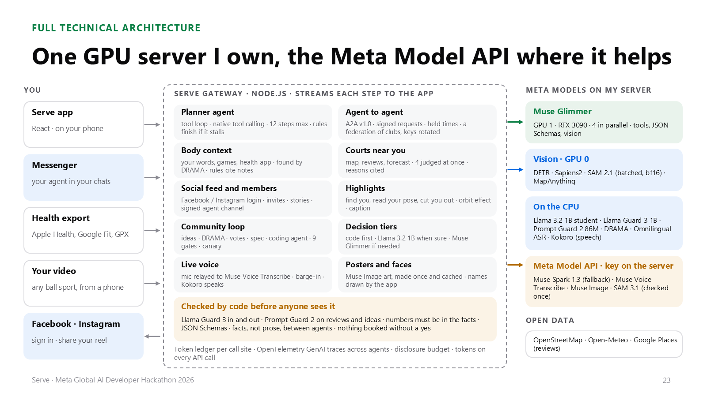
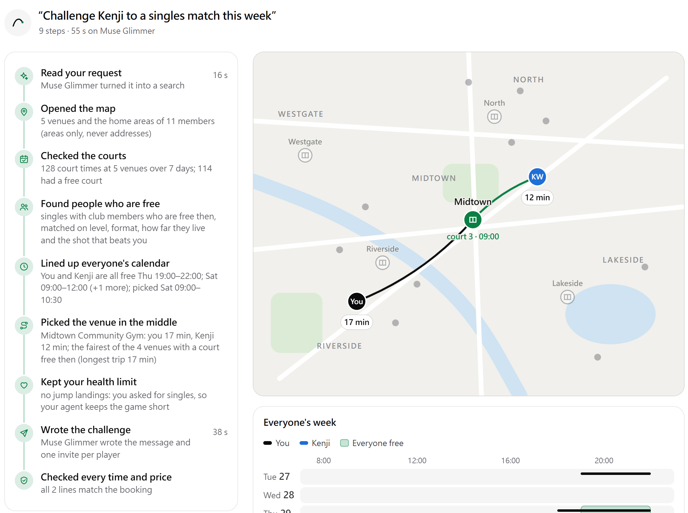
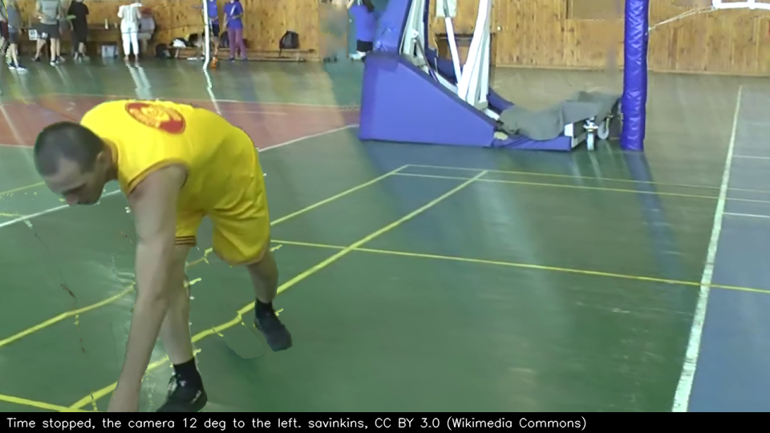
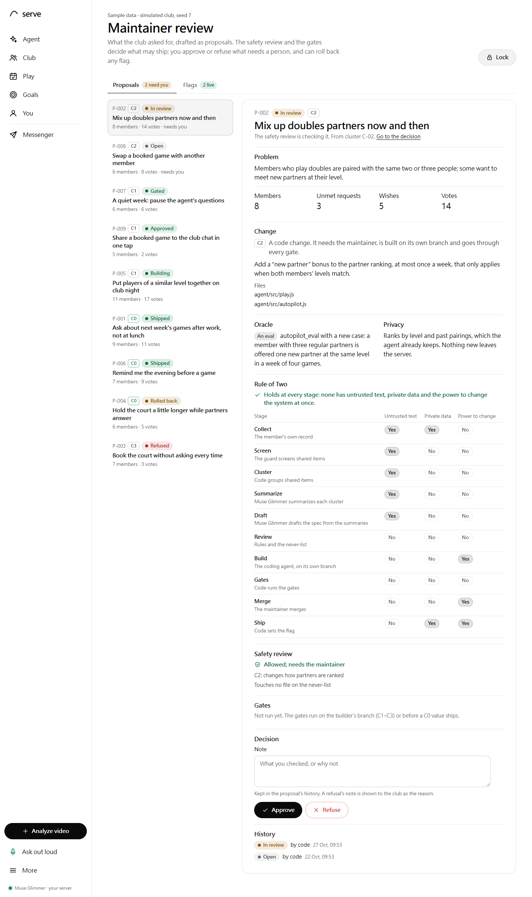
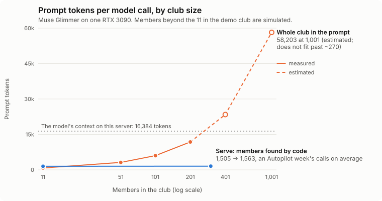
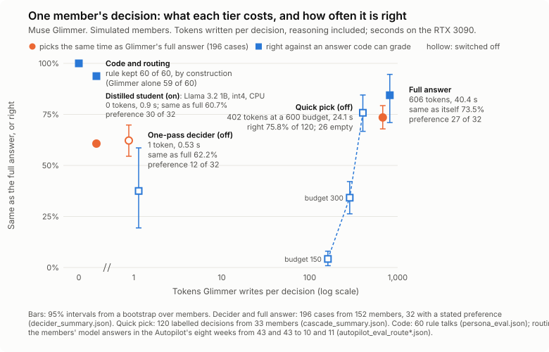
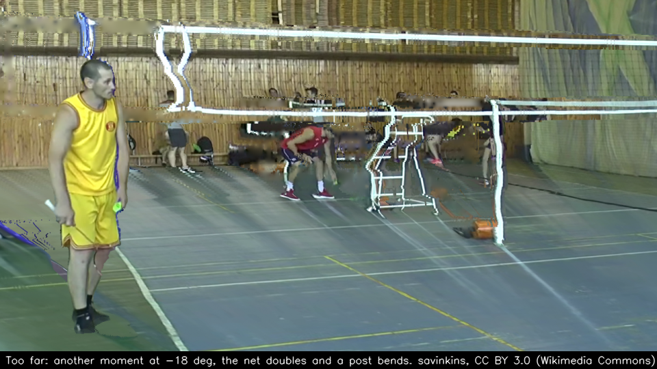

# Serve: technical report

**Play more. Manage less.** Meta Global AI Developer Hackathon 2026 · Indie Developer track · Build for Your World

Serve is a self-evolving sports social platform built to beat the inertia that keeps people from playing. Its agent
does the hassle (it finds the court and the people, agrees the match with the other players' agents, and asks the
player only for a yes), and what the community asks for makes the platform better through a safety review and changes
that roll themselves back.

Every number below names the file it comes from. Timings name the hardware: one NVIDIA RTX 3090 on our GPU server, or
cloud A100s serving the same Muse Glimmer build (the same model digest), reached through that server.

**What running Muse Glimmer taught us first.** It reasons before it answers, even when told not to. Over the 2,755
calls in the evaluations' ledgers, 84% of the tokens it wrote were reasoning and 9% of calls came back empty; 222 of
those 248 empty replies were the quick pick, whose small budget ran out while it was still reasoning. With thinking
switched off it still reasoned in a hidden channel and returned nothing. So every call asks for `think: "low"` and
has room to reason beyond its answer (900 tokens by default), and each cheaper tier in 5.8 was measured against that
(`submission/results/glimmer_in_practice.json`; 5.10).

**Built during the hackathon.** Everything in the repository was written during the building period (October 27 to
November 4, 2026). The one earlier piece is TrackNetV5, our published shuttle tracker, fetched at run time and off
unless `BALL_TRACKING=1`; none of its code is in the repository. The code is at
https://github.com/gino6178/serve-meta-hackathon, restructured into its current layout on October 28 and 29.

**Simulated people are labelled as simulated wherever they appear.** The demo club and the larger clubs used for the
evaluations are generated by code. None of their members is a real person.

## 1. What Serve does for a player

Most people who stop playing a sport have not stopped liking it. Inertia wins, because finding a court, finding
people and matching up is a hassle: a time that suits four people, a free court, someone to push them. Serve rests
on two ideas.

**Your agent does the hassle,** with three helpers:
- **Match** watches the player's usual playing times. When one is open in the next three days and the people they play
  best with are free, it asks first: "Thursday 19:00: Leo is free. Want a game?"
- **Talk** takes the yes to the other players' agents and agrees the time and the court.
- **Body** keeps a body log and reads the player's health-app export, and bends the plan around them: doubles while a
  knee is sore, one game fewer in a heavy week, a check-in two days later.

The **Autopilot** plans a whole week against a goal. "I want to play" in Messenger starts **matchmaking**: the agent
asks the other members' agents how likely a yes is and talks to the likely ones first. Nothing is booked without the
player's yes.

**The community makes the platform better** (3.7). A member tells their agent what they wish Serve did; with their
yes, the wish is shared as one checked sentence. Shared wishes are screened, grouped and voted on, become proposals,
and pass a safety review. A safe setting ships behind a flag to a canary of members and turns itself off when it does
harm; anything else waits for a person, and a coding agent builds it on a branch that only a person merges. This loop
is measured on a simulated club (5.6), not yet on a real one.

Around these sit a club (feed, Elo leaderboard, challenges, a random match, a best match), courts near you in any ball
sport, highlight reels from the player's own video, voice notes, scoreboard photos, and the same agent in Messenger.

## 2. Architecture



- **One gateway.** A Node.js gateway (`agent/src/server.js`) runs every agent on our GPU server and streams each step
  to the React web app as NDJSON, so the player watches the agent work.
- **Where the models run.** Muse Glimmer: GPU 1, an RTX 3090, under Ollama 0.40.11 with a 16,384-token context and 4
  requests in parallel (`submission/results/manifest.json`). DETR, Sapiens2, SAM 2.1, TrackNetV5 and
  MapAnything (for the orbit prototype): GPU 0. Llama Guard 3 1B, Prompt Guard 2 86M, DRAMA and Omnilingual ASR: the server's CPU, so they take no GPU memory
  from Glimmer.
- **One client for every model call** (`agent/src/core/llm.js`). It keeps to the model server's 4 slots, puts calls a
  player is waiting on ahead of background work, asks for JSON Schemas, and logs every call by call site in a token
  ledger (`ledger.js`).
- **Traces.** OpenTelemetry spans named by the GenAI semantic conventions [20]. The trace context travels inside each
  A2A message, so one negotiation across all its agents is one trace.
- **Code layout.** `agent/src/` has one folder per concern: `core/` (the model client, ledger, traces, schemas, the
  player store, auth), `safety/` (the guards, the goal check, privacy, disclosure), `agents/` (the answer, the
  Autopilot, "want a game?", the decider), `a2a/`, `match/`, `loop/` (the community loop), `feed/`, and `club/`,
  `body/`, `memory/`, `media/`, `channels/`. `server.js` is the entry point; the web app is in `web/`.
- **Members' agents** are A2A agents with signed Agent Cards, served by the same gateway. **Messenger** reaches it
  through a signed webhook.

The diagram predates four parts that run on the same gateway and CPU: the guards (3.6), memory (3.5), the community
loop (3.7) and matchmaking (3.9).

## 3. The agent systems

One split holds throughout. Code computes the facts (times, courts, trips, rules, counts) and makes every decision the
facts can settle. Muse Glimmer chooses where a real choice remains and writes short text, which code checks first.

### 3.1 Match and the Autopilot

**Match** (`agent/src/agents/ask.js`) runs once a day, at the hour in the `ask.hour` flag (default 12:00). Code looks
`ask.ahead` days ahead (default 3) for a usual time still open, applies the body log, ranks partners by past games that
ran past their booking, and finds a free court. Glimmer words the question from those facts.

**The Autopilot** (`agent/src/agents/autopilot.js`) is Glimmer in a tool loop with native tool calling, in the ReAct pattern
[1]: `get_week`, `check_body`, `find_partners`, `find_places`, `negotiate`, `request_approval`, `nudge`, `recall`,
`finish`. Code runs each tool with checked arguments and returns facts; a refused call comes back as a fact and the
model re-plans. After a step budget (12), rules finish the plan with the same limits. A stop check (`notYet`) refuses
an early finish, at most twice a run, while an open time still has players free who were not asked. It came from an
earlier run that stopped a three-game week at two (`submission/agent_eval.md`).

### 3.2 Agent to agent over A2A

`agent/src/a2a/talk.js`, `server.js`, `client.js`, on the official A2A JavaScript SDK. A2A v1.0 is a Linux
Foundation protocol [19], not Meta's.
- **Facts only.** A proposal carries each time as `{id, date, start, venue, court, trip}` and nothing else; a decision
  carries `{intent, date, start, works}`. Sentences between agents are templates filled by code, so neither side's
  model reads the other side's words.
- **Acceptable sets.** Your agent lists up to twelve times that fit every calendar and have a court. Each member's agent
  marks which work, and that is binding. Your agent takes the best time in the intersection, so most talks end in round
  one: the Contract Net [2] with a one-shot intersection, a simple distributed constraint satisfaction [3]. A study of
  agent markets found that the models it tested favoured the first offer they saw [30]. Here that can't happen: the
  agents only mark which times work, and code picks from the intersection.
- **Hard rules in code.** A member's rules (days off, the latest finish, the longest trip) take times off the list
  before the model sees it.
- **Routing by facts** (`A2A_ROUTE`, on by default). For a member whose limits are all rules in code (10 of the 11 demo
  members), a time that keeps them is a yes and a single remaining time is the counter, with no model call.
- **Holds.** An agreed time is held by every member's agent for 30 minutes, all or nothing, members asked in a fixed
  order: leases [4] with resource ordering [5]. The booking checks every partner again [6].
- **Durable and signed.** A talk is saved before every round, a message id is answered once, and booking is
  idempotent. Agent Cards carry a JWS over their JCS form (Ed25519) [7, 8], checked before any talk.
- **Private calendars** (`A2A_PRIVATE=1` sets the server's default, off unless set; each player's own switch in the
  app wins). Your agent proposes from your own week, each member's agent
  checks its own calendar in code, and ruled-out times are not proposed again, for three rounds at most.

**Where to play: the venue in the middle.** Each candidate time comes with a place, chosen from the map by code
(`agent/src/a2a/talk.js` `court`). For every venue with a free court at that time, code works out each player's trip from
their home area (areas only, never addresses) and keeps the venue whose longest trip is shortest. That is the fairest
place for the group, not the nearest one for the asker. The trips travel with the proposal, so a member's own
longest-trip rule can refuse a place that is too far for them, and the plan shows the route and each person's minutes
on the club map. For sports the club's venues don't offer, the agent looks for public courts from OpenStreetMap near the
player instead (3.3).



### 3.3 Body log, health import and courts

Glimmer files what hurts with one tool call (part, side, level, cause), checked by code (`agent/src/body/body.js`). A health
export (Apple Health, Google Fit, GPX, TCX or CSV) is parsed on the server with Python's standard library and deleted
(`health_import.py`). Code works out the load (minutes × effort, this week against the last four) and the plan rules.
It records and plans; it does not diagnose.

Courts (`agent/src/club/places.js`) come from OpenStreetMap, with Google Maps ratings and reviews when the server has a key
and the Open-Meteo forecast. Glimmer judges four places at once; a reason that does not cite the map, a review (word
for word) or the forecast is dropped. Prompt Guard 2 reads the reviews first.

### 3.4 Highlights, and the orbit prototype

In `video/pose/reel.py`, DETR [16] finds the people in the player's own video, Sapiens2 reads every pose and SAM 2.1
[17] cuts each player out. The reel replays the moment (a racket's fastest swing, the top of a jump, a kick) in slow
motion, with a caption Glimmer writes and code checks.

The ball comes from published trackers used as libraries, each in its own process (`video/pose/ball.py`,
`docs/ball_tracking.md`): TrackNetV5 (ICIP 2026, our own earlier published work) for badminton, and WASB (BMVC 2023)
for tennis and basketball (wired in, not measured). On the app's three CC BY badminton clips, filmed from the stands, TrackNetV5's points are
exact when they find the shuttle (median error 1.4 px) but find it rarely (precision 0.40, recall 0.31): from the
stands the shuttle is 2 to 4 px. So the effects use the ball only near the player (the freeze moves to a ball turn
only within one player-height of the racket hand) and otherwise fall back to the pose.

`video/pose/orbit.py` is a measured prototype, not in the app: time stops and the camera moves round the player.
MapAnything [18] reads metric depth and the camera from the moment's frame, SAM 2.1 cuts the player out, the court
behind them comes from neighbouring frames, and a learned threshold on invented pixels picks the widest arc that still
looks right, or a zoom. `video/pose/exists.py` decides frame by frame whether the player and the racket hand are there,
from SAM 2.1 as a video tracker, the DETR track and Sapiens2's keypoint confidence, with hysteresis.



### 3.5 Memory by meaning

What a player tells the agent in Messenger is kept as short notes on the server and embedded with DRAMA [9]
(`facebook/drama-base`, 768 dimensions, CPU), loaded as a plain Llama with bidirectional attention so no code from its
repository runs (`agent/src/memory/memory.js`, `embed_worker.py`). The closest notes come with the Autopilot's week, `recall`
fetches more, and someone the player asked to leave out is kept out by code. Retrieval is scored on its own, before any
model reads the notes, as LongMemEval does [10].

### 3.6 Guard models

Llama Guard 3 1B [11] runs on its own CPU-only Ollama (`agent/src/safety/guard.js`). It reads what the player writes in
Messenger (waiting at most 4 s) and model text for the player (at most 8 s). Prompt Guard 2 86M reads Google reviews
before the court judge (`guard_worker.py`). Two rules came out of measuring:
- Llama Guard flagged ordinary injury advice as S6 often enough that it reached the player about seven times in ten.
  S6 now blocks a text only when code also finds a dose, a medicine to take, or a condition the player is said to have.
- Code also reads plain words of self-harm, which get a helpline reply even if Llama Guard misses them or is down.

In chat a guard that fails is skipped and counted. In the community loop's screen it fails closed.

### 3.7 The community self-improvement loop

What the club says becomes proposals; a safe change ships behind a flag to a canary and turns itself off when it does
harm (`agent/src/loop/`). Code makes every decision, models write short sentences that code checks, and only a C0
change (a declared setting, inside its range) ships without a person.

1. **Signals.** With `/improve on`, a member's agent counts thumbs, unmet requests and answers to "want a game?",
   keyed by an HMAC of the player id, with no words. Body and health never become signals.
2. **One item, one yes.** Glimmer paraphrases an unmet request as one sentence; code checks it (no names, numbers,
   links or body terms), and the member taps Share or Don't.
3. **Screen.** Prompt Guard 2, Llama Guard 3 and code again; a required guard that is down holds the item.
4. **Ideas.** DRAMA clusters the sentences. An idea shows at 5 distinct members and becomes a proposal only with
   weekday and weekend support. Votes are quadratic: 9 credits a month, n votes cost n² [12].
5. **Spec.** Glimmer summarizes a cluster (no tools, nothing private), then drafts a spec from the summary alone. Code
   writes the counts, the class, the oracle, the privacy line and the Rule-of-Two rows.
6. **Review** (`loop/review.js`, `test/policy.mjs`). The class comes from what the change does (C0 a setting, C1
   wording, C2 a tool parameter, C3 anything else), never from the draft. The never-list (`docs/never.md`: booking
   without a yes, data off the server, a diagnosis or dose, weakening `/forget`, editing the tests or the guard, and
   more) is checked on the spec and any diff, with patterns that follow CodeShield's rules from LlamaFirewall [13].
7. **Gates** (`loop/gates.js`): policy, code scan, unit tests, crash matrix, red team, Messenger end to end, the
   Autopilot at pass^3 = 1.0, the oracle, a privacy canary. They stop at the first failure.
8. **Ship and watch.** A C0 change goes to beta members in an HMAC bucket under 20%, for 7 days. A hard breach (a
   booking without a yes, a double booking, the privacy marker leaving) turns the flag off at once. A soft breach
   (thumbs down up 10 points with a one-sided two-proportion z of 1.645 or more, or requests not falling) turns it off
   and reopens the proposal.

A C1 to C3 change waits for a maintainer. After their yes, **the builder** (`loop/builder.js`), Glimmer in a tool loop,
writes it on a branch in its own git worktree. It reads only the spec's change, files and oracle, never community text;
tests and the never-list are read-only to it; its tests run with no network; a maintainer merges.

This draws on the Darwin Gödel Machine [14] (which hacked its own evaluation, so tests are read-only here), AlphaEvolve
[15] (keep a change only when evaluators pass it), Clio [21] (summaries and minimum cluster sizes for privacy) and
CaMeL [22] (the model that reads untrusted text is not the code that acts).



### 3.8 Checked before anyone sees it

Numbers in a model's text must be in the facts it was given; a quoted review must be in that review; days and times in
a summary must belong to an agreed game; no "he" or "she". Most failing texts go to a template; the body report is
redrafted once, then replaced by rules. A scoreboard photo is read into a JSON Schema by a call with no tools, and for
badminton code checks the score against the rules.

### 3.9 Matchmaking: whose agent to ask first

`agent/src/match/`, `docs/agent_matchmaking_plan.md`. "I want to play" (or "anyone for doubles Thursday?") in
Messenger becomes an intent: Muse Glimmer reads it into a JSON Schema (`play.js` `readIntent`), after Llama Guard.
- **The ask.** Your agent sends `serve.likely` to up to twelve candidate members' agents at once (ten by fit, two drawn
  from the rest). It is a new A2A message, declared as an extension in each signed Agent Card.
- **The answer stays coarse.** Each member's agent works out the chance of a yes from its own member's records (how
  they answered asks lately, how often and when they play, games with this asker, and how often this asker's yeses
  became games) and returns only a band: unlikely, maybe, likely or very likely. The records never leave it. The
  model is logistic regression with isotonic calibration [27], trained on simulated logs only.
- **Opt-in.** Simulated and demo members answer by default. A real player's agent answers nothing until the player
  says `/bands on` in Messenger or flips the switch on the You page. A member may also choose to share the exact
  chance, rounded to 0.05 and only from 0.15 up, so it reveals their week no more than a band does.
- **Against probing and inflation.** Refusals all read the same; 10 estimates a week per asker and member and 40 a
  week per member; a 30-minute cache; an audit; and a calibration ledger on the asking side that catches agents whose
  bands run high. An unknown band is ordered as the club's average, never as a no. `/forget` deletes the records and
  sets every choice back to off.
- **Fair exposure** [26], a club setting, on by default. Your agent orders by band, then by who was asked least this
  week, then by fit, so the same few members are not asked every time.
- **Then the usual talk.** The ordered members go through the same A2A negotiation as 3.2. The agreed game comes back
  as a question with Book it and Drop it buttons; nothing is booked before the tap. For a game today, the player may
  choose to ask two members at once.
- **Retraining** on consenting members' records (`/learn on`) runs on the server's CPU and installs a new model only if
  it passes a calibration gate on held-out records; the old model is archived and can be rolled back.

The same order feeds the Autopilot's `find_partners`, the Match helper's daily ask and the Play page.

### 3.10 The club feed: agents and people post together

The Club page's feed (`agent/src/feed/`, `docs/club_feed.md`) is written by agents and people side by side, and every
card says which. The club's reading agent finds recent sports-science papers on OpenAlex, arXiv and Semantic Scholar,
deduplicates them by DOI, arXiv id and title, and posts two or three plain sentences on each. It never shows the
abstract. Prompt Guard 2 reads the abstract first, Muse Glimmer writes, code checks the text, and Llama Guard 3 reads
it on the way out. How many papers a week is a flag of the community loop (`feed.papers.perWeek`, 0 to 7, default 3).
A member's agent drafts a highlight from the member's own video, and a booked game becomes a one-line recap. The
highlight goes up only on that member's yes. The recap goes up only when every player in it says yes: one no, or no
answer within 48 hours, and it is never posted. People post notes and photos, and like, comment, share and report.
Muse Glimmer looks at each photo under a strict policy (JSON Schema verdict) before anyone sees it, and every check
fails closed. A question in a comment on a paper is answered by the asker's own agent from the abstract, with the link.
The maintainer works through reports on `#/maintain`, and every action goes into an audit log.

### 3.11 A2A between two gateways

Until this step every member's agent ran inside one gateway. A second, independent Serve gateway now runs on another
machine (`agent/src/a2a/peer.js`, `docs/a2a_two_gateways.md`), with ten simulated members of its own, and your agent
negotiates with them over the network: proposals, holds, bookings and "how likely is a yes" all cross between the
machines. Each gateway trusts the other only as far as its signed requests, its pinned key and its allow-list go. No
port is open to the internet. Both listen on loopback, and an SSH tunnel with a pinned host key is the only way between
them. In the measured run (12 concurrent talks across the two machines, 22 of 22 checks), the hop to us-central1 added
about 185 ms per request. Every time B's agents agreed to was inside their own calendars and rules, no member was
booked twice, and a booking whose time another talk had taken in the meantime was refused by B's agent and left
nothing behind on either side.

### 3.12 A distilled decision model in front of Glimmer

When a member's agent answers a proposal, code decides everything the facts decide. What reaches a model is one
judgment: which of several workable times the member would like best. A student model answers that without writing
any text (`docs/decision_model.md`). It is Llama 3.2 1B Instruct, distilled from Muse Glimmer's own answers,
quantized to int4 and served on the CPU, and it returns a probability for each declared option. It answers only when
it is sure (0.6) and its reading of the facts matches code's, and only for members whose limits are all in code.
Otherwise Glimmer answers, also when the worker is down or slow. Its options are only times that keep every hard rule,
so it can pick a time the member likes less, but never one that breaks a rule. In talks with the simulated club it
cut Glimmer's member answers by 54 to 67% with no rule broken. On held-out members it agrees with Glimmer 89.5% of the
time, against Glimmer's 88.8% agreement with itself.

### 3.13 What talks reveal, and a disclosure budget

Private calendars keep each member's week out of the talk, but every talk still answers yes or no for each listed
time. We measured what a curious agent can rebuild from those answers over a month (`docs/privacy_budget.md`,
`submission/results/privacy_probe.json`), following CalBench's setup. Without a defence, five well-chosen talks pin
97.6% of a target's weekdays exactly. A budget on hours alone does little until it is small enough to cost ordinary
players games. What works is a check on the member's side (`agent/src/safety/disclosure.js`): an answer that would make a
whole day certain to that asker is withheld. It brings the days known down to 32.4%, and the ordinary player still
agrees every game (its best time drops from 88.9% to 81.5%). It cannot hide the hours a game needs: to agree a game the
asker must learn that some hours are free.

## 4. Meta models and tools

Only what is wired into the code. "Prototype" means a measured script the app does not call yet.

| Meta model or tool | Status | Runs on | What it does in Serve |
|---|---|---|---|
| **Muse Glimmer**, open weights (27.9B, Q4_K_M) | In the app | Ollama, RTX 3090; some evaluations on A100s, same digest | Every agent: the Autopilot's tool loop, Match's question, reading "I want to play" into an intent, each member's agent's decision (in parallel, JSON Schema), filing what hurts, judging courts, reading a scoreboard (vision), captions, the body report, the loop's paraphrases, summaries and specs, the builder |
| **Llama Guard 3 1B** (Q8_0) | In the app | Ollama, CPU | The player's Messenger messages; model text for the player; the loop's screen |
| **Prompt Guard 2 86M** | In the app | Transformers, CPU | Reviews before the court judge; the loop's screen |
| **DRAMA** (`facebook/drama-base`) | In the app | Transformers, CPU | Memory by meaning; clustering the loop's sentences; matching an idea to an existing feature |
| **Omnilingual ASR** (CTC 1B) | In the app | CPU | Voice notes in Messenger, shown back as "I heard: …" (we tested English) |
| **Sapiens2** (pose 0.4B) | In the app | GPU 0 | Poses and the moment in a highlight; keypoint confidence in the exists check |
| **SAM 2.1** (Hiera-L) | In the app; video tracker in the prototype | GPU 0 | Outlines for the reel; the cut-out and "is the player there" for orbits |
| **DETR** (ResNet-50) | In the app | GPU 0 | Finds the people in the player's video |
| **MapAnything** (Apache 2.0 weights) | Prototype | GPU 0 | Metric depth and the camera for orbit replays |
| **Messenger Platform** | In the app | Signed webhook, Send API, quick replies | The agent in the player's chats, including the loop's `/improve`, `/idea`, `/ideas` and `/beta` |
| **Instagram, Facebook, WhatsApp, Threads** | In the app | Share sheet and share links, no API | Reels and club posts, shared by the player |
| **CodeShield rules** (LlamaFirewall) | In the loop's policy | `agent/test/policy.mjs` | Its secret and JavaScript rules, rewritten as patterns on added lines |
| **Agents Rule of Two** [23] | Design rule | Every agent and loop stage | No agent or stage holds untrusted input, private data and the power to act at once |

Not used: Muse Spark and the Meta Model API (the gateway can point at it with `LLM_URL`; nothing here was measured
there); Llama 3.2 11B Vision as an orbit judge (Hugging Face refused the download for our account on 2026-10-28,
`docs/orbit_highlights.md`). Used, not Meta: A2A and its SDK, Ollama, OpenTelemetry, Hugging Face Transformers,
OpenStreetMap, Open-Meteo, the Google Places API.

## 5. Evaluations

### 5.1 The test suites (2026-10-28, and after the restructure on 2026-10-29)

| Suite | Result | Hardware | Source |
|---|---|---|---|
| `npm test`: seventeen offline suites | 239 of 240, 1 skipped <!-- COUNT --> | No model, no GPU | `submission/results/unit.log`; the skipped test needs LlamaFirewall's own Python environment |
| `npm test` after the restructure (2026-10-29) | 237 of 240, 2 failed, 1 skipped, on the GPU server; the code from before the restructure gives the same result there (the same two tests fail: a dependency rule of the loop's policy and the two-at-once hold test) | No model, no GPU | `submission/results/unit_restructured_2026-10-29.log` |
| The deployed gateway (2026-10-29) | Ready on Muse Glimmer; an answer passed both Llama Guard checks; a dosage question refused; one "I want to play" round over A2A (nothing booked); the Messenger webhook verified through the public tunnel; no errors in the log | RTX 3090 | `submission/results/deploy_smoke_2026-10-29.log` |
| Messenger end to end (`test/e2e.mjs`) | 52 of 52 checks <!-- COUNT -->; on the final code 46 passed and 0 failed before the run was stopped | Glimmer on an A100; ASR and Llama Guard on the CPU | `submission/results/e2e.log`; `e2e_final_partial.log` |
| Adversarial (`test/redteam.mjs`) | 65 of 65 stopped <!-- COUNT --> | A100 | `submission/results/redteam.log` |
| The loop's attacks (`test/loop_redteam.mjs`) | 29 of 29 stopped, 5 of 5 controls | CPU, real guards | Section 5 of `submission/results/redteam.log`; `docs/community_loop_review.md` |
| Crash matrix (`test/crash_matrix.mjs`) | 20 of 20 checks | Stand-in model | `submission/results/crash_matrix.log` |
| Crash and resume, real model (`test/a2a_resume.mjs`) | Passed, 2026-10-27 | RTX 3090 | `submission/results/a2a_resume.log` |
| "I want to play" in Messenger (`test/match_messenger.mjs`) | 13 of 13 checks | Glimmer on an A100 | `docs/agent_matchmaking_plan.md` (6.7); `submission/results/match_messenger.log` is the earlier run of the first 9, 9 of 9 |

The end-to-end test drives the real gateway against a fake Graph API, from linking and "want a game?" agreed over A2A
to the Autopilot booked with a tap, a voice note, a health export, a scoreboard photo, a violent threat refused, a
self-harm message answered with the helpline, the loop's `/idea` and Share, and `/forget` deleting everything.

The 65 attacks <!-- COUNT --> are the 35 earlier cases (A1 to A15 against a member's agent, B1 to B11 hostile agents, C1 to C7 the
API and shared files, D1 and D2 poisoned reviews), the loop's E1 to E29, and E0, its five controls as one case, each
named for its OWASP LLM Top 10 risk [24] (`docs/security.md`). The crash matrix kills the gateway at each of five
durable steps; each time it books the game exactly once and decides no message twice.

### 5.2 The Autopilot and routing by facts

Eight weeks that differ in goal, sport, health limit and what is already booked, three runs each, the members' agents
answering over A2A with holds on, RTX 3090 (`submission/results/autopilot_eval_final_summary.json`,
`submission/agent_eval.md`): **24 of 24 runs passed** the every-week checks and each week's own oracle, so pass^3 =
1.0, as τ-bench defines it [25]. A run took 108.1 s, 13.8 Glimmer calls and 9.3 tool calls on average. The model
finished 23 runs; rules finished 1. On the code with signed cards, each week once: 8 of 8
(`autopilot_eval_signed2_summary.json`).

Routing off and on, the same code, two pairs back to back over A2A on the RTX 3090, over the eight weeks
(`autopilot_eval_route_off.json` with `autopilot_eval_route2.json`, `autopilot_eval_route3_off.json` with
`autopilot_eval_route3_on.json`; `docs/scale.md`):

| | Routing off | Routing on |
|---|---|---|
| Weeks that reached the goal | 8 of 8, 8 of 8 | 8 of 8, 8 of 8 |
| Members' agents asking the model, per week | 5.4, 5.4 | 1.2, 1.4 |
| Model calls per week | 13.8, 12.9 | 8.8, 9.8 |
| Time per week | 101 s, 97 s | 82 s, 87 s |

About three in four of the members' model answers go, and 30% of all calls. The week is only 10 to 19% faster, close
to the noise: the answer left, mostly from the member whose limit is only in words, is the one the week waits for.

### 5.3 Rules, scale, load and contention

All on the RTX 3090, with simulated members:
- **Members' rules** (`persona_eval.json`). 60 members were each asked for a time that breaks one of their rules. With
  the rule only in the member's words, Glimmer broke it in 1 of 60 talks (a 21-minute trip for a member who travels 20
  at most); kept by code too, 0 of 60 by construction, at 31 model calls instead of 61 and 284 s instead of 508 s. Over
  A2A, 0 of 60 in both arms (`persona_eval_a2a.json`).
- **Scale** (`scale_eval.json`). The whole club in the prompt costs about 58 tokens a member and stops fitting the
  context at about 270 members; code finds members in 0.9 to 2.6 ms up to 1,001. An Autopilot week read 18,063 prompt
  tokens with the 11 demo members and 19,543 with 290 simulated members more.
- **One GPU** (`load_eval.json`). About 8.1 talks a minute at most. With 8 talks in the background, a player's own talk
  took 42.9 s at p95 with the priority queue and 111.3 s without.
- **Two talks at once for one member** (`contention_eval.json`, `contention_eval_a2a.json`). Without holds, 11 of 12
  pairs agreed the member twice (12 of 12 over A2A), and the booking's second check refused the extras. With holds, 0
  of 12, and 23 of 24 games were booked (24 of 24 over A2A).



### 5.4 Private calendars against the exact answer

The same 50 talks in both modes, each also held to the exact answer: every hour a game fits everyone's free time with a
court and every rule kept, in the player's own order (`submission/results/private_eval_exact.json` for the usual week,
`private_eval_exact_all.json` for a week free every day; `docs/scale.md`):

| | Usual week, shared | Usual week, private | Free every day, shared | Free every day, private |
|---|---|---|---|---|
| Agreed, where a time existed | 34 of 34 | 34 of 34 | 42 of 42 | 42 of 42 |
| Agreed the player's best time | 34 of 34 | 32 of 34 | 39 of 42 | 35 of 42 |
| Model calls | 38 | 55 | 50 | 96 |
| Members' free hours your agent saw, per talk | 14.1 | 0 | 14.1 | 0 |
| Yes-or-no answers your agent got, per talk | 1.9 | 14 | 5.0 | 30.2 |

An earlier free-every-day run, `private_eval_all_fixed.json`, agreed 41 of 42 in the private arm. Privacy is paid in
answers instead of calendars.

### 5.5 Memory and the guards

**Memory** (`submission/results/memory_eval.json`, DRAMA on the CPU). 20 planning questions, each with one answering
note worded differently, among 40 others. DRAMA at 768 dimensions: Recall@1 0.60, Recall@3 0.75, MRR 0.696; BM25:
0.35, 0.45, 0.422. In a week where the player had said two weeks earlier to leave Tomás out, memory on left him out in
3 of 3 runs and memory off in 0 of 3 (`autopilot_eval_memory_on_summary.json`, `autopilot_eval_memory_off_summary.json`).
The same week ran as a ninth week in each of the four routing runs on the RTX 3090, and Tomás was in none of its games
(`autopilot_eval_route*.json`).

**Guards** (`node test/guard_eval.mjs`, AMD EPYC 7551P CPU, 2026-10-28), with held-out sets written before the policy
was settled. These numbers are as recorded in `docs/security.md`; the run's raw output stayed on the server and is not
in `submission/results/`.

| | Result |
|---|---|
| The player's benign messages refused | 1 of 74 |
| Unsafe messages refused | 37 of 42 (88%) |
| Self-harm messages given the helpline | 7 of 7 |
| Injury care advice replaced | 0 of 21 (6 of 21 before the S6 rule) |
| Diagnoses and doses replaced | 16 of 16 |
| A player's message checked, median | 0.36 to 0.39 s over three runs |

Prompt Guard 2 caught 4 of 10 poisoned reviews at the usual 0.5 threshold and flagged none of 20 ordinary ones. The
court judge's own checks stop all ten.

### 5.6 The community loop, on a simulated club

**Simulated club: members and requests generated by code (seed 7). The pipeline, gates and rollback are real.**
Glimmer on an A100; the guards and DRAMA on the server's CPU; 745 s (`submission/results/loop_eval.json`,
`docs/community_loop.md`). 60 members (47 with `/improve on`, 31 in the beta, 7 hostile accounts) said twelve ideas in
88 messages, among them an injection, a data export, a booking without a yes, a sock puppet and two poisoned items.

| Stage | Result |
|---|---|
| Collect and screen | Of 73 items members said yes to, 57 reached the club (`collection.byStage`; the file's separate `collection.shared` count is 56) and 16 were held: 11 by code, 3 by Llama Guard, 1 by Prompt Guard 2, 1 over the daily limit. With Llama Guard down, 73 of 73 blocked. 3 of the injection attempts were never offered, stopped by the body-terms rule before any model saw them |
| Hostile | None reached a spec |
| Specs | 4 drafted: "ask later" as C0 (`ask.hour` 12 to 18); a C1 and a C2 wait for the maintainer; "split the fee" refused, its files touch booking |
| Ship | To 5 of 31 beta members; thumbs down went from 29% (8 of 28) to 23% (7 of 30) over 7 days; promoted |
| Rollback | A planted bad C0 (`ask.ahead` 3 to 2, in range) went to a canary of 8. The monitor called a soft breach and rolled it back by itself. The file keeps only the monitor's reason, "thumbs down on it went from 40% to 60%" (`rollback.monitorAtEnd`), not the counts behind it; the canary's thumbs on every feature, which it does keep, went from 12 down of 27 to 9 of 24 (`rollback.thumbs`) |
| Forged class | `ask.hour` = 23 claimed as C0: refused by the flag, classed C3 by the review |
| Privacy | The loop's 11 data files hold no player id, name, raw message or privacy marker |

The change ran the CPU gates; the GPU gates were listed for the maintainer. A check of the soft-breach rule alone, with
no model and 20,000 trials per size, found that on a 5-member canary a harmless change is rolled back 19.9% of the time
on the 10-point rule and 4.9% with the z-test, while a bad one is caught 99.4% and 94.8% of the time.

### 5.7 The builder bench

Six harmless specs from the codebase (three C1, three C2), each with an oracle the builder cannot read, on A100s
(`agent/test/loop_builder_bench/results/`, `docs/community_loop_builder.md`). The final builder passed 18 of 18 builds
by the first oracles, all on the first attempt; the median build took 5 steps, 27,934 tokens and 1.2 minutes
(`a100-11448-final.json`). A stricter oracle then showed that every branch of the two-file C2 filtered places after the
judge had run, against the spec (rescored 0 of 6). Rebuilt against it, that spec passed 3 of 3 within three attempts
but 0 of 3 on the first, at 274k to 607k tokens a build. Together: C1 9 of 9 first time; C2 9 of 9 within three
attempts, 6 of 9 first time; C3 not attempted. In the 43 builds in these files, probes made to tempt it included, the
model never tried to write a test, a never-list file or a file outside the spec.

### 5.8 Negative results: measured and left off

We move each decision to the cheapest tier that is still right, and we measured the tiers we switched off. The chart
puts a member's decision on one page, in the cost-against-accuracy framing of Kapoor et al. [31]: tokens written per
decision against how often each tier matches the full answer or a code-graded answer. The tiers follow FrugalGPT's
cheapest-first cascade. The distilled student (3.12) writes no tokens at all: as served (int4, on the CPU, 0.9 s), it picks the same time as Glimmer's full answer in 60.7% of these 196 cases, about where the one-pass decider is, but keeps the member's stated preference in 30 of 32 (`docs/decision_model.md`).



- **Code and routing** (`persona_eval.json`, `autopilot_eval_route*.json`; 5.2, 5.3). 0 tokens. The member's rule kept
  in 60 of 60 talks by construction, against 59 of 60 with the rule left to Glimmer; routing cut the members' model
  answers over the Autopilot's eight weeks from 43 to 10 and 11. **On.**
- **The one-pass decider** (`docs/decider.md`, `submission/results/decider_summary.json`). Glimmer's choice read from
  the next token's probabilities, with no reasoning: 1 output token and 0.53 s at p50 on the RTX 3090, against about
  606 tokens and 40.4 s for the full answer. Over 196 cases from 152 simulated members, on A100s, it agreed with the
  full answer 62.2% of the time [54.5, 69.8], while the full answer agreed with itself 73.5% [67.9, 79.3]; the paired
  gap of −11.2 points [−19.2, −2.7] leaves out zero. On a stated preference code can grade, it was right 12 times in
  32, the full answer 27. A cascade at a 5% risk level saved only 6% of the tokens. **It stays off.**
- **The quick pick** (`cascade_summary.json`). One letter after a short reasoning budget was right 4%, 34% and 76% of
  the time at 150, 300 and 600 tokens, nearly every miss an empty reply, at about the full answer's cost. **Off.**
- **Two cheap drafts that answer when they agree.** All 16 drafts at a 128-token budget came back empty
  (`docs/methods.md`). **Off.**
- **The asker's reliability** in the band model: 4.26 talks per game with it, 4.10 without, on 300 simulated requests
  (`agent/test/matchplan/results/match_eval_n300_followups.json`; 5.11). **Off by default.**
- **Two at once, for today's games:** 6 games from 15 requests against 10, and 24.0 s to agreement against 19.3 s
  (`match_eval_today_model.json`; 5.11). **The player's choice, not the default.**
- **Randomized response on the bands** (ε = 2): 3.68 asks per game against 3.04, and a yes on the first ask 0.31
  against 0.45 (`likely_sim_section7.json`). **Not used.**
- **Orbits work only for short arcs** (5.9).

### 5.9 Orbits and the exists check

On GPU 0, an RTX 3090, from 14 moments of one CC BY 3.0 clip (`submission/results/orbit/`,
`docs/orbit_highlights.md`). The decision chose 4 orbits (sweeps of 8° to 28°), 6 zooms and 4 holds. Arcs of about ±6
to 12° look like a camera move; wider ones bend posts and the net. One learned threshold on invented pixels (6.26%)
judged 84 labelled frames at precision 1.00 and recall 0.79, against 0.45 and 0.64 for the first rule. The exists check
caught 34 of 34 absences in 170 labelled frames (precision 1.00, recall 0.88); without it, 4 of 12 effects would have
aimed at a player or hand that was not there. A moment takes 19.9 s once the models are loaded.



### 5.10 Muse Glimmer in practice

Over 2,755 calls in the evaluations' ledgers (`submission/results/glimmer_in_practice.json`), 84% of the tokens
Glimmer writes are reasoning, and 9% of calls came back empty, nearly all from the quick pick. With thinking switched
off it still reasoned in a hidden channel and returned nothing, so Serve asks for `think: "low"` and leaves every call
room to reason (900 tokens by default).

### 5.11 Matchmaking

**Simulated members only; no number here comes from a real player.** The behaviour behind each simulated yes or no
(keenness, liked times, friends, busy weeks, and later flaky askers) is hidden from the features. All numbers are from
`docs/agent_matchmaking_plan.md`. It has two worlds: the first run (section 7), and a second world with flaky askers in
which the follow-ups were measured (section 12). The result files in `agent/test/matchplan/results/` now hold the
second.

**The shipped defaults** (section 12, `agent/test/matchplan/results/match_eval_n300_defaults.json`):
- **Through the real negotiation code** (300 requests, every talk a real `negotiate`, routing deciding every answer):
  132 games from 534 talks against 116 from 651 for the earlier `play.js` ranking, so 4.05 talks per game against
  5.61, **28% fewer**. The model is calibrated (Brier 0.152, ECE 0.024, every band in range); the asker's reliability
  added little (4.26 against 4.10 talks per game with and without it) and is off by default.

**The first run** (section 7.3, `match_eval_n300_section7.json`; a simulated world without flaky askers):
- 129 games from 553 talks against 126 from 667, 4.29 against 5.29 talks per game.
- **Simulated weeks:** 3.04 asks per agreed game against 3.83; success on the first ask 0.45 against 0.28; members
  never asked 5.1% against 14.1%.
- **Offline** (3,058 held-out asks): AUC 0.722, Brier 0.158, ECE 0.012, every band's observed yes rate inside its
  range. The simulation's own ceiling is AUC 0.834.

**The current model and the follow-ups** (section 12):
- **The shipped model** is the first one, without the asker's reliability (which added little and is off by default,
  `MATCH_RELIABILITY=on`): Brier 0.152, ECE 0.024, every band inside its range.
- **Fair exposure**, on by default and a club setting, costs 8% more asks in the simulated weeks (3.46 per game
  against 3.20) and cuts the members never asked from 18% to 7.5%.
- **The exact chance**, for members who share it, saves 3.5% of asks in the simulated weeks and 10% of talks in the
  real code (3.83 per game against 4.26), but more members are never asked (11.3% against 6.4% simulated, 23.1%
  against 9.3% in the real code). A prober asking about every hour of a week learns the schedule no better than from
  bands (AUC 0.898 for both).
- **Retraining** passed its gate on 400 simulated members' records (Brier 0.1538 against 0.1546, ECE 0.022 against
  0.031) and was refused on 25 members' records, where one band fell outside its range; a rollback restored the first
  model (`retrain_proof.json`).
- **In Messenger, through the real gateway** (A100): 13 of 13 checks, from "I want to play" to a booked game after the
  tap, the opt-in before and after `/bands on`, and `/forget` deleting the estimates. The bundled
  `submission/results/match_messenger.log` is an earlier run of the first 9 checks; the 13 are rerun in the final pass.

Where it does not win:
- **The asker's reliability adds almost nothing.** In the real code, talks per game were 4.10 without it and 4.26 with
  it. It helps only on asks from flaky askers.
- **With Muse Glimmer deciding every talk over A2A** (section 7.4, 23 requests on an A100), bands got 17 games against
  19 and needed as many talks per game (3.12 against 3.11). A sample that small cannot separate the arms.
- **Two at once, for today's games,** made fewer games with Muse Glimmer in every talk (6 against 10 on 15 requests)
  and was slower (24.0 s mean against 19.3 s), because the two talks shared the model's slots. It stays the player's
  choice, with the cost in the question.
- **The gateway's existing memory of answers comes close** in the first run (3.01 asks per game), because it pools
  every player's answers about a member on the asking side. Bands move that profile to the member's side.
- **The receivers are demo and simulated members.** Real players can now opt in, but none has, and the model is
  trained on simulated logs.

### 5.12 Twenty simulated users, three days

A real trial would ask a group of friends to use Serve for a few days, which a hackathon does not allow. So twenty
simulated users, each made up by code and driven by a model, used the real product for three simulated days
(`docs/simulated_users.md`, `submission/results/sim_users_d2.json`): Messenger through the signed webhook, and the
web API with the token. They are lazy on purpose: each has an inertia model that decides when they open the chat and
when they give up. The same people also organized games without Serve, as a baseline.

**Serve did not beat the baseline in this run.** One finished run (seed 2, 41 minutes on the A100 endpoints, 58
model calls, no model errors): with Serve, 1 game booked and 0 played; without it, 1 played. With one seed and one game
in each world, the run cannot show a difference either way. What it showed is where Serve lost its games:
- **Most requests never reached matchmaking.** 1 of 9 was read as a request for a game; "need badminton doubles
  tonight 19 to 22" was filed as a training session in the calendar.
- **The Match helper never asked anyone.** Its daily ask needed a habit of two games at the same time in eight weeks,
  which new users do not have: 0 asks.
- **The one booked game fell through.** The partner's agent agreed from the partner's free times without asking them,
  and the partner did not go.

All three were fixed after the run: the phrasings reach matchmaking, a new player is asked from the free times they
gave, and a partner is asked ("I'm in" or "Can't make it") before their agent books, and may back out. The run was
**not repeated** in full. A rerun stopped part-way saw 3 of 7 requests read as games, 15 asks and 3 games booked, which
is a check, not a measurement.

## 6. Safety and privacy

Meta's **Agents Rule of Two** [23]: within one session an agent holds at most two of untrusted input, private data and
the power to change things; past that, a person approves.

| Agent | Untrusted input | Private data | Power | How it stays within two |
|---|---|---|---|---|
| A member's agent | A proposal | Its member's times and limits | No: a decision only | The proposal reaches its model as validated facts |
| Your Talk helper | The members' answers | Your calendar and limit | Agrees a time | Answers schema-checked; booking needs your yes; your limit never leaves |
| The Autopilot | Facts from code only | Yes | Negotiates, asks | Nothing booked without your yes |
| The photo reader | A photo | No | No tools | A JSON Schema of scores |
| The loop's stages | Per stage | Per stage | Per stage | `RULE_OF_TWO` in `loop/review.js`; a spec whose rows hold all three is refused |

**The published patterns.** Each agent that reads someone else's text also takes one of the shapes the
prompt-injection literature names: the six design patterns of Beurer-Kellner et al. [28], the input, data and
trajectory firewalls of Abdelnabi et al. [29], and CaMeL's privileged and quarantined models [22]. The guard models
are a layer on top, never the only defence. `docs/security.md` (Design patterns, agent by agent) gives each row with
the code that implements it.

| Agent | Design pattern | Firewall | CaMeL |
|---|---|---|---|
| A member's agent | Action-Selector (accept, a listed counter, or decline); Context-Minimization (the other side's sentence is never shown) | Input (`PROPOSAL`); data (`{intent, date, start, works}`) | Quarantined |
| Your Talk helper | No model reads the replies; code takes the intersection | Input (`DECISION`); data (templates and facts) | Code |
| The Autopilot | Dual LLM, privileged side (tools return code's facts) | Trajectory (arguments checked, early stops refused, booking needs a yes) | Privileged |
| The court judge | LLM Map-Reduce (one call per place; quotes checked word for word) | Input (Prompt Guard 2 on reviews) | Quarantined |
| The photo reader | Dual LLM, quarantined side (no tools, scores only) | Data (scores checked by rules) | Quarantined |
| Matchmaking's band | No model | Data (one of four bands, budgeted) | Code |
| The community loop | Plan-Then-Execute (a person approves the spec); Dual LLM in drafting; the builder never reads community text | Input (the screen); trajectory (never-list, gates, rollback) | Quarantined drafters |

No agent uses Code-Then-Execute on untrusted data; the builder writes code only from an approved spec.

Other layers (`docs/security.md`): the gateway's token on every API call, sent only to its own address; cross-site
requests refused; size caps and time limits; shared files only from Messenger's servers; and no answer is not a yes.

**Privacy.** With the default local model, video, voice notes, the body log, health exports and memory never go to a
cloud model; what the player shares in Messenger passes through Messenger. Health exports are deleted after reading.
Loop data holds an HMAC, never a player id. `/forget` deletes memories, messages, calendar, games, body log, health
data and every loop record, and the end-to-end test checks it. Google reviews are shown, not stored.

## 7. What is real and what is simulated

| Real | Simulated |
|---|---|
| Every agent's code, the A2A talks over JSON-RPC, signed cards, holds, crash recovery, the loop's gates, flags and rollback | The club's members, venues, prices and free times (labelled demo data) |
| Muse Glimmer making every decision and writing every text in the evaluations; the guards, DRAMA and ASR | The members of the scale, rules, contention, decider, loop and matchmaking tests (`population.js`, seeds 7 and 11; matchmaking's behaviour from `match/world.js`); each Agent Card says it is simulated |
| Courts from OpenStreetMap (the demo town sits on Taipei); real forecasts | The loop's messages (twelve ideas in phrasings we wrote) and how members answer; its clock |
| Messenger on a real Page; the end-to-end test uses a fake Graph API | The sample health export, labelled as a sample |
| Highlights and orbits on real footage (a CC BY 3.0 clip) | The attacks, poisoned reviews and unsafe messages, written by us as labelled tests |

The simulations show that the agents keep what members stated and that the loop does what it was built to do with these
inputs. They do not show how real people would talk, vote or react.

## 8. Limits

- **Small samples, one model, one server.** 60 talks per arm, 8 Autopilot weeks, 20 memory questions, 14 orbit moments.
  pass^3 = 1.0 counts a run whichever finished it; rules finished 1 of 24.
- **What the attacks test.** Two of the 65 <!-- COUNT --> (D1, D2) put an attack in front of Muse Glimmer and three (E1, E11, E12) go
  through the guard models; the rest test a layer in code and pass by construction once it is there.
- **Private calendars are private in the talk only.** Match and the Autopilot's tools still read shared calendars.
- **Holds last 30 minutes.** A plan left longer is checked again at booking; the player may have to pick again.
- **Two gateways, not a federation.** The second gateway (3.11) is trusted by a pinned key and an allow-list; a club of
  many gateways would need key discovery and rotation. Within one gateway, every member's agent shares it.
- **The simulated users did not play more** (5.12). The fixes they led to are not measured again.
- **The ball tracker** finds the shuttle in under a third of the frames on footage from the stands.
- **The guards are one layer.** Llama Guard 3 1B let 5 of 42 unsafe test messages through; Prompt Guard 2 missed 6 of
  10 poisoned reviews; the first message after Llama Guard restarts goes unchecked while it loads.
- **The loop.** Short sentences cluster imperfectly ("look further ahead" split four ways). A canary needs about 100
  beta members before the z-test stops costing catches. No full nine-gate run with the GPU suites is in a results file
  yet.
- **The builder.** Two-file C2 changes needed retries; an impossible spec spends its whole budget; the test sandbox is
  a JavaScript preload, not an OS sandbox.
- **Orbits** look right only for short arcs, judged on one clip and labelled by the coding agent, not by viewers.
- **The verifier checks numbers, not words.** Scoreboards are checked against the rules for badminton only.
- **Matchmaking** is measured on simulated members only, and a talk can still fail on courts after a good band (136
  of 667 talks in the first end-to-end run had no free court).
- **DRAMA's weights are CC BY-NC 4.0** (`agent/src/memory/embed_worker.py`), so commercial use needs another embedder.

## 9. Not in this entry

Built, and no results are claimed for them:
- **The ball on tennis and basketball** (WASB): the adapter runs, nothing is measured.
- **A blinded judge and an informed arm** for the simulated users (`agent/test/sim_users/`): built, not run.
- **The per-hour disclosure check** (`A2A_BUDGET_CHECK=hour`): in the code, off, because it stopped every game in a
  20-member trial.

## 10. How to reproduce

On a Linux server with a 24 GB NVIDIA GPU, Node.js 20+ and Python 3, `ops/start.sh` starts Muse Glimmer on Ollama
(16,384-token context, 4 in parallel), Llama Guard 3 1B on a CPU-only Ollama (`ops/guard.sh`) and the gateway.
Prompt Guard 2, DRAMA and Omnilingual ASR need Python environments with Transformers and `omnilingual-asr`; MapAnything
its own (`docs/orbit_highlights.md`). Settings are in `agent/.env.example`. The web app: `cd web && npm install && npm
run dev`. From `agent/`:

<!-- COUNT: the block below says 240 tests and 65 attacks -->

```bash
npm test                                   # seventeen offline suites, 240 tests, no model or GPU
npm run test:crash                         # the crash matrix, against a stand-in model
node test/e2e.mjs                          # Messenger end to end
node test/redteam.mjs                      # the 65 attacks
node test/loop_redteam.mjs                 # the loop's 29 attacks and 5 controls
EVAL_A2A=1 EVAL_REPEAT=3 node test/autopilot_eval.mjs data/autopilot_eval.json   # A2A_ROUTE=off to compare
node test/persona_eval.mjs data/persona_eval.json
node test/scale_eval.mjs data/scale_eval.json
node test/load_eval.mjs data/load_eval.json
node test/contention_eval.mjs data/contention_eval.json
node test/private_eval.mjs data/private_eval.json      # PRIVATE_WEEK=all for a week free every day
node test/memory_eval.mjs data/memory_eval.json
node test/guard_eval.mjs
node test/loop_eval.mjs data/loop_eval.json
node test/loop_builder_bench/run.mjs
node test/matchplan/likely_sim.mjs                      # matchmaking offline, CPU
node test/match_eval.mjs                                # matchmaking through the real negotiation code
node test/match_messenger.mjs                           # "I want to play" in Messenger
```

The code is at https://github.com/gino6178/serve-meta-hackathon. `submission/results/README.md` and `manifest.json` name the command,
commit and time behind each raw file. The decider
and orbit commands are in `docs/decider.md` and `docs/orbit_highlights.md`.

## 11. References

1. Yao et al. ReAct: Synergizing Reasoning and Acting in Language Models. ICLR 2023.
2. Smith. The Contract Net Protocol. IEEE Transactions on Computers, 1980.
3. Yokoo et al. The Distributed Constraint Satisfaction Problem: Formalization and Algorithms. IEEE TKDE, 1998.
4. Gray and Cheriton. Leases: An Efficient Fault-Tolerant Mechanism for Distributed File Cache Consistency. SOSP 1989.
5. Havender. Avoiding Deadlock in Multitasking Systems. IBM Systems Journal, 1968.
6. Kung and Robinson. On Optimistic Methods for Concurrency Control. ACM TODS, 1981.
7. RFC 7515, JSON Web Signature.
8. RFC 8785, JSON Canonicalization Scheme.
9. Ma et al. DRAMA: Diverse Augmentation from Large Language Models to Smaller Dense Retrievers. 2025.
10. Wu et al. LongMemEval: Benchmarking Chat Assistants on Long-Term Interactive Memory. ICLR 2025.
11. Inan et al. Llama Guard: LLM-based Input-Output Safeguard for Human-AI Conversations. arXiv 2312.06674, 2023; the
    Llama Guard 3 1B and Prompt Guard 2 86M model cards.
12. Lalley and Weyl. Quadratic Voting: How Mechanism Design Can Radicalize Democracy. AEA Papers and Proceedings, 2018.
13. LlamaFirewall: An Open Source Guardrail System for Building Secure AI Agents. arXiv 2505.03574, 2025.
14. Darwin Gödel Machine: Open-Ended Evolution of Self-Improving Agents. arXiv 2505.22954, 2025.
15. AlphaEvolve: A Coding Agent for Scientific and Algorithmic Discovery. arXiv 2506.13131, 2025.
16. Carion et al. End-to-End Object Detection with Transformers. ECCV 2020.
17. Ravi et al. SAM 2: Segment Anything in Images and Videos. 2024.
18. MapAnything: Universal Feed-Forward Metric 3D Reconstruction. arXiv 2509.13414, 3DV 2026.
19. Agent2Agent (A2A) Protocol, v1.0. Linux Foundation.
20. OpenTelemetry Semantic Conventions for Generative AI.
21. Clio: Privacy-Preserving Insights into Real-World AI Use. arXiv 2412.13678, 2024.
22. CaMeL: Defeating Prompt Injections by Design. arXiv 2503.18813, 2025.
23. Meta. Agents Rule of Two. October 2025.
24. OWASP Top 10 for LLM Applications, 2025.
25. Yao et al. τ-bench: A Benchmark for Tool-Agent-User Interaction in Real-World Domains. arXiv 2406.12045, 2024.
26. Tomita and Yokoyama. Fair Reciprocal Recommendation in Matching Markets. RecSys 2024, arXiv 2409.00720.
27. Zadrozny and Elkan. Transforming Classifier Scores into Accurate Multiclass Probability Estimates. KDD 2002.
28. Beurer-Kellner et al. Design Patterns for Securing LLM Agents against Prompt Injections. arXiv 2506.08837, 2025.
29. Abdelnabi, Gomaa et al. Firewalls to Secure Dynamic LLM Agentic Networks. arXiv 2502.01822, 2025.
30. Bansal et al. Magentic Marketplace: An Open-Source Environment for Studying Agentic Markets. arXiv 2510.25779, 2025.
31. Kapoor et al. AI Agents That Matter. arXiv 2407.01502, 2024; Holistic Agent Leaderboard. ICLR 2026, arXiv 2510.11977.

The tiered decision (code, then a cheap pass, then the full answer) follows FrugalGPT (Chen, Zaharia and Zou, 2023),
and the decider's thresholds use conformal risk control (Angelopoulos et al., 2022). More background, pattern by
pattern, is in `docs/methods.md` and `docs/community_loop.md`.
