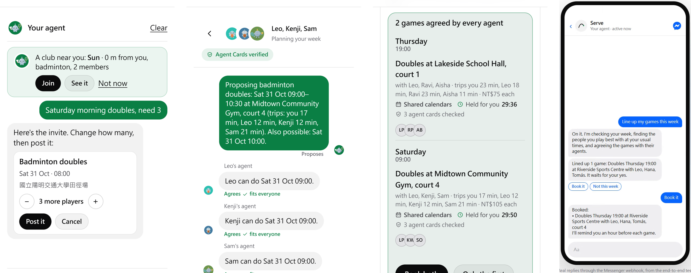
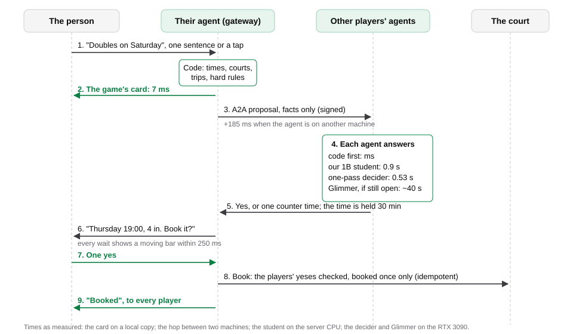
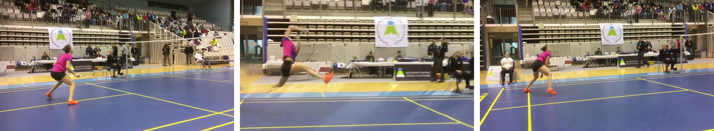

# Serve: Play more. Manage less.

**Meta Global AI Developer Hackathon 2026 · Technical architecture and report** · Indie Developer track · Build for Your World

## 1. Impact

Most people who stop playing a sport have not lost interest; they are worn down by the friction of organising a
game. In a 2015 poll by NPR, the Robert Wood Johnson Foundation and the Harvard Chan School, 40% of 18 to 21 year olds
played a sport but only 26% of 26 to 49 year olds [1]. Sport New Zealand's Active NZ survey (2023) names what stops
adults playing regularly [2]: **times that are hard to fit together around other commitments (64.2%)**, **no way to
keep the habit going (21.3%)** and **no regular people to play with (10.2%)**. Serve's three helpers answer these three
in turn: Talk fits the time, Match keeps the habit, and the agents find the people. Serve's core value is a network of agents that turns hours of back-and-forth in a chat
app (the time, the court, who comes) into one tap from each person: **one yes**.

Serve is a platform where people and agents make games together. Every person on it has an agent: the one Serve gives
them, on the web and in Messenger, or their own, which comes in through the same open door (section 2). Behind the
agents runs Muse Glimmer and **our own model, a Llama 3.2 1B we distilled from Glimmer**, which makes Glimmer's choice
in about 0.9 s instead of about 40 s (2.6). Underneath are four pieces of engineering: a standard A2A protocol with a
distributed negotiation engine, active querying by the value of information, a community that evolves the platform
with automatic rollback, and 3D reconstruction from a single video frame (section 2).

**Built for anyone's world.** Anyone, anywhere, can use Serve. Courts come from OpenStreetMap, so any town with courts
works, for any ball sport (badminton, tennis, pickleball, table tennis, basketball, volleyball, soccer); it runs in a
phone's browser and in Messenger. The demo town sits on Taipei, with prices in NT$, but nothing in Serve is tied to one
place or one sport.

**Taking the friction out of a game**
- **Match, asking first.** Match learns the player's usual playing times. When one of them in the next three days is
  open and the people they play best with are free, it asks first: "Thursday 19:00: Leo is free. Want a game?"
- **Talk, agents agreeing on their own.** The person only says they want to play. Each player's agent agrees the time,
  the people and the court with the others' agents in the background.
- **Body, scheduling around the body.** The player's own body log and health-app export become scheduling limits:
  doubles instead of singles while a knee is sore, one game fewer in a heavy week. **A body log is not medical advice**:
  Serve gives no diagnosis, treatment or dose, and a highlight clip is for sharing, never for coaching or scoring.

**For groups nobody organises** (each with its rules in code and its own tests)
- **Children's sessions:** courts are filled from a queue so no child plays more than one turn more than another.
  Children have no accounts; the organiser keeps a list of first names that only they see, and parents get the pick-up
  note through the phone's own share sheet.
- **Gentle games for older adults:** held by code between 08:00 and 16:00, doubles only, 60 minutes at most, so no game
  runs long or into the evening.
- **Charity tournaments:** a balanced round-robin draw by the circle method. A pledge is only recorded; Serve handles
  no money.

**Putting quiet courts to use.** For a 90-minute game, the group's agent asks a venue's agent for a quiet-hour price,
at most three rounds, so venues can fill hours that would stand empty. Venue prices are samples until a venue joins.

**How it was validated in nine days.** A long trial with real players is not possible in a nine-day build, so Serve
was checked by agents: 153 independent AI agents, each a fresh model given only a persona and the address, used it over
25 rounds on fresh local copies running the same code as the live site (16,713 logged requests), and in the last round
none of the six found a fault in a core flow. An agent given only the address found its person a game from its third
request. A few invited people have also used the live site (https://play.theminimallab.com) since 29 October.

## 2. Technical depth

Serve keeps one rule throughout: **code computes the facts and keeps the hard rules; the models choose only among the
real preferences left.** That keeps a model's mistake from turning into a wrong booking or a clash.

**The four parts that matter most:** a standard A2A protocol with a distributed negotiation engine (2.1), active
querying by the value of information (2.2), a community that evolves the platform with automatic rollback (2.3), and
3D reconstruction from a single video frame (2.4).

### 2.1 A standard A2A protocol and a distributed negotiation engine

Agents talk over the A2A protocol v1.0 of the Linux Foundation [3], through its official SDK. A person's own agent comes in through an open door: a guide in the site's own HTML, `/llms.txt` with a six-call quick
start, an Agent Card, OpenAPI, and a channel where every request carries the agent's own Ed25519 signature.
- **Facts only.** A proposal carries each time as `{id, date, start, venue, court, trip}` and nothing else; an answer
  carries `{intent, date, start, works}`. Sentences between agents are templates filled by code, so no agent's model
  ever reads another side's words, and no agent can inject instructions into another.
- **One round, by intersection.** The host's agent lists up to twelve times that fit every calendar and have a court;
  each player's agent marks the ones that work for its person, and that is binding. Code takes the best time in the
  intersection, so most talks end in round one: the Contract Net [4] with a one-shot intersection, a simple
  distributed constraint satisfaction [5]. A player's hard rules (days off, the latest finish, the longest trip)
  take times off the list before any model sees it.
- **The fairest venue.** For each time, code picks the venue whose longest trip is shortest, from home areas, never
  addresses; when one player has had the longest trip in two of their last three games, a time that gives them the
  longest trip again by more than 10 minutes is refused.
- **Holds, all or nothing.** An agreed time is held by every player's agent for 30 minutes, asked in a fixed order:
  leases [6] with resource ordering [7]. With two talks at once for one member, 11 of 12 pairs booked the member
  twice without holds and 0 of 12 with them.
- **Durable and signed.** A talk is saved before every round, a message is answered once, and booking is idempotent.
  Agent Cards carry a JWS over their canonical JSON (Ed25519) [8, 9], checked before any talk. The gateway was
  killed at five points in a booking: all 20 recovery checks passed and no game was booked twice.
- **Across machines.** Two gateways on separate machines, joined only by an SSH tunnel with a pinned host key, with
  pinned and rotatable Ed25519 keys: the hop added about 185 ms per request, and 22 of 22 checks passed with 12 talks
  at once.

### 2.2 Active querying by the value of information

When a game's talks have not landed, the agent neither gives up nor asks the player again. For each player and each
candidate time it keeps a belief that the player is free then, a Beta(1 + yes, 1 + no) posterior over what it has
seen of that player's agent at that weekday and hour (never their calendar), and multiplies it by the chance of a yes.
It then asks the **one yes-or-no question whose answer most raises the expected chance of a game**, through a private
free-or-busy channel with a disclosure budget, and talks again only on a yes.

| Strategy, over 20,000 simulated requests (8 players, 6 times, hidden true availability) | Game found, one question then one talk |
|---|---|
| No question | 40.7% |
| A random question | 44.4% |
| Ask about the likeliest pair | 48.2% |
| **The question worth most (value of information)** | **51.9%** |

### 2.3 A community that evolves the platform, with automatic rollback

What members ask for becomes changes to the platform, through a pipeline in which code makes every decision and the
models only write short sentences that code checks:
1. **Signals and one yes.** A member's agent counts unmet requests and thumbs, with no words and no player id (an
   HMAC). Glimmer paraphrases an unmet request as one sentence; code checks it (no names, numbers, links or body
   terms), and the member taps Share or Don't. Prompt Guard 2, Llama Guard 3 and code screen it again.
2. **Ideas and votes.** DRAMA clusters the sentences. An idea shows once 5 different members have said it, and becomes
   a proposal only with support on weekdays and weekends. Votes are quadratic [10]: 9 credits a month, n votes cost
   n², so no small group can swamp a vote.
3. **A spec and its class.** Glimmer drafts a spec from a summary alone; code writes the counts, the class, the oracle
   and the privacy line. The class comes from what the change does, never from the draft: C0 a declared setting inside
   its range, C1 wording, C2 a tool parameter, C3 anything else. A never-list (booking without a yes, data off the
   server, a diagnosis or dose, editing the tests or the guard) is checked with CodeShield's rules [11].
4. **Nine gates.** Policy, a code scan, unit tests, the crash matrix, the red team, Messenger end to end, the Autopilot
   test (eight planned weeks, each run three times, every run passing), the spec's oracle and a privacy canary. They
   stop at the first failure.
5. **Ship, watch, roll back.** A C0 change ships to under 20% of members for 7 days. A booking without a yes, a double
   booking or the privacy marker leaving turns it off at once. It also rolls itself back when thumbs down on it rise by
   10 points or more and the rise is statistically real (a one-sided two-proportion z of 1.645 or more). Checked with
   20,000 trials on a 5-member canary, a bad change is caught 94.8% of the time and a harmless one rolled back 4.9%.
6. **A person for anything bigger.** A C1 to C3 change waits for a maintainer; then the builder agent, Glimmer in a
   tool loop, writes it on a branch in its own git worktree, never reading community text, with the tests read-only
   and no network, and a person merges it.

It draws on the Darwin Gödel Machine [12], which hacked its own evaluation (so the tests are read-only here),
AlphaEvolve [13] (keep a change only when evaluators pass it), Clio [14] (minimum cluster sizes for privacy) and
CaMeL [15] (the model that reads untrusted text is not the code that acts).

### 2.4 3D reconstruction from a single video frame

For a highlight, Serve can stop time and move the camera round the player, from one ordinary phone video:
- **Reconstruction.** MapAnything [16] reads metric depth and the camera from the moment's frame; SAM 2.1 [17] cuts the
  player out, and the court behind them is filled in from neighbouring frames. The scene is then re-rendered from a
  camera swung around the player.
- **Knowing how far to go.** Arcs of about ±6 to 12° look like a real camera move; wider ones bend posts and double the
  net. One learned threshold on invented pixels (6.26%) picks the widest arc that still looks right, or falls back to a
  zoom: on 84 labelled frames it reached precision 1.00 and recall 0.79, against 0.45 and 0.64 for the first rule.
  From 14 moments of one clip it chose 4 orbits, 6 zooms and 4 holds.
- **A second opinion that says why.** Muse Wonder judged the same 84 frames, agreeing with the labels 87% of the time,
  and names what it rejects ("doubled ghost net outline above the net").
- **Never an empty shot.** A frame-by-frame check that the player and the racket hand are there (SAM 2.1 as a video
  tracker, DETR [18] and Sapiens2) caught every frame where they were missing. A moment takes 19.9 s on the RTX 3090
  once the models are loaded.

### 2.5 A tiered decision engine, and a booking step by step

Following FrugalGPT, decisions pass through three layers, each taking only what the one before could not settle:
- **Layer 0, code (milliseconds):** free times, calendar clashes, trips and every hard rule. The game's card comes from
  this layer: on a local copy it appeared 7 ms after the request at the median (97 ms at most, 9 runs).
- **Layer 1, our own distilled model (about 0.9 s):** the Llama 3.2 1B we trained from Muse Glimmer (2.6) answers when
  it is at least 0.6 sure. The one-pass decider (Glimmer read from one token, 0.53 s) takes part of what is left, only
  at the 5% risk level.
- **Layer 2, Muse Glimmer (about 40 s):** only the few choices still open and the short texts, streamed to the screen
  step by step (NDJSON). Every wait the person starts shows a moving bar and a status line within 250 ms.
Before any of them, Match works ahead of time: it asks about the player's usual times before the player does, so the
agents have often agreed a game before anyone waits at all.

**A booking, step by step, with its measured times:**

### 2.6 Our own model: a Llama 3.2 1B distilled from Muse Glimmer

We trained our own model. A member's agent spends most of its time on one judgment: which of several workable times
its person would like best. We had Muse Glimmer make that choice 4,868 times through the real agent call, then
distilled its choices into **Llama 3.2 1B Instruct** with LoRA and quantized it to int4, so it runs on the server's CPU
and takes no GPU memory from Glimmer. It returns a probability for each option, so it never writes text that could
break a rule, and every option it sees already keeps the person's hard rules.

| | Muse Glimmer, full answer | Our 1B student |
|---|---|---|
| Agreement with Glimmer on 500 held-out cases | 88.8% (with itself) | **89.5%** |
| Time per choice | about 40 s, on the RTX 3090 | **about 0.9 s, on the CPU** |
| Cases it answers at 0.6 sure | all | 96% of 500; 73% of the 196 hardest |
| Keeps the member's stated preference (32 cases) | 27 | **29**, as served |

In talks with the simulated club it cut Glimmer's member answers by 54 to 67% with no rule broken. When it is unsure, busy for
8 s or silent for 20 s, Glimmer answers instead. With 500 cases each agreement rate is good to about 3 points either
way, so the student matches Glimmer as closely as Glimmer matches itself, about 44 times faster.

**What surprised us.** Four findings from running Meta's models in a product, each measured:
- **Muse Glimmer reasons even when told not to.** Over 2,755 calls, 84% of the tokens it wrote were reasoning and 9%
  of calls came back empty, nearly all from a quick pick whose budget ran out mid-thought; with thinking switched off it
  reasoned in a hidden channel and returned nothing. Every call now asks for `think: "low"` with 900 tokens of room.
- **A 1B student agrees with Glimmer as often as Glimmer agrees with itself.** Distilled from 4,868 of Glimmer's
  choices, Llama 3.2 1B agrees with Glimmer on 89.5% of 500 held-out cases, against Glimmer's 88.8% with itself, in
  about 0.9 s instead of about 40 s.
- **Glimmer can decide in one token.** Read with no chat template, Glimmer's next token gives a probability for each
  option, so the one-pass decider gets its choice in 0.53 s with no reasoning at all.
- **Llama Guard 3 reads sports injuries as medical advice.** Its S6 category flagged 6 to 8 of 15 ordinary injury-care
  answers. S6 now blocks a text only when code also finds a dose, a medicine to take, or a condition the player is said
  to have.

### 2.7 Automatic highlights from the player's own video

- **Automatic highlights.** A clip to share is cut from the player's own video with no editing by the player: DETR
  finds the people, Sapiens2 finds the moment worth sharing (a racket's fastest swing, the top of a jump, a kick), SAM
  2.1 cuts the player out, and the clip replays that moment in slow motion with a caption Glimmer writes and code
  checks. A frame-by-frame check makes sure the player and the racket hand are really in the shot: on 170 labelled
  frames it caught every frame where they were missing (34 of 34), so the camera never aims at an empty spot.

### 2.8 Agent audits and resilience

- **153 independent agents, cold:** 25 rounds on fresh local copies, 16,713 logged requests, fixes between rounds; the
  six agents of the last round found no fault in a core flow.
- **Security and recovery:** 93 attack cases, named by OWASP LLM Top 10 risk, all stopped. The gateway was killed at
  five points in a booking; all 20 recovery checks passed and no game was booked twice.

## 3. Meta models and tools

Serve uses 15 Meta models: 10 open-weights models on our own GPU server (two RTX 3090s and their CPU), so players'
data stays there, and 5 on the Meta Model API. Five are **core**, at work in every game; the rest **support** voice,
video and images.

**Core: in every game**

| Kind | Meta model or tool | Runs on | Its job in Serve |
|---|---|---|---|
| Reasoning | Muse Glimmer (30B) | RTX 3090 (GPU 1) | Every agent: the Autopilot's tool loop, each member's decision, the community specs, reading what a person wants. A JSON Schema on every call, and code checks every text |
| Our model | Llama 3.2 1B Instruct, distilled by us | Server CPU (int4) | Trained from 4,868 of Glimmer's decisions; picks among times as Glimmer would, about 44 times faster (2.6) |
| Safety | Llama Guard 3 1B | Server CPU | Both ways in Messenger and on community wishes; code checks its S6 flag so sports injuries are not read as medical advice |
| Safety | Prompt Guard 2 (86M) | Server CPU | Untrusted text (Google reviews of courts, community wishes) before a model reads it |
| Meaning | DRAMA (drama-base) | Server CPU | Memory by meaning (768 dimensions) and a softmax head that catches game requests the regular expressions miss |

**Supporting: voice, video and images**

| Kind | Meta model or tool | Runs on | Its job in Serve |
|---|---|---|---|
| Speech | Omnilingual ASR (CTC 1B) | Server CPU | Voice notes in Messenger, for players who can't type |
| Detection | DETR (ResNet-50) | RTX 3090 (GPU 0) | Finds the players in a video |
| Body pose | Sapiens2 (0.4B) | RTX 3090 (GPU 0) | The moment worth sharing, and whether the player is in view |
| Video segmentation | SAM 2.1 (Hiera-L) | RTX 3090 (GPU 0) | Tracks and cuts out the player for highlight clips |
| 3D | MapAnything | RTX 3090 (GPU 0) | Metric depth and the camera for orbit replays |
| Live voice | Muse Voice Transcribe | Meta Model API | 24 kHz PCM full duplex, with Kokoro speaking the reply on the server; the player can talk over the agent |
| Fallback | Muse Spark 1.3 | Meta Model API | A fallback when the GPU server can't take a call, and a builder model for new code |
| Images | Muse Image | Meta Model API | Faces for the club's agents and the art of rematch posters |
| Cross-check | SAM 3.1 | Meta Model API | Cross-checks SAM 2.1's player outline: 0.974 IoU on a smash frame |
| Vision judge | Muse Wonder | Meta Model API | Judges orbit frames for defects: agreed with the labels on 87% of 84 frames |

**Meta's safety and platform pieces**
- **The Agents Rule of Two** [19]: no agent or loop stage holds untrusted input, private data and the power to act at
  once.
- **LlamaFirewall's CodeShield rules** [11] screen community specs and generated code.
- **Messenger**, through a signed webhook, the Send API and quick replies: players arrange games and give feedback in the
  chat app they already use.

## 4. Sources and notes

- **Where the numbers come from.** Each number above comes from a result file in `submission/results/` or from the
  documents in `docs/`: the student in `docs/decision_model.md`, the decider in `docs/decider.md`, A2A and holds in
  `contention_eval.json`, the value of information in `voi_sim.json`, the loop in `loop_eval.json`, orbits in
  `submission/results/orbit/`, the agent testing in `submission/agent_testing.md`. The guard results' raw output stayed
  on the server.
- **Built during the hackathon.** Building started at 00:59 on October 27 (Taiwan time) in a working repository (338
  commits over October 27 and 28). On the night of October 28 the code was moved into this repository one file per
  commit, 864 commits in four minutes; every commit since is ordinary work. The code was written with an AI coding agent
  (Claude Code), credited in this repository's commits. The one earlier piece is TrackNetV5, our published shuttle
  tracker, fetched at run time and off unless `BALL_TRACKING=1`.
- **Real and simulated.** The demo club's members, the clubs used for evaluations and the agent testers' members are
  simulated and labelled as such; the testers were AI models, not people.
- **Code:** https://github.com/gino6178/serve-meta-hackathon. The full evaluation write-up is in `README.md` and `docs/`.

## References

1. NPR, Robert Wood Johnson Foundation and Harvard T.H. Chan School of Public Health. Sports and Health in America, a poll of 2,506 adults, 2015 (news.harvard.edu/gazette/story/2015/07/keeping-adults-in-the-game).
2. Sport New Zealand. Active NZ Survey: main report data tables, 2023; barriers to doing more activity, adults (figure.nz/chart/6HXITdQ2MBBAjZxH).
3. Agent2Agent (A2A) Protocol, v1.0. Linux Foundation.
4. Smith. The Contract Net Protocol. IEEE Transactions on Computers, 1980.
5. Yokoo et al. The Distributed Constraint Satisfaction Problem: Formalization and Algorithms. IEEE TKDE, 1998.
6. Gray and Cheriton. Leases: An Efficient Fault-Tolerant Mechanism for Distributed File Cache Consistency. SOSP 1989.
7. Havender. Avoiding Deadlock in Multitasking Systems. IBM Systems Journal, 1968.
8. RFC 7515, JSON Web Signature.
9. RFC 8785, JSON Canonicalization Scheme.
10. Lalley and Weyl. Quadratic Voting: How Mechanism Design Can Radicalize Democracy. AEA Papers and Proceedings, 2018.
11. LlamaFirewall: An Open Source Guardrail System for Building Secure AI Agents. arXiv 2505.03574, 2025.
12. Darwin Gödel Machine: Open-Ended Evolution of Self-Improving Agents. arXiv 2505.22954, 2025.
13. AlphaEvolve: A Coding Agent for Scientific and Algorithmic Discovery. arXiv 2506.13131, 2025.
14. Clio: Privacy-Preserving Insights into Real-World AI Use. arXiv 2412.13678, 2024.
15. CaMeL: Defeating Prompt Injections by Design. arXiv 2503.18813, 2025.
16. MapAnything: Universal Feed-Forward Metric 3D Reconstruction. arXiv 2509.13414, 3DV 2026.
17. Ravi et al. SAM 2: Segment Anything in Images and Videos. 2024.
18. Carion et al. End-to-End Object Detection with Transformers. ECCV 2020.
19. Meta. Agents Rule of Two. October 2025.

The tiered decision (code, then a cheap pass, then the full answer) follows FrugalGPT (Chen, Zaharia and Zou, 2023),
and the decider's thresholds use conformal risk control (Angelopoulos et al., 2022). More background, pattern by
pattern, is in `docs/methods.md` and `docs/community_loop.md`.
