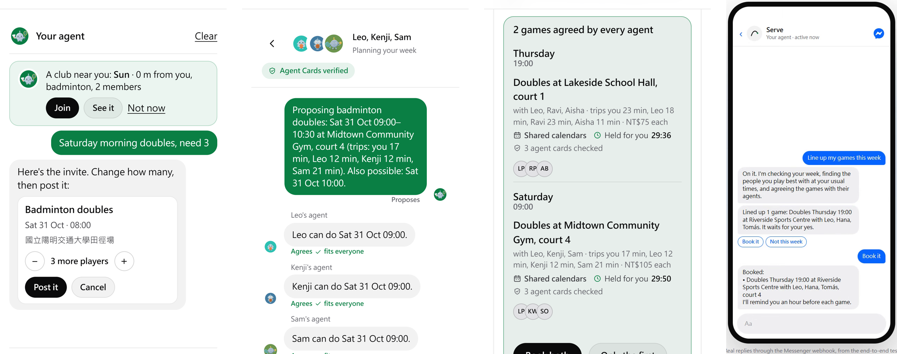
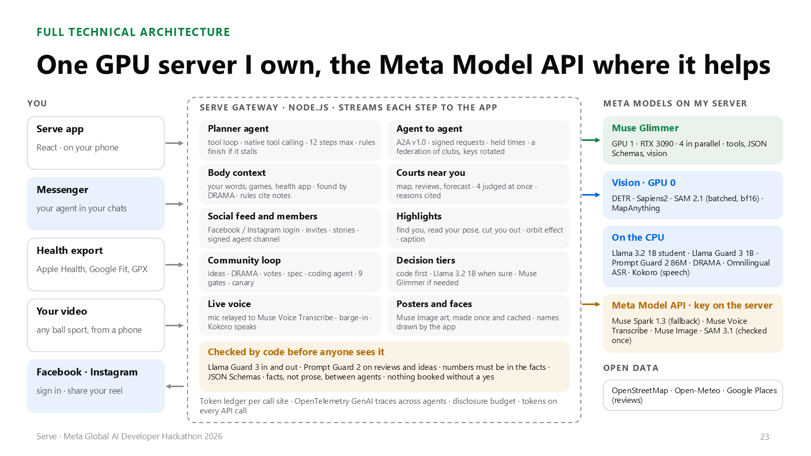
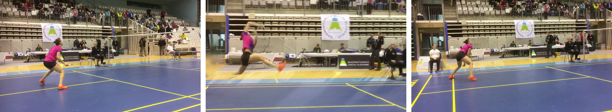
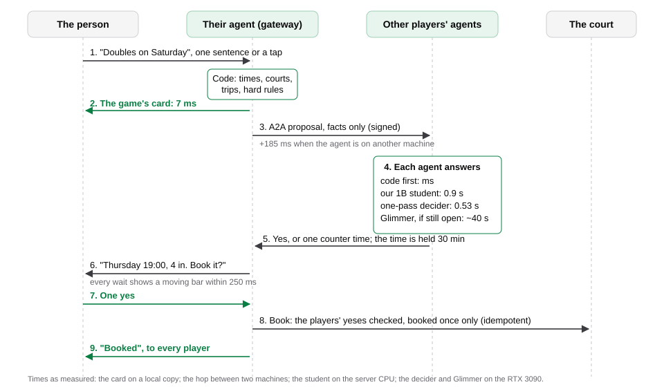

# Serve: Play more. Manage less.

**Meta Global AI Developer Hackathon 2026 · Technical architecture and report** · Indie Developer track · Build for Your World

**Demo video (2:59):** https://youtu.be/OXlW1dznFo4 · **Live site:** https://play.theminimallab.com · **Code:** https://github.com/gino6178/serve-meta-hackathon

## 1. Impact

**The gap.** People are starting to have personal AI agents that know their calendar and their limits, but there is
no safe, standard place where one person's agent can agree something with another person's agent. So anything that
needs several people to say yes still falls back to a group chat. Serve is that place: **a platform where personal
agents negotiate real-world plans for their people**, and each person is asked for **one yes**. We built and tested it
on the hardest everyday case we know, getting a ball game together, where four people, their weeks, a court and its
price all have to line up.

The need is real. Most people who stop playing a sport have not lost interest; they are worn down by organising. In a
2015 poll by NPR, the Robert Wood Johnson Foundation and the Harvard Chan School, 40% of 18 to 21 year olds played a
sport but only 26% of 26 to 49 year olds [1]. Sport New Zealand's Active NZ survey (2023) names what stops adults
playing regularly [2]: **times that are hard to fit together around other commitments (64.2%)**, **no way to keep the
habit going (21.3%)** and **no regular people to play with (10.2%)**. Talk lets the agents fit the time, Match keeps the
habit by asking first, and the agents find the people.

**Why a platform for agents needs this engineering.** Once the agents come from different people, every part of
Serve follows from that:

- **An open door with a lock.** Any person's agent, built anywhere, can come in through `/llms.txt` with its own
  Ed25519 key, approved by its person. Over an agent key a person's limits only get tighter: an agent that tries to
  raise its person's price cap is refused (`403`, `needs: person`).
- **Facts only between agents.** Agents talk over A2A v1.0, and a proposal carries signed facts (date, start, venue,
  court, trip), never free text, so no model reads another side's words and one agent cannot inject instructions into
  another. Holds stop two talks from booking one person twice (2.1).
- **Fast enough to negotiate.** When four agents negotiate, waiting about 40 s for a large model at every step stalls
  the talk. Code keeps the hard rules, a 27.6 KB classifier settles most ordinary choices, and
  **our own Llama 3.2 1B, distilled from Muse Glimmer**, makes Glimmer's choice in about 0.9 s on a CPU (2.5, 2.6).
- **Safe by construction.** No agent holds untrusted input, private data and the power to act at once (the Agents Rule
  of Two), and 93 of 93 attack cases are stopped (2.7).

Underneath are four pieces of engineering: a standard A2A protocol with a distributed negotiation engine, active
querying by the value of information, a community that evolves the platform with automatic rollback, and, as a bonus
after the game, 3D reconstruction from a phone video (section 2).

**Tested with friends.** During the hackathon more than 10 people from a badminton club tried Serve, and of the 3 game
invites sent through it, 2 became games that were played, within three days. Two players, in their own words
(translated from Chinese):

- *"It's actually really handy. You just talk to the agent."* (Player A)
- *"I think the way it suggests games first can make people more motivated to play."* (Player B)

#### A game from one sentence, against a group-chat poll

| Step | Group-chat poll | Serve |
|---|---|---|
| The time and the court | The organiser picks options and books the court | The agent drafts both from one sentence: the day from the words, the nearest court |
| Settled when | Everyone has voted and the organiser posts the result | The spots fill: whoever is free taps Join; nobody else is waited for |
| Someone not in the group | Has to be added to the chat first | Opens the link and joins |
| Who is in | Read back from the votes and replies | On the card; the agent posts each join in the thread |

Every person on Serve has an agent: the one Serve gives them, on the web and in Messenger, or their own, which comes
in through the same open door (section 2).

**Build for Your World.** Each person's world is their own week, their own courts and their own people, and Serve is
built around exactly that. Anyone, anywhere, can use it. Courts come from OpenStreetMap, so any town with courts
works, for any ball sport (badminton, tennis, pickleball, table tennis, basketball, volleyball, soccer); it runs in a
phone's browser and in Messenger. The demo town sits on Taipei, with prices in NT$, but nothing in Serve is tied to one
place or one sport.

#### Taking the friction out of a game
- **Match, asking first.** Match learns the player's usual playing times. When one of them in the next three days is
  open and the people they play best with are free, it asks first: "Thursday 19:00: Leo is free. Want a game?"
- **Talk, agents agreeing on their own.** The person only says they want to play. Each player's agent agrees the time,
  the people and the court with the others' agents in the background.
- **Pace, scheduling around exercise load.** Training load from the player's health-app export becomes a scheduling
  limit: one game fewer in a heavy week, doubles instead of singles. Pace plans around load and fatigue only, with no
  diagnosis, treatment or injury advice, and a highlight reel is for sharing with friends, never for coaching or scoring.

**For groups nobody organises:** children's sessions with fair turns and no child accounts, gentle daytime doubles
for older adults, and charity round-robins that record pledges but handle no money, each with its rules in code.
**Quiet courts:** the group's agent can ask a venue's agent for a quiet-hour price, so venues fill empty hours.

**How it was validated in nine days.** A long trial with real players is not possible in a nine-day build, so Serve
was also checked by agents. Over 28 rounds, a fresh set of independent AI agents used it each round (177 reports in
all), each a new model given only a persona and the address (17,432 logged requests). Rounds 1 to 26 ran on fresh local
copies running the same code as the live site; round 25 was the first with no fault in a core flow. Round 27 went to
the live site itself, with test accounts in a private club; round 28 ran the write flows on a local copy that also uses
the server's own models (Muse Glimmer, Llama Guard 3, Prompt Guard 2), so the safety checks a post goes through are the
real ones. Those harder rounds found new faults (a club name refused as a threat, a host leaving Serve without telling
their players, an agent reading its person's notices away), all fixed and checked again over HTTP. Three more agents
were given only the address and a request: the best of them was doing useful work by its third request to the API and
found its person a Sunday 09:00 tennis game, free, 2.6 km away.

## 2. Technical depth

Serve keeps one rule throughout: **code computes the facts and keeps the hard rules; the models choose only among the
real preferences left.** That keeps a model's mistake from turning into a wrong booking or a clash.

**Terms used below.** *One yes*: the single tap each person gives before anything is booked. *The student*: our
own Llama 3.2 1B, distilled from Muse Glimmer (2.6). *The decider*: Glimmer itself, read from a single token with no
reasoning.

**The four parts that matter most:** a standard A2A protocol with a distributed negotiation engine (2.1), active
querying by the value of information (2.2), a community that evolves the platform with automatic rollback (2.3), and
3D reconstruction from a phone video (2.4).

### 2.1 A standard A2A protocol and a distributed negotiation engine

Agents talk over the A2A protocol v1.0 of the Linux Foundation [3], through its official SDK. A person's own agent comes in through an open door: a guide in the site's own HTML, `/llms.txt` with a six-call quick
start, an Agent Card, OpenAPI, and a channel where every request carries the agent's own Ed25519 signature.
- **Facts only.** A proposal carries each time as `{id, date, start, venue, court, trip}` and nothing else; an answer
  carries `{intent, date, start, works}`. Sentences between agents are templates filled by code, so no agent's model
  ever reads another side's words, and no agent can inject instructions into another.
- **One round, by intersection.** The host's agent lists up to twelve times that fit every calendar and have a court;
  each player's agent marks the ones that work for its person, and that is binding. Code takes the best time in the
  intersection, so most talks end in round one: the Contract Net [4] with a one-shot intersection, a simple
  distributed constraint satisfaction [5]. A player's hard rules (days off, the latest finish, the longest trip)
  take times off the list before any model sees it.
- **The fairest venue.** For each time, code picks the venue whose longest trip is shortest, from home areas, never
  addresses; when one player has had the longest trip in two of their last three games, a time that gives them the
  longest trip again by more than 10 minutes is refused. Over 12 simulated games, no booked game gave anyone a longer
  longest trip than the best venue possible, at a cost of 2.3 minutes more total travel per game; the fairness score
  was 0.73, against 0.59 for the shortest total trip and 0.58 for a Nash product.
- **Times ranked by the chance everyone says yes.** A game needs every player, so the times are proposed in order of
  the product of each player's chance of a yes (from 2.2), and a time where any one player's chance is under 0.15 goes
  to the back: a least-misery floor, as group recommenders that predict perceived fairness advise [26]. With shared
  calendars the first time proposed decides whether each agent can say yes by code or must ask a model. Against the old
  order (the time the most players had free), on 3,000 simulated requests of each kind, the first time kept every player's rules in
  89.1% of doubles requests instead of 73.9% (92.4% instead of 89.8% for singles), and the model choices per doubles
  request fell from 0.261 to 0.109. With private calendars it found no more games.
- **Skill with uncertainty.** Each player has a rating per sport as a mean and an uncertainty, changed only by
  competitive games that the other side confirms; children's, gentle and charity games never count.
- **Holds, all or nothing.** An agreed time is held by every player's agent for 30 minutes, asked in a fixed order:
  leases [6] with resource ordering [7]. With two talks at once for one member, 11 of 12 pairs booked the member
  twice without holds and 0 of 12 with them.
- **Durable and signed.** A talk is saved before every round, a message is answered once, and booking is idempotent.
  Agent Cards carry a JWS over their canonical JSON (Ed25519) [8, 9], checked before any talk. The gateway was
  killed at five points in a booking: all 20 recovery checks passed and no game was booked twice.
- **Across machines.** Two gateways on separate machines, joined only by an SSH tunnel with a pinned host key, with
  pinned and rotatable Ed25519 keys: the hop added about 185 ms per request, and 22 of 22 checks passed with 12 talks
  at once.
- **To the standard.** Agent Cards point to their keys with `jku`, the proposal and hold extensions are declared and
  required, and errors use the protocol's own codes (-32700 for a body that is not JSON, -32005, -32008).

### 2.2 Active querying by the value of information

**Who gets asked, from each player's habits.** A request doesn't message the whole club. Each member's agent fits four
weights from its person's own choices (the time of week, the distance, the price, a quiet court; a logistic,
Bradley-Terry step per answer, `members/taste.js`). The asking agent picks candidates by that fit and asks each one's
agent over A2A how likely a yes is (`serve.likely`). That agent works the answer out on its own side from its person's
record and answers only with a band; the best-suited are invited first, and two of every twelve candidates are drawn
from the rest, so it isn't always the same few people (`match/ask.js`).

When a game's talks have not landed, the agent neither gives up nor asks the player again. For each player and each
candidate time it keeps a belief that the player is free then, a Beta(1 + yes, 1 + no) posterior over what it has
seen of that player's agent at that weekday and hour (never their calendar), and multiplies it by the chance of a yes.
It then asks the **one yes-or-no question whose answer most raises the expected chance of a game**, through a private
free-or-busy channel with a disclosure budget, and talks again only on a yes.

| Strategy (20,000 simulated requests each; 8 players, 6 times, hidden true availability) | Game found, one question then one talk |
|---|---|
| No question | 40.7% |
| A random question | 44.4% |
| Ask about the likeliest pair | 48.2% |
| **The question worth most (value of information)** | **51.9%** |

With 20,000 requests each, every rate is good to about 0.7 points either way, so each step in the table is real.
A new player starts from what the agent has seen across all players rather than a blank belief.

**One answer teaches about the hours like it.** At first every weekday and hour had its own belief, so a "no" for
Tuesday at 19:00 said nothing about Tuesday at 20:00. Following Pep [24] and VPL [25], which learn a person from a few
answers through structure shared across people, an answer now lends part of its count to the hours that go together
in the club's own free lists (the same evening an hour or two apart, the same hour on another weeknight, the two
weekend days), and the club's prior counts as half an answer instead of two. A window's last hour no longer counts as
free when a 90-minute game cannot start then. On 6,000 simulated requests, with members apart from those that make the prior: Brier score 0.223 to 0.200,
log loss 0.638 to 0.585, and the chance the first talk lands rose from 68.9% to 73.7%, or from 75.1% to 79.2% with one
value-of-information question first. Every free-or-busy
question is charged to the same disclosure budget as a proposal, so an agent that keeps asking learns at most 24 of
112 weekly hours in 28 days, and what A tells B never reaches C. No one is asked more than 3 times a week, and an optional micro-randomised trial (off by default) can measure whether
an ask at a given moment helps, with its analysis script. A player can also import an `.ics` calendar: only its busy
times are read, and they become weekly free windows.

### 2.3 A community that evolves the platform, with automatic rollback

What members ask for becomes changes to the platform, through a pipeline in which code makes every decision and the
models only write short sentences that code checks:

**unmet request → one sentence, shared only with a yes → screened → idea and quadratic vote → spec and class → nine
gates → canary of members → kept, or rolled back by itself** (bigger changes go to a person).

1. **Signals and one yes.** A member's agent counts unmet requests and thumbs, with no words and no player id (an
   HMAC). Glimmer paraphrases an unmet request as one sentence; code checks it (no names, numbers, links or body
   terms), and the member taps Share or Don't. Prompt Guard 2, Llama Guard 3 and code screen it again.
2. **Ideas and votes.** DRAMA clusters the sentences. An idea shows once 5 different members have said it, and becomes
   a proposal only with support on weekdays and weekends. Votes are quadratic [10]: 9 credits a month, n votes cost
   n², so no small group can swamp a vote.
3. **A spec and its class.** Glimmer drafts a spec from a summary alone; code writes the counts, the class, the oracle
   (a test of the change written from the spec, which the builder never sees) and the privacy line. The class comes from what the change does, never from the draft: C0 a declared setting inside
   its range, C1 wording, C2 a tool parameter, C3 anything else. A never-list (booking without a yes, data off the
   server, a diagnosis or dose, editing the tests or the guard) is checked with CodeShield's rules [11].
4. **Nine gates.** Policy, a code scan, unit tests, the crash matrix, the red team, Messenger end to end, the Autopilot
   test (eight planned weeks, each run three times, every run passing), the spec's oracle and a privacy canary. They
   stop at the first failure.
5. **Ship, watch, roll back.** A C0 change ships to under 20% of members for 7 days. A booking without a yes, a double
   booking or the privacy marker leaving turns it off at once. It also rolls itself back when thumbs down on it rise by
   10 points or more and the rise is statistically real under an anytime-valid test (an e-process [22], E of 20 or
   more), so the monitor can look every 5 minutes without false alarms piling up. In 20,000 simulated 7-day canaries
   of 5 members, looked at every 5 minutes, a harmless change was rolled back 0.6% of the time, against 22% for a
   z-test checked at every look; the price is caution, as a bad change (thumbs down from 25% to 60%) was caught in
   61% of canaries.
6. **A person for anything bigger.** A C1 to C3 change waits for a maintainer; then the builder agent, Glimmer in a
   tool loop, writes it on a branch in its own git worktree, never reading community text, with the tests read-only
   and no network, and a person merges it.

It draws on the Darwin Gödel Machine [12], which hacked its own evaluation (so the tests are read-only here),
AlphaEvolve [13] (keep a change only when evaluators pass it), Clio [14] (minimum cluster sizes for privacy) and
CaMeL [15] (the model that reads untrusted text is not the code that acts).

### 2.4 3D reconstruction and automatic highlights from a phone video

For a highlight, Serve can stop time and move the camera round the player, from one ordinary phone video:
- **Reconstruction.** MapAnything [16] reads metric depth and the camera from the moment's frame; SAM 2.1 [17] cuts the
  player out, and the court behind them is filled in from neighbouring frames. The scene is then re-rendered from a
  camera swung around the player.
- **Knowing how far to go.** Arcs of about ±6 to 12° look like a real camera move; wider ones bend posts and double the
  net. Seen from a new angle, part of the frame was never filmed, and the renderer has to make those
  pixels up. One learned threshold on that share of invented pixels (6.26% of the frame) picks the widest arc that still
  looks right, or falls back to a zoom: on 84 labelled frames it reached precision 1.00 and recall 0.79, against 0.45
  and 0.64 for our first rule (a budget on invented patches at low resolution).
  From 14 moments of one clip it chose 4 orbits, 6 zooms and 4 holds.
- **A second opinion that says why.** The threshold decides; Muse Wonder explains. On the same 84 frames it agreed
  with the labels 87% of the time, and it names what it rejects ("doubled ghost net outline above the net"), which a
  pixel count cannot.
- **Never an empty shot.** A frame-by-frame check that the player and the racket hand are there (SAM 2.1 as a video
  tracker, RT-DETR [18] and Sapiens2) caught every frame where they were missing. A moment takes 19.9 s on the RTX 3090
  once the models are loaded.

- **Automatic highlights.** A clip to share is cut from the player's own video with no editing by the player: RT-DETR
  finds the people (about 4 boxes a frame against DETR's 15 to 20, about 2× faster, and the right player on all three
  test clips), Sapiens2 finds the moment worth sharing (a racket's fastest swing, the top of a jump, a kick), SAM
  2.1 cuts the player out, and the clip replays that moment in slow motion with a caption Glimmer writes and code
  checks. The presence check above keeps the zoom on the player. With ball tracking on, the clip can start and end
  with the rally itself, cut where the shuttle comes into play and where it goes out.

### 2.5 Cache and router: a tiered decision engine, and a booking step by step

Following FrugalGPT [19], decisions pass through layers, each taking only what the one before could not settle:
- **Layer 0, code (milliseconds):** free times, calendar clashes, trips and every hard rule. The game's card comes from
  this layer: on a local copy it appeared 7 ms after the request at the median (97 ms at most, 9 runs).
- **A tiny layer first (0.06 ms):** four small networks in plain JavaScript (28 KB), trained on the same 4,868 Glimmer
  choices over facts code already holds (weekday, hour, trip, distance from the asked time, the member's habits), each
  with a doubt model that predicts when it would disagree with Glimmer. Over all held-out cases it agrees with Glimmer
  88.5% (69.4% on the hardest); at its threshold it answers 59.8% of ordinary choices, disagreeing on 4.3% of them, so
  most choices never reach a model at all.
- **Layer 1, our own distilled model (about 0.9 s):** the Llama 3.2 1B we trained from Muse Glimmer (2.6) answers when
  it is at least 0.6 sure: 96.0% of ordinary choices and 73.0% of the hardest.
- **Two cheap reads that agree.** When the student is unsure, the decider (0.53 s) reads Glimmer's choice in one token.
  It keeps its pick alone when the chance that it differs from Glimmer's full answer is under 5%; and when the student
  and the decider each give the same time at least 0.5, that time stands. On the decider's 196 hardest
  cases, split in halves 500 times, this rule raised the choices settled without Glimmer's full answer from 72.1% to
  79.0%, matching Glimmer 68.9% of the time instead of 69.6% (Glimmer matches itself 73.5%).
- **Layer 2, Muse Glimmer (about 20 to 40 s), stopped early when it is sure.** Only the few choices still open reach
  it, streamed to the screen step by step (NDJSON). Following DEER [23], once its reasoning is 1,000 characters long the
  options are read at each break in it, and the first read that is 0.98 sure ends the answer. On the RTX 3090, one
  answer at a time on 30 cases, Glimmer wrote 30% fewer tokens (596 to 420 an answer) and answered no later (22.3 s to
  21.3 s), though each read takes in the reasoning again (prompt tokens 1,074 to 4,885); read after the fact on 119
  cases, 1.7% of answers differ from the full one. Every wait the person starts shows a moving bar and a status line
  within 250 ms.
- **Text, by length.** Free text (wording an invite, a summary, a reply) goes by how long the call is: see section 3.
Before any of them, Match works ahead of time: it asks about the player's usual times before the player does, so the
agents have often agreed a game before anyone waits at all.

**The router.** Every model call goes through one router (`core/llm.js` `tierOf`): a choice among declared options
through the layers above; short text at a checked site to our text 1B; anything else to Glimmer on our GPU, or, on
the public site (`LLM_FAST=api`), to Muse Spark on the Meta Model API when a person waits for it (a caption in 2.4 s,
Glimmer if the API fails); very long calls to Muse Spark; background work behind every call a person waits for.
**The caches.** The planner's system prompt and tools stay the same between calls so Ollama reuses the prefix:
88.8% of 480,122 prompt tokens over 302 planner calls came from cache. A court's verdict is kept an hour under a hash
of what it was judged on, and a judging still running is joined; courts are judged ahead for the hour before and
after, which cut the wait after moving the time from 49.0 s to 25.7 s over 4 cities.

#### A booking, step by step, with its measured times

### 2.6 Our own model: a Llama 3.2 1B distilled from Muse Glimmer

We trained our own model. A member's agent spends most of its time on one judgment: which of several workable times
its person would like best. We had Muse Glimmer make that choice 4,868 times through the real agent call, then
distilled its choices into **Llama 3.2 1B Instruct** with LoRA and quantized it to int4, so it runs on the server's CPU
and takes no GPU memory from Glimmer. It works the way TypeSafe's Jev decision models do [20]: the options are declared in
advance and scored together in a single read, instead of an answer generated token by token. So it returns a
probability for each option and never writes text that could break a rule, and every option it sees already keeps the
person's hard rules.

| | Muse Glimmer, full answer | Our 1B student |
|---|---|---|
| Agreement with Glimmer on all 500 held-out cases (every case answered; always taking the first listed time: 82.7%) | 88.8% (with itself) | **89.5%** (88.5% after int4) |
| Time per choice | about 40 s, on the RTX 3090 | **about 0.9 s, on the CPU** |
| Cases it answers at 0.6 sure (the served threshold) | all | 96.0% of 500; 73.0% of the 196 hardest (the asked time breaks a rule, calendars shared) |
| Agreement with Glimmer at 0.6 sure, with Glimmer on the rest | 88.3% on the 500; 73.5% on the hardest (Glimmer again) | 89.9% on the 500; 68.4% on the hardest |

We tried a lower threshold on the last day. At 0.5 the student answers 96.9% of the hardest instead of 73.0%, leaving
3.1% to the layers after it instead of 27.0%, but its agreement there falls from 68.4% to 61.2% (0.3 points on the
500), so the served threshold stays at 0.6 and the hardest choices keep going to the decider and Glimmer. A pick whose reading of
which times work differs from code's still goes to Glimmer. In talks with the simulated club, it cut Glimmer's
member answers by 67% (ordinary talks) and 54% (with private calendars on), with no rule broken. When it is unsure, busy for
8 s or silent for 20 s, Glimmer answers instead. With 500 cases each agreement rate is good to about 3 points either
way, so the student matches Glimmer as closely as Glimmer matches itself, about 44 times faster than its full answer.

Its confidence can be trusted: over the 500 held-out cases its expected calibration error is 0.052, and at 0.8 sure it
answers 89% of them and differs from Glimmer on only 7%.

**A fourth round, served from 31 October.** Trained again on an A100 with one more Glimmer answer for 700 random
cases, and graded on the hardest cases against the majority of Glimmer's other answers (Glimmer itself reaches 76.7%
there), the new int4 file is ahead of the one it replaced on both held-out sets: 88.9% against 88.5% on test, and
69.5% against 67.0% on the hardest, neither difference significant, so it took over at the same threshold. Its int4
loses about 3.5 points to its own bf16 on the hardest cases (McNemar p = 0.039). Shuffling half the training prompts
cut the picks that change when the times are listed in reverse from 15.6% to 1.6%, but it was not chosen: Glimmer
itself picks the first listed time 83% of the time on test, so matching Glimmer partly means copying that habit.

**Why distil, when the one-pass decider takes 0.53 s?** The decider is still Glimmer, so it needs the GPU that every
agent's reasoning and the video models share, and it keeps a pick only when it is that sure (about 8% of choices). The
student runs on the CPU, answers 96% of the 500 test cases on its own, and leaves the GPU free for the work only Glimmer
can do.

**What surprised us.** Four findings from running Meta's models in a product, each measured:
- **Muse Glimmer reasons even when told not to.** Over 2,755 calls, 84% of the tokens it wrote were reasoning and 9%
  of calls came back empty, nearly all from a quick pick whose budget ran out mid-thought; with thinking switched off it
  reasoned in a hidden channel and returned nothing. Every call now asks for `think: "low"` with 900 tokens of room.
- **A 1B student agrees with Glimmer as often as Glimmer agrees with itself.** Distilled from 4,868 of Glimmer's
  choices, Llama 3.2 1B agrees with Glimmer on 89.5% of 500 held-out cases, against Glimmer's 88.8% with itself, in
  about 0.9 s instead of about 40 s.
- **Glimmer can decide in one token.** Read with no chat template, Glimmer's next token gives a probability for each
  option, so the one-pass decider gets its choice in 0.53 s with no reasoning at all.
- **Llama Guard 3 refused a club name as a threat.** On the live site it refused a club named "Serve test round 27" as violence
  (S9 once, S1 on a later run): S9 now counts only with a weapon word in the text, and S1 alone with no word of harm is
  left to the club's standard, which Glimmer reads; the feed red team still stops 13 of 13.

### 2.7 Security, and a failure the agents found

- **Attacks and crashes.** 93 attack cases, named by OWASP LLM Top 10 risk, were all stopped; the crash and recovery
  checks are in 2.1. Prompt Guard 2 now reads every post and comment first, before Llama Guard 3 and code.
- **A signed record of every yes.** Each consent is appended to a log in which every entry is signed and carries the
  hash of the one before, so a yes cannot be changed or removed afterwards without it showing.
- **De-identification.** What leaves a person's own agent is de-identified first, by code. On the public trust chain a
  person is an HMAC pseudonym and others see only words; the area they play from is rounded to about 1 km; another
  agent gets a likelihood band, never the calendar, and every question is charged to a disclosure budget, so an agent
  that keeps asking learns at most 24 of 112 weekly hours in 28 days; what groups paid at a venue and what players said
  about it carry no name or club. A sign-in provider's id is kept only as a hash.
- **No-shows, with no money.** A player's show-up record fades with a 60-day half-life and is shown as a range in
  words, never a score; a game short of its minimum players is called off 3 hours before; a freed spot is offered to
  the waitlist with 12 hours to confirm.
- **A failure, and the fix.** During the agent rounds, a tester working as a host found it could work out how
  many people nearby were open to being asked, first from a count and then from the talk. Now nearby people appear only
  once they can actually play, and everyone else sees only published badge words; later rounds re-checked it and found
  nothing.

### 2.8 A venue's own agent, and a fair split

A sports centre has an A2A agent of its own (`venues/agent.js`), with a signed Agent Card at
`/a2a/venues/<id>/.well-known/agent-card.json` and one skill, quote a court.

- **Signed quotes.** The group's agent sends a court ask (date, start, players, its offer); the venue's agent answers
  with a quote, accepted or a counter, signed with the venue's own Ed25519 key, which its card carries. Each round the
  group sends back the venue's last quote and the venue checks its own signature on it, so neither side can make up an
  earlier price.
- **The venue's rule.** Never under a floor: 60% of list for an hour that is usually empty, the list price once it is
  85% full, a little off for a weekly booking.
- **Each player decides what they pay** (`members/split.js`). Each sets the most they will pay and can opt in to cover
  more than an equal share. The group's agent never offers past what the limits cover between them; the price is
  split equal first, a tight limit is covered only by those who offered, and no one pays past their own limit.
- **A real venue's own agent.** A venue registers its agent's A2A address for its place (maintainer-approved); Serve
  then talks to it over A2A, checking its card and every quote. In a run against NTU Gymnasium's agent over HTTP, the
  card checked out, every quote was signed, and the talk went from NT$320 to the venue's floor, NT$290.
- **No money moves**: prices are samples until a venue joins, and nothing is paid in the app. Tests:
  `agent/test/venue_agent_unit.mjs`.
- **Checking the place before booking.** The game page has a short report on the place: its Google rating, review
  points each quoted word for word from one review (Prompt Guard 2 first, then Muse Glimmer, then a code check), its
  prices and what groups paid there, and what Serve players said after playing there. A player's own agent asks
  them once after a game; only players of a game agreed at the place can answer, and the marks go on the trust chain
  under their pseudonym. Tests: `agent/test/venue_report_unit.mjs`, `agent/test/venue_notes_unit.mjs`.

### 2.9 Observability

Every agent at work, every A2A request, model call and tool call is an OpenTelemetry span by the GenAI semantic
conventions (`invoke_agent`, `SendMessage`, `chat <model>`, `execute_tool`), with the W3C traceparent carried over A2A
so a member's agent continues the same trace; no message, argument or result is recorded. Spans go to a file, to a
waterfall in the app and to any OTLP collector. A token ledger records each call's tokens, cached tokens, reasoning,
seconds and model by call site. From the typed spans, code names the step a failed planner run ended on and the kind
of failure; against hand labels it was right on 14 of 14 runs and 15 of 15 talks.

### 2.10 Memory: retrieval-augmented generation (RAG)

A plan has to follow what a person told their agent weeks ago ("leave Tomás out for a while"). Their own words and
code-made facts are kept as short dated notes, embedded with Meta's DRAMA on the server's CPU; the notes closest to
the planner's question go in front of Muse Glimmer as facts. Nothing another agent or a review wrote becomes a note.
For Pace, each limit cites the notes it comes from and code checks the citations, so retrieval explains and orders
what the agent knows but cannot add a rule.

| Retrieval (20 planning questions among 60 notes) | Right note first | In the top 3 | MRR |
|---|---|---|---|
| DRAMA (Meta) | 60% | 75% | 0.696 |
| Granite embedding 278M | 40% | 80% | 0.587 |
| BM25 (words) | 35% | 45% | 0.422 |

With memory on, the planner kept what the person said in 3 of 3 runs of that week; with it off, in 0 of 3.

### 2.11 Built for 100,000 agents online, and MCP for every kind of agent

**The agent hub** holds every connected agent at once: one WebSocket per agent, admitted by an HMAC of its id that the
proxy makes for a signed-in member; a virtual actor per agent in the worker that holds its socket (16 workers on one
port); a bus through the primary's directory; and admission control, a queue per model tier with fixed slots and a cap
past which an agent is told to retry at once. Measured with 100,000 real WebSocket connections from 20 processes on
one 64-core machine: 99,892 agents connected at once, 9,893 messages a second between agents for 30 s at 2 / 3 / 4 ms
p50 / p95 / p99, 2.07 GB across the workers; pushed to 48,924 a second it saturated (p99 about 4 s); a burst of 12,000
model-work requests had 5,813 turned away at once with a retry time while the queues held at their caps. So the
connections are not the limit; compute is: one RTX 3090 runs about 8 talks a minute, about 80 people's agents thinking
at once. The plan to 100,000 thinking at once is in `docs/scale_100k_research.md`.

**MCP servers** (Streamable HTTP, protocol 2025-06-18) let any agent that speaks MCP connect with one address:
`/mcp` for a person's agent (sign in, limits, start a game, follow it, say yes, check a place, rate it), `/mcp/venues`
for venue agents and quotes, and `/mcp/a2a` for the Agent Card and the trust chain. Each tool calls Serve's own API
with the person's session, so every limit, guard and consent rule applies as in the app.

### 2.12 Privacy by design: encryption at rest, differential privacy, conversation memory and the data lifecycle

**Encryption at rest.** Every store about people is written sealed with AES-256-GCM. Each store has its own key,
derived by HKDF from a master key that never leaves the server and is never in a backup, and its name is the associated
data. A person's conversation memory is sealed with a key of their own, so forgetting them shreds the key and the
record can't be opened again, in backups too. On the live server, all 8 personal stores (14 stores in all) are sealed.

**Differential privacy.** A player's venue mark passes through randomized response before it is kept, here or on the
trust chain. It stays as given 79% of the time at ε = 2, so Serve never holds a true answer. Counts are debiased back:
within 2% of the truth on 30,000 simulated marks. Released counts get Laplace noise at ε = 1, seeded by a keyed hash so
repeated questions can't average it away, and nothing is shown over fewer than 5 people or games.

**Conversation memory in two tiers.** Short-term memory holds the last 8 turns word for word, plus a rolling summary
written by the 1B. A conversation closes after 6 idle hours and becomes a long-term episode, recalled by shared words
and decaying with a 14-day half-life, then dropped after 90 days. Facts stay in the RAG notes of §2.10. The context
the model reads is capped at 900 tokens however long the conversation.

**The data lifecycle.** A registry gives every store a class (personal, activity, public, operational or cache) and a
retention period. A daily purge seals what is still in the clear, closes idle conversations, drops faded episodes and
trims logs (model calls 30 days, traces 14). Each backup is one sealed file with every key left out, rotated to the
newest 7.

## 3. Meta models and tools

Serve runs its open-weights models on our own GPU server (two RTX 3090s and their CPU), so players' data stays there,
and calls the Meta Model API for live voice, a fallback, very long calls, images and checks.

**Which model answers, by length.** Each text call is routed by its estimated length. A short call (up to about 700
tokens) at a site where our 1B was checked goes to the 1B, run as a chat model on Glimmer's Ollama with no reasoning;
anything longer, or anywhere else, goes to Muse Glimmer; a very long call (12,000 tokens or more, near Glimmer's
16,384-token context) goes to Muse Spark on the Meta Model API; with the fallback, these are the only text calls that
leave our server. A 1B
reply that is empty or does not fit its schema is asked again of Glimmer, and tool loops and images never go to the
1B. We first sent every short call to the 1B, and it did not hold up: it filed training on the wrong day, logged games
wrongly and could not phrase a wish (9 end-to-end checks failed), let 2 of 6 hostile comments through the post
standard, and obeyed 4 of 10 court reviews that told it what to say. It was distilled to choose among options, not to
read and write freely. So we distilled a second 1B for short text: Glimmer answered 1,039 inputs through the real call
sites, and the 1B learned them with LoRA, plus 371 copies carrying injected or disguised text that keep Glimmer's answer
to the clean text, and outside text now arrives in a message of its own. On 446 attacks whose templates it never saw,
it let 8 of 71 hostile comments through (Glimmer 0, the first 1B 65), and poisoned reviews turned 7 of 180 bad courts
"good" (Glimmer 5, the first 1B 98). It takes short text at six checked sites (wording a game ask, a court's name in
English, a memory's beliefs, a paper's summary, a question about the feed, what a member's answer teaches), and new
sites go to Glimmer by default. With that list, the end-to-end test, the feed red team (13 of 13) and the red team (93
of 93) pass as with Glimmer alone.

#### The hackathon's models: the Muse family and SAM 3.1

| Kind | Model | Runs on | Its job in Serve |
|---|---|---|---|
| Reasoning | Muse Glimmer (30B) | RTX 3090 (GPU 1) | Every agent: the Autopilot's tool loop, each member's decision, the community specs, reading what a person wants. A JSON Schema on every call, and code checks every text |
| Live voice | Muse Voice Transcribe | Meta Model API | 24 kHz PCM full duplex, with Kokoro speaking the reply on the server; the player can talk over the agent |
| Long calls and fallback | Muse Spark 1.3 | Meta Model API | Calls of 12,000 tokens or more; a fallback when the GPU server can't take a call; an alternative model for the builder (which uses Glimmer by default) |
| Images | Muse Image | Meta Model API | Each agent's face (a friendly robot with its person's sport, never the person, so an agent's message reads as an agent's), and the art of rematch posters |
| Cross-check | SAM 3.1 | Meta Model API | Cross-checks SAM 2.1's player outline: 0.974 IoU on a smash frame |
| Vision judge | Muse Wonder | Meta Model API | Judges orbit frames for defects: agreed with the labels on 87% of 84 frames |

#### Meta's other open models, including our own distilled Llama

| Kind | Model | Runs on | Its job in Serve |
|---|---|---|---|
| Our models | Llama 3.2 1B Instruct, distilled by us twice | Server CPU (int4), and Glimmer's Ollama for short text | One trained from Glimmer's decisions picks among times as Glimmer would, about 44 times faster (2.6); one trained from Glimmer's short answers takes short text at six checked sites (section 3) |
| Safety | Llama Guard 3 1B | Server CPU | Both ways in Messenger and on community wishes; code checks its flags so ordinary sports chat is not misread as harm |
| Safety | Prompt Guard 2 (86M) | Server CPU | Untrusted text (Google reviews of courts, community wishes, every post and comment) before a model reads it |
| Meaning | DRAMA (drama-base) | Server CPU | Memory by meaning (768 dimensions) and a softmax head that catches game requests the regular expressions miss |
| Speech | Omnilingual ASR (CTC 1B) | Server CPU | Voice notes in Messenger, for players who can't type |
| Detection | DETR (ResNet-50) | RTX 3090 (GPU 0) | The fallback person detector; RT-DETR (not Meta's) is now the default, as it follows the right player (2.4) |
| Body pose | Sapiens2 (0.4B) | RTX 3090 (GPU 0) | The moment worth sharing, and whether the player is in view |
| Video segmentation | SAM 2.1 (Hiera-L) | RTX 3090 (GPU 0) | Tracks and cuts out the player for highlight clips |
| 3D | MapAnything | RTX 3090 (GPU 0) | Metric depth and the camera for orbit replays |

#### Meta's safety and platform pieces
- **The Agents Rule of Two** [21]: no agent or loop stage holds untrusted input, private data and the power to act at
  once.
- **LlamaFirewall's CodeShield rules** [11] screen community specs and generated code.
- **Messenger**, through a signed webhook, the Send API and quick replies: players arrange games and give feedback in the
  chat app they already use.

## 4. What is not done yet

- **Most validation is simulated.** Beyond one real club and two games, the evidence comes from AI agents, simulated
  members and local copies; timings such as the 7 ms card were measured on a local copy, not the live site.
- **The slow path still exists.** When the small models are unsure, Glimmer takes about 20 to 40 s. The person sees the steps
  stream in and a moving status line, but it is still a wait.
- **Venues are samples.** No venue has joined yet, so quiet-hour prices are sample prices.
- **The community loop has not run on real members.** An idea shows only once 5 different members ask for it, so
  with one small real club it has so far run on a simulated club.
- **Orbit replays are short.** Only arcs of about ±6 to 12° look right; otherwise Serve falls back to a zoom.

## 5. Sources and notes

- **Where the numbers come from.** Each number above comes from a result file in `submission/results/` or from the
  documents in `docs/`: the student in `docs/decision_model.md`, the decider in `docs/decider.md`, A2A and holds in
  `contention_eval.json`, the value of information in `voi_sim.json` and `pref_share.json`, the time order in
`rank_calls.json`, the agreement rule in `agree_cascade.json`, the early exit in `early_exit_ab.json` and `early_exit.json`, the loop in `loop_eval.json`, orbits in
  `submission/results/orbit/`, the student's fourth round in `dec1b.json`, the tiny layer in `tiny.json`, the text 1B in
  `text1b.json`, and the agent testing in `submission/agent_testing.md` (rounds 26 to 28 in `agent_trial25/`,
  `agent_trial26_live/` and `agent_trial28/`).
- **Built during the hackathon.** Building started on October 27, the hackathon's first day. We designed Serve and
  decided what it does and how, and every change went through the tests. The one earlier piece is TrackNetV5, our published shuttle
  tracker, fetched at run time and off unless `BALL_TRACKING=1`.
- **Real and simulated.** The badminton club above is real people. Separately, the built-in demo club that a new
  visitor sees, the clubs used for evaluations and the members the agent testers met are simulated and labelled as
  such; the testers were AI models, not people.
- **Code:** https://github.com/gino6178/serve-meta-hackathon, with the full evaluation in `README.md` and `docs/`.

## References

1. NPR, Robert Wood Johnson Foundation and Harvard T.H. Chan School of Public Health. Sports and Health in America, a poll of 2,506 adults, 2015 (news.harvard.edu/gazette/story/2015/07/keeping-adults-in-the-game).
2. Sport New Zealand. Active NZ Survey: main report data tables, 2023; barriers to doing more activity, adults (figure.nz/chart/6HXITdQ2MBBAjZxH).
3. Agent2Agent (A2A) Protocol, v1.0. Linux Foundation.
4. Smith. The Contract Net Protocol. IEEE Transactions on Computers, 1980.
5. Yokoo et al. The Distributed Constraint Satisfaction Problem: Formalization and Algorithms. IEEE TKDE, 1998.
6. Gray and Cheriton. Leases: An Efficient Fault-Tolerant Mechanism for Distributed File Cache Consistency. SOSP 1989.
7. Havender. Avoiding Deadlock in Multitasking Systems. IBM Systems Journal, 1968.
8. RFC 7515, JSON Web Signature.
9. RFC 8785, JSON Canonicalization Scheme.
10. Lalley and Weyl. Quadratic Voting: How Mechanism Design Can Radicalize Democracy. AEA Papers and Proceedings, 2018.
11. LlamaFirewall: An Open Source Guardrail System for Building Secure AI Agents. arXiv 2505.03574, 2025.
12. Darwin Gödel Machine: Open-Ended Evolution of Self-Improving Agents. arXiv 2505.22954, 2025.
13. AlphaEvolve: A Coding Agent for Scientific and Algorithmic Discovery. arXiv 2506.13131, 2025.
14. Clio: Privacy-Preserving Insights into Real-World AI Use. arXiv 2412.13678, 2024.
15. CaMeL: Defeating Prompt Injections by Design. arXiv 2503.18813, 2025.
16. MapAnything: Universal Feed-Forward Metric 3D Reconstruction. arXiv 2509.13414, 3DV 2026.
17. Ravi et al. SAM 2: Segment Anything in Images and Videos. 2024.
18. Zhao et al. DETRs Beat YOLOs on Real-time Object Detection (RT-DETR). CVPR 2024.
19. Chen, Zaharia and Zou. FrugalGPT: How to Use Large Language Models While Reducing Cost and Improving Performance. arXiv 2305.05176, 2023.
20. TypeSafe. Jev: decision models that score declared options in one pass. 2026.
21. Meta. Agents Rule of Two. October 2025.
22. Ramdas, Grünwald, Vovk and Shafer. Game-Theoretic Statistics and Safe Anytime-Valid Inference. Statistical Science, 2023.
23. Yang et al. Dynamic Early Exit in Reasoning Models (DEER). arXiv 2504.15895, 2025.
24. Bose et al. Pep: Cold-Start Personalization via Training-Free Priors from Structured World Models. arXiv 2602.15012, 2026.
25. Poddar et al. Personalizing Reinforcement Learning from Human Feedback with Variational Preference Learning. arXiv 2408.10075, NeurIPS 2024.
26. Waterschoot, Tintarev and Barile. Consensus vs. Dissent: Dynamic LLM Modeling of Subjective Preferences in Group Recommenders. arXiv 2607.10235, RecSys 2026.

The decider's thresholds use conformal risk control (Angelopoulos et al., 2022); more in `docs/methods.md`.
