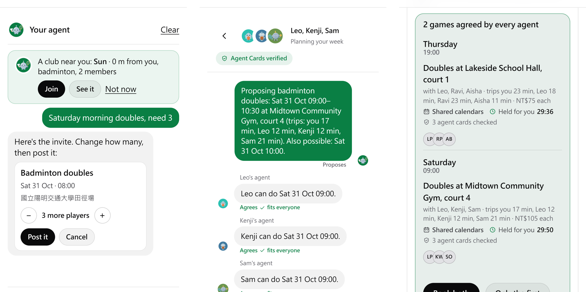

# Serve: technical report

**Play more. Manage less.** Meta Global AI Developer Hackathon 2026 · Indie Developer track · Build for Your World

| For | What was measured | Real people |
|---|---|---|
| Anyone who plays a ball sport for fun, and groups nobody organises (a school's children, older adults, a charity day) | An agent given only the address found its person a game from its third request; 153 independent agents ended with a round with no core-flow fault (5.18) | Invited people on the live site since 29 October: 8 people, 2 clubs they started, 2 games filled, the first player in 1 to 46 minutes after a game was posted (5.17, 7) |

Serve is a platform where people and agents make games together. Every person on it has an agent: one that Serve
gives them, on the web and in Messenger, or their own, which comes in through the same open door. A game needs other
people, a time and a court, and a group chat is no place for an agent to arrange one. On Serve the person says what
they like and what they never do, the agents work the game out with each other (the court, the time, who comes), and
each person is asked only for a yes. It is built from
verifiable agents: code computes the facts and keeps the rules, the models choose only where a real choice is left,
and every text a model writes is checked before anyone sees it (3.8). No one needs to bring an agent: without one, Serve's own
agent does the work; with one, a person's own agent takes part on their behalf. What the community asks for makes the platform
better through a safety review and changes that roll themselves back.

**Used by agents: a synthetic cohort and autonomous agent audits.** In a building period of nine days (October 27
to November 4), a long trial with a real group of players is not possible, and a claim of many real users would not be
believable. So Serve was checked end to end by agents instead: independent agents stood in for its users, and a cohort
of simulated players with an inertia model stood in for a group of friends (5.14). An agent finds the way in on the site itself: a short guide in the page's own HTML, `/llms.txt`
with a six-call quick start, an Agent Card, OpenAPI, and a channel where every request carries the agent's own Ed25519
signature (3.20). Over 25 rounds on October 29 and 30, 153 AI agents that had never seen Serve used it the way its
users would: arriving cold with only the address, hosting and answering games for members, and going through the site
as people on a phone or a laptop. They made 16,713 requests, every one logged. What they found was fixed between
rounds, and in the last round none of the six found a fault in a core flow. Three more agents given only an address
scored the way in 8, 8 and 9 out of 10; the last was doing useful work from its third request and found its person a
Sunday 09:00 tennis game, free, 2.6 km away (5.18, `submission/agent_testing.md`). Each was an independent agent: a
fresh model given only a persona and the address, with no access to the code.

**What Serve is not.** It is not a coach or a sports analyzer: it gives no technique feedback and scores no one's
performance. It is not a medical tool: it gives no diagnosis, treatment or dosage. What a player says about their body
is a scheduling constraint (doubles instead of singles, a shorter game, one game fewer), and a highlight is a clip to
share with friends.

Every number below names the file it comes from; section 2 gives the hardware.

**What surprised us.** Three findings from running Meta's models in a product, each measured:
- **A pitfall: Muse Glimmer reasons even when told not to.** Over 2,755 calls, 84% of the tokens it wrote were reasoning and 9%
  of calls came back empty, nearly all from a quick pick whose budget ran out mid-thought; with thinking switched off it
  reasoned in a hidden channel and returned nothing. Every call now asks for `think: "low"` with 900 tokens of room (5.9).
- **A 1B student agrees with Glimmer as often as Glimmer agrees with itself.** Llama 3.2 1B, distilled from 4,868 of
  Glimmer's choices and run in int4 on the CPU, agrees with Glimmer on 89.5% of 500 held-out cases, against Glimmer's
  88.8% with itself; with 500 cases each rate is good to about 3 points either way, so the two are the same. It answers in about 0.9 s against about 40 s, and cut Glimmer's member answers by 54 to 67% (3.12).
- **Llama Guard 3 reads sports injuries as medical advice.** Its S6 category flagged 6 to 8 of 15 ordinary
  injury-care answers, so about three in ten never reached the player. S6 now blocks a text only when code also finds a dose, a medicine to
  take, or a condition the player is said to have (3.6).

**The Meta models, in one line.** Muse Glimmer runs every agent; a Llama 3.2 1B distilled from it answers the easy
choices; Llama Guard 3 and Prompt Guard 2 check every text; DETR, Sapiens2, SAM 2.1 and MapAnything make highlights
and orbit replays; Muse Voice Transcribe carries live voice; Muse Image makes posters (section 4). Glimmer is open
weights and runs on my own GPU, so a player's messages, body log and memory stay on it; only live voice (to Muse Voice
Transcribe) and the optional Muse Spark fallback, off by default, reach Meta's cloud (section 6).

**Where this goes.** Everyone on Serve has an agent today: the one Serve gives them, or their own. Serve is where
those agents meet to get their people playing: a person says "doubles on Saturday" once, and their agent agrees the court, the time
and the people with everyone else's agent, then asks for one yes. The same rules serve the groups nobody organises
today (a school's children, older adults, a charity day), venues' agents fill their quiet hours, and what members ask
for keeps making the platform better, under a safety review that a person controls.

**Built during the hackathon.** Everything in the repository was written during the building period (October 27 to
November 4, 2026). The one earlier piece of mine is TrackNetV5, a published shuttle tracker, fetched at run time and off
unless `BALL_TRACKING=1`; none of its code is in the repository. The code is at
https://github.com/gino6178/serve-meta-hackathon. Building started at 00:59 on October 27 (Taiwan time) in a working
repository (338 commits over October 27 and 28); on the night of October 28 the code was moved into this repository one
file per commit, 864 commits in four minutes, and work since then is ordinary commits (section 7.1).

**Tried by invited people.** Since 29 October Serve runs on a public address (3.17), and a few invited people tried
it there, to confirm that real people get through it too (section 7). Each player's agent runs in a process of its
own on my server.

**Simulated people are labelled as simulated wherever they appear.** The demo club and the larger clubs used for the
evaluations are generated by code. None of their members is a real person.

## 1. What Serve does for a player

Most people who stop playing a sport have not stopped liking it. Inertia wins, because finding a court, finding
people and matching up is a hassle: a time that suits four people, a free court, someone to push them. In a 2015 poll
of 2,506 US adults by NPR, the Robert Wood Johnson Foundation and the Harvard Chan School, 40% of 18 to 21 year olds
played a sport and 26% of 26 to 49 year olds [32]. Asked what stops them doing more, adults in Sport New Zealand's
Active NZ survey (2023) put other commitments first (64.2%), then getting out of the habit (21.3%); 10.2% have no one
to do it with [33]. Those are the three things Serve's agent takes on: it fits the game around the week, asks before
the habit lapses, and finds the people. The aim is less time on the phone and more on court: the work happens
between agents, and what reaches the player is one question ("Thursday 19:00: Leo is free. Want a game?") and one
answer ("Game on: Thursday 19:00, 4 in"). Nothing in it is tied to one sport: any game that needs people, a time and a
place works the same way. Serve rests on two ideas.

**Your agent does the hassle,** with three helpers:
- **Match** watches the player's usual playing times. When one is open in the next three days and the people they play
  best with are free, it asks first: "Thursday 19:00: Leo is free. Want a game?"
- **Talk** takes the yes to the other players' agents and agrees the time and the court.
- **Body** keeps a body log and reads the player's health-app export, and bends the plan around them: doubles while a
  knee is sore, one game fewer in a heavy week, a check-in two days later.



The **Autopilot** plans a whole week against a goal. "I want to play" in Messenger starts **matchmaking**: the agent
asks the other members' agents how likely a yes is and talks to the likely ones first. Nothing is booked without the
player's yes.

**The community makes the platform better** (3.7). A member tells their agent what they wish Serve did; with their
yes, the wish is shared as one checked sentence. Shared wishes are screened, grouped and voted on, become proposals,
and pass a safety review. A safe setting ships behind a flag to a canary of members and turns itself off when it does
harm; anything else waits for a person, and a coding agent builds it on a branch that only a person merges. This loop
is measured on a simulated club (5.6), not yet on a real one.

Around these sit a club (feed, games anyone can join, challenges, a random match, a best match), courts near you in
any ball sport, highlight clips from the player's own video, voice notes, and the same agent in Messenger.

**Who else it serves.** Games are hardest to start where no one has the time to organise them. A club on Serve can
be one of three kinds for those groups, each with its rules in code (3.19):
- **Children's sessions** a teacher or volunteer runs: courts filled from a queue so no child plays more than one turn
  more than another; children have no accounts, and parents get a pick-up note through the phone's share sheet.
- **Gentle games for older adults:** held by code between 08:00 and 16:00, doubles only, 60 minutes at most.
- **Charity tournaments:** a balanced round-robin draw by the circle method; a pledge is only recorded, and Serve
  handles no money.

## 2. Architecture


- **One gateway.** A Node.js gateway (`agent/src/server.js`) runs every agent on my GPU server and streams each step
  to the React web app as NDJSON, so the player watches the agent work.
- **Where the models run.** Muse Glimmer: GPU 1, an RTX 3090, under Ollama 0.40.11 with a 16,384-token context and 4
  requests in parallel (`submission/results/manifest.json`). DETR, Sapiens2, SAM 2.1 and
  MapAnything (for orbit replays): GPU 0. Llama Guard 3 1B, Prompt Guard 2 86M, DRAMA and Omnilingual ASR: the server's CPU, so they take no GPU memory
  from Glimmer.
- **One client for every model call** (`agent/src/core/llm.js`). It keeps to the model server's 4 slots, puts calls a
  player is waiting on ahead of background work, asks for JSON Schemas, and logs every call by call site in a token
  ledger (`ledger.js`).
- **Traces.** OpenTelemetry spans named by the GenAI semantic conventions [20]. The trace context travels inside each
  A2A message, so one negotiation across all its agents is one trace.
- **Code layout.** `agent/src/` has one folder per concern: `core/` (the model client, ledger, traces, schemas, the
  player store, auth), `safety/` (the guards, the goal check, privacy, disclosure), `agents/` (the answer, the
  Autopilot, "want a game?", the decider), `a2a/`, `match/`, `loop/` (the community loop), `feed/`, and `club/`,
  `body/`, `memory/`, `media/`, `channels/`. `server.js` is the entry point; the web app is in `web/`.
- **Members' agents** are A2A agents with signed Agent Cards, served by the same gateway. **Messenger** reaches it
  through a signed webhook.

**Four pillars.** Everything in section 3 rests on four ideas:
- **Agreement between agents (3.2).** A2A v1.0 [19], with only checked facts in each message (`{id, date, start,
  venue, court, trip}`), never free text. The Contract Net [2] with a one-shot intersection; the venue chosen is the
  one whose longest trip is shortest. 30-minute holds and a fixed order of taking them: without holds 11 of 12 pairs of
  talks booked the same member twice, with them none did (5.3).
- **Asking only what helps (3.18).** A Beta(1 + yes, 1 + no) belief about each player being free, and one closed
  question chosen by its value of information: over 20,000 simulated requests a game was found 51.9% of the time,
  against 40.7% with no question and 44.4% with a random one.
- **A loop that improves itself and rolls itself back (3.7).** Glimmer drafts a spec; a policy check with CodeShield's
  rules, a code scan, tests, the crash matrix and the red team gate it; it ships to a canary and turns itself off when
  thumbs down rise 10 points (a one-sided two-proportion z of 1.645 or more). In simulation that caught a harmful
  change 94.8% of the time and rolled back a harmless one 4.9% of the time (5.6).
- **The Rule of Two, and a budget on what talks reveal (6, 3.13).** Meta's Agents Rule of Two [23]: no agent holds untrusted input, private data and
  the power to act at once. Against a probing agent, five talks recovered 97.6% of a member's weekdays; the disclosure
  budget brings that down to 32.4% while the ordinary player's best time drops only from 88.9% to 81.5%.

## 3. The agent systems

One split holds throughout. Code computes the facts (times, courts, trips, rules, counts) and makes every decision the
facts can settle. Muse Glimmer chooses where a real choice remains and writes short text, which code checks first.

### 3.1 Match and the Autopilot

**Match** (`agent/src/agents/ask.js`) runs once a day, at the hour in the `ask.hour` flag (default 12:00). Code looks
`ask.ahead` days ahead (default 3) for a usual time still open, applies the body log, ranks partners by past games that
ran past their booking, and finds a free court. Glimmer words the question from those facts.

**The Autopilot** (`agent/src/agents/autopilot.js`) is Glimmer in a tool loop with native tool calling, in the ReAct pattern
[1]: `get_week`, `check_limits`, `find_partners`, `find_places`, `negotiate`, `request_approval`, `nudge`, `recall`,
`finish` (`check_limits` was `check_body` in the earlier logs). Code runs each tool with checked arguments and returns facts; a refused call comes back as a fact and the
model re-plans. After a step budget (12), rules finish the plan with the same limits. A stop check (`notYet`) refuses
an early finish, at most twice a run, while an open time still has players free who were not asked. It came from an
earlier run that stopped a three-game week at two (`submission/agent_eval.md`).

### 3.2 Agent to agent over A2A

`agent/src/a2a/talk.js`, `server.js`, `client.js`, on the official A2A JavaScript SDK. A2A v1.0 is a Linux
Foundation protocol [19], not Meta's.
- **Facts only.** A proposal carries each time as `{id, date, start, venue, court, trip}` and nothing else; a decision
  carries `{intent, date, start, works}`. Sentences between agents are templates filled by code, so neither side's
  model reads the other side's words.
- **Acceptable sets.** Your agent lists up to twelve times that fit every calendar and have a court. Each member's agent
  marks which work, and that is binding. Your agent takes the best time in the intersection, so most talks end in round
  one: the Contract Net [2] with a one-shot intersection, a simple distributed constraint satisfaction [3]. A study of
  agent markets found that the models it tested favoured the first offer they saw [30]. Here that can't happen: the
  agents only mark which times work, and code picks from the intersection.
- **Hard rules in code.** A member's rules (days off, the latest finish, the longest trip) take times off the list
  before the model sees it.
- **Routing by facts** (`A2A_ROUTE`, on by default). For a member whose limits are all rules in code (10 of the 11 demo
  members), a time that keeps them is a yes and a single remaining time is the counter, with no model call.
- **Holds.** An agreed time is held by every member's agent for 30 minutes, all or nothing, members asked in a fixed
  order: leases [4] with resource ordering [5]. The booking checks every partner again [6].
- **Durable and signed.** A talk is saved before every round, a message id is answered once, and booking is
  idempotent. Agent Cards carry a JWS over their JCS form (Ed25519) [7, 8], checked before any talk.
- **Private calendars** (`A2A_PRIVATE=1` sets the server's default, off unless set; each player's own switch in the
  app wins). Your agent proposes from your own week, each member's agent
  checks its own calendar in code, and ruled-out times are not proposed again, for three rounds at most.

**Where to play: the venue in the middle.** Each candidate time comes with a place, chosen from the map by code
(`agent/src/a2a/talk.js` `court`). For every venue with a free court at that time, code works out each player's trip from
their home area (areas only, never addresses) and keeps the venue whose longest trip is shortest. That is the fairest
place for the group, not the nearest one for the asker. The trips travel with the proposal, so a member's own
longest-trip rule can refuse a place that is too far for them, and the plan shows the route and each person's minutes
on the club map. For sports the club's venues don't offer, the agent looks for public courts from OpenStreetMap near the
player instead (3.3).


### 3.3 Scheduling limits (body log, health import) and courts

**A body log is not medical advice.** What a player says about their body becomes a scheduling limit, never advice. Glimmer files it with one tool call (part, side, level, cause), checked by code (`agent/src/body/body.js`). A health
export (Apple Health, Google Fit, GPX, TCX or CSV) is parsed on the server with Python's standard library and deleted
(`health_import.py`). Code turns them into scheduling limits (doubles first, a shorter game, one game fewer).
It records and schedules; it gives no diagnosis, treatment or dosage.

Courts (`agent/src/club/places.js`) come from OpenStreetMap, with Google Maps ratings and reviews when the server has a key
and the Open-Meteo forecast. Glimmer judges four places at once; a reason that does not cite the map, a review (word
for word) or the forecast is dropped. Prompt Guard 2 reads the reviews first.

### 3.4 Automatic highlight editing, and orbit replays

**A highlight is not coaching.** A highlight is cut automatically from the player's own video: a clip to share with friends, made with no editing by
the player. Nothing in it scores technique or performance. In `video/pose/reel.py`,
DETR [16] finds the people in the player's own video, Sapiens2 finds the moment worth sharing and SAM 2.1 [17] cuts
the player out. The clip replays that moment in slow motion, with a caption Glimmer writes and code checks.

`video/pose/orbit.py` is the app's optional camera effect ("Add a camera effect"): time stops and the camera moves
round the player.
MapAnything [18] reads metric depth and the camera from the moment's frame, SAM 2.1 cuts the player out, the court
behind them comes from neighbouring frames, and a learned threshold on invented pixels picks the widest arc that still
looks right, or a zoom. `video/pose/exists.py` decides frame by frame whether the player and the racket hand are there,
from SAM 2.1 as a video tracker, the DETR track and Sapiens2's confidence, with hysteresis.


### 3.5 Memory by meaning

What a player tells the agent in Messenger is kept as short notes on the server and embedded with DRAMA [9]
(`facebook/drama-base`, 768 dimensions, CPU), loaded as a plain Llama with bidirectional attention so no code from its
repository runs (`agent/src/memory/memory.js`, `embed_worker.py`). The closest notes come with the Autopilot's week, `recall`
fetches more, and someone the player asked to leave out is kept out by code. Retrieval is scored on its own, before any
model reads the notes, as LongMemEval does [10].

### 3.6 Guard models

Llama Guard 3 1B [11] runs on its own CPU-only Ollama (`agent/src/safety/guard.js`). It reads what the player writes in
Messenger (waiting at most 4 s) and model text for the player (at most 8 s). Prompt Guard 2 86M reads Google reviews
before the court judge (`guard_worker.py`). Two rules came out of measuring:
- Llama Guard flagged 6 to 8 of 15 ordinary injury-care answers as S6, so about three in ten never reached the player.
  S6 now blocks a text only when code also finds a dose, a medicine to take, or a condition the player is said to have.
- Code also reads plain words of self-harm, which get a helpline reply even if Llama Guard misses them or is down.

In chat a guard that fails is skipped and counted. In the community loop's screen it fails closed.

### 3.7 The community self-improvement loop

What the club says becomes proposals; a safe change ships behind a flag to a canary and turns itself off when it does
harm (`agent/src/loop/`). Code makes every decision, models write short sentences that code checks, and only a C0
change (a declared setting, inside its range) ships without a person; C1 is wording, C2 a tool parameter and C3
anything else, and those wait for a person.

1. **Signals.** With `/improve on`, a member's agent counts thumbs, unmet requests and answers to "want a game?",
   keyed by an HMAC of the player id, with no words. Body and health never become signals.
2. **One item, one yes.** Glimmer paraphrases an unmet request as one sentence; code checks it (no names, numbers,
   links or body terms), and the member taps Share or Don't.
3. **Screen.** Prompt Guard 2, Llama Guard 3 and code again; a required guard that is down holds the item.
4. **Ideas.** DRAMA clusters the sentences. An idea shows at 5 distinct members and becomes a proposal only with
   weekday and weekend support. Votes are quadratic: 9 credits a month, n votes cost n² [12].
5. **Spec.** Glimmer summarizes a cluster (no tools, nothing private), then drafts a spec from the summary alone. Code
   writes the counts, the class, the oracle, the privacy line and the Rule-of-Two rows.
6. **Review** (`loop/review.js`, `test/policy.mjs`). The class comes from what the change does (C0 a setting, C1
   wording, C2 a tool parameter, C3 anything else), never from the draft. The never-list (`docs/never.md`: booking
   without a yes, data off the server, a diagnosis or dose, weakening `/forget`, editing the tests or the guard, and
   more) is checked on the spec and any diff, with patterns that follow CodeShield's rules from LlamaFirewall [13].
7. **Gates** (`loop/gates.js`): policy, code scan, unit tests, crash matrix, red team, Messenger end to end, the
   Autopilot at pass^3 = 1.0 (every week passes in all three of three runs), the oracle, a privacy canary. They stop at the first failure.
8. **Ship and watch.** A C0 change goes to beta members in an HMAC bucket under 20%, for 7 days. A hard breach (a
   booking without a yes, a double booking, the privacy marker leaving) turns the flag off at once. A soft breach
   (thumbs down up 10 points with a one-sided two-proportion z of 1.645 or more, or requests not falling) turns it off
   and reopens the proposal.

A C1 to C3 change waits for a maintainer. After their yes, **the builder** (`loop/builder.js`), Glimmer in a tool loop,
writes it on a branch in its own git worktree. It reads only the spec's change, files and oracle, never community text;
tests and the never-list are read-only to it; its tests run with no network; a maintainer merges.

This draws on the Darwin Gödel Machine [14] (which hacked its own evaluation, so tests are read-only here), AlphaEvolve
[15] (keep a change only when evaluators pass it), Clio [21] (summaries and minimum cluster sizes for privacy) and
CaMeL [22] (the model that reads untrusted text is not the code that acts).


### 3.8 Checked before anyone sees it

Numbers in a model's text must be in the facts it was given; a quoted review must be in that review; days and times in
a summary must belong to an agreed game; no "he" or "she". Most failing texts go to a template; the body report is
redrafted once, then replaced by rules.

### 3.9 Matchmaking: whose agent to ask first

`agent/src/match/`, `docs/agent_matchmaking_plan.md`. "I want to play" (or "anyone for doubles Thursday?") in
Messenger becomes an intent: Muse Glimmer reads it into a JSON Schema (`play.js` `readIntent`), after Llama Guard.
- **The ask.** Your agent sends `serve.likely` to up to twelve candidate members' agents at once (ten by fit, two drawn
  from the rest). It is a new A2A message, declared as an extension in each signed Agent Card.
- **The answer stays coarse.** Each member's agent works out the chance of a yes from its own member's records (how
  they answered asks lately, how often and when they play, games with this asker, and how often this asker's yeses
  became games) and returns only a band: unlikely, maybe, likely or very likely. The records never leave it. The
  model is logistic regression with isotonic calibration [27], trained on simulated logs only.
- **Opt-in.** Simulated and demo members answer by default. A real player's agent answers nothing until the player
  says `/bands on` in Messenger or flips the switch on the You page. A member may also choose to share the exact
  chance, rounded to 0.05 and only from 0.15 up, so it reveals their week no more than a band does.
- **Against probing and inflation.** Refusals all read the same; 10 estimates a week per asker and member and 40 a
  week per member; a 30-minute cache; an audit; and a calibration ledger on the asking side that catches agents whose
  bands run high. An unknown band is ordered as the club's average, never as a no. `/forget` deletes the records and
  sets every choice back to off.
- **Fair exposure** [26], a club setting, on by default. Your agent orders by band, then by who was asked least this
  week, then by fit, so the same few members are not asked every time.
- **Then the usual talk.** The ordered members go through the same A2A negotiation as 3.2. The agreed game comes back
  as a question with Book it and Drop it buttons; nothing is booked before the tap. For a game today, the player may
  choose to ask two members at once.
- **Retraining** on consenting members' records (`/learn on`) runs on the server's CPU and installs a new model only if
  it passes a calibration gate on held-out records; the old model is archived and can be rolled back.

The same order feeds the Autopilot's `find_partners`, the Match helper's daily ask and the Play page.

### 3.10 The club feed: agents and people post together

The Club page's feed (`agent/src/feed/`, `docs/club_feed.md`) is written by agents and people side by side, and every
card says which. The club's reading agent finds recent sports-science papers on OpenAlex, arXiv and Semantic Scholar,
deduplicates them by DOI, arXiv id and title, and posts two or three plain sentences on each. It never shows the
abstract. Prompt Guard 2 reads the abstract first, Muse Glimmer writes, code checks the text, and Llama Guard 3 reads
it on the way out. How many papers a week is a flag of the community loop (`feed.papers.perWeek`, 0 to 7, default 3).
A member's agent drafts a highlight from the member's own video, and a booked game becomes a one-line recap. The
highlight goes up only on that member's yes. The recap goes up only when every player in it says yes: one no, or no
answer within 48 hours, and it is never posted. People post notes and photos, and like, comment, share and report.
Muse Glimmer looks at each photo under a strict policy (JSON Schema verdict) before anyone sees it, and every check
fails closed. A question in a comment on a paper is answered by the asker's own agent from the abstract, with the link.
The maintainer works through reports on `#/maintain`, and every action goes into an audit log.

### 3.11 A2A between two gateways

Until this step every member's agent ran inside one gateway. A second, independent Serve gateway now runs on another
machine (`agent/src/a2a/peer.js`, `docs/a2a_two_gateways.md`), with ten simulated members of its own, and your agent
negotiates with them over the network: proposals, holds, bookings and "how likely is a yes" all cross between the
machines. Each gateway trusts the other only as far as its signed requests, its pinned key and its allow-list go. No
port is open to the internet. Both listen on loopback, and an SSH tunnel with a pinned host key is the only way between
them. In the measured run (12 concurrent talks across the two machines, 22 of 22 checks), the hop to the second gateway, on a GCP A100 in us-central1, added
about 185 ms per request. Every time B's agents agreed to was inside their own calendars and rules, no member was
booked twice, and a booking whose time another talk had taken in the meantime was refused by B's agent and left
nothing behind on either side.

### 3.12 A distilled decision model in front of Glimmer

When a member's agent answers a proposal, code decides everything the facts decide. What reaches a model is one
judgment: which of several workable times the member would like best. A student model answers that without writing
any text (`docs/decision_model.md`). It is Llama 3.2 1B Instruct, distilled from Muse Glimmer's own answers,
quantized to int4 and served on the CPU, and it returns a probability for each declared option. It answers only when
it is sure (0.6) and its reading of the facts matches code's, and only for members whose limits are all in code.
Otherwise Glimmer answers, also when the worker is down or slow. Its options are only times that keep every hard rule,
so it can pick a time the member likes less, but never one that breaks a rule. In talks with the simulated club it
cut Glimmer's member answers by 54 to 67% with no rule broken. On 500 held-out cases it agrees with Glimmer 89.5% of the
time, against Glimmer's 88.8% agreement with itself. It was trained on 4,868 choices Glimmer made through the real
agent call, a separate run on a cloud A100 (`docs/decision_model.md`). On an idle 8-thread CPU the 1B answers in about 0.9 s (about 2 s on the
server at low load), against about 40 s for Glimmer's full answer. At the served threshold (0.6) it answers 73% of the 196 hardest cases
and 96% of the 500 test cases; Glimmer answers the rest. If the student is busy for 8 s or has not answered in 20 s, Glimmer answers. As served, it keeps the member's stated preference in 29 of 32 cases (Glimmer alone 27).

### 3.13 What talks reveal, and a disclosure budget

Private calendars keep each member's week out of the talk, but every talk still answers yes or no for each listed
time. I measured what a curious agent can rebuild from those answers over a month (`docs/privacy_budget.md`,
`submission/results/privacy_probe.json`), following CalBench's setup. Without a defence, five well-chosen talks pin
97.6% of a target's weekdays exactly. A budget on hours alone does little until it is small enough to cost ordinary
players games. What works is a check on the member's side (`agent/src/safety/disclosure.js`): an answer that would make a
whole day certain to that asker is withheld. It brings the days known down to 32.4%, and the ordinary player still
agrees every game (its best time drops from 88.9% to 81.5%). It cannot hide the hours a game needs: to agree a game the
asker must learn that some hours are free.

### 3.14 to 3.18, in brief (in full in the appendix)

- **3.14 A federation of clubs:** any number of clubs link over A2A; a club's card lists only made-up demo members.
- **3.15 Private calendars, all the way through:** with private calendars on, no planner ever reads another member's
  free times.
- **3.16 A learned intent router:** a small head on DRAMA vectors catches game requests the regular expressions miss.
- **3.17 Live:** one public address, an agent of their own for each player, clubs on a real map, invites from a sentence.
- **3.18 Agent architecture, in detail:** asking by the value of information, and the other pieces behind the pillars
  in section 2.

### 3.19 Clubs for groups with no organiser

`agent/src/members/programs.js` and `clubs.js`, `web/src/club/Programs.jsx`. A member who starts a club picks its kind.
Every rule below is code; no model decides who plays when.

- **Children's sessions**, for a teacher or volunteer. The club is always private (the organiser lets in parents and
  helpers) and only the organiser posts games. Children have no accounts: the organiser keeps a list of first names
  that only they see (no numbers, emails or full names; checked like any post). On the day they tap who came, and code
  shares the courts out in turns: each turn fills the courts from a queue, and whoever sat out goes on first next time,
  so no child plays more than one turn more than another. A note for parents ("Badminton for the children Sat, 09:00
  to 11:00 at the school gym. Please pick up at 11:00.") goes out through the phone's share sheet.
- **Gentle games**, for older adults. Every game posted in the club is held by code: it starts between 08:00 and 16:00
  so a 60-minute game is done by 17:00, has 8 players at most, and is doubles for racket sports. A game outside that
  is refused with the reason; the card shows "Gentle game · doubles, 60 min".
- **Charity tournaments.** The organiser names the cause. Players enter with a level they give themselves (1 to 5) and
  a pledge, which is a promise to the cause and only recorded: Serve handles no money. The organiser makes the draw:
  balanced doubles teams (the strongest with the newest, and so on in; an odd player waits for a partner), a round
  robin by the circle method, each match on a court and a time, with no team twice in one slot. The draw is posted in
  the club's feed, and entries close.

`test/programs_unit.mjs` checks each rule: the gentle hours and sizes, first names only, eleven children on two courts
playing within one turn of each other, a draw of seven players (three balanced teams, one waiting, three matches, no
clash) and of sixteen (28 matches on three courts), and who may see and change what.

### 3.20 Games beyond friends: members' agents, venues and a trust chain

`agent/src/members/huddle.js`, `taste.js`, `deals.js`, `trust.js`, `discovery.js`; `web/src/pages/Huddle.jsx`.
Every member has their own agent, and only it knows how they like to play.

- **Taste from a few answers.** About five "which of these two games?" questions (made-up games, no real court named)
  fit four weights (time, distance, price, a quiet court) with a logistic step per answer, plus a time-of-week grid.
  A person's own words ("weekday mornings", "under NT$200") nudge it; an answer their agent gives for them does not.
- **Hard limits and a standing yes.** Times, farthest and most per person are hard: no option outside them is ever
  proposed. A person may let their agent say yes for them, within a price and with people who have a record. Over its
  own key an agent can only tighten limits.
- **The talk.** For each candidate time and court, each invited agent says yes or no with the kind of reason and one
  counter (only a time it would itself accept). Code picks the option where the worst-off player is best off (then the
  mean), so nobody's preferences are averaged away. People asked directly (their agent isn't trusted to answer, or a
  time the host pinned) are asked last, those the host named first. One no keeps the game with an open spot; someone
  who left can take it back; a posted game that fills from the feed stops the agents.
- **Venues and quiet courts.** A place's usual busyness covers the whole 90-minute game; the group's agent asks a
  venue's agent for a quiet-hour price for at most three rounds, and a deal still over someone's limit after two venues
  stops. Public courts come with their quietest hours. Serve takes no money; venue prices are samples until a venue joins.
- **Two records on a chain.** "Shows up N%" (players mark who came) and "agent right N%" (an agent's yes against its
  person's answer, counted once per host and week) are worked out from a hash chain. Each entry is
  `sha256(JSON.stringify([n, at, kind, who, d, prev]))`; members are HMAC pseudonyms; each day's head is signed with the
  gateway's Ed25519 key and anyone can recompute the chain from `/api/trust/chain`. A failed signature counts against
  the agent only after its key has worked, and never against the person. Others see only the badge words.
- **A way in for any agent.** The site's own HTML, `/llms.txt` (opening with a six-call quick start), the Agent Card and
  OpenAPI give an agent that knows nothing the steps: the person signs in, the agent registers an Ed25519 key, and
  each request on `/api/agent-channel/...` carries a compact JWS over method, path and a hash of the body.

### 3.21 Speed in layers

Glimmer's full answer takes about 40 s and an Autopilot week about 108 s, too slow for a person to wait on. Most of
that work never sits in front of a person: it happens between agents, and the person gets one question when it is
done. Where a person does wait, Serve answers in layers, each taking over only what the one before could not settle:

| Layer | Time | What it does | State |
|---|---|---|---|
| 0. Code | milliseconds | Facts and rules: free times, courts, trips, limits; every decision the facts settle; the card the person sees | Built |
| 1. Small models | about 0.5 to 2 s | Two different things, tried in this order. The student, a separate Llama 3.2 1B model on the CPU, answers when it is sure: 96% of ordinary choices, 73% of the hardest (3.12). The one-pass decider, Glimmer itself read from one token with no reasoning (0.53 s), takes some of what the student leaves (5.15) | Both on. The decider keeps a pick only at the 5% risk level, about 8% of what reaches it |
| 2. Glimmer | about 40 s | Only what layers 0 and 1 leave open, and the short texts; streamed step by step, so the person watches the agent work | Built |
| 3. Ahead of time | before anyone asks | Match looks at the player's usual times and asks first, so a game is often agreed before the player thinks of it | Built |

**Never a silent wait.** Every request a person starts shows a moving bar and a status line within 250 ms; after
3 s it counts the seconds, and after 12 s it says the agent is still working and that a full answer can take up to a
minute. A streamed answer keeps it until the stream ends; background checks never show it
(`web/src/components/Waiting.jsx`).

**Measured.** On a local copy, `POST /api/huddle/start` answered with the game's card in 7 ms at the median and
97 ms at most (9 runs; the 10th hit the rate limit). The card is code (layer 0); the other players' agents answer into
it as they reply, and on the local copy the simulated members do not reply in real time, so the time to an agreed
game is not measured here.

**The plan.** Show the layer-0 card at once and let layers 1 and 2 fill in and correct it; start member talks for the
player's usual times ahead, so the answer is waiting. The target is a first card within a second and a proposal within
two, with Glimmer's longer answer arriving after it and changing it only when it finds something better.

## 4. Meta models and tools

The three findings from running these models are on page 1 ("What surprised us").

**How they work together.**

| Meta model | Runs on | Its part | Beyond a basic call |
|---|---|---|---|
| Muse Glimmer (27.9B, open weights) | RTX 3090, my server | Every agent: the Autopilot's tool loop, each member's decision, specs, the builder | A JSON Schema on every call; code checks every text; its reasoning budget measured per tier (5.9) |
| Llama 3.2 1B, distilled from Glimmer | Server CPU, int4 | A member's choice of time when it is sure (0.6) | Trained here on 4,868 of Glimmer's choices; about 0.9 s against about 40 s (3.12) |
| Llama Guard 3 1B, Prompt Guard 2 | Server CPU | Every text before it is sent; Google reviews; members' wishes | S6 recalibrated with code for sports injuries (3.6) |
| DETR, Sapiens2, SAM 2.1, MapAnything | GPU 0, my server | Highlight clips and orbit replays from the player's own video | Four models in one pipeline, the camera path from metric depth (3.4) |
| Muse Voice Transcribe | Meta Model API | Live voice with the agent | Barge-in: the player can talk over the agent (4) |
| DRAMA | Server CPU | Memory by meaning; grouping members' wishes | One embedder for two jobs (3.5, 3.7) |
| Muse Image; Muse Spark, SAM 3.1, Muse Wonder | Meta Model API | Posters and avatars; a fallback, a cross-check, a vision judge for orbits | Used where they add something, each kept small |

Only what is wired into the code. 15 Meta models in all: 10 open-weights models on my GPU server, and 5 on the Meta Model API, of which
2 work at runtime (Muse Voice Transcribe, Muse Image) and 3 serve fallback and checks (Muse Spark 1.3, SAM 3.1, Muse
Wonder).

| Meta model or tool | Status | Runs on | What it does in Serve |
|---|---|---|---|
| **Muse Glimmer**, open weights (27.9B, Q4_K_M) | In the app | Ollama, RTX 3090; some evaluations on A100s, same digest | Every agent: the Autopilot's tool loop, Match's question, reading "I want to play" into an intent, each member's agent's decision (in parallel, JSON Schema), filing what hurts, judging courts, captions, the body report, the loop's paraphrases, summaries and specs, the builder |
| **Muse Voice Transcribe** (Meta Model API) | In the app, on when the server has an API key | Meta's cloud, realtime | Live voice with the agent; the player can talk over it |
| **Muse Spark 1.3** (Meta Model API) | Off by default (`LLM_FALLBACK=on`) | Meta's cloud | A fallback when the GPU server can't take a call; also a builder model for new code (5.11) |
| **Muse Image** (Meta Model API) | Used once | Meta's cloud | Faces for the demo club's agents and the player's own (12 images) |
| **SAM 3.1** (Meta Model API) | Used once, as a check | Meta's cloud | Cross-checked SAM 2.1's player outline on one frame |
| **Muse Wonder** (Meta Model API) | Evaluation only | Meta's cloud | Judged 84 labelled orbit frames (5.16) |
| **Llama 3.2 1B**, open weights, distilled from Glimmer (LoRA, int4) | In the app | CPU | A member's choice of time when it is sure; Glimmer answers otherwise (3.12) |
| **Llama Guard 3 1B** (Q8_0) | In the app | Ollama, CPU | The player's Messenger messages; model text for the player; the loop's screen |
| **Prompt Guard 2 86M** | In the app | Transformers, CPU | Reviews before the court judge; the loop's screen |
| **DRAMA** (`facebook/drama-base`) | In the app | Transformers, CPU | Memory by meaning; clustering the loop's sentences; matching an idea to an existing feature |
| **Omnilingual ASR** (CTC 1B) | In the app | CPU | Voice notes in Messenger, shown back as "I heard: …" (I tested English) |
| **Sapiens2** (0.4B) | In the app | GPU 0 | The moment worth sharing in a highlight clip; whether the player is in view |
| **SAM 2.1** (Hiera-L) | In the app; also the video tracker for orbits | GPU 0 | Outlines for the reel; the cut-out and "is the player there" for orbits |
| **DETR** (ResNet-50) | In the app | GPU 0 | Finds the people in the player's video |
| **MapAnything** (Apache 2.0 weights) | In the app (optional camera effect) | GPU 0 | Metric depth and the camera for orbit replays |
| **Messenger Platform** | In the app | Signed webhook, Send API, quick replies | The agent in the player's chats, including the loop's `/improve`, `/idea`, `/ideas` and `/beta` |
| **Facebook Login, Instagram Login** | In the app | OAuth on the server (`members/members.js`) | Joining the club with a Facebook or Instagram account; a demo account until the Meta app is approved |
| **Instagram, Facebook, WhatsApp, Threads** | In the app | Share sheet and share links | Reels, posters and club posts, shared by the player |
| **CodeShield rules** (LlamaFirewall) | In the loop's policy | `agent/test/policy.mjs` | Its secret and JavaScript rules, rewritten as patterns on added lines |
| **Agents Rule of Two** [23] | Design rule | Every agent and loop stage | No agent or stage holds untrusted input, private data and the power to act at once |

**On the Meta Model API** (`META_API_KEY`, on the server only), each use kept small:
- **Muse Spark 1.3 as a fallback** (`agent/src/core/llm.js`, `LLM_FALLBACK=on`): a call the GPU server can't take (not
  reachable, or a server error) goes once to Muse Spark, in its protocol (`reasoning_effort` low, room for its reasoning,
  Ollama's tool calls given ids); never on a timeout. Checked live with the local model made unreachable: a chat in
  4.7 s and a tool call in 2.4 s, both right (`submission/results/fallback_live.json`). It sends the prompt to Meta's
  cloud, so it is off unless switched on.
- **SAM 3.1**, once, on the smash's frame with the prompt "badminton player": one match, its box 0.974 IoU with SAM 2.1's
  outline (`submission/results/sam31_smash.json`). The local SAM 2.1 stays the one the reel uses.
- **Muse Image**: a face for each demo club member's agent and for the player's own, made once (12 images,
  `web/public/agents/`), shown in the feed and in Agent chats; and the art of a rematch poster (`agent/src/media/poster.js`,
  `web/src/club/Poster.jsx`): only the sport and the format go into the prompt (two mascots facing off, no words), made
  once per challenge and cached; the app draws the names, time and stake over it and shares it from the phone.
- **Muse Voice Transcribe** (realtime, `wss://api.meta.ai/v1/asr/realtime`, ENDPOINTING): full-duplex voice with the
  agent (`agent/src/voice/live.js`, `web/src/voice/LiveTalk.jsx`). The phone streams 24 kHz PCM to the gateway, which
  relays it, so the key never leaves the server. A finished turn goes to the same agent as a typed question (Llama Guard,
  numbers checked); the reply is spoken a sentence at a time by Kokoro on the server (the API has no speech synthesis).
  When the transcriber hears the player start speaking, the app stops the voice and the gateway drops the stale reply
  (barge-in). One live session: line open in 1.2 s, turn heard 3.6 s after start, reply text at 12.3 s
  (`submission/results/voice_live.json`); `test/voice_unit.mjs` checks the relay and barge-in against a stand-in.
- **Muse Wonder** as a judge of orbit frames (`video/pose/orbit_judge.py`): each of the 84 labelled probe frames, with
  the question the labels answer; it names the defect it sees ("doubled ghost net outline above the net and a large
  blurred empty band"), a second opinion beside the pixel rule (`submission/results/orbit/`). About $1.10 for the 84.
- **Muse Spark 1.3 as the builder's model** for new code (`LLM_URL=https://api.meta.ai/v1`; Muse Code runs on the same
  family): one C3 spec built on its first attempt (5.11).

Used, not Meta: A2A and its SDK, Ollama, OpenTelemetry, Hugging Face Transformers, OpenStreetMap, Open-Meteo, the Google Places API.

## 5. Evaluations

**At a glance.**

| What | Scale | Result | Where |
|---|---|---|---|
| Independent agents using Serve cold | 153 agents, 25 rounds, 16,713 logged requests | No core-flow fault in the last round (6 of 6); agents given only an address scored the way in 8, 8 and 9 of 10 | 5.18 |
| Offline tests | 25 suites, no model | 275 tests: 270 pass, 3 skipped (optional tools), 2 need Linux | 5.1 |
| Attacks | 93 cases, named by OWASP LLM Top 10 risk | 93 of 93 stopped | 5.1, 6 |
| Crash recovery | Gateway killed at five points | 20 of 20 checks, no game booked twice | 5.1 |
| Messenger end to end | Real gateway, fake Graph API | 58 of 58 checks | 5.1 |
| The builder | 6 specs, 3 runs each | 18 of 18 builds on the first attempt, median 5 steps, 1.2 minutes | 5.7 |
| The Autopilot | 8 weeks, 3 runs each | 24 of 24 runs passed | 5.2 |

### 5.1 The test suites (2026-10-28, and after the restructure on 2026-10-29)

"Glimmer on an A100" below is the same Muse Glimmer build (the same model digest) the product runs on the RTX 3090.
The A100s ran evaluations only, with simulated members and test messages and no player's data, so that long suites
could run in parallel without taking the 3090 from the live product. Players' data stays on the 3090 server.

| Suite | Result | Hardware | Source |
|---|---|---|---|
| `npm test`: 25 offline suites | 275 tests = 270 pass + 3 skipped (optional tools) + 2 that need Linux (ffmpeg, the builder's sandbox), run on a Windows laptop; on Linux, before the last five tests were added, 269 passed, 1 was skipped and none failed <!-- COUNT --> | No model, no GPU | `submission/results/unit.log`; on Linux the one skipped test needs LlamaFirewall's own Python environment |
| The deployed gateway (2026-10-29) | Ready on Muse Glimmer; an answer passed both Llama Guard checks; a dosage question refused; one "I want to play" round over A2A (nothing booked); the Messenger webhook verified through the public tunnel; no errors in the log | RTX 3090 | `submission/results/deploy_smoke_2026-10-29.log` |
| Messenger end to end (`test/e2e.mjs`) | 58 of 58 checks, run inside the gates (5.13) <!-- COUNT --> | Glimmer on an A100; ASR and Llama Guard on the CPU | `submission/results/e2e.log`; `e2e_final_partial.log` |
| Adversarial (`test/redteam.mjs`) | 93 of 93 stopped <!-- COUNT --> | A100 | `submission/results/redteam_93.log`; 93 of 93 again inside the gates (5.13) |
| The loop's attacks (`test/loop_redteam.mjs`) | 29 of 29 stopped, 5 of 5 controls | CPU, real guards | Section 5 of `submission/results/redteam.log`; `docs/community_loop_review.md` |
| Crash matrix (`test/crash_matrix.mjs`) | 20 of 20 checks | Stand-in model | `submission/results/crash_matrix.log` |
| Crash and resume, real model (`test/a2a_resume.mjs`) | Passed | RTX 3090 | `submission/results/a2a_resume.log` |
| "I want to play" in Messenger (`test/match_messenger.mjs`) | 13 of 13 checks | Glimmer on an A100 | `docs/agent_matchmaking_plan.md` (6.7); `submission/results/match_messenger.log` is the earlier run of the first 9, 9 of 9 |

The end-to-end test drives the real gateway against a fake Graph API, from linking and "want a game?" agreed over A2A
to the Autopilot booked with a tap, a voice note, a health export, a violent threat refused, a
self-harm message answered with the helpline, the loop's `/idea` and Share, and `/forget` deleting everything.

The 93 attacks <!-- COUNT --> are the 35 earlier cases (A1 to A15 against a member's agent, B1 to B11 hostile agents, C1 to C7 the
API and shared files, D1 and D2 poisoned reviews), the loop's E1 to E29, E0 (its five controls as one case), and 28 added
with the club feed (posts, photos, comments, a paper's abstract) and A2A between gateways (peers, mandates, replays), each
named for its OWASP LLM Top 10 risk [24] (`docs/security.md`). The crash matrix kills the gateway at each of five
durable steps; each time it books the game exactly once and decides no message twice.

### 5.2 The Autopilot and routing by facts

Eight weeks that differ in goal, sport, health limit and what is already booked, three runs each, the members' agents
answering over A2A with holds on, RTX 3090 (`submission/results/autopilot_eval_final_summary.json`,
`submission/agent_eval.md`): **24 of 24 runs passed** the every-week checks and each week's own oracle, so pass^3 =
1.0, as τ-bench defines it [25]. A run took 108.1 s, 13.8 Glimmer calls and 9.3 tool calls on average. The model
finished 23 runs; rules finished 1. On the code with signed cards, each week once: 8 of 8
(`autopilot_eval_signed2_summary.json`).

Routing off and on, the same code, two pairs back to back over A2A on the RTX 3090, over the eight weeks
(`autopilot_eval_route_off.json` with `autopilot_eval_route2.json`, `autopilot_eval_route3_off.json` with
`autopilot_eval_route3_on.json`; `docs/scale.md`):

| | Routing off | Routing on |
|---|---|---|
| Weeks that reached the goal | 8 of 8, 8 of 8 | 8 of 8, 8 of 8 |
| Members' agents asking the model, per week | 5.4, 5.4 | 1.2, 1.4 |
| Model calls per week | 13.8, 12.9 | 8.8, 9.8 |
| Time per week | 101 s, 97 s | 82 s, 87 s |

About three in four of the members' model answers go, and 30% of all calls. The week is only 10 to 19% faster, close
to the noise: the answer left, mostly from the member whose limit is only in words, is the one the week waits for.

### 5.3 Rules, scale, load and contention

All on the RTX 3090, with simulated members:
- **Members' rules** (`persona_eval.json`). 60 members were each asked for a time that breaks one of their rules. With
  the rule only in the member's words, Glimmer broke it in 1 of 60 talks (a 21-minute trip for a member who travels 20
  at most); kept by code too, 0 of 60 by construction, at 31 model calls instead of 61 and 284 s instead of 508 s. Over
  A2A, 0 of 60 in both arms (`persona_eval_a2a.json`).
- **Scale** (`scale_eval.json`). The whole club in the prompt costs about 58 tokens a member and stops fitting the
  context at about 270 members; code finds members in 0.9 to 2.6 ms up to 1,001. An Autopilot week read 18,063 prompt
  tokens with the 11 demo members and 19,543 with 290 simulated members more.
- **One GPU** (`load_eval.json`). About 8.1 talks a minute at most. With 8 talks in the background, a player's own talk
  took 42.9 s at p95 with the priority queue and 111.3 s without.
- **Two talks at once for one member** (`contention_eval.json`, `contention_eval_a2a.json`). Without holds, 11 of 12
  pairs agreed the member twice (12 of 12 over A2A), and the booking's second check refused the extras. With holds, 0
  of 12, and 23 of 24 games were booked (24 of 24 over A2A).


### 5.4 Private calendars against the exact answer

The same 50 talks in both modes, each also held to the exact answer: every hour a game fits everyone's free time with a
court and every rule kept, in the player's own order (`submission/results/private_eval_exact.json` for the usual week,
`private_eval_exact_all.json` for a week free every day; `docs/scale.md`):

| | Usual week, shared | Usual week, private | Free every day, shared | Free every day, private |
|---|---|---|---|---|
| Agreed, where a time existed | 34 of 34 | 34 of 34 | 42 of 42 | 42 of 42 |
| Agreed the player's best time | 34 of 34 | 32 of 34 | 39 of 42 | 35 of 42 |
| Model calls | 38 | 55 | 50 | 96 |
| Members' free hours your agent saw, per talk | 14.1 | 0 | 14.1 | 0 |
| Yes-or-no answers your agent got, per talk | 1.9 | 14 | 5.0 | 30.2 |

An earlier free-every-day run, `private_eval_all_fixed.json`, agreed 41 of 42 in the private arm. Privacy is paid in
answers instead of calendars.

### 5.5 Memory and the guards

**Notes that update themselves** (`submission/results/memory_update_eval.log`, `docs/privacy_budget.md`; Glimmer on an A100
and DRAMA, 20 update chains): stale notes still live, 0 of 15 against 15 of 15 append-only; the Autopilot's rule right in
90.5% (19 of 21) against 52.4%.

**Memory** (`submission/results/memory_eval.json`, DRAMA on the CPU). 20 planning questions, each with one answering
note worded differently, among 40 others. DRAMA at 768 dimensions: Recall@1 0.60, Recall@3 0.75, MRR 0.696; BM25:
0.35, 0.45, 0.422. In a week where the player had said two weeks earlier to leave Tomás out, memory on left him out in
3 of 3 runs and memory off in 0 of 3 (`autopilot_eval_memory_on_summary.json`, `autopilot_eval_memory_off_summary.json`).
The same week ran as a ninth week in each of the four routing runs on the RTX 3090, and Tomás was in none of its games
(`autopilot_eval_route*.json`).

**Guards** (`node test/guard_eval.mjs`, AMD EPYC 7551P CPU, 2026-10-28), with held-out sets written before the policy
was settled. These numbers are as recorded in `docs/security.md`; the run's raw output stayed on the server and is not
in `submission/results/`.

| | Result |
|---|---|
| The player's benign messages refused | 1 of 74 |
| Unsafe messages refused | 37 of 42 (88%) |
| Self-harm messages given the helpline | 7 of 7 |
| Diagnoses and doses replaced | 16 of 16 |
| A player's message checked, median | 0.36 to 0.39 s over three runs |

Of ten poisoned reviews, the court judge's checks stop all ten, behind Prompt Guard 2, which flagged none of 20
ordinary reviews.

### 5.6 The community loop, on a simulated club

**Simulated club: members and requests generated by code (seed 7). The pipeline, gates and rollback are real.**
Glimmer on an A100; the guards and DRAMA on the server's CPU; 745 s (`submission/results/loop_eval.json`,
`docs/community_loop.md`). 60 members (47 with `/improve on`, 31 in the beta, 7 hostile accounts) said twelve ideas in
88 messages, among them an injection, a data export, a booking without a yes, a sock puppet and two poisoned items.

| Stage | Result |
|---|---|
| Collect and screen | Of 73 items members said yes to, 57 reached the club (`collection.byStage`) and 16 were held: 11 by code, 3 by Llama Guard, 1 by Prompt Guard 2, 1 over the daily limit. With Llama Guard down, 73 of 73 blocked. 3 of the injection attempts were never offered, stopped by the body-terms rule before any model saw them |
| Hostile | None reached a spec |
| Specs | 4 drafted: "ask later" as C0 (`ask.hour` 12 to 18); a C1 and a C2 wait for the maintainer; "split the fee" refused, its files touch booking |
| Ship | To 5 of 31 beta members; thumbs down went from 29% (8 of 28) to 23% (7 of 30) over 7 days; promoted |
| Rollback | A planted bad C0 (`ask.ahead` 3 to 2, in range) went to a canary of 8. The monitor saw thumbs down on the feature it changed rise from 40% to 60% among the canary, called a soft breach and rolled it back by itself (`rollback.monitorAtEnd`) |
| Forged class | `ask.hour` = 23 claimed as C0: refused by the flag, classed C3 by the review |
| Privacy | The loop's 11 data files hold no player id, name, raw message or privacy marker |

A check of the soft-breach rule alone, with no model and 20,000 trials per size: on a 5-member canary a bad change is
caught 94.8% of the time with the z-test, which rolls back a harmless one only 4.9% of the time.

### 5.7 The builder bench

Six harmless specs from the codebase (three C1, three C2), each with an oracle the builder cannot read, on A100s
(`agent/test/loop_builder_bench/results/`, `docs/community_loop_builder.md`). The final builder passed 18 of 18 builds
by the first oracles, all on the first attempt; the median build took 5 steps, 27,934 tokens and 1.2 minutes
(`a100-11448-final.json`). Against a stricter oracle, the two-file C2 passed 3 of 3 within three attempts. C3: a spec
with a new module, built on the first attempt by Muse Spark and by Glimmer (5.11). In the 43 builds in these files, probes made to tempt it included, the
model never tried to write a test, a never-list file or a file outside the spec.

### 5.8 Orbits and the exists check

On GPU 0, an RTX 3090, from 14 moments of one CC BY 3.0 clip (`submission/results/orbit/`,
`docs/orbit_highlights.md`). The decision chose 4 orbits (sweeps of 8° to 28°), 6 zooms and 4 holds. Arcs of about ±6
to 12° look like a camera move; wider ones bend posts and the net. One learned threshold on invented pixels (6.26%)
judged 84 labelled frames at precision 1.00 and recall 0.79, against 0.45 and 0.64 for the first rule. The exists check
caught 34 of 34 absences in 170 labelled frames (precision 1.00, recall 0.88); without it, 4 of 12 effects would have
aimed at a player or hand that was not there. A moment takes 19.9 s once the models are loaded.


### 5.9 Muse Glimmer in practice

Over 2,755 calls in the evaluations' ledgers (`submission/results/glimmer_in_practice.json`), 84% of the tokens
Glimmer writes are reasoning, and 9% of calls came back empty, nearly all from the quick pick. With thinking switched
off it still reasoned in a hidden channel and returned nothing, so Serve asks for `think: "low"` and leaves every call
room to reason (900 tokens by default).

### 5.10 Matchmaking

**Simulated members only; no number here comes from a real player.** The behaviour behind each simulated yes or no
(keenness, liked times, friends, busy weeks, and later flaky askers) is hidden from the features. All numbers are from
`docs/agent_matchmaking_plan.md`. It has two worlds: the first run (section 7), and a second world with flaky askers in
which the follow-ups were measured (section 12). The result files in `agent/test/matchplan/results/` now hold the
second.

**The shipped defaults** (section 12, `agent/test/matchplan/results/match_eval_n300_defaults.json`):
- **Through the real negotiation code** (300 requests, every talk a real `negotiate`, routing deciding every answer):
  132 games from 534 talks against 116 from 651 for the earlier `play.js` ranking, so 4.05 talks per game against
  5.61, **28% fewer**. The model is calibrated (Brier 0.152, ECE 0.024, every band in range); the asker's reliability
  is off by default.

**The first run** (section 7.3, `match_eval_n300_section7.json`; a simulated world without flaky askers):
- 129 games from 553 talks against 126 from 667, 4.29 against 5.29 talks per game.
- **Simulated weeks:** 3.04 asks per agreed game against 3.83; success on the first ask 0.45 against 0.28; members
  never asked 5.1% against 14.1%.
- **Offline** (3,058 held-out asks): AUC 0.722, Brier 0.158, ECE 0.012, every band's observed yes rate inside its
  range. The simulation's own ceiling is AUC 0.834.

**The current model and the follow-ups** (section 12):
- **The shipped model** is the first one, without the asker's reliability (`MATCH_RELIABILITY=on` adds it): Brier 0.152, ECE 0.024, every band inside its range.
- **Fair exposure**, on by default and a club setting, costs 8% more asks in the simulated weeks (3.46 per game
  against 3.20) and cuts the members never asked from 18% to 7.5%.
- **The exact chance**, for members who share it, saves 3.5% of asks in the simulated weeks and 10% of talks in the
  real code (3.83 per game against 4.26). A prober asking about every hour of a week learns the schedule no better than from
  bands (AUC 0.898 for both).
- **Retraining** passed its gate on 400 simulated members' records (Brier 0.1538 against 0.1546, ECE 0.022 against
  0.031) and was refused on 25 members' records, where one band fell outside its range; a rollback restored the first
  model (`retrain_proof.json`).
- **In Messenger, through the real gateway** (A100): 13 of 13 checks, from "I want to play" to a booked game after the
  tap, the opt-in before and after `/bands on`, and `/forget` deleting the estimates. The bundled
  `submission/results/match_messenger.log` is an earlier run of the first 9 checks; the 13 are rerun in the final pass.

### 5.11 The builder on a C3 change, with Muse Spark

A new benchmark spec of class C3 (new code: a new module `club/streak.js`, weeks in a row with a game, and a field in
the planner's `get_week`), with an oracle the builder cannot read (`agent/test/loop_builder_bench/`, P-B07). Built with
Muse Spark 1.3 on the Meta Model API, it was built on the first attempt: 19 steps, 202k tokens (195k read), 1.4 minutes (`results/spark-c3-P-B07.json`). Muse Glimmer on an A100 also built it on
its first attempt: 14 steps, 111k tokens, 1.6 minutes (`results/a100-11448-c3-P-B07.json`).

### 5.12 A memory embedder for commercial use

DRAMA's weights are CC BY-NC 4.0. `EMBED_MODEL` now switches the embedder (`memory/embed_worker.py`), and the 20
memory questions (5.5) were run with two Apache 2.0 encoders on the server's CPU (`submission/results/memory_embedders.json`):

| Encoder | Licence | Recall@1 | Recall@3 | MRR |
|---|---|---|---|---|
| DRAMA (`facebook/drama-base`, 768 dims) | CC BY-NC 4.0 | **0.60** | 0.75 | **0.70** |
| IBM Granite Embedding 278M multilingual (CLS pooling) | Apache 2.0 | 0.40 | **0.80** | 0.59 |
| paraphrase-multilingual-MiniLM-L12-v2 | Apache 2.0 | 0.35 | 0.50 | 0.47 |
| BM25 (words) | | 0.35 | 0.45 | 0.42 |

Granite opens commercial use, and finds the right note in its top three most often. DRAMA stays the default.

### 5.13 The GPU suites, run through the gates

One C0 change (`places.radius` to 3000) run through the gates with the GPU suites, Muse Glimmer on a cloud A100
(`submission/results/full_nine_gates.json` and `.log`): policy, scan, unit (77 of 77), crash matrix (all 20 checks, made of 201 assertions), red
team (93 of 93) and Messenger end to end (58 of 58) passed, and the spec's oracle passed
(`gates_oracle_privacy.json`). The run also caught a test of ours reading the loop's secret from the wrong folder under
the gates; fixed (`test/e2e.mjs`).

### 5.14 Twenty simulated users, three days

A real trial would ask a group of friends to use Serve for a few days, which a hackathon does not allow. So twenty
simulated users, each made up by code and driven by a model, used the real product for three simulated days
(`docs/simulated_users.md`, `submission/results/`): Messenger through the signed webhook, and the web API with the
token. Each has an inertia model that decides when they open the chat and when they give up, and the same people also
organized games without Serve, as a baseline. Muse Glimmer ran on two A100 endpoints with the server's model digest,
with no model errors.

- **The first run found three gaps, and all three were fixed:** a request worded "need badminton doubles tonight 19 to
  22" now reaches matchmaking; a new player is asked from the free times they gave, without waiting for a habit; and
  a partner is asked ("I'm in" or "Can't make it") before their agent books.
- **After the fixes** (seeds 2, 3 and 4): the Match helper asked 8, 16 and 9 times, and partners were asked before
  booking 6, 12 and 3 times.
- **All three seeds**, with Serve against the same people without it (`sim_users_v2s2.json`, `sim_users_v2s3.json`,
  `sim_users_v3s4.json`):

| Seed | Games played | Users with a game | Player-games per user, difference (95% CI) | Median minutes from wanting a game to booking it |
|---|---|---|---|---|
| 2 | 3 against 1 | 8 against 2 | +0.3 (0.1 to 0.5) | 220 against 60 (3 and 1 games) |
| 3 | 1 against 1 | 2 against 2 | 0 | 0 against 44 (1 and 1) |
| 4 | 1 against 4 | 2 against 8 | -0.3 (-0.5 to -0.1) | 0 against 100.5 (4 and 4) |

  The effect on games played is mixed: better in seed 2, the same in seed 3, worse in seed 4, where Serve booked as
  many games as the baseline (4 each) but fewer were played within the three days. Twenty users over three simulated
  days are too few to settle it.
- **How the users read:** a blinded judge (Muse Glimmer, `test/sim_users/judge.mjs`) told their messages from 40
  held-out messages in 11 of 20 pairs, near chance (`sim_judge_v3s4.json`). The held-out messages were themselves
  written by an AI imitating people, and the judge is the same model as the users, so this shows only that the two
  sets were hard to tell apart, not that the users behave like real people.
- Everything they made loads as a seed (`export_seed.mjs`), so the demo starts with a club that already has people in
  it.

### 5.15 Options built, measured and kept as settings

- **The one-pass decider, now on** (`docs/decider.md`, `decider_summary.json`): Glimmer's choice read from the next
  token's probabilities, with no reasoning: 1 output token and 0.53 s at p50 on the RTX 3090, against about 606 tokens
  and 40.4 s for the full answer. On its own it agrees with the full answer less often than the full answer agrees with
  itself, so it keeps a pick only at the 5% risk level (3 of 89 answers changed) and passes the rest on (3.21).

Each of the following is in the code, measured, and off unless chosen:
- **Two talks at once for today's games** (`MATCH_TWO_AT_ONCE=1`): the first agent to agree gets the game, the other
  hears a polite sentence and its hold is freed (`test/match_unit.mjs`).
- **The asker's reliability** in the band model (`MATCH_RELIABILITY=on`), for clubs with askers who often cancel.
- **A per-hour disclosure check** (`A2A_BUDGET_CHECK=hour`) beside the per-talk budget (3.13).
- **An informed arm** for the simulated users (`run.mjs --informed`), in which each user is told how to ask.

### 5.16 A vision judge for orbits

The 84 labelled probe frames (5.8) shown to Muse Wonder on the Meta Model API with the labels' own question: would a
viewer notice a defect in a 2-second sweep? (`video/pose/orbit_judge.py`, `submission/results/orbit/`). It agreed with
the labels on 87% of the frames, about 9 s a frame and $1.10 for the 84, and it names what it rejects: "doubled ghost net
outline above the net and a large blurred empty band on the right". Muse Glimmer ran the same judge on an A100 with a
JSON Schema, with no cloud. It sits beside the pixel rule as a second opinion that says why.

### 5.17 A game from a sentence, against a group-chat poll

How a pick-up game is usually set up today, a poll in a group chat, against Serve's invite, step by step:

| Step | Group-chat poll | Serve |
|---|---|---|
| The time and the court | The organiser picks the options and books the court | The agent drafts both from one sentence: the day from the words, the nearest court to the player |
| Settled when | Everyone has voted, and the organiser posts the result | The spots fill: whoever is free taps Join; nobody else is waited for |
| Someone not in the group | Has to be added to the chat first | Opens the link and joins (the link in 3.17) |
| Who is in | Read back from the votes and the replies | On the card, and the agent posts each join in the thread |

On the live site (29 October), the first player was in 1, 6 and 46 minutes after a game was posted, and two games
filled: badminton 3 of 3 within 76 minutes, basketball 2 of 2 within 46.

### 5.18 Testing with AI agents, 25 rounds

On October 29 and 30, 153 AI testers used Serve the way its users would, each with only a persona and the address:
new agents arriving cold, member agents hosting and answering games with test accounts, and web users clicking on a
phone or a laptop. Six testers ran per round on a fresh local copy; every request was logged (16,713 in all). Between
rounds we fixed what they found, ran the tests, checked the pages and deployed. Reported bugs per round ran 5 to 19
until round 20; from round 21 a bug meant a core-flow fault (a game, a yes or no, joining, calling off, limits,
permission, privacy, trust, money), and rounds 21 to 25 found 2, 2, 3, 4 and 0. The last round came back clean from
all six testers. Three further agents given only an address scored the way in 8, 8 and 9 out of 10, the last after a
quick start was added to `/llms.txt`. Every report, the per-round tables and what the testers did not cover are in
`submission/agent_testing.md` and `submission/agent_trial*/`.

## 6. Safety and privacy

Meta's **Agents Rule of Two** [23]: within one session an agent holds at most two of untrusted input, private data and
the power to change things; past that, a person approves.

| Agent | Untrusted input | Private data | Power | How it stays within two |
|---|---|---|---|---|
| A member's agent | A proposal | Its member's times and limits | No: a decision only | The proposal reaches its model as validated facts |
| Your Talk helper | The members' answers | Your calendar and limit | Agrees a time | Answers schema-checked; booking needs your yes; your limit never leaves |
| The Autopilot | Facts from code only | Yes | Negotiates, asks | Nothing booked without your yes |
| The photo reader | A photo | No | No tools | A JSON Schema of scores |
| The loop's stages | Per stage | Per stage | Per stage | `RULE_OF_TWO` in `loop/review.js`; a spec whose rows hold all three is refused |

**The published patterns.** Each agent that reads someone else's text also takes one of the shapes the
prompt-injection literature names: the six design patterns of Beurer-Kellner et al. [28], the input, data and
trajectory firewalls of Abdelnabi et al. [29], and CaMeL's privileged and quarantined models [22]. The guard models
are a layer on top, never the only defence. `docs/security.md` (Design patterns, agent by agent) gives each row with
the code that implements it.

| Agent | Design pattern | Firewall | CaMeL |
|---|---|---|---|
| A member's agent | Action-Selector (accept, a listed counter, or decline); Context-Minimization (the other side's sentence is never shown) | Input (`PROPOSAL`); data (`{intent, date, start, works}`) | Quarantined |
| Your Talk helper | No model reads the replies; code takes the intersection | Input (`DECISION`); data (templates and facts) | Code |
| The Autopilot | Dual LLM, privileged side (tools return code's facts) | Trajectory (arguments checked, early stops refused, booking needs a yes) | Privileged |
| The court judge | LLM Map-Reduce (one call per place; quotes checked word for word) | Input (Prompt Guard 2 on reviews) | Quarantined |
| The photo reader | Dual LLM, quarantined side (no tools, scores only) | Data (scores checked by rules) | Quarantined |
| Matchmaking's band | No model | Data (one of four bands, budgeted) | Code |
| The community loop | Plan-Then-Execute (a person approves the spec); Dual LLM in drafting; the builder never reads community text | Input (the screen); trajectory (never-list, gates, rollback) | Quarantined drafters |

No agent uses Code-Then-Execute on untrusted data; the builder writes code only from an approved spec.

Other layers (`docs/security.md`): the gateway's token on every API call, sent only to its own address; cross-site
requests refused; size caps and time limits; shared files only from Messenger's servers; and no answer is not a yes.

**Privacy.** With the default local model, video, voice notes, the body log, health exports and memory never go to a
cloud model; what the player shares in Messenger passes through Messenger. Two things do leave the server: live voice
streams the player's audio to Meta's Muse Voice Transcribe (3.11's Meta Model API uses, section 4), and Muse Wonder
judged 84 labelled orbit frames once, for an evaluation. Health exports are deleted after reading.
Loop data holds an HMAC, never a player id. `/forget` deletes memories, messages, calendar, games, body log, health
data and every loop record, and the end-to-end test checks it. Google reviews are shown, not stored.

## 7. What is real and what is simulated

| Real | Simulated |
|---|---|
| Every agent's code, the A2A talks over JSON-RPC, signed cards, holds, crash recovery, the loop's gates, flags and rollback | The club's members, venues, prices and free times (labelled demo data) |
| Muse Glimmer making every decision and writing every text in the evaluations; the guards, DRAMA and ASR | The members of the scale, rules, contention, decider, loop and matchmaking tests (`population.js`, seeds 7 and 11; matchmaking's behaviour from `match/world.js`); each Agent Card says it is simulated |
| Courts from OpenStreetMap (the demo town sits on Taipei); real forecasts | The loop's messages (twelve ideas in phrasings I wrote) and how members answer; its clock |
| Messenger on a real Page; the end-to-end test uses a fake Graph API | The sample health export, labelled as a sample |
| Highlights and orbits on real footage (a CC BY 3.0 clip) | The attacks, poisoned reviews and unsafe messages, written by me as labelled tests |
| The 153 testers' requests against the real gateway code, every one logged (5.18) | The testers themselves: AI models with personas, not people; the local copies' members never answered in real time |

The simulations show that the agents keep what members stated and that the loop does what it was built to do with these
inputs. They do not show how real people would talk, vote or react.

**Real players.** The public site (https://play.theminimallab.com) went live on 29 October, day 3 of the hackathon. By that afternoon 8 people had
joined (14 accounts, with the demo sign-in while the Meta app waits for review), started 2 clubs, posted 4 games and
made 7 joins; 2 games filled. Measured from here on: games booked, the time from the first message to an agreed game,
how many invited players join, and the same group's group-chat polls for comparison.

### 7.1 What was built here, and what was not

**Built during the hackathon (which runs October 27 to November 4, 2026).** All the code in the repository: the gateway and every
agent, A2A and its signing, the matchmaking, the memory and its beliefs, the guards' use, the community loop and its
builder, the highlight pipeline's code, the web app, the members, clubs and the per-player gateways, the tests and
evaluations. Building started at 00:59 on October 27 (Taiwan time), the hackathon's first hour, in a working repository
(338 commits over October 27 and 28). On the night of October 28 the code was moved into this repository with one
commit per file: 864 commits between 23:57 and 00:01, which is why the count is high. Every commit since is ordinary
work. The code was written with an AI coding agent (Claude Code), credited in each of this repository's commits. The demo video (2:27) was
recorded from this code.

**Mine, from before.** TrackNetV5, a published shuttle tracker (ICIP 2026): fetched at run time, off unless
`BALL_TRACKING=1`, and not used in this entry.

**Third party, used as published.**
- Models: Muse Glimmer, Llama 3.2 1B (fine-tuned here), Llama Guard 3 1B, Prompt Guard 2, DRAMA, Omnilingual ASR, DETR,
  Sapiens2, SAM 2.1, MapAnything; on the Meta Model API, Muse Spark 1.3, Muse Voice Transcribe, Muse Image, Muse
  Wonder and SAM 3.1; Kokoro for speech; IBM Granite Embedding as an optional embedder; WASB (BMVC 2023), wired in for
  tennis and basketball and off in this entry.
- Software: the A2A SDK, Ollama, Hugging Face Transformers, OpenTelemetry, React and Vite, Leaflet, Cloudflare's tunnel.
- Data and services: OpenStreetMap, Open-Meteo, Google Places, and CC BY clips credited where shown.

**Licences and terms.** Sapiens2 is used under Meta's Sapiens2 License and DRAMA under CC BY-NC 4.0 (5.12 measures a
commercial-use alternative). Google Places reviews follow Google's terms: read at request time and not stored, shown
with their author and a link to the place on Google Maps and never on another map; Glimmer reads them only to judge
the court, behind Prompt Guard, and a review it quotes must match the review word for word. Courts found through
Google Places, when OpenStreetMap is busy, are listed under the map with their Google Maps links, never pinned on it,
and not stored.

## 8. How to reproduce

On a Linux server with a 24 GB NVIDIA GPU, Node.js 20+ and Python 3, `ops/start.sh` starts Muse Glimmer on Ollama
(16,384-token context, 4 in parallel), Llama Guard 3 1B on a CPU-only Ollama (`ops/guard.sh`) and the gateway.
Prompt Guard 2, DRAMA and Omnilingual ASR need Python environments with Transformers and `omnilingual-asr`; MapAnything
its own (`docs/orbit_highlights.md`). Settings are in `agent/.env.example`. The web app: `cd web && npm install && npm
run dev`. From `agent/`:

<!-- COUNT: the block below says 265 tests and 93 attacks -->

```bash
npm test                                   # 25 offline suites, 275 tests, no model or GPU
npm run test:crash                         # the crash matrix, against a stand-in model
node test/e2e.mjs                          # Messenger end to end
node test/redteam.mjs                      # the 93 attacks
node test/loop_redteam.mjs                 # the loop's 29 attacks and 5 controls
EVAL_A2A=1 EVAL_REPEAT=3 node test/autopilot_eval.mjs data/autopilot_eval.json   # A2A_ROUTE=off to compare
node test/persona_eval.mjs data/persona_eval.json
node test/scale_eval.mjs data/scale_eval.json
node test/load_eval.mjs data/load_eval.json
node test/contention_eval.mjs data/contention_eval.json
node test/private_eval.mjs data/private_eval.json      # PRIVATE_WEEK=all for a week free every day
node test/memory_eval.mjs data/memory_eval.json
node test/guard_eval.mjs
node test/loop_eval.mjs data/loop_eval.json
node test/loop_builder_bench/run.mjs
node test/matchplan/likely_sim.mjs                      # matchmaking offline, CPU
node test/match_eval.mjs                                # matchmaking through the real negotiation code
node test/match_messenger.mjs                           # "I want to play" in Messenger
```

The code is at https://github.com/gino6178/serve-meta-hackathon. `submission/results/README.md` and `manifest.json` name the command,
commit and time behind each raw file. The decider
and orbit commands are in `docs/decider.md` and `docs/orbit_highlights.md`.

## Appendix: sections 3.14 to 3.18 in full

### 3.14 A federation of clubs

The two-gateway A2A link (3.11) is generalized to any number of clubs (`agent/src/a2a/peer.js`). A club publishes a
card, `/a2a/club.json`: its name, the members other clubs may ask (made-up demo members only, never a real player), a
public profile each, and where its keys are. A gateway's `A2A_FEDERATION_FILE` lists only addresses; it reads each card
at start and every ten minutes, and each club becomes a peer whose key is pinned on first use. Keys can be rotated: the
old key signs a hand-over statement (`typ: serve-key-rotation+jwt`) naming the new key, published in the key set next to
it. When a request arrives under a key it does not know, a gateway follows the statements from the key it pinned, and
re-pins only if every link verifies; a statement signed by any other key, or a page that is not a card, is refused.
`test/federation_unit.mjs` (4 of 4) runs three clubs over real HTTP: discovery, signed requests and a replay refused, a rotation
followed two statements deep, and a forged rotation refused with the pin unchanged.

### 3.15 Private calendars, all the way through

The talk between agents could already keep calendars private (3.11). Now the code that plans for one player does too
(`agent/src/agents/freebusy.js`): with private calendars on, the Match helper's daily ask, the planner's
`find_partners` and its check before a talk, the play search and best match never read another member's free times.
They ask that member's agent "free on this date at this time for 90 minutes?" and get a yes or a no. One asker may ask
about one member at most 24 different times a day (`A2A_PROBE_BUDGET`), so a week cannot be read back hour by hour;
past the budget the answer is no and the refusal is counted. The calendar the player sees shows the partners' rows as
the one time their agents said yes to.
`test/freebusy_unit.mjs` seals each member's calendar so that any read outside its own agent throws: the play search
and the daily ask find the same best time and partners as with shared calendars, and the shared mode is shown to read
them directly.

### 3.16 A learned intent router behind the expressions

A game request in Messenger is recognised by regular expressions (`match/flow.js isPlayRequest`). A message they miss
now goes to a small softmax head on DRAMA vectors (`agent/src/match/router.js`, trained on the CPU in numpy by
`test/router_train.py`; five classes: play, played, body, question, chat). When "play" is the most likely class the
message goes to matchmaking, whose game still waits for the player's yes. Trained on 132 messages: 111 the simulated
users wrote in the three runs after the fixes and 21 phrasings written for the expressions' own tests; tested on the
judge's held-out set, written separately in a person's style (32 messages in these classes). The expressions found 6
of 10 game requests; the router 9 of 10; the two together 10 of 10 (`submission/results/intent_router.json`).

### 3.17 Live: an agent of their own for each player, clubs on a real map, invites from a sentence

**One address, an agent each** (`agent/src/tenants/proxy.js`, `ops/tenants.sh`). A Cloudflare tunnel publishes a small
proxy on the GPU server. It serves the web app's public build (no gateway token in it: the browser holds only the
member's session) and routes by path: sign-in, members, clubs, the feed and A2A go to the club's gateway, which
everyone shares; every other call goes to the signed-in member's own gateway, a separate process started on their
first call, with its own data folder (memory, body log, plans, prefs) and stopped after 20 idle minutes. Leaving
deletes the member's folder with their account. A restart of the proxy takes the running gateways up again.

**Clubs anyone can start** (`agent/src/members/clubs.js`, `web/src/pages/Clubs.jsx`). A member starts a club with a
name, a sport and a place picked on a real map (OpenStreetMap through Leaflet; the courts nearby from OpenStreetMap,
or Google Places when OpenStreetMap's public servers are busy). Public clubs: anyone sees their games and posts, and
posting joins. Private clubs: on the map, but their posts are for members, who ask to join and the owner says yes.
The name and line are checked like any post. A member's agent recommends the nearest public club within 15 km.

**Invites from a sentence** (`play.js inviteDraft`, `web/src/pages/Messages.jsx`). Told "Saturday morning doubles, need
3" (or 「我想打羽球」), the agent drafts the invite: the sport and format, the day worked out by code from the words, the
time, how many players, and the nearest court to the player. The player changes the count and taps Post; it goes into
their club for that sport, else the shared feed, and the chat shows who has joined.

**An invite as a link** (`web/src/pages/InviteLink.jsx`, `GET /api/invite`). Any invite can be shared from the feed or
the chat (the phone's share sheet, else the link copied) to a group chat or to someone not on Serve. The link opens a
card anyone can read without an account: the sport, the time, the place on the map and the spots left, never who is
going, and nothing from a private club. Signing in from it (a demo account, Facebook or Instagram) joins the game
straight away, also after a login that left the page. That is how a new club starts with no one on Serve yet.

### 3.18 Agent architecture, in detail

**Active epistemic querying, by the value of information** (`agent/src/match/voi.js`). When a game request's talks have
not landed, the agent does not give up or ask the player again. For each member and each of the player's times it
keeps a Beta posterior of "free then", Beta(1 + yes, 1 + no), over what it has seen of that member's agent at that
weekday and hour (the faded counts of 3.2, never a calendar), and multiplies it by the chance of a yes from the
member's band. It then asks the one yes-or-no question whose answer most raises the expected best chance of a game,
through the private free-or-busy channel and its budget (3.15), and talks again only on a yes. On 20,000 simulated
requests (8 members, 6 times, hidden true availability; `test/voi_sim.mjs`, `submission/results/voi_sim.json`), one
question by value of information then one talk found a game 51.9% of the time, against 40.7% with no question, 44.4%
with a random question and 48.2% asking about the likeliest pair.

**A critic in the loop on every counter-offer** (`agent/src/a2a/critic.js`). Before the player's agent may take a
member's agent's counter-offer, code reviews it for the player. Probing: a member's agent that asks for more than two
different times in one talk is mapping the player's week, and its further counters are refused. Fairness: the trips of
the games the agent agreed are kept; when the player had the longest trip in two of their last three games, a counter
that again gives them the longest trip by more than 10 minutes is refused, and the talk goes on with the other times.
Each refusal is said in the trail, with the reason.

**From episodes to beliefs** (`agent/src/memory/beliefs.js`). Once a week (or on ask), Muse Glimmer abstracts the
player's live notes into a few standing beliefs about how they like to play, each citing the notes it rests on. Code
checks every belief: the cited notes exist and are live, a belief that generalizes ("usually", "prefers") cites at least
two, and every number in it is in what it cites; a belief that fails is dropped. The planner reads the beliefs first,
each with how many notes stand behind it; the notes stay, and `/forget` deletes both. On 10 written notes, Glimmer gave
3 beliefs, each resting on two notes, none dropped, in 42 s (`submission/results/beliefs_glimmer.json`), for example
"work-night games start no earlier than 19:00 and finish by 22:00".

**Proof of consent before a booking** (`agent/src/a2a/consent.js`). When a talk agrees a game, each member's agent
that said yes signs the game's canonical record (date, start, length, venue, sport and the sorted players) with its own
Ed25519 key; the player's agent signs when the player says yes. Booking verifies every signature against the game it
is asked to book: a record changed after it was signed (another time or venue, a player added) or a signature made with
another agent's key is refused. Members on a peer gateway confirm through their own gateway's mandate (3.11).
`CONSENT=require` also refuses a game that carries no signatures.

The four are tested without a model in `test/agentic_unit.mjs`; the offline suites now hold 275 tests
(25 suites, with `test/programs_unit.mjs` and the invite tests in `test/feed_unit.mjs`).

## 9. References

1. Yao et al. ReAct: Synergizing Reasoning and Acting in Language Models. ICLR 2023.
2. Smith. The Contract Net Protocol. IEEE Transactions on Computers, 1980.
3. Yokoo et al. The Distributed Constraint Satisfaction Problem: Formalization and Algorithms. IEEE TKDE, 1998.
4. Gray and Cheriton. Leases: An Efficient Fault-Tolerant Mechanism for Distributed File Cache Consistency. SOSP 1989.
5. Havender. Avoiding Deadlock in Multitasking Systems. IBM Systems Journal, 1968.
6. Kung and Robinson. On Optimistic Methods for Concurrency Control. ACM TODS, 1981.
7. RFC 7515, JSON Web Signature.
8. RFC 8785, JSON Canonicalization Scheme.
9. Ma et al. DRAMA: Diverse Augmentation from Large Language Models to Smaller Dense Retrievers. 2025.
10. Wu et al. LongMemEval: Benchmarking Chat Assistants on Long-Term Interactive Memory. ICLR 2025.
11. Inan et al. Llama Guard: LLM-based Input-Output Safeguard for Human-AI Conversations. arXiv 2312.06674, 2023; the
    Llama Guard 3 1B and Prompt Guard 2 86M model cards.
12. Lalley and Weyl. Quadratic Voting: How Mechanism Design Can Radicalize Democracy. AEA Papers and Proceedings, 2018.
13. LlamaFirewall: An Open Source Guardrail System for Building Secure AI Agents. arXiv 2505.03574, 2025.
14. Darwin Gödel Machine: Open-Ended Evolution of Self-Improving Agents. arXiv 2505.22954, 2025.
15. AlphaEvolve: A Coding Agent for Scientific and Algorithmic Discovery. arXiv 2506.13131, 2025.
16. Carion et al. End-to-End Object Detection with Transformers. ECCV 2020.
17. Ravi et al. SAM 2: Segment Anything in Images and Videos. 2024.
18. MapAnything: Universal Feed-Forward Metric 3D Reconstruction. arXiv 2509.13414, 3DV 2026.
19. Agent2Agent (A2A) Protocol, v1.0. Linux Foundation.
20. OpenTelemetry Semantic Conventions for Generative AI.
21. Clio: Privacy-Preserving Insights into Real-World AI Use. arXiv 2412.13678, 2024.
22. CaMeL: Defeating Prompt Injections by Design. arXiv 2503.18813, 2025.
23. Meta. Agents Rule of Two. October 2025.
24. OWASP Top 10 for LLM Applications, 2025.
25. Yao et al. τ-bench: A Benchmark for Tool-Agent-User Interaction in Real-World Domains. arXiv 2406.12045, 2024.
26. Tomita and Yokoyama. Fair Reciprocal Recommendation in Matching Markets. RecSys 2024, arXiv 2409.00720.
27. Zadrozny and Elkan. Transforming Classifier Scores into Accurate Multiclass Probability Estimates. KDD 2002.
28. Beurer-Kellner et al. Design Patterns for Securing LLM Agents against Prompt Injections. arXiv 2506.08837, 2025.
29. Abdelnabi, Gomaa et al. Firewalls to Secure Dynamic LLM Agentic Networks. arXiv 2502.01822, 2025.
30. Bansal et al. Magentic Marketplace: An Open-Source Environment for Studying Agentic Markets. arXiv 2510.25779, 2025.
31. Kapoor et al. AI Agents That Matter. arXiv 2407.01502, 2024; Holistic Agent Leaderboard. ICLR 2026, arXiv 2510.11977.
32. NPR, Robert Wood Johnson Foundation and Harvard T.H. Chan School of Public Health. Sports and Health in America, a poll of 2,506 adults, 2015 (news.harvard.edu/gazette/story/2015/07/keeping-adults-in-the-game).
33. Sport New Zealand. Active NZ Survey: main report data tables, 2023; barriers to doing more activity, adults (figure.nz/chart/6HXITdQ2MBBAjZxH).

The tiered decision (code, then a cheap pass, then the full answer) follows FrugalGPT (Chen, Zaharia and Zou, 2023),
and the decider's thresholds use conformal risk control (Angelopoulos et al., 2022). More background, pattern by
pattern, is in `docs/methods.md` and `docs/community_loop.md`.
